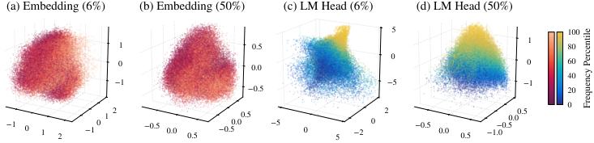
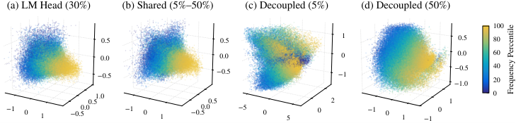

# UltraBERT: Beyond the Limit of BERT Pre-Training 深度精读报告

> **论文**：UltraBERT: Beyond the Limit of BERT Pre-Training
> **作者**：Jungwoo Park、Taewoo Lee、Jaewoo Kang（Korea University, DMIS Lab）
> **arXiv ID**：2610.15028
> **发表时间**：2026-10-10（v1）
> **许可协议**：Apache 2.0
> **代码仓库**：https://huggingface.co/dmis-lab/UltraBERT-150M（官方权重、评测代码与数据混合均已发布）

## 第 1 章 概述

### 1.1 一句话定位

UltraBERT 通过对「饱和现象、masking ratio 对分类与检索的双向影响、蒸馏×剪枝的非均匀交互」三大预训练配方的系统性消融，据作者所知首次打造出在分类（GLUE 91.0）与检索（BEIR 47.7）上同时达到 SOTA 的 encoder 模型家族，突破了 BERT 系模型长期在两类任务上无法兼顾的极限。

### 论文图表总览

| 编号 | 内容 | 章节 |
|------|------|------|
| **Figure 1** | base/medium 两组分类 vs 检索散点（来自 Table 3） | 第 5 章 |
| **Figure 2** | 8.8T token 训练的下游饱和曲线 | 第 3 章 |
| **Figure 3** | encoder vs SmolLM2 decoder 在 6 个 MCQA 上的对比（instruction tuning 前后） | 第 3 章 |
| **Figure 4** | GLUE/SQuAD vs masking ratio（3 种规模） | 第 3 章 |
| **Figure 5** | MLM vs RTD 在匹配 corruption 水平下的对比 | 第 3 章 |
| **Figure 6** | BEIR vs ratio + effective rank + KoLeo 消融（a/b/c/d 四联图） | 第 3 章 |
| **Figure 7** | 6% 与 50% masking 下输入嵌入与 LM head 的几何对比 | 第 3 章 |
| **Figure 8** | 输入嵌入与 LM head 的奇异值谱 | 第 3 章 |
| **Figure 9** | 解耦双 LM head 的几何形状 | 第 3 章 |
| **Figure 10** | UltraBERT 框架总图 | 第 4 章 |
| **Table 1** | masking 混合与 LM head 解耦消融 | 第 3 章 |
| **Table 2** | 蒸馏×剪枝消融 | 第 3 章 |
| **Table 3** | 主结果（分类 + 检索，base ≤200M 与 medium ≤500M） | 第 5 章 |
| **Table 4** | 2T token 数据混合 | 第 4 章 |
| **Table 6** | RTD 续训 100B 后的 GLUE 分项 | 第 3 章 |
| **Table 8** | GLUE 各任务细分 | 第 5 章 |
| **Table 9** | RewardBench 细分 | 第 5 章 |
| **Table 10** | BEIR 15 数据集细分 | 第 5 章 |
| **Table 11** | LongEmbed 6 任务细分 | 第 5 章 |

注：原文 Figure 2/3/4/5/6/8/10 在 arXiv HTML 渲染中无数据，本报告以表格与文字替代；Figure 7 与 Figure 9 的图片已采集并嵌入第 3 章。

### 1.2 核心贡献

1. **揭示下游饱和现象**：以 150M/1.3B 模型用 30% masking 训练 8.8T tokens，发现 GLUE/SQuAD2.0/BEIR 在 1–2T tokens 处即告饱和（BEIR 甚至在 275B 之后无显著提升），而 train/val loss 持续下降——下游指标的停止改善与 loss 的继续优化存在系统性脱节。这一发现为后续所有配方实验提供了「按饱和点分配 token 预算」的方法论基础，即先消除收敛速度的混淆，再比较不同 masking ratio。
2. **masking ratio 的任务分裂规律**：分类任务（GLUE+SQuAD）上 ratio 越高分数一致越低（所有规模成立），与 Wettig2023 等基于 10B–100B token 预算得出的「大模型用大 ratio」结论相反；检索任务（BEIR）上 50% 一致最高。任务最优 ratio 的方向性分裂是全文最核心的实证结论。
3. **正则化与替代训练目标无法替代高 ratio**：KoLeo 正则在 6% masking 下能提升 BEIR 但不及 50% 且伤害 GLUE；RTD 相对 MLM 的优势仅在 15% 峰值处出现，两端（50%/3%）消失，且其表面增益中 CoLA 是混淆项。
4. **LM head 解耦设计**：6% 与 50% masking 下的输入嵌入几何几乎相同，但 LM head 形状迥异；作者猜想（conjecture）共享 LM head 可能造成梯度级干扰；将 {5%,50%} 混合与双 LM head 解耦结合，同时逼近两端的单模型最优。
5. **蒸馏×剪枝的非均匀交互**：1.3B→380M 的蒸馏在 15% masking 下提升分类（+0.6 GLUE）且检索持平，但在 50% 下检索反而倒退（−0.7 BEIR），说明蒸馏并不能均匀改善所有配置。
6. **据作者所知的首个分类+检索双 SOTA encoder**（原文 "To our knowledge, UltraBERT is the first encoder to achieve state of the art on both"）：基于上述发现构建的 UltraBERT 在 base（152M）与 medium（380M）两组上几乎全面领先，且以 150M 匹配 RoBERTa-large 的分类水平（2.3× 参数减少）、检索超越 Ettin-400M（2.6× 更小）。

### 1.3 关键结果速览

三大核心指标的速览（数值取自 Table 3）：

| 指标 | UltraBERT 152M | base 组次优 | UltraBERT 380M | medium 组次优 |
|:---|:---:|:---:|:---:|:---:|
| GLUE | 89.5 | 88.9（Ettin 149M） | 91.0 | 90.8（Ettin 395M） |
| BEIR | 45.2 | 42.6（ModernBERT 149M） | 47.7 | 47.3（LFM2.5-Enc 355M） |
| LongEmbed | 72.0 | 63.2（ModernBERT 149M） | 74.9 | 71.7（LFM2.5-Enc 355M） |

- **主榜成绩**：UltraBERT-380M 达到 GLUE 91.0、SQuAD2.0 90.9、BEIR 47.7，为首个在分类与检索同时 SOTA 的 encoder；UltraBERT-152M 达 GLUE 89.5、SQuAD2.0 89.2、BEIR 45.2。
- **code/math 检索提升最大**：base 组 RAR-b Code +7.3（39.1 vs 31.8）、RAR-b Math +8.3（55.4 vs 47.1）；medium 组 +8.4（47.0 vs 38.6）/+7.7（61.7 vs 54.0）over second best。
- **长文本检索双规模第一**：LongEmbed base 72.0、medium 74.9；base 版甚至超过所有 medium 竞品（LFM2.5-355M 为 71.7）。
- **HF Daily Papers 2026-10-16 榜首**，社区关注度极高。
- **开源**：150M/380M/Embed-150M 三个权重以 Apache 2.0 发布于 HuggingFace，评测代码与数据混合一并公开。

**本报告阅读路线**：只关心结论的读者可读 1.2/1.3 与第 5 章；关心「为什么」的读者应精读第 3 章——五个实验模块构成一条完整的因果链（饱和 → ratio 分裂 → 正则失效 → 几何诊断 → 解耦与蒸馏），最终配方（第 4 章）的每个组件都能在这条链上找到出处；工程实践者可直接跳至 6.3 的复现路径。

## 第 2 章 相关工作与问题定位

### 2.1 BERT 系 encoder 的演进脉络

BERT（2018）确立了 MLM 预训练 + 下游微调的 encoder 范式，但其 512 上下文、原始 tokenizer 与绝对位置编码已明显过时。后续工作沿三条轴线演进：

- **训练目标改造**：RoBERTa 以动态 masking 与更大 batch 挖掘 MLM 潜力；ELECTRA 系（含 DeBERTaV3 采用的 RTD）以 replaced token detection 降低预训练-微调差异；本研究在匹配 corruption 水平的受控条件下重新检验了 RTD vs MLM。
- **架构现代化**：ModernBERT 引入 RoPE、交替 local/global attention 与 FlashAttention 级工程优化；NeoBERT、Ettin Encoder、NomicBERT（8K 上下文）、MosaicBERT、GTE-en-MLM、LFM2.5-Enc 等在 base/medium 区间持续刷新单点成绩。UltraBERT 直接继承了这一现代化架构谱系（RoPE + SwiGLU + 交替 local/global attention，仿 ModernBERT）。
- **任务专精化**：GTE-en-MLM、NomicBERT 等嵌入导向模型在 BEIR/长文本检索上显著领先，但分类成绩平平；反之 ModernBERT/Ettin 等强于 GLUE/SQuAD 而检索一般。**没有任何一个 encoder 在两类任务上同时领先**——这正是 Figure 1 散点图所呈现的「分类-检索权衡带」，也是本文要打破的极限。

从 Table 3 的数据可以直接读出这条权衡带：GTE-en-MLM（137M）LongEmbed 58.5 但 GLUE 仅 85.6；Ettin（149M）GLUE 88.9 但 LongEmbed 60.1；两个专精模型各自在对方的主场落后 3 分以上。唯一的例外候选 LFM2.5-Enc 双线接近但均未登顶（230M：88.2/46.7；355M：89.2/47.3）。

三个最直接的竞争者值得单独说明，因为它们分别代表了通往 UltraBERT 之前的三条「最接近」路线：

- **ModernBERT（base 149M / medium 395M）**：架构现代化的旗手，也是 UltraBERT 架构的直接蓝本。它在 base 组提供了次优的 BEIR（42.6）与 LongEmbed（63.2），分类侧 GLUE 88.4/SQuAD 86.7 稳居第一梯队。UltraBERT 对它的超越是全方位的（base 组 11 列中 10 列），说明增益确实来自配方而非架构——这正是论文叙事最有说服力的对照：同架构、新配方、全面领先。
- **Ettin Encoder（base 149M / medium 395M）**：数据配比导向的训练配方探索，base 组 RAR-b Code/Math 的此前次优（31.8/47.1）。UltraBERT 在这两个 code/math 检索榜上对其 +7.3/+8.3（base）与 +8.4/+7.7（medium），说明在同类「注重数据」的路线内，masking 配方与双 LM head 仍有独立增量。
- **LFM2.5-Enc（230M / 355M）**：唯一在双任务上都逼近 UltraBERT 的家族，也是 medium 组 MLDR 的第一名（44.5）。它的存在说明「双任务均衡」并非无人区，UltraBERT 的贡献是把均衡点整体推高（medium 组 BEIR 47.7 vs 47.3，GLUE 91.0 vs 89.2）。

### 2.2 masking ratio 研究的分歧

BERT 原始工作用 15% masking；Wettig2023 等基于 10B–100B token 预算的研究提出「大模型应使用大 masking ratio」。本文的关键方法论批评是：**在未饱和的 token 预算下，不同 ratio 的收敛速度差异会污染结论**——小 ratio 收敛慢，在短预算下看似更差。因此论文先确立各配置的饱和点（原文脚注：15% 约 1–2T、6%/3% 约 2–3T tokens），再按各自充足预算（1T–5T 不等）比较终态性能，从而首次分离「收敛速度」与「渐近质量」两个维度，得到了与既有文献相反的分类结论。

这一分歧的裁决对实践意义重大：如果一个团队按 Wettig2023 的建议在大模型上采用高 ratio，按本文的结论，其分类能力将系统性受损，而损失只有在预算充分展开后才会显现。

### 2.3 表征正则与嵌入几何

KoLeo 正则源自对比学习/白化嵌入的研究，通过拉大（最大化）最近邻距离促使嵌入在球面上均匀展开，常被用于提升检索。本文检验了它能否在低 ratio 下替代高 ratio 的检索增益（结论：不能）；进一步用奇异值谱分析（effective rank、Figure 8）从几何角度解释了为何单一 LM head 无法同时服务两种 masking 策略，将「嵌入几何」分析从输入侧延伸到了输出侧（LM head），这是方法论上的新贡献。

「输入嵌入 vs LM head」的区分在本领域此前较少被显式讨论：常规的表征分析（各向异性、白化、谱分析）几乎都针对最后一层 hidden states 或输入 embedding，读出矩阵通常被视为「应用层」而非「表征层」。本文的证据（Figure 7/8）表明预训练目标对两者都有一致塑形，且塑形方向可以解耦——这一视角对混合目标预训练、多任务 LoRA 中的「头部分歧」问题都有直接的启发价值。

### 2.4 蒸馏与剪枝

知识蒸馏与结构化剪枝（沿宽度/深度压缩）是大模型小型化的标准工具，但既有工作多关注单一任务的均匀收益。本文发现蒸馏收益与 masking ratio 存在**非均匀交互**（15% 下有益、50% 下检索倒退），提示蒸馏研究需要在多任务、多训练配置下验证，而非只看单一基准。Cascade Distillation（1.3B→380M→150M，均从原始 teacher 蒸馏而非中间 student）沿用 Muralidharan et al. (2024) 与 Liu et al. (2026) 的已有设计——两者发现从原始 parent 蒸馏优于从中间 child 蒸馏。

### 2.5 encoder 与 decoder 的能力对照

Figure 3 引入 SmolLM2-1.7B 作为 decoder 参照系：在 6 个 MCQA 任务上 5-shot 评估时 encoder 均上升；instruction tuning 之后 encoder 饱和而 decoder 持续上升。这一对照把「encoder 饱和」与「decoder 持续受益于 instruction 数据」并置，为「MLM 目标的天花板」提供了外部锚点，也自然引出问题：encoder 的剩余预算应该投到哪里？本文的回答是——投给配方（masking、几何、蒸馏），而非单纯堆 token。

### 2.6 问题定位

综合而言，本文定位的研究问题是：**在 encoder 架构现代化之后，预训练配方（token 预算、masking ratio、正则、训练目标、蒸馏/剪枝）如何系统性地决定分类与检索的双任务上限？** 既有工作要么只调单点配方、要么在未饱和预算下得出可迁移性存疑的结论。UltraBERT 的贡献是把这个问题变成一系列受控实验，并把实验结论固化成一个可复现的最终配方。

## 第 3 章 预训练配方系统探索

本章是论文的实证核心：五个层层递进的实验模块（饱和 → masking×分类 → masking×检索 → LM head 解耦 → 剪枝蒸馏），每一步都为最终配方提供一个组件。

### 3.1 下游饱和：loss 在降，benchmark 不再动

**设置**：150M 与 1.3B 两个规模、30% masking，训练至 8.8T tokens（Figure 2）。

**发现**：

- GLUE/SQuAD2.0/BEIR 三类下游指标在 **1–2T tokens** 处饱和；
- BEIR 甚至在 **275B tokens 之后**就没有显著提升；
- 与此同时 train/val loss 持续下降，即 loss 的改进已经不再转化为下游能力。

**与 decoder 的对照**（Figure 3）：与 SmolLM2-1.7B decoder 在 6 个 MCQA 任务上对比，5-shot 下 encoder 均上升；instruction tuning 之后 encoder 进入饱和而 decoder 持续上升。这说明饱和并非「任务太简单」，而是 encoder 预训练目标本身对这批下游指标的边际收益耗尽。

这组对照的三层读法：

- **5-shot 阶段两者都在升**：说明 MCQA 类能力在两个家族里都还未饱和，上升空间存在；
- **instruction tuning 后曲线分叉**：decoder 借助指令数据继续爬升，encoder 停滞——瓶颈不在「任务难度」而在「目标函数与数据形态的适配」；decoder 的自回归生成目标天然同构于指令跟随，MLM 则否；
- **对配方的约束**：既然继续堆 token 无益、换 instruction 数据形态又超出 encoder 范式，剩余的自由度就只在「如何分配 corruption、如何在输出端组织几何」——这正是第 3 章后续实验所占据的设计空间。

**方法论后果**：所有后续 masking ratio 实验的 token 预算按各自饱和点分配：

| masking ratio | token 预算 |
|:---|:---:|
| 50% | 1T |
| 30% | 1T |
| 15% | 2T |
| 6% | 5T |
| 3% | 5T |

这确保比较的是渐近性能而非收敛速度——低 ratio 因每步有效信号少而收敛更慢，若用统一短预算会系统性低估它们。

**饱和对算力分配的含义**：饱和点的存在把「训得越久越好」的直觉修正为分段决策：

- 若目标是 GLUE/SQuAD 类分类能力，1–2T tokens 之后继续训练的边际收益趋零，多出的算力应转投数据质量、masking 配方或蒸馏 teacher；
- 若目标是检索，饱和来得更早（BEIR 在 275B 后即趋平），2T 预算里大部分 token 对检索的直接贡献有限——但注意这指的是预训练阶段；检索微调（MS MARCO）仍能显著抬升绝对分数；
- train/val loss 持续下降而下游不动，意味着 loss 曲线不能再作为预训练进度的代理指标，必须以下游 checkpoint 评估驱动训练决策（论文的 WSD 末段 decay 与 32K 扩展都据此安排在饱和之后的「收尾」区间）。

### 3.2 masking ratio × 分类：ratio 越高，分类越差

**结论**（Figure 4，GLUE+SQuAD，150M/380M/1.3B 三规模）：masking ratio 增高时分类分数**一致下降**，在所有规模上成立。这与 Wettig2023 等「大模型用大 ratio」的结论相反——后者基于 10B–100B token 预算，实际度量的是收敛速度而非渐近质量。

三规模一致这个细节值得强调：如果只是「小模型不适合高 ratio」，还可以争辩说规模会翻转结论；但 150M 到 1.3B 的单调一致性说明该效应在 encoder 的常规规模区间内稳健。

与 Wettig2023 分歧的来源可以做更精确的拆解：其一，预算量级——10B–100B 远低于本文各配置的饱和点（约 1–3T），测得的是「快慢」而非「好坏」；其二，任务覆盖——分类为主的评测会系统性高估低 ratio 的相对劣势起点，因为低 ratio 恰恰是分类友好区；其三，模型家族——decoder LM 的 span corruption 最优区间与 encoder MLM 不能直接互推。三条中任何一条都足以翻转结论，本文用饱和预算设计同时堵住了三条。

**RTD vs MLM 的受控重检**（150M，匹配 corruption 水平，Figure 5）：

- RTD 优势仅在 **15% 峰值**处出现；
- 两端消失，且各有机理：
  - 50% 处 generator 上下文不足 → 替换 token 变得平凡，判别任务失去难度梯度；
  - 3% 处 MLM 与 RTD 的差异本身很小， corrupted token 太少，两个目标的信号几乎重合。

**RTD 续训 100B 的混淆项**（Table 6）：RTD+100B 后 CoLA 从 61.6 升至 71.5（+9.9），而其余 GLUE 任务仅 +0.5 左右。也就是说，RTD 表面上的总体增益几乎全部来自 CoLA 这一个任务——CoLA（语法可接受性判断）恰好对「替换 token 是否语法自然」异常敏感，与 RTD 判别目标高度同构。CoLA 是 RTD 的混淆项，不能作为 RTD 整体优越的证据。

**DeBERTaV3 对照**（Appendix C.2）：

| Model | 分类 | 检索 |
|:---|:---:|:---:|
| DeBERTaV3-base | 74.2 | 20.7 |
| UltraBERT-150M | 75.4 | 45.3 |
| DeBERTaV3-large | 78.1 | 25.8 |
| UltraBERT-380M | 78.5 | 48.7 |

同为 RTD 系模型，DeBERTaV3 在检索上严重偏科（20.7/25.8 对 45.3/48.7），进一步佐证 RTD 路线难以兼顾双任务。

### 3.3 masking ratio × 检索：50% 一致最高，KoLeo 补不上

**BEIR vs ratio**（Figure 6a）：检索任务上 **50% masking 一致最高**——与分类的方向完全相反。

**几何解释**（Figure 6b）：嵌入的 effective rank 随 ratio 上升而增大。按奇异值 $\sigma_1,\dots,\sigma_d$ 定义归一化谱分布

$$p_i=\frac{\sigma_i}{\sum_{j=1}^{d}\sigma_j},$$

effective rank 为该分布的指数化熵：

$$\mathrm{erank}=\exp\!\left(-\sum_{i=1}^{d}p_i\log p_i\right).$$

高 masking 下嵌入占据更高维的子空间（erank 更高）。erank 的取值范围是 $[1,d]$：当谱完全集中在一个奇异值上时为 1，当谱完全均匀时为 $d$。「erank 随 ratio 上升」可以解读为高 ratio 训练把嵌入从少数主导方向上「撑开」到更接近满秩的利用状态。但原文明确声明：无法判断是更高的 erank **导致**了检索提升，还是二者只是独立现象——两者在观测上同向，因果链条未获证实。

**KoLeo 正则消融**（Figure 6c,d）：在 6% masking 上加 KoLeo 正则。KoLeo 对批次内每个嵌入 $z_i$ 及其最近邻 $\bar{z}_i$ 施加

$$\mathcal{L}_{\mathrm{KoLeo}}=-\frac{1}{n}\sum_{i=1}^{n}\log\lVert z_i-\bar{z}_i\rVert_2,$$

推动嵌入在球面上均匀展开。结果：

- BEIR 有所提升，但**不及 50% masking**；
- 且**伤害 GLUE**——均匀化嵌入与分类所需的判别几何存在张力。

结论明确：输出表征正则化无法替代高 ratio 本身带来的表征塑造。正则只在输出端「涂妆」，而 ratio 在整个编码过程中重塑表征。

把这组结果放在一起看，§3.2 与 §3.3 构成一个完整的二维矩阵：分类（GLUE/SQuAD）与检索（BEIR）各自有独立的 ratio 偏好，且两者都无法通过「附加技巧」（RTD 换目标、KoLeo 加正则）在对方偏好区获得同等成绩。这排除了「只是还没找到合适的辅助损失」的解释，把问题收敛为一个真正的结构性矛盾——从而自然引出 §3.4 的问题：矛盾究竟藏在网络的哪一层？

### 3.4 LM head 解耦：一个身体，两套输出几何

既然 6% 最利分类、50% 最利检索，能否在一个模型里两者兼得？直接混合 masking 的朴素方案受制于 LM head 的几何冲突。

**Table 1 完整数据**（150M，GLUE/BEIR）：

| 配置 | GLUE | BEIR |
|:---|:---:|:---:|
| 单一 6% | 89.5 | 43.5 |
| 单一 15% | 88.9 | 43.8 |
| 单一 30% | 88.3 | 44.2 |
| 单一 50% | 87.5 | 45.0 |
| decay 50%→6% | 88.8 | 43.9 |
| decay 50%→15% | 88.6 | 44.1 |
| U(5%,50%) | 88.0 | 44.2 |
| {5%,50%} | 88.9 | 44.7 |
| {5%,50%}+解耦 | **89.4** | **45.1** |

逐行解读：

- **单一 ratio 行**给出 Pareto 前沿本身：GLUE 从 89.5（6%）单调降到 87.5（50%），BEIR 从 43.5（6%）单调升到 45.0（50%）。
- **decay 调度**（训练中从 50% 退火到 6%/15%）落在前沿内侧，不产生超越——调度只是时间上的混合，无法逃出共享 head 的几何约束。
- **连续均匀 U(5%,50%)** 最差（GLUE 88.0）：原文的解释是其效果**收敛到平均 ratio 的作用**（均值 27.5%，GLUE/BEIR 表现与单一 30% 几乎相同，LM head 几何也接近 30%），而非简单的「干扰」；对照之下，离散混合 {5%,50%} 才能同时触及两端的最优区间。
- **离散 {5%,50%}** 混合恢复到 88.9/44.7，仍在前沿内侧——即使离散化，共享 LM head 依然限制两端逼近。
- **{5%,50%}+解耦**同时逼近 6% 的 GLUE（89.4 vs 89.5）与 50% 的 BEIR（45.1 vs 45.0），几乎无损地走出权衡带。

**几何证据**（Figure 7/8）：6% 与 50% masking 下训练得到的**输入嵌入几乎相同**，但 **LM head 形状迥异**；6% 的 LM head 奇异值更集中（低维子空间）。作者由此猜想（conjecture）：共享 LM head 时，两种 ratio 的梯度可能在同一输出矩阵上相互干扰，使头被迫折中变形。

*图7：输入嵌入（左）在两种 masking 下几何几乎重合，而 LM head（右）形状截然不同——共享输出矩阵是混合训练失效的根源。*

这里的关键洞察是冲突的**位置**：表征层（encoder body + 输入嵌入）是共享友好的——两种 ratio 学到的身体几乎一样；冲突集中在读出层（LM head）。因此解耦只需付出一个输出矩阵的参数代价，而不需要双塔或任务专属的 encoder。这与常见的「多任务需要多头/多塔」直觉形成对照：先诊断冲突位置，再只在冲突处解耦。

**解耦后的效果**（Figure 9）：为两种 ratio 各自配备独立 LM head 后，两个头的几何形状分别趋近各自单一 ratio 训练出的参考形状，梯度干扰消除，双任务同时逼近单任务上限。

*图9：解耦后的双 LM head 各自保留对应 masking ratio 的几何形状——与「共享 head 存在梯度干扰」的猜想一致（consistent with），但论文并未直接验证该因果。*

把解耦行与对应单一 ratio 行并排，可以精确度量「兼得的代价」：

| 对比 | GLUE 差距 | BEIR 差距 |
|:---|:---:|:---:|
| {5%,50%}+解耦 vs 单一 6% | −0.1（89.4 vs 89.5） | +1.6（45.1 vs 43.5） |
| {5%,50%}+解耦 vs 单一 50% | +1.9（89.4 vs 87.5） | +0.1（45.1 vs 45.0） |

即：相对分类最优配置，分类仅让 0.1 而检索净赚 1.6；相对检索最优配置，检索仅让 0.1 而分类净赚 1.9。两个方向的单侧代价都压缩到 0.1，这是「解耦」一词在数字上的含义——混合模型事实上同时成为两个单任务模型，而非它们的折中。

**批内配比**：{5%,50%} 按 **4:1** 混合（5% 序列占 4 倍），因为 5% masking 的梯度更稀疏、收敛更慢，需要更多样本补偿（原文注明：收敛速度与 ratio 并不成正比，低 ratio 仍更慢，故以 4:1 补偿）。端点取 5%/50% 沿用 Dong et al. (2025) 的 U(5%,50%) 设置。

### 3.5 蒸馏 × 剪枝：收益不均匀

**设置**（Table 2）：1.3B teacher → 380M student，500B tokens 蒸馏（15% 处 250B 即饱和）：

| masking ratio | 380M 配置 | GLUE | BEIR |
|:---|:---|:---:|:---:|
| 15% | from-scratch | 90.2 | 46.0 |
| 15% | distilled | 90.8 | 46.0 |
| 50% | from-scratch | 89.6 | 47.2 |
| 50% | distilled | 89.6 | 46.5 |
| —（teacher） | 1.3B @ 15% | 91.8 | 47.4 |
| —（teacher） | 1.3B @ 50% | 90.7 | 48.3 |

**解读**：

- 15% 下蒸馏提升分类（+0.6 GLUE，90.2→90.8）且检索持平（46.0 = 46.0）；
- 50% 下分类持平（89.6 = 89.6）而检索**倒退 0.7**（47.2 → 46.5）；
- 即蒸馏收益依赖 masking ratio，**不是均匀的免费午餐**。

值得注意的细节：50% from-scratch 的 380M 检索已达 47.2，逼近 1.3B@50% teacher 的 48.3；也就是说小模型在检索上并不必然大幅落后，而蒸馏反而可能把 student 从高 ratio 的检索优势上拉偏——teacher 的软标签分布若偏向 teacher 自身的 ratio 偏好，student 的高 ratio 潜力就被稀释。

从 Table 2 还能读出两条次级信息：

- **蒸馏饱和更快**：15% 配置下蒸馏在 250B 即饱和，短于 from-scratch 的对应预算——软标签提供了更平滑的优化地形，收敛步数减半；
- **teacher 的双配置差距在 student 侧缩小**：teacher 15% vs 50% 的 GLUE 差 1.1（91.8 vs 90.7），distilled 380M 侧差 1.2（90.8 vs 89.6），几乎原样传递；但 BEIR 侧 teacher 差 0.9（47.4 vs 48.3），distilled 侧反而差 −0.5（46.0 vs 46.5）——蒸馏对检索配置间差异的传递是有损且非线性的。

**对最终配方的影响**：UltraBERT 的 Cascade Distillation 选择 1.3B 作为 teacher（§3.2 最佳），且每个 student 都从**原始 1.3B teacher** 蒸馏而非中间子模型——避免误差级联。更深一层，§4.5 中「KL 蒸馏只作用于 5% 序列、50% 序列用标准 MLM」的不对称设计，正是本节「50% 蒸馏倒退」发现的直接工程化：既然高 ratio 通路经不起 teacher 软标签的稀释，就干脆不让它接受蒸馏。

## 第 4 章 UltraBERT 设计

### 4.1 架构

现代 encoder 栈（Appendix A.1），核心要素：

- **注意力模式**：交替 local/global attention，每 3 层 1 层 global（仿 ModernBERT）。local 层承担大部分 token 交互的廉价计算，global 层以 1/3 的频率注入长程依赖；
- **位置编码**：RoPE，base 分层设置——local attention 10K，global 640K；32K 上下文扩展时 global 升至 2.56M。分层 base 让高频局部位置与低频全局位置各得其所，是长上下文外推（LongEmbed 高分）的基础；
- **FFN**：SwiGLU；
- **LM head 与输入 embedding 不绑定**（untied）——这是双 LM head 解耦的前提；tied head 下「为两种 ratio 配独立头」在结构上不可能；
- **tokenizer**：SmolLM2 cosmo2-tokenizer，词表 49,152；
- **深度固定 24 层，仅沿宽度缩放**：

| 规模 | hidden | SwiGLU int | heads | head_dim |
|:---|:---:|:---:|:---:|:---:|
| 150M | 768 | 1024 | 6 | 128 |
| 380M | 1024 | 3072 | 8 | 128 |
| 1.3B | 2048 | 5632 | 8 | 256 |

深度固定有两个好处：剪枝时只处理宽度维度（第 4.4 节），以及三个规模共享相同的层数-数据并行切分方案。

几个架构选择与第 3 章结论的对应关系值得点明：

- **untied LM head 是 §3.4 的结构前提**：BERT 传统的 tied embedding 在参数上经济，但把输入几何与输出几何焊死，从根上排除了解耦方案。UltraBERT 是先有「LM head 几何冲突」的诊断，再反向锁定这一架构决策。
- **交替 local/global 与 RoPE 分层 base 服务于长上下文目标**：LongEmbed 双规模第一（72.0/74.9）与 Passkey 近满分（99.2/99.8）不是偶然——global 层的 640K/2.56M RoPE base 给 32K 扩展留足了频率空间。
- **SwiGLU 与 24 层深度的组合遵循当前 decoder 侧验证过的最优实践**：论文没有在架构上做任何新颖赌注，把全部创新预算留给配方——这与其「架构已被 ModernBERT 解决，配方才是瓶颈」的隐含判断一致。

### 4.2 数据混合

2T token 预算，unique 数据共 1227.8B，平均约 1.63 epoch（Table 4）：

| 类别 | 数据集 | Unique(B) | Trained(B) | 占比 |
|:---|:---|:---:|:---:|:---:|
| Web 66.9% | DCLM | 756.4 | 881.7 | 44.1% |
| Web | FineWeb-Edu | 195.4 | 455.5 | 22.8% |
| Code 14.0% | Stack-Edu | 120.3 | 280.5 | 14.0% |
| Academic 7.1% | peS2o | 60.7 | 141.6 | 7.1% |
| Math 5.8% | MegaMath/FineMath/InfiWebMath | 41.4 | 115.8 | 5.8%（2.9/1.5/1.3） |
| Reference 3.7% | Cosmopedia v2 + Wikipedia | 32.0 | 74.8 | 3.7%（3.3/0.5） |
| Instruction 2.5% | FLAN/StackEx/NaturalReasoning | 21.5 | 50.2 | 2.5%（2.2/0.2/0.1） |

Web 占三分之二（DCLM + FineWeb-Edu 合计 66.9%），Code/Academic/Math 合计约 27%，与主结果中 code/math 检索的大幅领先（base +7.3/+8.3）相互印证。

各数据集的 epoch 倍数并不均匀：DCLM 约 1.17 倍（881.7/756.4），FineWeb-Edu 约 2.33 倍（455.5/195.4），Stack-Edu 约 2.33 倍，Reference 约 2.34 倍，Instruction 约 2.33 倍——高质量/高难度子集被有意识地过采样约 2 倍。

逐类别的功能定位：

- **Web（66.9%）**：通用语言能力与事实知识的底盘，DCLM 为主、FineWeb-Edu 补充教育性内容；
- **Code（14.0%）与 Math（5.8%）**：直接对应 RAR-b Code/Math 的大幅领先，也为结构化推理提供信号；Math 内部再三分（MegaMath 2.9/FineMath 1.5/InfiWebMath 1.3），覆盖网页数学与合成数学两类来源；
- **Academic（peS2o 7.1%）**：学术语体与长文档结构，支撑 MLDR（长文档检索）43.5/44.1 的成绩；
- **Reference（3.7%）与 Instruction（2.5%）**：占比虽小但分别锚定知识密集问答与指令跟随的分布，Instruction 中 FLAN 占 2.2 为绝对主体。

**多阶段 mixture 调度实验**：尝试按阶段改变 mixture，下游 fine-tune 后性能几乎不受影响，因此最终采用**单一 mixture 贯穿全程**——又一处「复杂调度无收益」的负结果。

### 4.3 训练配置

- **优化器**：AdamW，β1=0.9、β2=0.95、ε=1e-8，weight decay 0.1，梯度裁剪 1.0；
- **LR 调度**：WSD（10B tokens warmup + 末 10% decay 到 0）；§3 实验用 peak LR 3e-4，蒸馏与 UltraBERT 最终训练用 1e-4；
- **batch**：4M tokens（2048 序列 × 2048 长度）；
- **总预算**：2T tokens，最后 100B 扩展到 32K 上下文；
- **硬件**：单 pod TPU v4-512 / v5e-256 / v6e-256（256 chips），16 DP × 16 FSDP；32K 扩展阶段改用 8 FSDP × 2 TP——长序列激活内存上升，需要张量并行分摊。

配置层面的两点观察：

- **LR 的两档制**（实验 3e-4 / 最终 1e-4）本身是一个结论：蒸馏与混合目标训练需要更保守的步长。对照第 5 章微调阶段的 LR 分布（UltraBERT 3e-5 vs 竞品 3e-4/5e-4），可以看出「预训练越充分、最优步长越小」的一致趋势贯穿预训练与微调两端；
- **单 pod 256 chips 的规模克制**：全流程（1.3B teacher + 两个 student + 全部消融）都在一个 pod 内完成，说明论文的结论对中等算力的实验室是可追随的，这也是其配方结论能被社区快速检验的前提。

### 4.4 Cascade Distillation 与剪枝

- **teacher**：1.3B（§3.2 最佳配置）；
- **级联路径**：1.3B 剪枝 → 380M 蒸馏；再剪枝 → 150M 蒸馏。两个 student 均**从原始 1.3B teacher 蒸馏**，而非中间子模型，避免误差级联；
- **只沿宽度剪枝**（保持 24 层不变）；
- **重要性估计仅前向**（无需反向梯度），三处观测点：
  - hidden channels：用 pre-attention norm 输出，跨层聚合；
  - attention heads：用进入 output projection 前的 per-head 输出；
  - FFN neurons：用进入 down projection 前的 gated activation；
  - 全部以 L2 范数聚合；
- **calibration 集**：2000 文档，打包为 1024×1024；
- **head_dim 256→128 的结构化缩放**：Q/K 保持每两行 rotary 频率对 + Q 缩放 1/√2；V/O 用共享随机正交投影（期望保持乘积）。

前向式重要性估计的实用价值在于成本：剪枝一个 1.3B 模型只需对 calibration 集做一遍前向，无需对每个通道求梯度，使级联剪枝-蒸馏管线在单 pod 预算内可行。head_dim 缩放中「Q/K 保 rotary 频率对」的细节保证了剪枝后位置编码语义不漂移，「V/O 共享随机正交投影」则在期望意义下保持 $W_O W_V$ 的乘积结构——两处都是为「剪完还能蒸馏回来」服务的工程保障。

三个观测点的选择各有讲究，都在「信息最浓缩处」取样：

- hidden channels 在 pre-attention norm 输出上跨层聚合——单层观测会被残差连接稀释，聚合后的重要性更接近通道的全局贡献；
- heads 用进 output projection 前的 per-head 输出——投影之前每个 head 的贡献尚未混合，可分离归因；
- FFN neurons 用进 down projection 前的 gated activation——SwiGLU 的门控值本身就是该 neuron 激活强度的直接读数，重要性估计几乎免费。

「均 L2 聚合」的朴素性反而是优点：不引入任何可调权重或温度，跨三次剪枝（1.3B→380M→150M）的行为可预测。

### 4.5 最终配方（Figure 10）

把第 3 章的全部结论装配为一个模型：

1. **masking**：{5%,50%} 批内 4:1 混合（5% 序列占 4 倍）——来自 §3.4；
2. **LM head**：双 LM head 解耦，两套输出几何各司其职——来自 §3.4 的几何诊断；
3. **蒸馏**：KL 蒸馏损失只作用于 5% 序列，50% 序列用标准 MLM——呼应 §3.5 的非均匀性：不把 teacher 的标签强加给高 ratio 通路；
4. **预算**：2T tokens + 末 100B 32K 扩展，LR 1e-4——来自 §3.1 的饱和点（远超 1–2T 饱和线，因混合目标更复杂）；
5. **teacher**：原始 1.3B，级联剪枝-蒸馏产出 380M 与 150M——来自 §3.2/§3.5。

每个组件都对应第 3 章一个受控实验的直接结论，没有依赖任何未经验证的默认选择——这是论文「配方科学」叙事的收束点。

组件与实验的对应关系一览：

| 配方组件 | 来源实验 | 支撑结论 |
|:---|:---|:---|
| {5%,50%} 离散混合 | §3.4 Table 1 | 离散优于连续 U(5%,50%)；端点 5%/50% 沿用 Dong et al. (2025) 的 U(5%,50%) 设置 |
| 双 LM head 解耦 | §3.4 Figure 7/8/9 | 输入嵌入共享友好、LM head 几何冲突，解耦后单侧代价仅 0.1 |
| 批内 4:1 配比 | §3.4 | 5% 梯度更稀疏、收敛更慢（原文注明收敛速度与 ratio 不成正比），以 4 倍序列补偿 |
| KL 蒸馏仅作用 5% 序列 | §3.5 Table 2 | 50% 通路蒸馏检索倒退 −0.7，高 ratio 通路不宜接受软标签 |
| 1.3B 原始 teacher 级联 | §3.2 + §3.5 | 1.3B 为 §3.2 最佳；直连 teacher 避免误差级联 |
| 2T + 末 100B 32K | §3.1 饱和点 | 超过 1–2T 饱和线确保充分收敛；32K 扩展撬动 LongEmbed |
| 单一 mixture 贯穿 | §4.2 调度实验 | 多阶段调度对下游几乎无影响，简单方案获胜 |

值得强调的是这张映射表里「没有」的东西：没有任何一个组件来自未经验证的惯例或作者的事先偏好，连最普通的超参（LR、batch、调度）都对应着饱和点或蒸馏行为的实验证据。以「配方科学」的标准衡量，这种完备的决策可追溯性在同类系统论文中相当罕见。

## 第 5 章 实验结果

### 5.1 评测协议（Appendix B）

- **GLUE**：8 任务（除 WNLI）；RTE/MRPC/STS-B 从最佳 MNLI checkpoint 初始化；小任务 4 seeds 取中位；输入截断 128；
- **SQuAD 2.0**：F1（384 长度 / stride 128）；
- **NER**：MultiCoNER v2 英文子集 macro-F1（16,778 训练 / 871 验证 / 249,980 测试）；Few-NERD 监督 micro-F1（131,767 / 18,824 / 37,648）；
- **RewardBench**：Bradley-Terry，UltraFeedback + Skywork-80K 单轮共 135,981 对（5% = 6,800 dev）；
- **检索**：MS MARCO 1.25M 难负三元组训 1 epoch，LR 扫 10 个值，mteb 评测，BEIR 15 数据集 nDCG@10；RAR-b code/math 分别从 301K/389K 候选中检索；
- **MLDR**：BEIR 最佳 checkpoint 上加 80K triplets；**LongEmbed**：6 任务（4 个真实任务 nDCG@10 + Passkey/Needle recall@1，8 个长度取平均）。

RewardBench 的入选值得一提：把 reward 建模（偏好对的 Bradley-Terry 分类）纳入 encoder 评测，反映了对「encoder 作为通用分类底座」的定位，而不只是 NLU 传统四件套。

协议中还有两处容易被忽略但影响公平性的细节：

- **RTE/MRPC/STS-B 从最佳 MNLI checkpoint 初始化**：小数据集从头微调方差极大，这一惯例把三个最不稳定的任务锚定到可比较的起点，配合「4 seeds 取中位」，把小任务噪声压到可接受范围；
- **检索 LR 扫 10 个值**：MS MARCO 微调对 LR 的敏感度（第 5.4 节可见一个数量级差异）使得单点 LR 的比较毫无意义，10 值扫描是该领域比较的最低公平线，但也是许多论文省略的步骤。

### 5.2 主结果：base 组（≤200M，Table 3）

| Model | Params | GLUE | SQuAD2.0 | MultiCoNERv2 | Few-NERD | RewardBench | BEIR | RAR-b Code | RAR-b Math | MLDR | LongEmbed |
|:---|:---:|:---:|:---:|:---:|:---:|:---:|:---:|:---:|:---:|:---:|:---:|
| BERT | 110M | 84.7 | 76.3 | 53.8 | 66.6 | 59.4 | 36.7 | 6.6 | 27.5 | 29.0 | 29.3 |
| RoBERTa | 125M | 86.4 | 83.7 | 56.5 | 67.1 | 63.2 | 39.6 | 11.7 | 33.4 | 28.7 | 33.8 |
| MosaicBERT | 137M | 85.4 | 79.4 | 57.8 | 65.7 | 62.5 | 41.4 | 12.7 | 30.9 | 29.6 | 40.5 |
| NomicBERT | 137M | 84.0 | 82.7 | 60.1 | 66.9 | 64.1 | 42.0 | 13.8 | 30.2 | 29.9 | 45.0 |
| GTE-en-MLM | 137M | 85.6 | 82.7 | 59.2 | 66.4 | 63.4 | 42.4 | 12.0 | 33.6 | 37.1 | 58.5 |
| ModernBERT | 149M | 88.4 | 86.7 | 57.4 | 66.7 | 68.0 | 42.6 | 29.6 | 46.1 | 37.7 | 63.2 |
| Ettin Encoder | 149M | 88.9 | 87.4 | 57.4 | 66.5 | 70.3 | 42.4 | 31.8 | 47.1 | 35.9 | 60.1 |
| **UltraBERT** | **152M** | **89.5** | **89.2** | 57.9 | **67.4** | **73.0** | **45.2** | **39.1** | **55.4** | **43.5** | **72.0** |

base 组除 MultiCoNER v2 外全部第一；MultiCoNER v2 上 NomicBERT 60.1 第一、GTE-en-MLM 59.2 第二，UltraBERT 57.9 第三（原文注明仍优于 ModernBERT 与 Ettin 的 57.4）。逐列观察：

- **GLUE 89.5**：比次优 Ettin（88.9）高 0.6，比现代管线前的 RoBERTa（86.4）高 3.1；
- **SQuAD2.0 89.2**：比次优 Ettin（87.4）高 1.8，是全表中数一数二的分差；
- **RewardBench 73.0**：比次优 Ettin（70.3）高 2.7，说明增益不止于传统 NLU；
- **BEIR 45.2**：比次优 ModernBERT（42.6）高 2.6；
- **RAR-b Code 39.1 / Math 55.4**：分别比次优 Ettin（31.8/47.1）高 7.3/8.3，是全表最大分差——数据混合中 14% Code + 5.8% Math 的直接回报；
- **MLDR 43.5**：base 组第一（GTE 37.1、ModernBERT 37.7 之后）；
- **LongEmbed 72.0**：不仅 base 第一（次优 ModernBERT 63.2，+8.8），还超过全部 medium 竞品（最高 LFM2.5-355M 71.7）。

两个横跨结论：**150M 匹配 RoBERTa-large 分类**（参数 2.3× 减少）；**检索胜 Ettin-400M**（2.6× 更小）。

把 base 与 medium 两组连起来看还有一个隐藏观察：UltraBERT 是全表唯一在两组中同时把 GLUE 与 BEIR 都推到组内第一的模型家族，且其 base 版（BEIR 45.2）已经追平 ModernBERT-395M（45.2），仅低于 Ettin-395M（45.9）与 LFM2.5 两档（46.7/47.3）。对延迟敏感的检索服务而言，「用 152M 部署、性能锚定 medium 档」是这篇论文最具商业含义的一行数字。

### 5.3 主结果：medium 组（≤500M，Table 3）

| Model | Params | GLUE | SQuAD2.0 | MultiCoNERv2 | Few-NERD | RewardBench | BEIR | RAR-b Code | RAR-b Math | MLDR | LongEmbed |
|:---|:---:|:---:|:---:|:---:|:---:|:---:|:---:|:---:|:---:|:---:|:---:|
| BERT | 334M | 85.2 | 81.8 | 57.7 | 67.8 | 62.6 | 38.6 | 12.2 | 33.0 | 29.8 | 30.0 |
| RoBERTa | 355M | 88.9 | 89.4 | 62.3 | 68.1 | 68.5 | 42.8 | 20.3 | 37.8 | 29.5 | 32.2 |
| GTE-en-MLM | 434M | 87.6 | 87.2 | 63.0 | 67.1 | 62.2 | 39.4 | 13.5 | 32.0 | 40.8 | 57.0 |
| NeoBERT | 222M | 89.0 | 86.6 | 57.4 | 66.4 | 57.6 | 42.9 | 17.3 | 33.4 | 21.7 | 32.4 |
| LFM2.5-Enc | 230M | 88.2 | 86.1 | 59.6 | 67.6 | 67.5 | 46.7 | 30.9 | 50.2 | 43.7 | 70.0 |
| LFM2.5-Enc | 355M | 89.2 | 87.2 | 62.7 | 67.9 | 68.5 | 47.3 | 38.6 | 50.2 | **44.5** | 71.7 |
| ModernBERT | 395M | 90.4 | 89.8 | 60.9 | 67.6 | 72.8 | 45.2 | 34.0 | 46.1 | 39.9 | 63.5 |
| Ettin Encoder | 395M | 90.8 | 90.4 | 62.3 | 67.8 | 76.7 | 45.9 | 38.5 | 54.0 | 40.9 | 64.3 |
| **UltraBERT** | **380M** | **91.0** | **90.9** | **63.5** | **68.3** | **78.8** | **47.7** | **47.0** | **61.7** | 44.1 | **74.9** |

medium 组除 MLDR 第二（LFM2.5-355M 44.5 第一，UltraBERT 44.1 第二）外全部第一。GLUE 91.0 + BEIR 47.7 构成「首个分类+检索同时 SOTA」的核心 claim。

medium 组的对手明显更强：LFM2.5-Enc 两个规模（230M/355M）都已做到双线接近（46.7/47.3 BEIR + 88.2/89.2 GLUE），是权衡带上最接近 UltraBERT 的点。即便如此，UltraBERT-380M 在 BEIR 上仍高 LFM2.5-355M 0.4（47.7 vs 47.3）、GLUE 高 1.8（91.0 vs 89.2），且 RAR-b Code/Math 的领先保持在 +8.4/+7.7。RewardBench 78.8 对 Ettin 76.7 的 +2.1 说明偏好分类的增益在 medium 组依然成立。

medium 组逐列补充观察：

- **SQuAD2.0 90.9**：比次优 Ettin（90.4）高 0.5；有趣的是 RoBERTa-355M 的 89.4 在 2020 年曾是该榜王者，如今被多个现代模型超过——但 UltraBERT 是唯一同时保持 GLUE 第一的；
- **MultiCoNERv2 63.5**：base 组丢掉的一列在 medium 组夺回（超次优 GTE 的 63.0），说明 NER 短板随规模消失，与 base 组的 57.9 对比提示小模型的多语言实体知识密度是瓶颈；
- **Few-NERD 68.3**：以 380M 超过 RoBERTa-355M 的 68.1，细粒度 NER 的增益虽小但一致；
- **NeoBERT 的警示**：222M 参数 BEIR 42.9 尚可，但 RewardBench 57.6、MLDR 21.7 全面垫底——现代架构不等于均衡配方，这正是本文反复论证的主题。

### 5.4 BEIR 15 数据集细分（Table 10 尾部，medium 组）

| Model | Params | LR | NFCorpus | SciFact | TREC-COVID | FiQA | ArguAna | Climate-FEVER | DBPedia | FEVER | HotpotQA | MS MARCO | NQ | Quora | SciDocs | Touche-2020 | CQADupstack | Avg |
|:---|:---:|:---:|:---:|:---:|:---:|:---:|:---:|:---:|:---:|:---:|:---:|:---:|:---:|:---:|:---:|:---:|:---:|:---:|
| **UltraBERT**（base） | **152M** | 5e-5 | 28.4 | 64.3 | 75.8 | 33.5 | 50.2 | 23.9 | 30.6 | 69.6 | 52.5 | 40.1 | 47.8 | 87.2 | 15.2 | 23.5 | 36.0 | **45.2** |
| LFM2.5-Encoder | 355M | 3e-4 | 32.1 | 68.5 | 80.3 | 34.9 | 53.9 | 25.7 | 32.8 | 69.8 | 56.5 | 40.3 | 50.4 | 87.6 | 16.8 | 21.9 | 38.4 | 47.3 |
| ModernBERT | 395M | 3e-4 | 29.2 | 62.4 | 77.7 | 34.4 | 51.1 | 24.1 | 28.9 | 68.7 | 51.2 | 40.7 | 49.2 | 87.2 | 15.5 | 22.1 | 36.0 | 45.2 |
| Ettin Encoder | 395M | 5e-4 | 29.6 | 65.2 | 79.4 | 33.3 | 50.8 | 24.2 | 31.7 | 67.1 | 51.2 | 41.6 | 49.5 | 87.3 | 15.6 | 25.1 | 36.5 | 45.9 |
| **UltraBERT** | **380M** | 3e-5 | 31.7 | 66.4 | 77.0 | 38.1 | 53.9 | 25.7 | 33.9 | 73.2 | 56.5 | 41.1 | 51.6 | 87.7 | 18.0 | 23.3 | 38.0 | **47.7** |

注：上表为论文 Table 10 的 medium 组（≤500M）完整 15 个 BEIR 子数据集列，另附 base 组 UltraBERT-152M 一行作参照（base 组完整基线见论文原文）。论文 E.4（Full BEIR Results）总结：UltraBERT 在 base 规模的 15 个数据集中 10 个取得最优、medium 规模 8 个最优，medium 组 LFM2.5-Encoder-355M 领先于 NFCorpus、SciFact、TREC-COVID、CQADupstack 四项。

逐列分析（medium 组，对照全部 9 个基线模型）：

- **UltraBERT 的优势集中**在：FiQA-2018（38.1 vs 次优 LFM2.5 的 34.9，+3.2，金融领域查询-文档匹配）、FEVER（73.2 vs 69.8）、NQ（51.6 vs 50.4）、DBPedia（33.9 vs 32.8）、SciDocs（18.0 vs 16.8）、Quora（87.7 vs 87.6），HotpotQA 与 LFM2.5-355M 并列最高（56.5）；Climate-FEVER（25.7）与 LFM2.5-355M 持平、落后 LFM2.5-230M 的 26.1；ArguAna（53.9）与 LFM2.5-355M 并列最高；
- **不占优处**：LFM2.5-Encoder-355M 在 NFCorpus（32.1 vs 31.7）、SciFact（68.5 vs 66.4）、TREC-COVID（80.3 vs 77.0）、CQADupstack（38.4 vs 38.0）四项保持领先——短查询-事实型/科学文献检索上 LFM2.5 保留局部优势；MS MARCO（41.6）与 Touche-2020 由 Ettin/LFM2.5-230M 领先（Touche 最高为 LFM2.5-230M 的 25.9，Ettin 25.1，UltraBERT 23.3）；
- **微调 LR 差异**：UltraBERT 用 3e-5（base 规模 5e-5），三个竞品用 3e-4/5e-4——检索微调对 LR 极其敏感（相差一个数量级），论文对每个模型扫描 10 个 LR 值，这一细节是公平比较的关键；也提示预训练充分的模型需要更小的微调步长。

### 5.5 LongEmbed 细分（Table 11）

长文本检索，base 组各模型 Avg：

| Model | Avg |
|:---|:---:|
| BERT | 29.3 |
| RoBERTa | 33.8 |
| MosaicBERT | 40.5 |
| NomicBERT | 45.0 |
| GTE-en-MLM | 58.5 |
| ModernBERT | 63.2 |
| Ettin Encoder | 60.1 |
| **UltraBERT** | **72.0** |

medium 组各模型 Avg（完整 9 模型，含源表全部条目）：

| Model | Length | Avg |
|:---|:---:|:---:|
| BERT | 512 | 30.0 |
| RoBERTa | 512 | 32.2 |
| GTE-en-MLM | 8192 | 57.0 |
| NeoBERT | 4096 | 32.4 |
| LFM2.5-Enc 230M | 8192 | 70.0 |
| LFM2.5-Enc 355M | 8192 | 71.7 |
| ModernBERT | 8192 | 63.5 |
| Ettin Encoder | 8192 | 64.3 |
| **UltraBERT** | 32768 | **74.9** |

UltraBERT 的 6 个子任务成绩：

| 规模 | Passkey | Needle | NarrativeQA | QMSum | SummScreenFD | 2Wiki | Avg |
|:---|:---:|:---:|:---:|:---:|:---:|:---:|:---:|
| UltraBERT 152M | 99.2 | 59.8 | 56.0 | 45.4 | 95.2 | 76.6 | 72.0 |
| UltraBERT 380M | 99.8 | 68.2 | 58.2 | 48.0 | 96.6 | 78.7 | 74.9 |

解读：

- **Passkey 近满分**（99.2/99.8）说明 32K 上下文扩展的长度外推成功——模型没有在中段长度上出现「迷失中段」式的退化；
- **SummScreenFD（95.2/96.6）显著领先**；2Wiki（76.6/78.7）在 base 组领先（次优 75.3），但 medium 组落后于 LFM2.5-230M 的 79.0——长篇语义聚合是最大受益者，多跳检索的优势则随竞品规模上升被收窄；
- **Needle 从 59.8 升到 68.2**（base→medium），是 6 个子任务中规模增益最大的，说明大海捞针型任务对容量的依赖最强；
- 末 100B 的 32K 扩展阶段以约 5% 的总预算撬动了长文本能力的跃升，性价比极高。

与 BEIR 细分对照还能看出能力结构的分化：BEIR（多为短-中文档检索）上 UltraBERT 对 LFM2.5 只有 0.4 的优势，而 LongEmbed（长文档）上优势扩大到 3.2（74.9 vs 71.7）——UltraBERT 的检索增益有一半以上来自长文档区间，这与架构节所述的 RoPE 分层设计及 32K 扩展阶段的针对性一致。

### 5.6 DeBERTaV3 对照

| Model | 分类 | 检索 |
|:---|:---:|:---:|
| DeBERTaV3-base | 74.2 | 20.7 |
| UltraBERT-150M | 75.4 | 45.3 |
| DeBERTaV3-large | 78.1 | 25.8 |
| UltraBERT-380M | 78.5 | 48.7 |

同为现代训练管线下的对照，UltraBERT 在分类小胜（75.4 vs 74.2；78.5 vs 78.1）的同时检索大幅领先（45.3 vs 20.7；48.7 vs 25.8，差距 22.9–24.6 分）——RTD 路线在检索上的短板在长上下文现代管线下被进一步放大。结合 §3.2 的 RTD 机理分析（替换 token 的判别信号在检索相关的高 ratio 表征塑造上乏力），这条对照线把「训练目标选择」与「任务均衡性」直接挂钩。

### 5.7 结果全景小结

把第 5 章四个证据面（base 主榜、medium 主榜、BEIR 细分、LongEmbed 细分）叠加，UltraBERT 的增益画像可以概括为三句话：

- **均衡增益**：GLUE/SQuAD/RewardBench 等分类面稳定 +0.5～+2.7，无一处倒退（除两处第二）；
- **结构增益**：code/math 检索 +7.3～+8.4 的爆发来自数据混合（14% Code + 5.8% Math）与检索通路的乘积效应；
- **长度增益**：LongEmbed base 组对次优 +8.8（72.0 vs 63.2）、medium 组对次优 +3.2（74.9 vs 71.7），Passkey 近满分（99.2/99.8）来自架构（RoPE 分层）与末段 32K 扩展的针对性投入。

三类增益各有明确的归因出口，使得 UltraBERT 的领先不是单一 trick 的堆叠，而是配方各组件在各评测面上的独立兑现。

也因此，第 5 章的数字可以反向用作「配方体检表」：若后续复现在某一类增益上缺失，可直接回溯对应组件（数据混合、双 LM head、32K 扩展）逐一排查。

## 第 6 章 评析

### 6.1 意义

1. **方法论示范**：论文最大的贡献或许不是 152M/380M 两个权重，而是「先确立饱和点、再按饱和预算比较渐近性能」的实验纪律。masking ratio 文献中长期互相矛盾的结论（Wettig2023 vs 本文）很大程度源于收敛速度与渐近质量的混淆，这一教训对任何超参数-scaling 研究都适用。
2. **打破分类-检索权衡**：此前 encoder 生态事实上分裂为「分类模型」与「嵌入模型」两个物种；UltraBERT 证明一个模型可以同时逼近两个物种的上限，且机制解释（输入嵌入相同、LM head 几何冲突）清晰、可检验。
3. **LM head 几何分析**：把奇异值谱/effective rank 分析从输入嵌入推广到输出投影矩阵，指出预训练目标的「形状」不仅塑造表征也塑造读出层。这是一个可迁移的分析工具——任何混合目标训练（如多任务 LoRA、混合模态）都可以先做同样的「冲突定位」诊断。
4. **负结果同样有价值**：多阶段 mixture 调度无收益、KoLeo 不能替代高 ratio、RTD 增益集中于 CoLA、50% 下蒸馏倒退——这些受控负结果为社区省下了大量重复试错，且每条都附有机理层面的解释而非仅止于现象。
5. **实用性**：base 版 152M 在长文本检索上超过 medium 竞品，意味着实际部署可以以更小参数获得更强的检索栈；Apache 2.0 + 全套数据混合公开使复现门槛极低，对应用团队是即取即用的升级路径。

如果把五点意义压缩成一句：论文证明了在「后架构现代化」的 encoder 研究中，**配方是最后一个未被系统开采的收益来源**。架构红利已被 ModernBERT 一代吃尽（表内竞品架构高度同质化），此后 base/medium 区间的排名变化全部来自数据与目标函数层面——UltraBERT 只是把这一层面的探索做成了受控科学。

对后续工作的三点可预期影响：

- **masking ratio 从超参数升级为设计维度**：分类与检索各取所优的双通路设计（{5%,50%}+解耦）预计会被后续 encoder 与多任务预训练工作直接继承；
- **饱和点报告应成为惯例**：任何 ratio/token 预算比较若不报告饱和点，其结论的可比性都应被质疑——这是论文给社区立下的一条方法学标尺；
- **几何诊断工具的普及**：奇异值谱分析定位「哪一层冲突」的流程（Figure 7/8/9 三步）几乎可以原样搬到其他混合目标场景。

### 6.2 局限

1. **饱和的机理未解**：论文观察到 loss 持续下降而下游饱和，但没有给出机理层面的解释（是 MLM 目标与下游能力的错位，还是评测集天花板？）。Figure 3 的 decoder 对照暗示是目标本身的问题，但止步于现象学。
2. **ratio 分裂的解释偏几何描述**：effective rank 随 ratio 上升是相关性证据，因果链条（为什么高维嵌入有利于 nDCG@10）仍需理论补全。
3. **评测协议的耦合**：检索成绩依赖 MS MARCO 微调 + 10 值 LR 扫描，最佳 LR 因模型而异（UltraBERT 3e-5 vs 竞品 3e-4/5e-4）；尽管扫描是公平的，但如此敏感的微调协议意味着「预训练质量」与「微调搜索预算」部分耦合。
4. **未覆盖的维度**：所有实验限于英文；masking ratio 只测了 3%–50% 区间，没有探索 >50% 的极端区间；蒸馏×剪枝的非均匀性只在 1.3B→380M 一条路径上验证，150M 蒸馏路径的对应消融未报告。
5. **绝对提升幅度与成本**：GLUE/BEIR 上的领先是清晰的，但 2T tokens + TPU 256-chip pod 的训练成本是否与提升成比例，论文没有做性价比分析；对资源受限的团队，ModernBERT 级别配方仍可能是够用的选择。
6. **MultiCoNERv2 / MLDR 两处非第一**：base 组 MultiCoNERv2（57.9 vs NomicBERT 60.1）与 medium 组 MLDR（44.1 vs LFM2.5-355M 44.5）说明「全任务通吃」仍有边界——专精 NER 的模型与专精长文档检索的模型各自保留了局部优势。
7. **蒸馏阶段的目标不对称**：KL 蒸馏只作用于 5% 序列、50% 用标准 MLM——这个设计是 §3.5 非均匀性的直接推论，但也意味着 50% 通路完全没有 teacher 监督，其检索能力完全依赖自身的高 ratio 训练；是否有对两通路都无害的蒸馏形式（如仅蒸馏中间层特征）未被探索。
8. **消融多在 150M/380M 上进行**：除饱和实验外，masking×分类的 Figure 4 虽覆盖三规模，但 LM head 解耦（Table 1）与蒸馏（Table 2）的消融都在单一规模完成；解耦在 1.3B 或更大规模上是否同样只付 0.1 的代价，论文没有直接证据。
9. **未见中间 checkpoint 的几何演化**：Figure 7/8 给出的是终态几何，「LM head 分叉」是训练早期还是晚期形成、是否可逆，对理解干扰机理很关键，但论文未报告时间维度的分析。

### 6.3 复现资源

- **权重**：HuggingFace `dmis-lab/UltraBERT-150M`、`dmis-lab/UltraBERT-380M`、`dmis-lab/UltraBERT-Embed-150M`（Apache 2.0）；
- **官方博客**：huggingface.co/blog/dmis-lab/ultrabert；
- **评测代码 + 权重 + 数据混合**：均已发布（论文 Reproducibility statement）；
- **训练配置要点**（供复现）：AdamW（β1=0.9/β2=0.95/ε=1e-8，wd 0.1，clip 1.0）、WSD 调度（10B warmup + 末 10% decay）、batch 4M tokens（2048×2048）、LR 1e-4、{5%,50%} 4:1 双 LM head、末 100B 扩 32K；硬件单 pod 256 TPU chips（16 DP × 16 FSDP，32K 扩展阶段 8 FSDP × 2 TP）。

对希望复用而非复现的实践者，按投入递增的三条路径：

- **零训练**：直接拉取三个 HF 权重，检索场景选 Embed-150M/380M，分类场景选基座版；注意复现论文检索数字需按 §5.1 协议做 MS MARCO 微调并扫 LR；
- **只做微调侧实验**：以 UltraBERT-150M 为底座替换自家管线中的 BERT/RoBERTa——论文已证明其分类与检索双底座属性，且 152M 的推理成本与 BERT-base 同档；
- **完整复现预训练**：需要 2T tokens 的数据处理（Table 4 混合已公开）与单 pod 256 chips 级别的算力；更现实的变体是只复现 {5%,50%}+解耦配方到自有数据域，验证配方结论的域外稳健性。

### 6.4 总结

UltraBERT 展示了一条罕见的「配方科学」路径：每个设计决策都由一个受控实验支撑，负结果被同等严肃地报告，最终产物在 base 与 medium 两个规模上几乎全面刷新 encoder 记录。其对 masking ratio 双向效应的发现、对 LM head 几何冲突的解耦方案、以及对蒸馏非均匀性的警示，都将在 BERT 系模型的后续迭代中被反复引用。

从更大的时间尺度看，这项工作回答的问题其实是：当 decoder LLM 在通用能力上一路高歌时，encoder 还剩下什么不可替代的位置？论文的答案藏在结果结构里——152M 的参数量、72.0 的 LongEmbed、45.2 的 BEIR、89.5 的 GLUE，全部指向「小模型 + 双任务均衡 + 可私有化部署」这一 decoder 难以企及的生态位。

剩余的开放问题——饱和的机理、ratio 分裂的因果理论、以及非英文场景的泛化——构成了清晰的后续研究议程。
