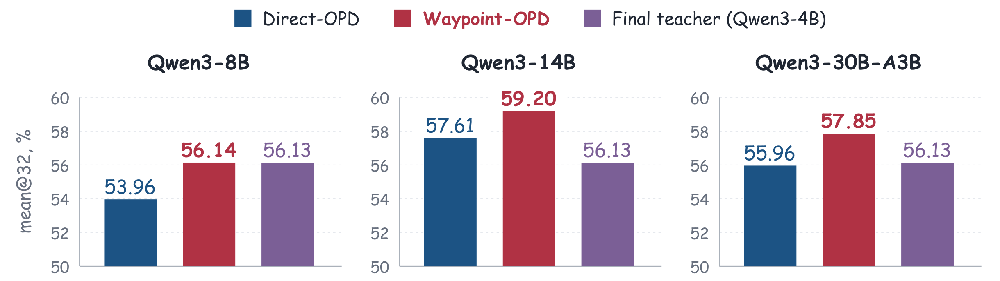
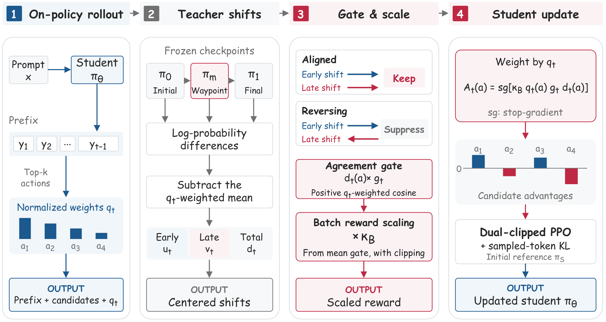

# Waypoint-OPD：基于门控在策蒸馏迁移 RL 诱导的策略偏移 论文精读

> **论文**：Waypoint-OPD: Transferring RL-Induced Policy Shifts via Gated On-Policy Distillation
> **作者**：Bingxi Hou, Guochao Jiang, Guofeng Quan, Weiqing Li, Wenfeng Feng, Guohua Liu, Yuewei Zhang
> **arXiv ID**：2610.21601
> **发表时间**：2026-10-15
> **许可协议**：arXiv 许可（CC BY 4.0，据论文页标注）
> **代码仓库**：https://github.com/hhhbxloveai/WaypointOPD

## 第 1 章 概述

### 1.1 一句话定位

Waypoint-OPD 在 Direct-OPD 的「Initial-to-Final 端点策略差迁移」之上引入同一次 teacher RL 运行的中间检查点（Waypoint），用早、晚两段策略偏移在学生访问前缀处的方向一致性（加权余弦门控）来加权端点信号，以一次额外冻结 teacher 打分为代价，在数学与代码推理的全部六个域-规模设置中取得最高平均分。

### 论文图表总览

| 编号 | 内容 | 章节 |
|------|------|------|
| **Figure 1** | 数学推理三规模主结果概览（mean@32，七 benchmark 平均） | 第 1 章 |
| **Figure 2** | Waypoint-OPD 训练流水线（三检查点打分 → 一致性门控 → 端点迁移） | 第 3 章 |
| **Figure 3** | Qwen3-8B 数学训练学习动态（三 benchmark 逐 checkpoint 对比） | 第 5 章 |
| **Table 1** | 数学主结果（7 benchmark × teacher/8B/14B/30B-A3B） | 第 5 章 |
| **Table 2** | 代码平均结果（5 评测 × 三规模学生） | 第 5 章 |
| **Table 3** | 门控与归一化消融（8B 数学） | 第 5 章 |
| **Table 7** | 完整代码结果（MBPP/MBPP+/LCB v4-v6） | 第 5 章 |
| **Table 8** | Waypoint 位置敏感性（step 500/600/700） | 第 5 章 |
| **Table 9** | 训练时间与 GPU 开销对比 | 第 5 章 |

*图1：三个规模学生模型的数学推理平均分（mean@32，七 benchmark 平均）——Waypoint-OPD 相对最强基线 Direct-OPD 分别提升 2.18、1.59、1.89 个百分点*

### 1.2 核心贡献

1. **时序一致性作为选择性迁移准则**：端点对 (π₀, π₁) 的策略差无法区分「早晚期同向增强」与「方向相反部分抵消」两种来源；Waypoint 检查点在学生访问的前缀处揭示这一方向信息，是端点对无法提供的证据。
2. **Waypoint 引导的门控端点信号**：构建稠密在策目标，用早晚段中心化偏移的 q_t 加权余弦生成正余弦门 g_t=max(0, c_t)，对齐的端点变化保留、反转的抑制；相对端点迁移仅需一次额外冻结 teacher 打分，无需新增 teacher 训练或 verifier 调用。
3. **跨域跨规模一致的增益**：Qwen3-8B/14B/30B-A3B 学生在数学与代码两域的六个设置中全部取得最高域平均分，且 14B 学生在全部七个数学 benchmark 上超过 Final teacher（56.13%）。

### 1.3 关键结果速览

| 设置 | Direct-OPD | Waypoint-OPD | 提升 |
|------|:---:|:---:|:---:|
| 数学 8B（Avg., %） | 53.96 | 56.14 | +2.18 pp |
| 数学 14B（Avg., %） | 57.61 | 59.20 | +1.59 pp |
| 数学 30B-A3B（Avg., %） | 55.96 | 57.85 | +1.89 pp |
| 代码 8B（Avg., %） | 50.59 | 53.25 | +2.66 pp |
| 代码 14B（Avg., %） | 56.30 | 57.82 | +1.52 pp |
| 代码 30B-A3B（Avg., %） | 56.35 | 57.54 | +1.19 pp |

数学逐项对比 19/21 胜出（例外：14B HMMT25N 47.60%→47.08%、30B-A3B HMMT26F 33.05%→32.77%）；代码 15/15 全胜。14B、30B-A3B 学生分别超过 Final teacher 数学平均 56.13% 达 +3.07、+1.72 pp，代码平均 55.37% 达 +2.45、+2.17 pp；8B 数学平均 56.14% 与 teacher 基本持平。训练开销上，Waypoint-OPD 反而低于 Direct-OPD（8 小时 2 分 21 秒 vs 8 小时 21 分 3 秒，−3.73%，64.31 vs 66.81 GPU 小时），响应截断率从 14.83% 降至 11.97%。

## 第 2 章 研究背景与动机

**从 RL 可验证奖励到改进复用。** 在可验证奖励上做强化学习（RLVR）能显著提升 LLM 的推理能力，但训练成本高昂：每个优化步都要让策略反复生成长回答、执行奖励验证、并进行多样本优化。以本文的 Qwen3-4B teacher 为例，一次 1200 步的 GRPO 运行将其数学基准均值从 24.84（Initial）提到 56.13（Final），且 step 600 的 Waypoint 检查点已达 51.82（Table 1）——改进大部分在中段之前完成。既然 teacher 的 RL 改进已经付出高昂代价获得，一个自然的诉求是把这份改进直接迁移给其他模型，避免在学生端重复等价的 RL 过程。

**标准 OPD 及其上限。** Agarwal et al.（2024）的 On-Policy Distillation（OPD）让学生在自生成轨迹上学习，用 reverse-KL 匹配 Final teacher 的绝对分布。由于优化目标是 teacher 的绝对分布本身，学生能力被 teacher 的能力上限束缚，难以突破 teacher 水平。

**OPD2：变化而非绝对分布。** Heo et al.（2026）的 OPD2 将监督信号从绝对分布改为 teacher−base 的策略变化，并在 sampled token 上以符号一致性（sign agreement）门控更新，只有当 teacher 相对 base 的变化方向与更新方向一致时才施加监督。

**Direct-OPD：稠密隐式奖励。** Feng et al.（2026）的 Direct-OPD 把 Initial-to-Final 的 log-ratio 作为稠密隐式奖励，在每个前缀处直接迁移策略变化而非绝对分布；该方法是本文的直接基线。

**endpoint 差值的盲区。** OPD2 与 Direct-OPD 的监督信号都只依赖 teacher RL 的两个端点（Initial 与 Final）。但 endpoint 策略差无法揭示训练过程中局部动作偏好是否一致演化：同一个非零的 endpoint 差值，既可能来自早、晚两个阶段同向增强的 shift，也可能来自方向相反、部分抵消的 shift——两种情形下首末观测完全相同，仅凭 endpoint 无法区分，而其作为监督证据的可信度显然不同。方向一致本身也不保证信号有益，但反向抵消相对同向增强是明确更弱的证据。

**假设与研究问题。** 论文假设：teacher 早、晚期策略变化的方向一致性，可以为 endpoint shift 在各前缀处的权重提供证据——同向增强支撑强权重，反向抵消应被抑制甚至清零。由此提出核心问题：teacher 的哪些局部策略变化应当指导学生自生成轨迹上的学习？Waypoint-OPD 对此的回应是引入同一 RL run 的中间检查点（Waypoint），在学生访问的每个前缀处比较早、晚段 shift 的方向一致性，并据此门控 endpoint 信号。

## 第 3 章 方法剖析：Waypoint-OPD

### 3.1 三检查点与学生局部候选支撑

方法从同一 teacher RL run 保存三个检查点，全程冻结、仅做前向打分，不引入任何可训练参数：

- **Initial 策略 π₀**：RL 前的 teacher；
- **Waypoint 策略 π_m**：RL step 600，即 1200 步运行的时序中点；
- **Final 策略 π₁**：RL step 1200，运行终点。

学生 π_θ 在自生成轨迹 y ∼ π_θ(·|x) 上学习。在每个前缀 s_t 处取学生当前策略的 top-k = 16 候选动作构成局部支撑 𝒦_t，并将学生概率在支撑上归一化为权重：

$$q_t(a)=\frac{\pi_\theta(a\mid s_t)}{\sum_{b\in\mathcal{K}_t}\pi_\theta(b\mid s_t)}\tag{5}$$

q_t 把比较集中在学生实际可能采取的动作上：时序一致性评估恰好发生在接受学生更新的局部支撑内，概率更高的候选获得更大权重。三个冻结 teacher 对 𝒦_t 的全部候选做前向打分，为段间 shift 的计算提供 logits。

*图2：Waypoint-OPD 训练流水线——三个冻结 teacher 检查点在学生生成前缀处打分，中心化段间 shift 定义一致性门控*

### 3.2 中心化与时序一致性度量

Waypoint 检查点将 endpoint shift 分解为两个连续的段间 shift：

$$\delta_t^{(1)}(a)=\log\pi_m(a\mid s_t)-\log\pi_0(a\mid s_t)\tag{6}$$

$$\delta_t^{(2)}(a)=\log\pi_1(a\mid s_t)-\log\pi_m(a\mid s_t)\tag{7}$$

二者伸缩求和为 endpoint shift：δ_t = δ_t^{(1)} + δ_t^{(2)}。

计算方向一致性之前须先去除候选间的均匀分量：一个对所有候选均匀的 shift 不改变相对偏好，却会改变原始 shift 向量之间的夹角，从而污染一致性估计。为此定义 q_t-centering 算子剥离动作无关分量：

$$C_{q_t}[z](a)=z(a)-\mathbb{E}_{b\sim q_t}[z(b)]\tag{8}$$

并记 u_t = C_{q_t}[δ_t^{(1)}]、v_t = C_{q_t}[δ_t^{(2)}]、d_t = C_{q_t}[δ_t] = u_t + v_t。

时序一致性用候选支撑上以学生概率 q_t 加权的余弦度量：

$$\langle u_t,v_t\rangle_{q_t}=\sum_{a\in\mathcal{K}_t}q_t(a)\,u_t(a)\,v_t(a),\qquad c_t=\frac{\langle u_t,v_t\rangle_{q_t}}{\lVert u_t\rVert_{q_t}\,\lVert v_t\rVert_{q_t}}\tag{9}$$

其中加权范数 ‖u_t‖_{q_t} = √⟨u_t,u_t⟩_{q_t}（v_t 同理）。c_t ∈ [−1, 1] 度量去除均匀分量后早、晚段 shift 在学生可能采取的动作上的方向一致性。

### 3.3 正余弦门控与批尺度归一化

当两个中心化段范数均超过 ε = 10⁻⁸ 时，使用正余弦门控：

$$g_t=\max(0,c_t)\tag{10}$$

门控 g_t ∈ [0, 1] 由前缀 s_t 处全部候选共享：c_t ≤ 0 时直接移除 endpoint 信号，c_t > 0 时按 c_t 缩放信号幅度。当任一段范数 ≤ ε 时回退为 g_t = 1（low-norm fallback），避免对近零段 shift 做出噪声主导的方向估计。

论文用一对反例说明门控的信息增量：对同一非零的 q_t-centered endpoint d，u = v = d/2 给出 c = 1、g = 1；u = 2d、v = −d 给出 c = −1、g = 0；两种分解均有 u + v = d——只依赖 endpoint 差值的迁移方法完全无法区分二者，而门控可以。

为稳定各 batch 间门控的平均尺度，对 batch B 中所有门控奖励乘以共享系数：

$$\kappa_B=\operatorname{clip}\!\left(\frac{\tau}{\max\!\left(|B_{\mathrm{pref}}|^{-1}\sum_{t\in B_{\mathrm{pref}}}g_t,\ \varepsilon_{\mathrm{num}}\right)},\ \kappa_{\min},\ \kappa_{\max}\right)\tag{11}$$

其中 B_pref 为 batch 中有效响应前缀的集合，ε_num > 0 是防止除零的数值下限，τ = 0.8 是重缩放后门控均值的目标，clip 区间 [κ_min, κ_max] = [0.75, 1.5]。κ_B 是共享正乘子：保持门控的相对权重与零门控不变；有效乘子 κ_B g_t 可以超过 1——批归一化针对门控均值尺度，并不修复奖励向量本身的范数。

### 3.4 稠密候选目标

候选动作 a ∈ 𝒦_t 的最终监督系数为：

$$A_t(a)=\operatorname{sg}\!\left[\kappa_B\,q_t(a)\,g_t\,d_t(a)\right]\tag{12}$$

stop-gradient 算子 sg 切断 A_t 内全部因子（κ_B、q_t、g_t、d_t 均不参与求导）。由中心化性质 Σ_{a∈𝒦_t} q_t(a) d_t(a) = 0，故 Σ_{a∈𝒦_t} A_t(a) = 0（Eq.15）：A_t 在支撑上零和，天然具有逐前缀"advantage"的正负语义。需要注意，方向一致本身并不保证监督有益；门控移除的只是可识别的反向抵消证据。

沿用 signal-minus-KL 形式，最大化如下局部 on-policy 代理目标：

$$\mathcal{J}_{\mathrm{WP}}(\theta)=\mathbb{E}_{x\sim\mathcal{D}}\!\left[\mathbb{E}_{y\sim\pi_\theta(\cdot\mid x)}\!\left[\sum_{t=1}^{T}\sum_{a\in\mathcal{K}_t}A_t(a)\log\pi_\theta(a\mid s_t)\right]-\beta\,\widehat{D}_{\mathrm{KL}}\!\left(\pi_\theta(\cdot\mid x)\,\big\|\,\pi_S(\cdot\mid x)\right)\right]\tag{13}$$

第一项是稠密候选信用分配，覆盖 𝒦_t 全体候选；第二项是在采样响应 token 上估计的 KL 惩罚，以 β = 2.5 将学生锚定到其基础策略 π_S。对代理目标求导时，rollout 样本与候选支撑均保持固定。

### 3.5 实现与 dual-clipped PPO 的等价性

实现上将目标（Eq.13）写成 candidate-wise 的 dual-clipped PPO 代理（Eq.17）：在候选支撑上引入逐候选概率比 r_t(a) = π_θ(a|s_t) / π_roll(a|s_t)，取

$$J_t(a)=\begin{cases}\min\{r_t(a)A_t(a),\ \bar{r}_t(a)A_t(a)\}, & A_t(a)\ge 0,\\[2pt]\max\{\min[r_t(a)A_t(a),\ \bar{r}_t(a)A_t(a)],\ cA_t(a)\}, & A_t(a)<0.\end{cases}\tag{17}$$

附录 B 证明该代理在 rollout policy 处与 Eq.13 的梯度相同：dual-clipped PPO 形式是稠密目标的可微实现，PPO 比率裁剪约束候选概率比的更新幅度，dual clip 下界 c·A_t(a)（c > 1）限制负优势候选的过度更新。

工程上基于 patched verl（verl + FSDP + vLLM，单节点 8×H20）实现，门控超参以环境变量暴露：WAYPOINT_GATE_MODE=cosine（唯一支持模式）、WAYPOINT_GATE_TARGET_MEAN=0.8、WAYPOINT_GATE_SCALE_MIN/MAX=0.75/1.5，与 Eq.11 的 τ 及 [κ_min, κ_max] 一一对应。相对 Direct-OPD，方法只增加一个冻结 teacher 检查点与一次 scoring pass，不引入额外可训练参数，也不增加学生 rollout。

## 第 4 章 理论性质与信号分析

Waypoint-OPD 的方法设计在附录 A 中给出一组构造层面的信号性质。这些性质说明 Waypoint 检查点在方法中的确切角色：它只提供加权证据，不改变被迁移信号本身；门控与归一化只调节信号的幅度，不改变其方向与候选间的相对结构。

### 4.1 Endpoint 保持性

方法在固定前缀 $s_t$、候选集 $\mathcal{K}_t$ 与学生权重 $q_t$、且 teacher log 分数有限的条件下，利用 centering 算子的线性性可得：

$$u_t+v_t=C_{q_t}\big[\delta^{(1)}_t+\delta^{(2)}_t\big]=C_{q_t}\big[\log\pi_1-\log\pi_0\big]=d_t \tag{14}$$

其中早段 shift $\delta^{(1)}_t=\log\pi_m-\log\pi_0$、晚段 shift $\delta^{(2)}_t=\log\pi_1-\log\pi_m$ 之和恒等于 endpoint 对数差。这一分解给出两点结构性结论。其一，被迁移的对象始终是 endpoint 信号 $d_t$：Waypoint 检查点 $\pi_m$ 的全部影响都体现在门控 $g_t$ 与批归一化系数 $\kappa_B$ 上，$d_t$ 本身与 $\pi_m$ 的选取无关。Waypoint 是加权准则的证据来源，而非模仿目标。其二，同一个非零的 $d_t$ 可以来自相互加强的分解（$u=v=d/2$，此时余弦 $c=1$、门控 $g=1$），也可以来自相互抵消的分解（$u=2d,\ v=-d$，此时 $c=-1$、$g=0$）——两者都满足 $u+v=d$，因此仅依赖 endpoint 对 $(\pi_0,\pi_1)$ 的迁移方法在原理上无法区分这两种情形。这正是引入中间检查点的动机。

需要强调论文明确给出的限定：式 (14) 的比较在固定的学生前缀与权重下成立；一旦学生开始训练，两条方法的后续轨迹可以分岔，该等式不再逐点对应两个已发散的训练过程。

### 4.2 门控的构造性质

在低范数回退（任一段范数 $\le\varepsilon$ 时取 $g_t=1$）之外，门控由加权余弦 $c_t=\langle u_t,v_t\rangle_{q_t}/(\|u_t\|_{q_t}\|v_t\|_{q_t})$ 经 $g_t=\max(0,c_t)$ 得到，具有以下直接由定义推出的性质。

**常数偏移不变性。** 对任意与动作无关的常数 $b$，$C_{q_t}[z+b]=C_{q_t}[z]$。teacher 分数中的 prompt 相关常数偏移（如不同 checkpoint 共享的偏置项）在 centering 后被完全消除，迁移信号不受影响。这与最优策略下 log 概率差仅确定到正缩放与 prompt 相关常数的事实相衔接。

**共线与反向的极值行为。** 正向共线（$u$ 与 $v$ 方向一致）时 $g=1$，endpoint 信号全额通过；加权余弦非正（$c_t\le 0$）时 $g=0$，信号被完全抑制。门控因此实现的是软性的方向一致性筛选，而非连续的幅度调节。

**对独立正缩放不敏感。** 对 $u_t$、$v_t$ 分别施加独立的正缩放，只要两段都不进入低范数回退，$g_t$ 保持不变——余弦对范数缩放天然免疫。但二者的和 $d_t$ 会随缩放改变，说明门控的稳定性与被加权信号自身的尺度是两个独立层面。

**符号保持。** $g_t\in[0,1]$ 且 $\kappa_B>0$ 保证 $A_t(a)=\mathrm{sg}[\kappa_B q_t(a) g_t d_t(a)]$ 不会翻转 $d_t(a)$ 的符号：门控永远只会压缩或归零某个候选上的监督方向，不会将其反转。同时有效乘子 $\kappa_B g_t$ 可以超过 1，因为批归一化的目标是均值门控（$\tau/\max(\overline{g},\varepsilon_{\mathrm{num}})$ 经 clip 到 $[0.75,1.5]$），而非固定的奖励范数。

论文对这些性质的定位措辞值得注意：它们是"构造的性质"（properties of the construction），时间加权的有用性由实验评估决定，理论本身不提供保证。

### 4.3 零和系数与局部梯度

由于 $d_t$ 在 $q_t$ 下 centering（$E_{q_t}[d_t]=0$），优势系数满足零和性：

$$\sum_{a\in\mathcal{K}_t}A_t(a)=\kappa_B g_t\sum_{a\in\mathcal{K}_t}q_t(a)\,d_t(a)=0 \tag{15}$$

即在候选集内，正系数之和等于负系数之和的绝对值。零和性直接决定了蒸馏目标的局部梯度结构。记 $z_b$ 为学生词表 token $b$ 在 $s_t$ 处的 logit，在 $\mathcal{K}_t$ 固定、$A_t$ 被停止梯度的条件下，候选目标的梯度为：

$$\frac{\partial}{\partial z_b}\Big[-\sum_{a\in\mathcal{K}_t}A_t(a)\log\pi_\theta(a\mid s_t)\Big]=\begin{cases}-A_t(b), & b\in\mathcal{K}_t,\\[2pt]0, & b\notin\mathcal{K}_t.\end{cases} \tag{16}$$

式 (16) 的关键在于 softmax 公共项被抵消：若系数非零和，$\partial\log\pi_\theta(a)/\partial z_b$ 中对所有 $b$ 非零的公共归一化项会带来整体性的候选外梯度；零和性使其严格消失，梯度变成每个候选上一个独立的、幅度为 $-A_t(b)$ 的更新，非候选 logit 在此局部意义上不受影响。候选级 dual-clipped PPO 代理（式 17）在 rollout 策略处（$r_t(a)=1$、裁剪不激活）与该局部梯度一致。

两个限定同样来自原文：该局部结果不包含 KL 惩罚项；且它不蕴含共享参数的实际更新会保持候选概率质量或不改变非候选概率——一次参数更新会耦合词表上所有 token 的分布。

### 4.4 解释边界：加权准则而非正确性保证

论文在两处明确划定了理论解释的边界，构成理解实验结论的前提。

第一，方向一致性只是一个加权准则（weighting criterion），不是监督有益性的保证。$g_t$ 高仅说明 teacher RL 的早晚两段在当前前缀上对相对动作偏好的调整方向一致，而"一致"与"正确"之间没有建立任何理论联系：一致地走向一个对 student 任务分布次优的偏好同样会产生高门控。附录 A 结尾的表述是"时间加权的有用性由实验评估"——即第 5 章的全部结果是该准则的经验检验，而非理论推论。

第二，论文不假设有限步 RL 达到理想最优。endpoint 信号的动机来自最优策略下 log 概率差仅确定到正缩放与 prompt 相关常数这一性质，但 1200 步 GRPO 得到的 $\pi_1$ 是一个有限步训练的中间产物，论文从未假设它接近该最优。这解释了实验中 teacher 与 student 的交错排序（部分 benchmark 上 student 超过 Final teacher、部分低于）：被迁移的是"teacher 实际发生的策略变化中方向一致的部分"，其价值取决于这段 RL 轨迹本身的质量，方法对此不作承诺。

## 第 5 章 实验设置与关键结果

### 5.1 实验设置概述

**Teacher 训练。** Teacher 为 Qwen3-4B，两个域各训一次：数学域从 DeepMath-103K 中选取难度 ≥6 的约 57K 条样本，代码域使用 Eurus-RL-Code 约 25K 条样本。两域均用 GRPO 训练 1200 步，除数据集外超参数完全一致（学习率 1e-6，rollout n=8，最大响应长度 16,384）。同一次 RL 运行保留三个检查点：Initial（RL 前）、Waypoint（step 600，中点）、Final（step 1200）。

**学生与迁移训练。** 学生为 Qwen3-8B、Qwen3-14B、Qwen3-30B-A3B 三档规模。迁移阶段训练数据为 DAPO-Math-17K（数学）与 Codeforces 衍生集（代码）；batch 256、mini-batch 64、rollout n=1、共 100 步；KL 系数 β=2.5；候选数 k=16；归一化目标 τ=0.8；$\kappa_B$ 裁剪区间 $[0.75,1.5]$；低范数阈值 $\varepsilon=10^{-8}$。三个 frozen teacher（Initial/Waypoint/Final）对学生 top-16 token 打分，答案评分器仅用于评测，迁移阶段不调用 verifier。

**评测协议。** 数学用 mean@32，覆盖 7 个 benchmark（AIME24/25/26、HMMT25 Feb、HMMT25 Nov、HMMT26 Feb、AMC23）；代码用 mean@8，覆盖 5 项评测。采样温度 0.7、top-p 0.95、最大生成长度 16,384。验证集为 AIME 2024，用于 checkpoint 选择。基线为 Base、OPD（Final teacher reverse-KL）、OPD2（符号一致门控、sampled-token 目标）、Direct-OPD（endpoint 对数比）。全部方法共享训练与评测设置，仅方法特有超参不同。框架为 verl + FSDP + vLLM，单节点 8×H20。

### 5.2 主结果分析

六个 setting（math/code × 8B/14B/30B-A3B）中 Waypoint-OPD 全部取得被比较蒸馏方法中最高的 domain average，这是论文标题性结论的精确内容。

**数学域。** 三个规模的 domain average 分别为 56.14 / 59.20 / 57.85（8B/14B/30B-A3B），相对最强基线 Direct-OPD（53.96 / 57.61 / 55.96）提升 2.18 / 1.59 / 1.89 个百分点。21 个逐 benchmark 比较中胜出 19 个，仅有的两个例外是 14B 的 HMMT25N（47.60→47.08，−0.52 pp）与 30B-A3B 的 HMMT26F（33.05→32.77，−0.28 pp），两处退幅均不足 0.6 pp。值得注意的是 14B 学生在全部 7 个数学 benchmark 上超过 Final teacher 的对应分数，domain average 59.20 对 teacher 的 56.13 高出 3.07 pp；30B-A3B 同样超过 teacher（+1.72 pp），8B 则与 teacher 基本持平（56.14 对 56.13）。学生规模越大、起点越高（Base 26.04/27.32/28.03），Waypoint-OPD 相对 teacher 的余量越明显，而相对 Direct-OPD 的增益在 8B 上最大。

**代码域。** 三个规模的 domain average 为 53.25 / 57.82 / 57.54，相对 Direct-OPD（50.59 / 56.30 / 56.35）提升 2.66 / 1.52 / 1.19 个百分点，15 个逐项比较全胜。OPD2 仅在 14B LCB v5 与 30B-A3B MBPP/MBPP+ 三处更高，但各学生的平均分仍以 Waypoint-OPD 最高。14B 与 30B-A3B 分别以 +2.45、+2.17 pp 超过 Final teacher 的 55.37，5 项代码评测中 4 项更高。代码域相对增益随规模递减（2.66→1.19 pp），与数学域的模式一致：学生越强，蒸馏信号可利用的头部空间越小。

**结构性观察。** 两个域合起来看，Waypoint-OPD 对 Direct-OPD 的增益（1.19–2.66 pp）系统性大于 Direct-OPD 对 OPD 的增益（数学 8B 上 51.04→53.96 为 +2.92 pp，但代码域 OPD 反而显著弱于 OPD2 与 Direct-OPD，如 8B 代码 OPD 仅 43.91）。这说明在 reverse-KL 到 Final teacher 的经典 OPD 已被 endpoint 类方法取代的当前基线水平上，时间一致性门控仍提供了独立于 endpoint 信息的增量。

**数学推理（Table 1，mean@32，%）**

| 方法 | AIME24 | AIME25 | AIME26 | HMMT25F | HMMT25N | HMMT26F | AMC23 | Avg. |
|------|:---:|:---:|:---:|:---:|:---:|:---:|:---:|:---:|
| Teacher Initial | 21.67 | 21.67 | 21.67 | 12.50 | 10.00 | 15.15 | 71.25 | 24.84 |
| Teacher Waypoint | 58.96 | 54.79 | 56.77 | 31.35 | 35.73 | 31.72 | 93.44 | 51.82 |
| Teacher Final | 65.83 | 60.00 | 60.83 | 35.83 | 40.83 | 35.13 | 94.45 | 56.13 |
| 8B Base | 29.17 | 20.83 | 18.33 | 11.67 | 13.33 | 18.94 | 70.00 | 26.04 |
| 8B OPD | 63.65 | 49.69 | 54.90 | 29.06 | 38.65 | 32.58 | 88.75 | 51.04 |
| 8B OPD2 | 64.48 | 48.33 | 53.96 | 28.44 | 40.52 | 31.53 | 92.97 | 51.46 |
| 8B Direct-OPD | 67.29 | 55.31 | 57.40 | 31.77 | 40.83 | 33.71 | 91.41 | 53.96 |
| 8B Waypoint-OPD | 68.85 | 57.92 | 60.21 | 34.38 | 42.60 | 36.36 | 92.66 | **56.14** |
| 14B Base | 30.00 | 27.50 | 20.00 | 10.00 | 11.67 | 18.94 | 73.13 | 27.32 |
| 14B OPD | 69.17 | 55.52 | 58.44 | 36.77 | 45.21 | 31.82 | 96.25 | 56.17 |
| 14B OPD2 | 69.48 | 46.98 | 54.38 | 33.13 | 41.98 | 31.91 | 91.95 | 52.83 |
| 14B Direct-OPD | 70.10 | 56.46 | 61.98 | 37.92 | 47.60 | 35.13 | 94.06 | 57.61 |
| 14B Waypoint-OPD | 70.21 | 60.52 | 63.75 | 40.21 | 47.08 | 36.55 | 96.09 | **59.20** |
| 30B-A3B Base | 31.67 | 22.50 | 22.50 | 10.00 | 13.33 | 21.21 | 75.00 | 28.03 |
| 30B-A3B OPD | 63.54 | 49.06 | 57.50 | 30.83 | 37.71 | 28.03 | 91.88 | 51.22 |
| 30B-A3B OPD2 | 64.90 | 51.77 | 60.42 | 31.56 | 38.54 | 30.21 | 91.33 | 52.68 |
| 30B-A3B Direct-OPD | 69.17 | 54.69 | 61.98 | 38.96 | 41.56 | 33.05 | 92.34 | 55.96 |
| 30B-A3B Waypoint-OPD | 70.94 | 58.44 | 63.65 | 39.90 | 44.69 | 32.77 | 94.53 | **57.85** |

**代码推理（Table 2 域平均与 Table 7 完整结果，mean@8，%）**

| 方法 | MBPP | MBPP+ | LCB v4 | LCB v5 | LCB v6 | Avg. |
|------|:---:|:---:|:---:|:---:|:---:|:---:|
| Teacher Initial | 62.53 | 54.53 | 25.37 | 20.36 | 25.43 | 37.64 |
| Teacher Waypoint | 83.33 | 70.37 | 36.01 | 37.20 | 34.21 | 52.22 |
| Teacher Final | 88.00 | 72.65 | 38.61 | 40.57 | 37.00 | 55.37 |
| 8B OPD | 69.58 | 57.67 | 35.64 | 26.95 | 29.71 | 43.91 |
| 8B OPD2 | 79.10 | 68.68 | 36.54 | 37.72 | 34.00 | 51.21 |
| 8B Direct-OPD | 78.14 | 65.81 | 36.63 | 37.95 | 34.43 | 50.59 |
| 8B Waypoint-OPD | 82.97 | 69.38 | 37.87 | 40.19 | 35.86 | **53.25** |
| 14B OPD | 84.49 | 72.62 | 35.64 | 33.53 | 32.00 | 51.66 |
| 14B OPD2 | 85.98 | 72.92 | 38.61 | 43.56 | 36.93 | 55.60 |
| 14B Direct-OPD | 85.32 | 73.58 | 43.44 | 42.96 | 36.21 | 56.30 |
| 14B Waypoint-OPD | 87.57 | 74.60 | 45.54 | 43.11 | 38.29 | **57.82** |
| 30B-A3B OPD | 86.61 | 72.25 | 35.15 | 32.49 | 33.07 | 51.91 |
| 30B-A3B OPD2 | 88.23 | 74.44 | 40.10 | 41.62 | 35.43 | 55.96 |
| 30B-A3B Direct-OPD | 87.24 | 73.77 | 42.33 | 41.54 | 36.86 | 56.35 |
| 30B-A3B Waypoint-OPD | 88.00 | 74.21 | 43.94 | 42.89 | 38.64 | **57.54** |

（8B Base 代码平均 41.03%、14B Base 47.72%、30B-A3B Base 50.33%；逐项数据见表 7。）代码域 OPD2 在 14B LCB v5（43.56% vs 43.11%）和 30B-A3B MBPP（88.23% vs 88.00%）、MBPP+（74.44% vs 74.21%）三处高于 Waypoint-OPD，但各学生的五项平均仍以 Waypoint-OPD 最高。

### 5.3 学习动态

*图3：Qwen3-8B 数学训练中 Waypoint-OPD 与 Direct-OPD 的逐 checkpoint 对比，step 60 起全 benchmark 领先*

Figure 3 在 Qwen3-8B 数学训练的同一 100 步内，对齐评测步逐点比较两条方法，补充 Table 1 仅报告选定 checkpoint 的视角。排除共享初始化后，Waypoint-OPD 在 15 个 benchmark–checkpoint 组合中 13 个得分更高，仅有的两个例外都出现在训练早期；自 step 60 起，Waypoint-OPD 在三个 benchmark 的每一次记录评测上全部领先，优势持续到训练结束。step 100 处的增益为 AIME 2025 +4.17 pp、AIME 2026 +3.13 pp、HMMT November 2025 +0.10 pp。

增益幅度在 benchmark 间的分化明显：两个 AIME 上是 3–4 pp 量级，HMMT25N 上几乎归零。与 Final teacher 灰色参考线的对照则呈现跨 benchmark 的不同排序：HMMT25N 上 Waypoint-OPD 在 step 60/80/100 三处均超过 Final teacher 的 40.83，step 60 达到 42.60（超 teacher 1.77 pp）；而两个 AIME 上的记录分数始终低于对应 teacher 参考线。对 Direct-OPD 的改进与相对 teacher 的位置是两个独立维度，同一训练运行中可以共存"全面领先基线"与"部分 benchmark 未及 teacher"两种状态。HMMT25N 上的持续优势表明 Waypoint-OPD 能够利用 teacher 的策略偏移取得超过 Final teacher 的性能，但这一现象并未在 AIME 上复现。

### 5.4 消融与敏感性

消融在 Qwen3-8B 数学上进行，完整方法 56.14 为参照。去门控（保留 centering 与归一化）降至 53.50（−2.64 pp，7 个 benchmark 全部下降）；打乱门控（在 rollout batch 内跨前缀随机重分配门控值，保持每个前缀的候选权重与 centered endpoint 信号）进一步降至 51.20（−4.94 pp，且比无门控还低 2.30 pp，逐 benchmark 排序一致）；去均值归一化（$\kappa_B\equiv1$，保留正余弦门控）为 55.22（−0.92 pp，7 项中 6 项受益，例外是 HMMT25 Feb：无归一化 34.79 高于完整方法的 34.38）。

三个数字的相对结构比各自幅度更有信息量。**shuffle 比 no-gate 更差（51.20 < 53.50）是关键证据**：shuffle 在固定 rollout batch 内保持门控分布与 $\kappa_B$ 不变，唯一被破坏的是门控与前缀的配对。随机配对比完全去掉选择性加权更糟，说明门控值本身携带有前缀特定的方向信息，错误的配对会主动将高权重施加到方向不一致的前缀上，造成的损害甚于不加权。门控的有效性同时依赖"值"与"位置"两个成分。无归一化变体仍在全部 7 个 benchmark 上超过 Direct-OPD 平均 1.26 pp，说明归一化是增量收益而非必要条件；同时论文明确指出该变体保留了 centering 等与 Direct-OPD 的其他差异，剩余增益不能全部归因于门控本身——各消融差距以保留组件为条件，不是独立的可加贡献。

**Waypoint 位置敏感性（Table 8，Qwen3-8B 数学，%）**

| Waypoint 位置 | AIME24 | AIME25 | AIME26 | HMMT25F | HMMT25N | HMMT26F | AMC23 | Avg. |
|------|:---:|:---:|:---:|:---:|:---:|:---:|:---:|:---:|
| Step 500 | 69.06 | 58.13 | 59.79 | 33.96 | 42.60 | 36.74 | 92.97 | 56.18 |
| Step 600（默认） | 68.85 | 57.92 | 60.21 | 34.38 | 42.60 | 36.36 | 92.66 | **56.14** |
| Step 700 | 69.27 | 57.60 | 59.79 | 34.58 | 42.81 | 36.36 | 92.50 | 56.13 |

三位置平均分范围仅 0.05 pp，单 benchmark 最大范围 0.62 pp（HMMT25F 33.96–34.58%），且三者均超 Direct-OPD（53.96%）2.17–2.22 pp——迁移增益对 Waypoint 在 RL 轨迹邻域内的具体位置不敏感。

Waypoint 位置敏感性（Appendix F）在 8B 数学上测试 teacher RL step 500/600/700 三个位置，得分 56.18 / 56.14 / 56.13，范围仅 0.05 pp，均超 Direct-OPD 2.17–2.22 pp。在 step 600 中点附近的一段邻域内，方法对 Waypoint 的具体选取几乎不敏感；但该结论的外推边界同样明确——测试仅覆盖 500–700 这 200 步的窗口，不涵盖靠近 Initial 或 Final 的极端位置。

**门控与归一化消融（Table 3，Qwen3-8B 数学，%）**

| 变体 | AIME24 | AIME25 | AIME26 | HMMT25F | HMMT25N | HMMT26F | AMC23 | Avg. |
|------|:---:|:---:|:---:|:---:|:---:|:---:|:---:|:---:|
| No gate（g_t=1） | 66.25 | 54.27 | 56.67 | 32.60 | 39.79 | 34.66 | 90.23 | 53.50 |
| Shuffled gate | 63.33 | 52.92 | 54.58 | 30.00 | 37.08 | 31.06 | 89.45 | 51.20 |
| No normalization（κ_B=1） | 68.13 | 56.46 | 58.33 | 34.79 | 41.56 | 35.23 | 92.03 | 55.22 |
| Direct-OPD | 67.29 | 55.31 | 57.40 | 31.77 | 40.83 | 33.71 | 91.41 | 53.96 |
| Waypoint-OPD（完整） | 68.85 | 57.92 | 60.21 | 34.38 | 42.60 | 36.36 | 92.66 | **56.14** |

**训练时间（Table 9，Qwen3-8B 数学，100 步，8×H20）**

| 方法 | 总时长 | 秒/步 | GPU 小时 |
|------|:---:|:---:|:---:|
| Direct-OPD | 8:21:03 | 300.63 | 66.81 |
| Waypoint-OPD | 8:02:21 | 289.41 | 64.31 |

### 5.5 训练开销与门控诊断

**开销。** 尽管 Waypoint-OPD 比 Direct-OPD 多一次 frozen teacher（Waypoint 检查点）打分，8×H20 上的实测总时长反而更短：8:02:21 对 8:21:03，节省 18 分 42 秒（−3.73%）；GPU 时间 64.31 对 66.81 GPU-h，每步 289.41 s 对 300.63 s。原因是门控改变了对学生的有效监督分布，训练出的学生生成更短的响应：截断率从 14.83% 降至 11.97%（−2.86 pp），100 步中 87 步的响应更短。更短的 rollout 直接降低了生成开销，抵消并反超了额外打分的成本。"一致性筛选抑制了导致冗长生成的偏好漂移"是一个与截断率下降方向吻合的解读，但论文未在因果层面单独隔离这一点。

**门控动态。** Appendix G 的诊断显示训练过程中一致性信号在衰减：平均门控从前 20 步的 0.810 降至后 20 步的 0.683，zero-gate 比例从 7.26% 升至 16.59%。这表明学生训练后期，teacher 早晚段 shift 在学生访问前缀上的方向一致比例下降——可以理解为一致性高的前缀其信号被逐步吸收，剩余前缀更多是方向分歧的情形。$\kappa_B$ 全程处于 [0.955, 1.223] 的窄带内，末 20 步的 per-prefix 奖励向量范数均值（缩放前 0.0855 / 缩放后 0.1002）保持在同一量级。结合 5.3 节 step 60 后持续领先的曲线，一致性衰减并未转化为性能回落，与 5.4 节"均值归一化是增量收益"的观察一致：归一化针对均值门控而非奖励范数，门控均值下降时它并不自动补偿信号幅度。

## 第 6 章 代码实现详解

### 6.1 官方仓库结构

论文摘要明确给出官方实现（一级可信）：`https://github.com/hhhbxloveai/WaypointOPD`，以「匿名实现 + 补丁版 verl 运行时 + 训练数据集」形式发布。仓库关键目录：

| 路径 | 内容 |
|------|------|
| `verl/` | 补丁版 verl 训练框架（Waypoint 门控逻辑在此实现） |
| `run/train_waypoint_opd_qwen.sh` | 默认训练入口（单节点 8 GPU） |
| `datasets/train/DAPO-17K/train.parquet` | 数学迁移训练数据 |
| `datasets/eval/aime24.parquet` | 验证集 |
| `models/` | 检查点挂载点（权重不随仓库分发） |

### 6.2 关键实现约定（源自 run/train_waypoint_opd_qwen.sh）

| 环境变量 | 默认值 | 对应论文符号 |
|----------|--------|--------------|
| `WAYPOINT_GATE_MODE` | cosine（仅支持） | 正余弦门 g_t=max(0,c_t) |
| `WAYPOINT_GATE_EPS` | 1e-8 | 低范数阈值 ε |
| `WAYPOINT_GATE_NORMALIZE` | True | 批尺度归一化开关 |
| `WAYPOINT_GATE_TARGET_MEAN` | 0.8 | 目标门均值 τ |
| `WAYPOINT_GATE_SCALE_MIN/MAX` | 0.75 / 1.5 | κ_B 裁剪区间 |
| `REWARD_MODEL_PATH` | models/Qwen3-4B-Step1200 | Final teacher π₁ |
| `ACTOR_MODEL_PATH` | models/Qwen3-8B | 学生 π_θ |

Waypoint 检查点挂载于 `models/Qwen3-4B-Step600`，与论文「Waypoint = teacher RL step 600」一致。脚本同时设置 `RAY_memory_usage_threshold=0.99`、`TORCH_NCCL_BLOCKING_WAIT=1` 等分布式训练容错参数，默认 SEED=42，W&B 日志默认关闭。

### 6.3 训练协议复现要点（论文 Table 4/5）

**Teacher RL（GRPO）**：训练批 128、rollout n=8、最大提示 2,048 tokens、最大响应 16,384 tokens、温度 1.0、学习率 1e-6、1,200 优化步、KL 系数 0.0；数学用 DeepMath-103K 中难度 ≥6 的约 57K 条样本，代码用 Eurus-RL-Code 约 25K 条。

**学生迁移**：训练批 256、mini-batch 64、rollout n=1、100 优化步、学习率 1e-6、KL 系数 β=2.5、候选支撑 k=16、τ=0.8、κ 裁剪 [0.75, 1.5]、ε=1e-8、ε_num 为最小正 normal float32（约 1.18×10⁻³⁸）。

**评测**：温度 0.7、top-p 0.95、最大生成长度 16,384 tokens；数学 mean@32、代码 mean@8；以 AIME 2024 验证精度选择 checkpoint。硬件为单节点 8×NVIDIA H20，框架组合 verl + FSDP（训练）+ vLLM（rollout）。

### 6.4 实现质量评估

仓库与论文方法一一对应：门控超参数（ε、τ、裁剪区间）在脚本中均可配置且默认值与论文附录 C 完全一致；`WAYPOINT_GATE_MODE` 硬编码仅允许 cosine，与论文消融只研究正余弦门一致。训练数据（DAPO-Math-17K、aime24）与论文声明一致。需注意 README 声明依赖「反映原始 Ubuntu/CUDA 环境且含系统特定包，未在新环境验证安装」，复现者需自行处理依赖漂移；模型权重需自行准备（Qwen3-4B 的 Initial/Step600/Step1200 三个检查点，其中后两者来自用户自行运行的 GRPO 训练——仓库不提供 teacher RL 检查点本身）。

## 第 7 章 局限性与延伸阅读

### 7.1 局限性

**模型家族单一。** 全部实验在 Qwen3 家族内完成，teacher（4B）与学生（8B/14B/30B-A3B）共享 tokenizer 与候选空间，top-16 候选打分与 centering 权重 $q_t$ 的定义都建立在这一兼容性上。跨家族（不同 tokenizer、不同预训练分布）场景下候选集对齐与信号质量均未验证。

**一致性准则无理论保证。** 如 4.4 节所述，方向一致只是加权准则，不保证监督有益；其有效性由经验结果支撑，且消融显示的增益依赖保留组件，非独立可加。论文自身将理论部分定位为"构造的性质"。

**消融与敏感性覆盖有限。** 门控与归一化消融仅在 Qwen3-8B 数学单一 setting 上进行；Waypoint 位置敏感性仅测试 step 500–700 邻域（0.05 pp 范围），靠近端点的位置、非中点的更早/更晚检查点未测。代码域与更大规模上这些组件的贡献是否同构，属未回答问题。

**增益属增量改进。** 相对最强基线 Direct-OPD 的提升在 1.19–2.66 pp 之间，且随学生规模增大呈收窄趋势（代码域 2.66→1.19 pp）；21 个数学逐项比较中有 2 项小幅退步。改进是稳定但小幅的增量，而非数量级变化。

**单 teacher 规模。** Teacher 固定为 4B 一个规模、每域一次 RL 运行，未检验 teacher 规模、RL 步数（Final 之外）或多次 RL 运行下 waypoint 信号的稳定性。

### 7.2 相关工作对比

Waypoint-OPD 处于 on-policy 蒸馏中"policy-shift 迁移"这支谱系的最新位置，其区别性证据是 teacher 自身 RL 轨迹上的连续 shift。Direct-OPD（Feng et al., 2026）是本文的直接基线与方法基础：在学生 rollout 上迁移 endpoint 对数比 $\log\pi_1-\log\pi_0$，无法区分早晚期相互加强或抵消的分解——Waypoint-OPD 正是补上这一缺失维度。W2S-OPD（Yu et al., 2026）走 proxy teacher 路线，把弱模型 logit 对比加到学生 base logits 上构造合成 teacher 再最小化 reverse KL，其对比信号跨越 RL checkpoint、模型规模与对错提示，来源是外部模型而非 teacher 自身轨迹。OPRD（Park et al., 2026）同样使用 centered teacher–reference shift，但用途是放大 verifier 驱动梯度在该方向上的分量，服务于奖励梯度而非纯蒸馏。门控类方法中，OPD2（Heo et al., 2026）按 centered teacher–base 与 teacher–student 优势的符号一致门控 sampled-token 更新；RG-OPD（Akhondzadeh et al., 2026）用 verifier 优势与 teacher–student 序列 log 似然差的一致性门控整条轨迹——两者的门控证据分别来自符号一致与外部 verifier，本文的证据则是学生支持的候选动作上连续 shift 的加权方向一致，粒度为前缀级、作用于 dense endpoint 信号。信号整形维度上，Prune-OPD（Yang et al., 2026）用支持重叠做后缀衰减，EOPD（Jin et al., 2026）把 teacher 不确定性引入熵相关的前向 KL。与渐进蒸馏（Pro-KD 类 checkpoint 课程方法）的区分最本质：后者把中间检查点当作模仿目标按课程依次学习，本文的 Waypoint 既非模仿目标也非课程，仅作方向一致性的证据来源，被迁移对象始终是 centered Initial-to-Final shift。

### 7.3 延伸阅读建议

1. **Direct-OPD（Feng et al., 2026）**：本文直接基线。理解 Waypoint-OPD 的前提是先掌握 endpoint 对数比迁移的形式与动机，本文方法是其上的门控扩展。
2. **OPD / GKD（Agarwal et al., 2024）**：on-policy 蒸馏的源头工作，reverse-KL 到 Final teacher 的框架是本文所有基线共享的上界设定，也是"为什么需要 policy-shift 而非直接模仿"的问题起点。
3. **OPD2（Heo et al., 2026）**：符号一致门控的 sampled-token 实现。与本文对照可看清"门控证据选什么"（符号 vs 连续余弦）与"作用粒度选什么"（sampled token vs 前缀级候选集）两个设计轴。
4. **W2S-OPD（Yu et al., 2026）与 OPRD（Park et al., 2026）**：分别代表 proxy teacher 构造与 centered shift 服务 verifier 梯度的两条分支，合读可建立 policy-shift 迁移方法的完整谱系图。
5. **GRPO（Shao et al., 2024）与 verl（Sheng et al., 2025）**：teacher 训练算法与训练框架。复现或扩展本文实验（官方代码基于 patched verl）前的必要背景。
