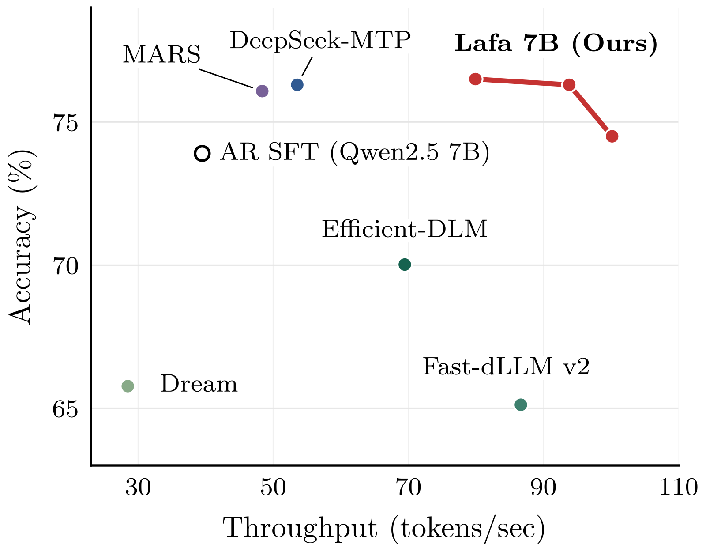
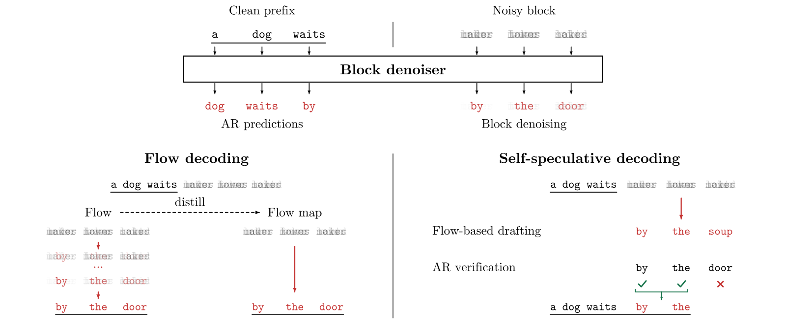
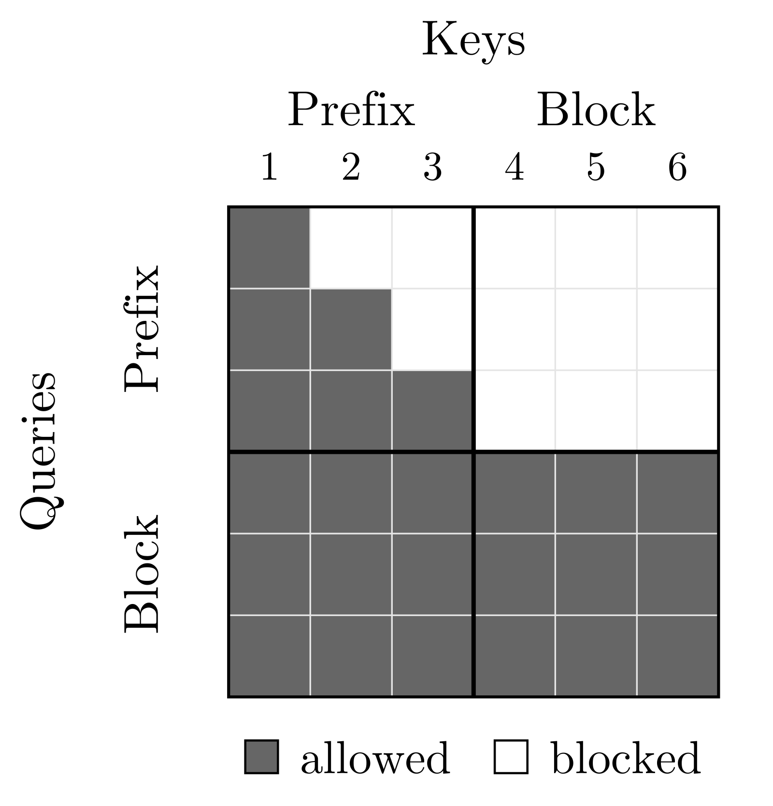
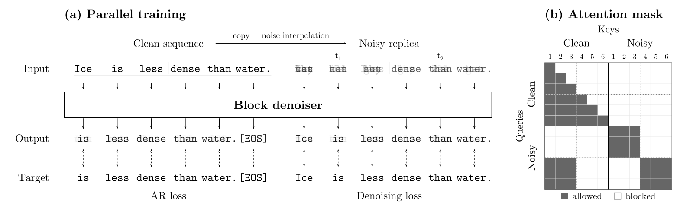
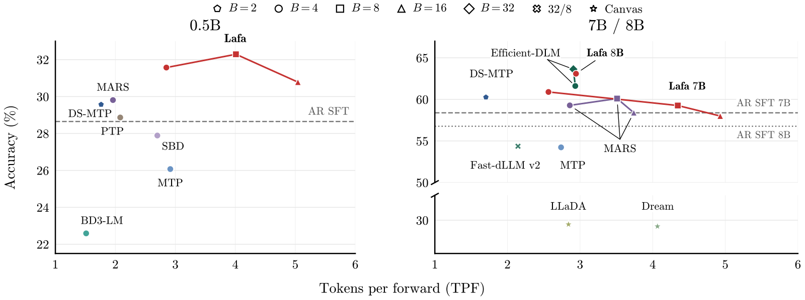
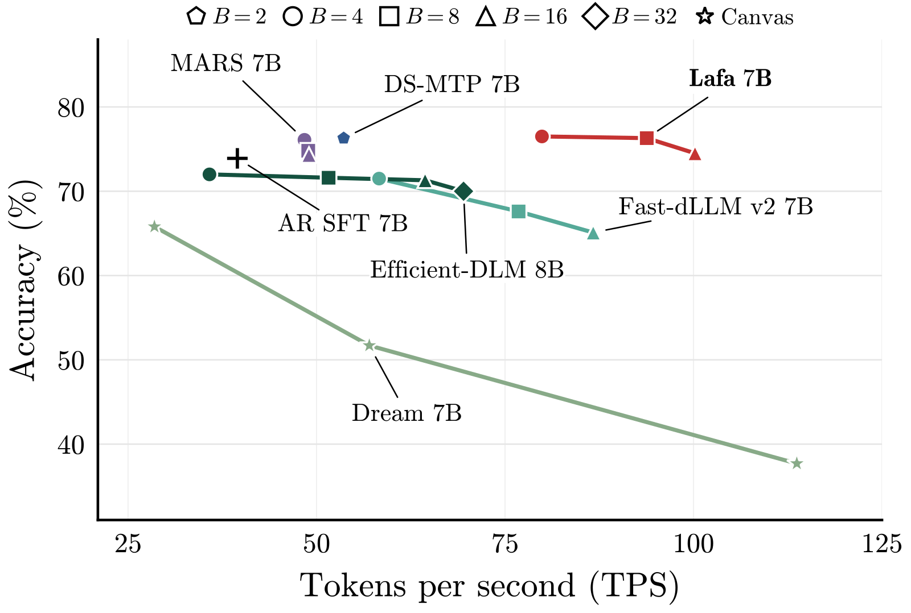

# Large Flow Language Models(Lafa)深度精读

> **论文**:Large Flow Language Models(Lafa)
> **作者**:Arnav Chavan, Chanhyuk Lee, Udbhav Bamba, Jaehoon Yoo, Seunghoon Hong, Aditi Raghunathan, Jinwoo Kim(KAIST / Stanford 等)
> **arXiv ID**:2610.28559
> **发表时间**:2026-10-21
> **许可协议**:Apache 2.0
> **代码仓库**:github.com/lafa-gh/large-flow-lms

## 第 1 章 概述

### 1.1 一句话定位

Lafa 是一套最大 8B 规模的连续流语言模型:将生成分解为「块间自回归、块内异步连续流」,以块级异步流与 AR 权重适配,在 <30B token 训练预算内从预训练 AR 模型(Qwen2.5 0.5B/7B Instruct、Qwen3 8B Base)直接适配出流生成能力,流生成质量匹配乃至超越 AR,并以 self-speculative decoding 实现 2.54× AR 端到端吞吐(7B,B=16,100.2 TPS vs 39.5 TPS)。

### 论文图表总览

| 图表 | 内容 | 报告章节落点 |
|---|---|---|
| 论文 Figure 1 | 质量-速度前沿:Lafa 7B 端到端吞吐 2.02–2.54× AR SFT | 第 1 章、第 6 章 |
| 论文 Figure 2 | Lafa 架构总览:块级异步流 + AR 适配 | 第 1 章、第 3 章 |
| 论文 Figure 3 | attention mask:前缀因果 + 块内双向 | 第 3 章 |
| 论文 Figure 4 | 并行训练示意:clean 前缀与 noisy 块单次前向联合训练 | 第 4 章 |
| 论文 Figure 5 | 学到的 tokenwise time τ 自动呈左→右异步偏置 | 第 3 章 |
| 论文 Figure 6 | flow / flow map 解码的步数-精度曲线 | 第 6 章 |
| 论文 Figure 7 | self-speculative decoding 的 Acc vs TPF | 第 6 章 |
| 论文 Figure 8 | Acc vs TPS 端到端吞吐对比(单卡 H100) | 第 6 章 |
| 论文 Table 1 | 单 token AR 解码六基准平均(0.5B/7B/8B) | 第 6 章 |
| 论文 Table 2 | self-speculative decoding 的 Acc/TPF 全量对比 | 第 6 章 |
| 论文 Table 3 | 消融:注意力类型/时间条件/训练目标/自条件/guidance | 第 6 章 |
| 论文 Table 4 | 超参数:初始化、数据、block size、adaLN、噪声、tokenwise time | 第 7 章 |
| 论文 Table 5 | flow / flow map 解码步数-精度(GSM8K/HumanEval/IFEval 平均) | 第 6 章 |
| 论文 Table 6 | 单 token 解码逐基准明细(六基准) | 第 6 章 |
| 论文 Table 7 | self-spec 逐基准 Acc/TPF(支撑 Figure 7) | 第 6 章 |
| 论文 Table 8 | 7B 端到端吞吐:单卡 H100、bs=1、bfloat16 | 第 6 章 |

注:论文 Figure 9/10(fused decoding、confidence decoding)位于附录,暂不纳入;Figure 5/6 以文字描述其结论。

### 1.2 核心贡献

对应论文 Introduction 的贡献列表,共五条:

1. **块级异步连续流建模范式**:块间 AR 分解(Eq.1)+ 块内连续流匹配(Eq.2–5),流定义在 d 维嵌入空间而非 |V| 维 one-hot 空间,规模可扩展;tokenwise 异步时间 τ 允许块内各 token 各自的去噪进度。
2. **从预训练 AR 模型数据高效地学流**:前缀因果注意力 + 块内双向注意力(复用 AR 权重与 KV cache)、adaLN 时间条件恒等初始化、嵌入范数冻结只学方向、AR 与去噪联合单前向并行训练、τ 从数据学习等一系列设计,使 Qwen2.5/Qwen3 权重可直接初始化,以 <30B token(9–27B token)完成适配,比离散扩散基线少 ≥18×。
3. **多模式推理与加速解码**:Euler 积分流解码(含 self-conditioning 与 prefix guidance)、flow map 蒸馏(semigroup bootstrapping)实现 1–8 步少步生成、self-speculative decoding(流一步草拟 + 保留的 AR 预测器验证,输出与 greedy AR 完全一致)。
4. **0.5B–8B 三档规模的系统验证**:单 token 解码六基准平均全面超过同预算 AR SFT(0.5B/7B/8B 分别 31.6%/60.9%/63.1% vs 28.7%/58.4%/56.8%);flow 解码 7B 128 步 75.7% 超 AR SFT 73.9%。
5. **效率结论**:7B 端到端吞吐 2.02–2.54× AR SFT(B=4 79.9 TPS、B=16 100.2 TPS vs 39.5 TPS);流训练经 MTP 正则效应保持甚至提升 AR 单 token 能力,是 self-speculative decoding 可行的前提。

### 1.3 关键结果速览

- **端到端吞吐(7B,单卡 H100,bs=1,bfloat16)**:Lafa self-speculative decoding B=16 达 100.2 TPS,vs AR SFT 39.5 TPS,即 2.54×,且 Acc 74.5% 不低于 AR SFT 73.9%;B=4 为 79.9 TPS(2.02×,Acc 76.5%),B=8 为 93.8 TPS(约 2.38×,Acc 76.3%)。
- **单 token AR 解码(六基准平均)**:Lafa 0.5B/7B/8B = 31.6%/60.9%/63.1%,同预算 AR SFT = 28.7%/58.4%/56.8%,分别提升 +2.9/+2.5/+6.3 个百分点(8B 组 AR SFT 基于 Qwen3 8B Base,其 IFEval 存在模板口径异常,详见第 6 章);8B 的 63.1% 与训练预算至 500B token 的 Efficient-DLM(63.5%)相当。
- **训练效率**:适配训练 <30B token(正文 5–15 epochs,即 9–27B token),比 Dream/LLaDA/Efficient-DLM 等离散扩散基线少 ≥18×。
- **flow 解码(GSM8K/HumanEval/IFEval 平均)**:7B B=4 Euler 128 步 75.7%,超过 AR SFT 73.9%;64 步 75.9% 为峰值;flow map 蒸馏后 8 步 71.0%、1 步 49.0%。
- **self-speculative decoding(TPF)**:7B B=4 60.9%/TPF 2.6×,B=8 59.3%/TPF 4.3×,B=16 58.0%/TPF 4.9×;输出与 greedy AR 完全一致。



*论文 Figure 1:质量-速度前沿——Lafa 7B 以 2.02–2.54× AR 吞吐(B=4 至 B=16)落在 AR SFT 的右上方,同区间 Dream、Fast-dLLM v2 等基线质量明显下滑。*



*论文 Figure 2:Lafa 总览——块间保持 AR 分解与前缀 KV 复用,块内转为异步连续流去噪,同一模型支持 flow 解码、flow map 少步生成与 self-speculative decoding。*

## 第 2 章 研究背景与动机

### 2.1 AR 生成的序列性瓶颈

自回归(AR)语言模型按链式分解生成:

$$p(y\mid c)=\prod_{i} p\!\left(y^{i}\mid c,\,y^{<i}\right)$$

每个 token 依赖其全部前缀,一次前向只能产出一个 token:生成长 1024 token 即 1024 次串行前向,解码延迟与生成长度线性相关。KV cache 只能消除重复计算,无法消除串行依赖本身;在 memory-bandwidth 受限的单卡推理场景,逐 token 解码的算力利用率极低,长生成指令任务(IFEval、GSM8K、HumanEval)首当其冲。speculative decoding 用轻量模型草拟、AR 模型验证来摊薄前向次数,但加速比受接受率与草拟长度约束(论文中 7B DeepSeek-MTP 的 TPF 为 1.7×),且「验证仍串行」的结构未变。

### 2.2 并行生成的三条路线及其缺陷

**路线一:多 token 预测(MTP)/block-AR。** DeepSeek-MTP、MARS、SBD、BD3-LM、PTP 等让模型一次预测或草拟多个 token,再由 AR 头验证。单 token 质量可以超过 AR SFT(7B DeepSeek-MTP 60.0% vs 58.4%),端到端也有 1.36×(B=2,53.6 TPS vs 39.5 TPS),但生成过程仍是顺序的 draft-verify 循环,吞吐增益有限(7B DeepSeek-MTP TPF 1.7×、MTP 2.7× 量级),并行度受验证接受率约束。

**路线二:离散扩散。** Dream、LLaDA、Fast-dLLM、Efficient-DLM 在离散 token 空间做加噪/去噪,以双向注意力并行生成,理论吞吐高,但代价明显:

- **训练低效、预算高企**:离散去噪目标与 AR 预训练目标差距大,难以复用已有权重,Dream/LLaDA/Efficient-DLM 的训练预算至 500B token 量级,而 Lafa 用 <30B token 达到相当或更高质量(token 用量少 ≥18×)。
- **质量-速度折衷差**:LLaDA 8B 单 token 六基准平均仅 43.5%,远低于同规模 Qwen3 SFT 56.8%;Dream 7B self-spec TPF 4.1× 但 Acc 仅 29.3%,端到端 k=4 时 113.7 TPS 换来 Acc 跌至 37.7%(k=1 时 65.8%);Fast-dLLM v2 同预算对照 7B 仅 49.3%(官方 checkpoint 54.4%),均低于 AR SFT 58.4%;Efficient-DLM B=32 端到端最快配置 95.3 TPS 时 Acc 降至 55.7%。

**路线三:连续扩散/连续流。** CDCD 等工作把扩散/流搬到连续嵌入空间:流匹配可在 d 维嵌入空间而非 |V| 维词表空间定义速度场,信号更平滑、更可扩展,与 AR 模型的 softmax 概率头天然相容。但先前工作停留在小规模模型与简单任务(如文本填充),未在真实大规模指令基准上验证,也没有回答「如何从预训练 AR 权重高效适配」的问题。

### 2.3 Lafa 的切入点

Lafa 的核心判断:并行生成范式的瓶颈不在「并行」本身,而在与 AR 归纳偏置及 AR 基础设施的兼容性。据此做出两个组合选择。

**其一,块级 AR 分解,保留 AR 生态。**

$$p(y\mid c)=\prod_{r} p\!\left(y^{rB+1:(r+1)B}\mid c,\,y^{\le rB}\right)$$

块间仍按顺序生成,前缀使用因果注意力,KV cache 与现有部署栈完全复用;需要变革的只有块内 B 个 token。「前缀因果 + 块内双向」的注意力掩码(论文 Figure 3)使预训练 AR 权重可以被直接初始化流模型,而不是从头训练。

**其二,块内异步连续流,贴近 AR 归纳偏置。** 块内不做同步去噪,而是以 tokenwise time τ 为每个 token 赋予独立去噪进度;τ 不靠手工调度,而是从去噪损失的归一化逆 CDF 学习。学到的时间调度自动呈现左→右异步(论文 Figure 5)——与 AR 的生成顺序一致,正是预训练 AR 权重已内化的知识结构。适配因此只需 <30B token:0.5B 用约 9B token,正文设置 9–27B token,比离散扩散基线少 ≥18×。

两个选择叠加产生额外收益:AR 与去噪的联合训练相当于持续的多 token 预测正则,单 token AR 能力不降反升(0.5B 28.7%→31.6%,7B 58.4%→60.9%),适配后的模型同时是合格的 AR 解码器。这直接支撑 self-speculative decoding:流模型一步草拟一个块、保留的 AR 预测器验证并可在 fused 单次前向中同时验证与重草拟,输出与 greedy AR 完全一致,却在 7B 上取得 2.02–2.54× 端到端吞吐。

## 第 3 章 块异步流的数学建模

### 3.1 块级 AR 分解

Lafa 的生成模型建立在标准 block-autoregressive 分解之上(与 block diffusion 同构):设词表 V、前缀 $\mathbf{c}\in V^{N}$、续写 $\mathbf{y}\in V^{M}$,按块大小 B(B|M)把续写切为 M/B 块:

$$p(\mathbf{y}\mid\mathbf{c})=\prod_{r=0}^{M/B-1}p\!\left(\mathbf{y}^{rB+1:(r+1)B}\mid\mathbf{c},\,\mathbf{y}^{\le rB}\right)$$

- **块间严格保序**:第 r 块以完整前缀 $\mathbf{c}$ 与此前所有已生成块 $\mathbf{y}^{\le rB}$ 为条件,生成顺序仍为左→右,因果生成与跨块前缀 KV cache 全部保留——这是适配预训练 AR 权重(第 4 章)与推理加速(第 5 章)的结构基础。
- **两个极端**:B=1 退化为逐 token 的标准 AR;B=M 退化为整段一次性并行生成。B 是并行度与质量的折衷旋钮(实验配置见第 4 章)。
- 该分解只规定块间依赖;块内条件分布 $p(\mathbf{y}^{rB+1:(r+1)B}\mid\mathbf{c},\mathbf{y}^{\le rB})$ 交给连续流建模,即 3.2–3.4 的内容。



*论文 Figure 3:注意力掩码——干净前缀内部保持因果注意力且不看噪声块;噪声块对块内双向注意、对其之前的全部干净 token 因果注意。前缀 KV 与块状态无关,可跨去噪步与跨块复用。*

### 3.2 嵌入空间 flow matching 与异步插值

**嵌入表示。** 用词表嵌入矩阵 $E\in\mathbb{R}^{|V|\times d}$ 把每个块 $\mathbf{y}\in V^{B}$ 编码为 $\mathbf{x}_1=(E_{y^1},\ldots,E_{y^B})^{\top}\in\mathbb{R}^{B\times d}$:逐 token 维度从 one-hot/simplex 表示的 $|V|$ 降到 $d$($d\ll|V|$),训练与推理都更可扩展。

**概率路径。** 以 flow matching 从高斯噪声 $\mathbf{x}_0\sim\mathsf{N}(0,\sigma^2 I)$(训练时 σ=4.0)构造条件概率路径 $p_t(\cdot\mid\mathbf{c})$,$t\in[0,1]$,终点为嵌入数据分布。

**异步插值。** 标准 flow matching 用共享时间 $t$ 的插值 $I_t=(1-t)\mathbf{x}_0+t\,\mathbf{x}_1$,块内所有 token 同步推进。为贴合文本固有的左→右方向性,Lafa 改用 **tokenwise time** $\tau:[0,1]\to[0,1]^{B}$:可微、每个坐标单调递增,且 $\tau(0)=\mathbf{0}$、$\tau(1)=\mathbf{1}$,把基准时间 $t$ 映为逐位置时间 $\tau^i(t)$,允许早位置先行。概率路径由逐位置插值定义:

$$I_t^i=(1-\tau^i(t))\,x_0^i+\tau^i(t)\,x_1^i,\qquad i\in[B],\qquad I_t\sim p_t(\cdot\mid\mathbf{c}),\qquad t\in[0,1]$$

若对 $i<j$ 恒有 $\tau^i(t)>\tau^j(t)$(早位置进度更快),则插值与生成过程都会先「显影」早位置:AR 的方向性被编码进连续时间轴,而无需把块内也做成自回归。

**速度场。** 对每个 $\mathbf{c}$,概率路径对应速度场 $b_t(\cdot;\mathbf{c}):\mathbb{R}^{B\times d}\to\mathbb{R}^{B\times d}$,把一块噪声经 ODE

$$\dot{x}_t=b_t(x_t;\mathbf{c}),\qquad x_0\sim p_0,\qquad x_t\sim p_t(\cdot\mid\mathbf{c}),\qquad t\in[0,1]$$

输运到干净嵌入;生成即数值积分该 ODE(第 5 章)。

### 3.3 块去噪器与速度恒等式

Lafa 不直接回归速度场,而是学**块去噪器** $D_t(\cdot;\mathbf{c}):\mathbb{R}^{B\times d}\to(\Delta^{|V|-1})^{B}$,逐位置做分类预测:

$$D_t(\mathbf{x};\mathbf{c})^i=p(y^i=\cdot\mid\mathbf{c},\,I_t=\mathbf{x}),\qquad i\in[B]$$

分类形式与 AR 模型的 softmax 头同构,可用交叉熵监督、可直接由预训练 LM 头初始化——这是第 4 章适配的关键。去噪器与速度场由恒等式(Prop A.1)连接:

$$b_t(\mathbf{x},\mathbf{c})^i=\frac{\dot\tau^i(t)}{1-\tau^i(t)}\left(D_t(\mathbf{x},\mathbf{c})^i E-\mathbf{x}^i\right),\qquad t\in[0,1)$$

证明思路(附录 A.1,四步):

1. 对插值求导:$\dot I_t^i=\dot\tau^i(t)(x_1^i-x_0^i)$;
2. 由插值式反解噪声 $x_0^i=(I_t^i-\tau^i(t)x_1^i)/(1-\tau^i(t))$,得 $x_1^i-x_0^i=(x_1^i-I_t^i)/(1-\tau^i(t))$;
3. 速度场是插值导数的条件期望 $b_t(\mathbf{x};\mathbf{c})=\mathbb{E}[\dot I_t\mid\mathbf{c},I_t=\mathbf{x}]$,代入得 $b_t^i=\dot\tau^i(t)/(1-\tau^i(t))\cdot(\mathbb{E}[x_1^i\mid\mathbf{c},I_t=\mathbf{x}]-x^i)$;
4. 由 $x_1^i=E_{y^i}$,条件均值恰为去噪器给出的**后验均值嵌入** $\mathbb{E}[x_1^i\mid\mathbf{c},I_t=\mathbf{x}]=\sum_{v\in V}p(y^i=v\mid\mathbf{c},I_t=\mathbf{x})E_v=D_t(\mathbf{x};\mathbf{c})^iE$。

直观:该式把「噪声输入 $x^i$ → 去噪目标 $D_t^iE$」的方向按 tokenwise 进度速率 $\dot\tau^i(t)/(1-\tau^i(t))$ 缩放,异步节奏完全由 τ 决定;学到 $D_t$ 即同时得到 $b_t$,无需单独的速度回归目标。

### 3.4 tokenwise time 的学习

τ 不手工设定,而是在训练中从去噪损失学习(CDCD 式 loss-aware time warping,逐位置独立进行)。设位置 i 在 tokenwise 时间 τ 的期望去噪交叉熵为 $\ell_i(\tau)>0$,定义归一化损失 CDF $F_i$ 并取其逆:

$$\tau^i(t)=F_i^{-1}(t),\qquad F_i(\tau)=\frac{\int_0^{\tau}\ell_i(r)\,dr}{\int_0^1\ell_i(r)\,dr}$$

机制:$\dot\tau^i\propto 1/\ell_i(\tau^i)$,损失高的噪声区间时间走得慢。于是训练时对基准时间 t 的均匀采样、推理时对 t 的均匀积分网格,都自动把训练样本与积分步集中到最难的噪声水平——时间调度本身成为免费的课程学习。

**在线估计。** 维护逐位置去噪交叉熵的 EMA 直方图 $L\in\mathbb{R}^{B\times M}$:M=200 个均匀时间 bin,初始化为均匀;每 S=100 个优化步,对每个 noisy 块用独立均匀采样的时间做 4 次无梯度前向,对遍历到的位置-bin 对 $(i,m)$ 以 β=0.99 更新 $L_{i,m}\leftarrow\beta L_{i,m}+(1-\beta)\bar L_{i,m}$,未遍历的 bin 保留旧值;每个 $F_i$ 取归一化行 $L_{i,:}$ 的分段线性 CDF。独立均匀估计保证学到的采样分布不会「饿死」低概率区域。

**结果。** 学到的调度普遍满足 $i<j\Rightarrow\tau^i(t)>\tau^j(t)$(论文 Figure 5):块内左→右异步并非手工施加,而是从数据中自发涌现,与 AR 权重已内化的生成顺序一致。

## 第 4 章 从预训练 AR 模型适配与训练

第 3 章的公式化保持因果结构,因此可以把预训练 AR 模型 $f$ 适配为块去噪器 $\hat D_t(\mathbf{x};\mathbf{c})^i:=f_t(\mathbf{x};\mathbf{c})^{N+i}$;核心挑战是「在连续噪声嵌入上并行去噪」与「保留 AR 预测和前缀 KV cache」兼得。适配设置(Table 4):初始化取 Qwen2.5 0.5B/7B Instruct 与 Qwen3 8B Base(8B 的 Instruct 版再训练反而退化,故用 Base);数据为 Dolci-Instruct-SFT,5–15 epochs(约 9–27B token);序列长 512–1024。

### 4.1 adaLN tokenwise time 条件化

- 模型输入为嵌入前缀 $\mathbf{c}$ 拼接噪声块 $\mathbf{x}$,每个位置经 adaLN 以自身噪声水平为条件:前缀位置恒接收时间 1(无噪声),块内位置 i 接收 $\tau^i(t)$。单次前向同时承担前缀的 AR 计算与块内异步去噪。
- adaLN **恒等初始化**:初始时时间条件化不改变预训练计算,适配训练从 AR 权重的原点平滑出发。
- 配置:0.5B 每层独立 adaLN,7B/8B 各层共享;adaLN 学习率为 5.0×(相对主干)。

### 4.2 块内双向注意力

- **块内双向**:部分去噪的晚位置 token 反过来为早位置提供信息,匹配并行去噪(而非顺序解码)的本质。
- **前缀因果且隔离**:噪声块 attend 到其之前的全部干净 token;前缀注意力保持因果、不看噪声块。
- **前缀 KV 可复用**:前缀位置恒以时间 1 条件化,加上前缀注意力与噪声块无关,前缀的 key/value 与块状态 $(\mathbf{x},t)$ 无关,可在块内去噪步之间与跨块之间复用——前缀 KV cache 完整保留。
- **前缀输出保留 AR 角色**:$f_t(\mathbf{x};\mathbf{c})^i$ 对 $i<N$ 预测 $\mathbf{c}^{i+1}$、对 $i=N$ 预测 $y^1$;这些与块无关的预测记作 $f(\mathbf{c})^i$,即第 5 章 self-speculative decoding 用于验证草稿的 AR 预测器。
- 消融(Table 3,0.5B、B=4、32 Euler 步):块内双向 38.0% vs 全因果 32.7%,+5.3 个百分点。

### 4.3 嵌入范数冻结

嵌入 $E$ 从预训练模型初始化,前缀与嵌入流共享,并与去噪器联合训练。风险在于:噪声尺度 σ 固定,而无约束的更新会相对 σ 推高嵌入范数——嵌入变大等效于噪声变小,模型以「有效噪声缩减」的方式让去噪变容易,流质量受损。对策:把每个词嵌入 $E_v$ 的 L2 范数冻结在预训练值,只学习方向——既允许嵌入朝流目标适配,又保住嵌入尺度与噪声尺度的相对关系。

消融(Table 3,同 4.2 设置):范数冻结 38.0% vs 完全冻结 34.4%(无法适配,差 3.6 个百分点)vs 无约束更新 36.9%(有效噪声缩减,差 1.1 个百分点)。

### 4.4 联合损失

对每个训练对 $(\mathbf{c},\mathbf{y})$,采样 $t\sim\mathsf{U}[0,1]$ 与 $\mathbf{x}_0\sim p_0$,由插值式构造 $I_t$(其中 $x_1^i=E_{y^i}$),最小化:

$$\mathcal{L}(\hat D)=\mathbb{E}_{\mathbf{c},\mathbf{y},t,\mathbf{x}_0}\Big[\underbrace{\sum_{i=1}^{N}-\log f(\mathbf{c})^i_{\mathbf{c}^{i+1}}}_{\text{AR 交叉熵}}+\underbrace{\sum_{i=1}^{B}-\log\hat D_t(I_t;\mathbf{c})^i_{y^i}}_{\text{去噪交叉熵}}+\underbrace{\sum_{i=1}^{B}\big|\hat D_t(I_t;\mathbf{c})^iE-E_{y^i}\big|^2}_{\text{嵌入平方误差}}\Big]$$

三个 underbrace 逐项:

1. **AR 交叉熵**:前缀上的标准 next-token 损失;边界约定 $\mathbf{c}^{N+1}:=y^1$,即前缀最后位置预测续写首 token,把 AR 目标与块目标无缝衔接。
2. **去噪交叉熵**:监督块去噪器输出的 token 概率(分类视角),提供词表级别的语义监督。
3. **嵌入平方误差**:监督决定流速度的均值嵌入 $\hat D_t^iE$(速度恒等式中的方向项,回归视角),直接对齐生成所需的几何量。

AR 与去噪预测共享全部 transformer 参数。两个去噪项结合优于任一单项;意外发现是加入 AR 项后流精度进一步提升——保留 AR 能力不以牺牲流生成为代价(消融见第 6 章 6.6 节)。反向地,联合训练相当于持续的多 token 预测(MTP)正则,使单 token AR 精度超过同预算 AR SFT(第 6 章 Table 1),这是 self-speculative decoding 可行的前提。

### 4.5 并行训练

序列各块的前缀高度重叠,逐块训练会重复计算。沿 block diffusion 的做法,把每条干净训练序列与一份划分为大小 B 的噪声块副本配对:干净位置因果注意;每个噪声块只注意其之前的全部干净 token 并在块内双向;不看更晚的干净 token、也不看其他噪声块。单次前向同时产出干净序列的全部 AR 预测与每个噪声块的去噪预测,三项损失一次反传。



*论文 Figure 4:并行训练——clean 序列与其 noisy 块副本拼接为单次前向:clean 部分走因果注意力产出 AR 预测,各 noisy 块走「前缀因果 + 块内双向」掩码产出去噪预测,重叠前缀只计算一次。*

训练配置(Table 4):AdamW,β=(0.9,0.999),权重衰减 0,梯度裁剪 1.0,batch 384 序列,bfloat16;学习率 1×10⁻⁴(0.5B)/1×10⁻⁵(7B、8B),常数调度 + 前 1% 步 warmup;分布式 DDP(0.5B)/ZeRO-3(7B、8B);参数 EMA 0.999(自 step 500 起);块大小 0.5B/7B 为 {4,8,16},8B 为 4。

### 4.6 self-conditioning

- **训练**:每 batch 以固定概率 p=0.5 启用。第一次前向(无梯度)得粗预测,其期望 token 嵌入 $\bar x_1=\mathsf{sg}(D_t(I_t;\mathbf{c})E)$ 经投影层喂回:$\tilde I_t=I_t+I_tW_1^{\top}+\bar x_1W_2^{\top}$,其中 $W_1,W_2\in\mathbb{R}^{d\times d}$ **零初始化**(启用的瞬间仍保持原计算);损失在第二次前向上计算;未启用时单次前向。
- **推理**:流解码的每个 Euler 步直接复用上一步的预测 $q_{k-1}$ 做条件($\tilde x_{t_k}=\hat x_{t_k}+\hat x_{t_k}W_1^{\top}+(q_{k-1}E)W_2^{\top}$,$q_0=D_0(\hat x_0;\mathbf{c})$),不增加任何前向次数——「先粗后精」的两阶段去噪在推理时是免费的。
- 消融(第 6 章 6.6 节)中其增益大于 prefix guidance,且解码时零额外前向。

### 4.7 flow map 蒸馏

流解码每块需要多次去噪器评估。为降低该成本,把学到的流蒸馏为 **flow map** $X_{s,t}$:从时刻 s 直接输运到 t。引入两时间去噪器 $\delta_{s,t}(\mathbf{x};\mathbf{c})\in(\Delta^{|V|-1})^{B}$ 预测 token 概率,经 E 映射后与噪声态插值:

$$X_{s,t}(\mathbf{x};\mathbf{c})^i=\frac{1-\tau^i(t)}{1-\tau^i(s)}\,\mathbf{x}^i+\frac{\tau^i(t)-\tau^i(s)}{1-\tau^i(s)}\,\delta_{s,t}(\mathbf{x};\mathbf{c})^iE,\qquad i\in[B],\quad 0\le s<t\le 1$$

这是对 simplex 值两时间去噪器的新扩展——搬到词表嵌入上的异步流:保留类别预测用于蒸馏,同时在嵌入空间输运状态。由于所有 tokenwise 时间由单一全局时间驱动(一维单调曲线),flow map 恰由两个全局时间 $(s,t)$ 索引。

**蒸馏方案(semigroup bootstrapping)**:

- 学生 $\hat\delta_{s,t}$ 从冻结教师 $\hat D_s$ 初始化,另加一个对目标时间 t 的恒等初始化 adaLN。
- 损失(Eq.20)为三项 KL:**对角项**(s=t)把学生的瞬时去噪匹配到教师 $\hat D_s$;**非对角项**(s≠t)的 stop-gradient 目标由学生自己组合两条更短跃迁自举——$\bar\delta_{s,t}=\mathsf{sg}[\gamma^i\hat\delta_{s,u}(x_s)+(1-\gamma^i)\hat\delta_{u,t}(x_u)]$,$x_u=\hat X_{s,u}(x_s)$,$\gamma^i=\frac{(1-\tau_t^i)(\tau_u^i-\tau_s^i)}{(1-\tau_u^i)(\tau_t^i-\tau_s^i)}$;再加 **AR 蒸馏项** $\mathsf{KL}(f(\mathbf{c})\Vert f^{\hat\delta}(\mathbf{c}))$ 保留前缀 AR 预测。
- **理论保证**:Prop A.2——满足对角条件($\delta_{s,t}\to\hat D_s$,当 t→s)与 semigroup 条件($\delta_{s,t}=\gamma^i\delta_{s,u}+(1-\gamma^i)\delta_{u,t}(X_{s,u})$)的两时间去噪器,由上式定义的流映射必等于真流映射 $X_{s,t}$;Prop A.3——两个流 map KL 项的总体目标最小值为零,且每个总体最小化子都恢复教师流映射(AR 项只依赖前缀读出,不改变最小化子)。短跃迁组合长跃迁的 bootstrapping 一路外推到一步生成 $\hat X_{0,1}$。
- 学生保留前缀 KV cache,支持少至 1 步的块生成;遗留问题:蒸馏尚未纳入 self-conditioning 与 prefix guidance(第 5 章),是论文自陈的改进方向。

## 第 5 章 推理方案:从多步流到自投机解码

第 3–4 章学到的块去噪器 $\hat D_t$ 与保留的 AR 预测器 $f$ 在推理端组成一个方案家族:多步 flow 解码(质量上限)、flow map 少步解码(蒸馏加速)、self-speculative decoding(一步 draft + AR 验证,无损,默认方案)与 confidence decoding(阈值接受,附录 C.3)。全部方案共享同一基础设施:复用前缀 key-value(KV)cache,并在提交新 token 后扩展。

### 5.1 flow 解码:K 步 Euler 积分

从 $\hat{\mathbf{x}}_0\sim p_0$ 出发(推理噪声 σ=0.1,训练为 4.0,Table 4),在基准时间网格 $t_k=k/K$ 上做 K 步 Euler 积分;网格经 tokenwise time 诱导异步时间格 $\tau(t_k)\in[0,1]^B$。记 $\mathbf{p}_k:=\hat D_{t_k}(\hat{\mathbf{x}}_{t_k};\mathbf{c})$,更新式(Eq.8):

$$\hat{\mathbf{x}}_{t_{k+1}}^i=\hat{\mathbf{x}}_{t_k}^i+\frac{\tau^i(t_{k+1})-\tau^i(t_k)}{1-\tau^i(t_k)}\left(\mathbf{p}_k^iE-\hat{\mathbf{x}}_{t_k}^i\right),\qquad \hat{y}^i=\mathsf{argmax}\left(\mathbf{p}_{K-1}^i\right),\qquad i\in[B]$$

- 每步把状态沿「噪声 → 去噪均值嵌入 $\mathbf{p}_k^iE$」方向推进,步长由 tokenwise 时间增量 $\frac{\tau^i(t_{k+1})-\tau^i(t_k)}{1-\tau^i(t_k)}$ 逐位置给出;块内最终 token 由最后一步预测的 argmax 决定。
- 均匀网格 $t_k$ 配合从数据学到的 τ(第 3 章 3.4):损失高的噪声区间 τ 走得慢,积分步自动集中到最难的噪声水平——时间调度本身就是积分器。
- **self-conditioning(零额外前向)**:每个 Euler 步复用上一步的预测做条件(Eq.25):

$$\tilde{\mathbf{x}}_{t_k}=\hat{\mathbf{x}}_{t_k}+\hat{\mathbf{x}}_{t_k}W_1^{\top}+(\mathbf{q}_{k-1}E)\,W_2^{\top},\qquad \mathbf{q}_k=\hat D_{t_k}(\tilde{\mathbf{x}}_{t_k};\mathbf{c}),\qquad \mathbf{q}_0=\hat D_0(\hat{\mathbf{x}}_0;\mathbf{c})$$

其中 $W_1,W_2$ 零初始化(第 4 章 4.6)。上一步的预测 $\mathbf{q}_{k-1}$ 即条件输入,不增加任何前向次数。
- **prefix guidance(每步 +1 次轻量评估)**:类比 classifier-free guidance(视频扩散的 history guidance),用无前缀评估外推前缀条件的影响(Eq.27):

$$D_t^g(\mathbf{x};\mathbf{c})=D_t(\mathbf{x};\varnothing)+g\left(D_t(\mathbf{x};\mathbf{c})-D_t(\mathbf{x};\varnothing)\right),\qquad g\ge 1$$

$g=1$ 复原常规预测,$g>1$ 改变速度场从而改变采样分布;推理取 g=8.0。$D_t^gE$ 替换(self-conditioned)Euler 步中的 $\mathbf{p}_kE$。额外成本是每步一次 $D_t(\mathbf{x};\varnothing)$——无前缀可 attend,只需处理 B 个块 token,开销远小于带前缀的评估。

### 5.2 flow map 解码:蒸馏跃迁替代 Euler 步

第 4 章 4.7 蒸馏出的两时间去噪器 $\hat\delta_{s,t}$ 把「一步 Euler」换成「一次学习到的跃迁」:在 Eq.8 中以 $\hat\delta_{t_k,t_{k+1}}$ 替代 $\hat D_{t_k}$(Eq.9):

$$\hat{\mathbf{x}}_{t_{k+1}}=\hat X_{t_k,t_{k+1}}(\hat{\mathbf{x}}_{t_k};\mathbf{c}),\qquad \hat{y}^i=\mathsf{argmax}\left(\hat\delta_{t_{K-1},1}\left(\hat{\mathbf{x}}_{t_{K-1}};\mathbf{c}\right)^i\right),\qquad i\in[B]$$

- K=1 即**一步块生成**:一次 $\hat X_{0,1}$ 前向直接从噪声到 token。
- flow map 解码不含 self-conditioning 与 prefix guidance——蒸馏目标(Eq.20)未纳入两者,论文自陈为遗留方向(见 8.1);少步区间的精度增益与残余差距的量化见第 6 章(Table 5)。

### 5.3 self-speculative decoding:一步 flow draft + AR 验证

flow 解码要 K 次去噪评估才出一块,而草稿只需一次:用单个 Euler 步(**不用 prefix guidance**)draft 一块。由 $\tau^i(0)=0$、$\tau^i(1)=1$,从 $t_0=0$ 直达 $t_1=1$ 的单步 Euler 更新系数为 1,步后状态恰为预测均值嵌入,整个 draft 退化为**单次去噪器评估**(Eq.10):

$$\mathbf{p}^i=\hat D_0\left(\hat{\mathbf{x}}_0;\mathbf{c}\right)^i,\qquad \hat{\mathbf{x}}_1^i=\mathbf{p}^iE,\qquad \hat{y}^i=\mathsf{argmax}\left(\mathbf{p}^i\right),\qquad i\in[B]$$

(单步情形没有「上一步预测」可复用,self-conditioning 不参与。)

一步并行出块的位置之间可能不一致,用**联合训练保留的 AR 预测器 $f$**(第 4 章 4.2)按 greedy 验证:

- 提交与 greedy AR 预测一致的最长 draft 前缀 $\hat{\mathbf{y}}^{1:a}$;
- 若首 token 即不一致,改提交 $\mathsf{argmax}(f(\mathbf{c})^N)$——每轮至少前进 1 个 token,不会卡死;
- **无损性**:输出与 $f$ 的 greedy AR 解码**逐 token 严格一致**。greedy 验证下「最长一致前缀 + 不一致处回退到 AR 预测」精确重构 greedy 轨迹,不需要标准 speculative decoding 的采样/拒绝校正项——draft 质量只影响速度,不影响输出。

「self-」的含义:草稿器($\hat D_0$)与验证器($f$)是**同一模型的两类读出**(块位置去噪 vs 前缀位置 AR),无需独立小模型或额外草稿头。可行前提是联合训练经 MTP 效应保留甚至提升 AR 能力(第 6 章 Table 1)。

### 5.4 fused decoding:单次前向完成验证 + 再起草

朴素 self-spec 每块需要「一次验证前向 + 一次 redraft 前向」。fused 方案(附录 B.3、Algorithm 4)把两者合并:每步给定前缀 $\mathbf{c}$、前缀 AR 预测 $\mathbf{q}=f(\mathbf{c})$ 与上一 draft $\mathbf{p}$(块 $\hat{\mathbf{y}}=\mathsf{argmax}$),单次前向同时完成对上一 draft 的验证与下一候选的生成。

- **首 token 验证免费**:直接比较 $\hat{y}^1$ 与已有的 $\mathbf{q}^N$,无需任何计算。若不一致,以 $\mathsf{argmax}(\mathbf{q}^N)$ 替换 $\hat{y}^1$、接受 a=1,评估 $D_0(\mathbf{z};\mathbf{c}\oplus\hat{y}^1)$ 起草下一块(同时产出扩展前缀的 AR 预测 $f(\mathbf{c}\oplus\hat{y}^1)$)。
- **一致时构造 fused 前向**:输入为 clean 前缀 $\mathbf{c}\oplus\hat{\mathbf{y}}$ 拼接 B 个噪声后继块 $\mathbf{z}^{(1)},\ldots,\mathbf{z}^{(B)}\sim\mathsf{N}(0,\sigma^2I)$(各 $B\times d$)。注意力掩码:前缀对自身因果(其输出即验证 logits $f(\mathbf{c}\oplus\hat{\mathbf{y}})$);第 j 个噪声块块内双向、对候选前缀 $\mathbf{c}\oplus\hat{\mathbf{y}}^{1:j}$ 因果——**第 j 块恰好是「接受长度为 j」条件下的下一块草稿**。tokenwise time 设定:前缀条件 1,全部噪声块条件 0。单次前向处理 clean 前缀（长 N+B）拼接 B 个噪声块（共 $B^2$ 个噪声 token），以计算宽度换取并行。
- **接受长度**(Eq.28;首 token 已免费验证,此处校验块内衔接):

$$a=\max\left\{j\in[B]\,:\,\hat{y}^{i+1}=\mathsf{argmax}\left(f\left(\mathbf{c}\oplus\hat{\mathbf{y}}\right)^{N+i}\right)\ \ \text{for every}\ \ 1\le i<j\right\}$$

- **redraft 免费**:直接取 $\mathbf{z}^{(a)}$ 对应的输出,其计算与 $D_0(\mathbf{z}^{(a)};\mathbf{c}\oplus\hat{\mathbf{y}}^{1:a})$ 完全相同,免去单独 redraft 前向。下一步在扩展前缀 $\mathbf{c}\oplus\hat{\mathbf{y}}^{1:a}$、新 draft、以及可截取的 AR 预测 $f(\mathbf{c}\oplus\hat{\mathbf{y}}^{1:a})=f(\mathbf{c}\oplus\hat{\mathbf{y}})^{1:N+a}$ 上继续;前缀 KV cache 复用,验证通过部分的 KV 状态亦保留(附录 C.2),避免单独的 redrafting 前向。

### 5.5 confidence decoding:阈值接受(附录 C.3)

替代 AR 验证的方案(沿用 MARS 的规则):接受一步 draft 中置信度逐位置达阈值的最长左→右前缀,即 $(\mathbf{p}^i)_{\hat{y}^i}\ge\lambda$(保底 a≥1):

- 在 fused 框架下实现时,a 在前向之前已知,只需备 $\mathbf{z}^{(a)}$ 一个块(而非 B 个),每步更省;
- 代价是**精度换速度**:接受不再保证与 greedy AR 一致,λ 调低则精度下滑。论文 Figure 10(附录)扫描阈值:0.5B 上 Lafa(B=4)峰值精度为全部方法最高(含 AR SFT),高阈值下不低于纯 AR;7B 高阈值区间超过 AR SFT(专为 confidence 解码训练的 MARS 低阈值退化更平缓);8B 全测试区间高于 AR SFT、与 Efficient-DLM 相当;
- AR 验证在低阈值区间无退化且免调阈值,故正文默认 self-spec,confidence decoding 移至附录(代码配置:gen_mode="flow"、num_steps=1、threshold≈0.9、self_cond=False)。

### 5.6 小结与并行度度量

方案谱系:**flow 解码**(K 步,质量上限,每步 1 次带前缀评估 + 1 次无前缀评估)→ **flow map**(1–few 步蒸馏跃迁,尚无 SC/guidance)→ **self-spec**(一步 draft + AR 验证 + fused 前向,无损,默认)→ **confidence**(阈值接受,更快但有损)。四者统一在前缀 KV cache 之上。

并行度用 **TPF(tokens per forward,Eq.29)**度量:

$$\text{TPF}=\frac{\sum_j T_j}{\sum_j F_j}$$

其中 $T_j$ 为样例 j 提交的 token 数,$F_j$ 为前向次数;**AR 解码按定义恒为 1**。对 Lafa(与 Efficient-DLM),$F_j$ 计入 fused 验证+redraft 前向及初始 drafting 的一次前向,不含 prompt prefill(Efficient-DLM 另不含 cache 刷新);Fast-dLLM v2 则计入顶层去噪、prefill 与 cache 更新前向。TPF 是硬件无关的算法并行度;端到端 wall-clock 吞吐(TPS,单卡 H100)与 2.02–2.54× 的结论见第 6 章。



*论文 Figure 7:self-speculative decoding 的精度–TPF 前沿。7B 上 B 从 4 增至 16,TPF 从 2.6 升至 4.9,精度保持接近或高于 AR SFT;对照 MTP、DeepSeek-MTP、MARS、Fast-dLLM v2、Dream、LLaDA、Efficient-DLM 的逐基准数值见第 6 章 Table 2。*


## 第 6 章 实验结果与分析

### 6.1 实验设置

**模型与数据**。Lafa 在 0.5B 与 7B 尺度上分别适配 Qwen2.5 0.5B/7B Instruct；8B 尺度改用 Qwen3 8B Base——论文实测发现对 Qwen3 8B 的深度后训练版本（Instruct）继续训练会导致性能退化。全部模型在 Dolci-Instruct-SFT 上训练 5–15 epochs（约 9–27B tokens），比 Dream、LLaDA、Efficient-DLM 在可比规模下报告的训练预算（最高 500B tokens）**至少少 18×**。0.5B 用于消融，7B 用于主结果，8B 用于规模对齐对比。

**基线**。0.5B：MTP、DeepSeek-MTP、MARS、SBD、BD3-LM、PTP；7–8B 额外对比 Fast-dLLM v2、Dream、LLaDA、Efficient-DLM。带 † 的基线由作者用与 Lafa 相同的 AR 初始化、数据与训练预算复现（受控对比），其余使用官方发布 checkpoint。

**基准**。六项生成任务：IFEval（0-shot，prompt-level strict）、BBH（3-shot）、MMLU-Pro（0-shot）、GPQA（0-shot）、GSM8K（0-shot）、HumanEval（0-shot，pass@1）。全部经 lm-evaluation-harness 评测，生成长度上限 1024 tokens（GSM8K 512、HumanEval 640）。

### 6.2 单 token AR 解码：流训练提升 AR 能力（论文 Table 1）

联合流训练不仅没有破坏 AR 能力，反而因 multi-token prediction 效应**提升**了单 token 解码精度：

| 方法 | 0.5B（%） | 7B（%） | 8B（%） |
|:-----|:---:|:---:|:---:|
| AR SFT† | 28.7 | 58.4 | 56.8 |
| MTP† | 25.9 | 53.9 | – |
| DeepSeek-MTP† | 30.2 | 60.0 | – |
| MARS† | 30.4 | 59.7 | – |
| SBD† | 27.6 | – | – |
| BD3-LM† | 22.8 | – | – |
| Fast-dLLM v2† | – | 49.3 | – |
| Fast-dLLM v2（官方） | – | 54.4 | – |
| Dream | – | 55.6 | – |
| LLaDA | – | – | 43.5 |
| Efficient-DLM | – | – | 63.5 |
| **Lafa（本文）†** | **31.6** | **60.9** | 63.1 |

（六基准平均；8B 行 AR SFT 基于 Qwen3 8B Base，其 IFEval 仅 38.1%，与 7B 行的 Qwen2.5 SFT 73.8% 差距明显——论文未解释该差异，报告推断主要来自评测模板/提示格式口径差异，跨行比较需谨慎。）

Lafa 在 0.5B 与 7B 上同时超过受控复现的全部并行解码基线与 AR SFT；8B 上与 Efficient-DLM（63.5%）接近（63.1%），但训练 token 少至少 18×。逐基准看（论文 Table 6），7B Lafa 为 IFEval 78.9 / BBH 63.0 / MMLU-Pro 41.8 / GPQA 31.0 / GSM8K 73.8 / HumanEval 76.8，相对 Qwen2.5 SFT（73.8/59.2/41.6/27.9/69.1/78.7）在 IFEval、BBH、GPQA、GSM8K 上提升，MMLU-Pro 基本持平，HumanEval 略降。

### 6.3 Flow / flow map 解码：步数-精度-块大小权衡（论文 Table 5）

纯流解码需要多次积分步才能逼近 AR 质量。以 GSM8K/HumanEval/IFEval 三基准平均衡量：

| 尺度 | 块大小 B | Euler 1 步 | 8 步 | 32 步 | 128 步 | AR SFT |
|:-----|:---:|:---:|:---:|:---:|:---:|:---:|
| 0.5B | 4 | 20.8 | 31.8 | 38.1 | 37.1 | 38.6 |
| 7B | 4 | 43.7 | 71.2 | 75.2 | 75.7 | 73.9 |
| 7B | 16 | 14.2 | 57.3 | 66.5 | 67.2 | 73.9 |

规律：积分步数增加精度单调改善；7B B=4 在 64 步达峰 75.9%、128 步 75.7%，**超过 AR SFT 的 73.9%**；固定步数下更大的块以精度换并行度。Flow map 蒸馏（B=4）显著改善少步区间：7B 上 1 步 49.0%、2 步 63.3%、4 步 69.4%、8 步 71.0%（2 步学生已接近 4 步 teacher，4 步学生反超同步数 teacher，8 步与 teacher 精度相当），但相对多步流解码仍有质量差距——论文明确将 self-conditioning 与 prefix guidance 的蒸馏纳入列为 future work。

### 6.4 Self-speculative 解码：并行度（论文 Table 2/7）

自投机解码的输出与 greedy AR 严格一致，精度损失只来自块级 checkpoint 的训练差异。六基准平均精度与每前向提交 token 数（TPF）：

| 方法 | B | 0.5B Acc（%）/TPF | 7B Acc（%）/TPF | 8B Acc（%）/TPF |
|:-----|:---:|:---:|:---:|:---:|
| AR SFT | – | 28.7 / 1.0 | 58.4 / 1.0 | 56.8 / 1.0 |
| MTP† | 4 | 26.1 / 2.9 | 54.2 / 2.7 | – |
| DeepSeek-MTP† | 2 | 29.6 / 1.8 | 60.3 / 1.7 | – |
| MARS | 4–16 | 29.8 / 2.0 | 58.4–60.1 / 2.9–3.7 | – |
| BD3-LM† | 4 | 22.6 / 1.5 | – | – |
| Fast-dLLM v2 | 32/8 | – | 54.4 / 2.1 | – |
| Dream | Canvas | – | 29.3 / 4.1 | – |
| LLaDA | Canvas | – | – | 29.5 / 2.8 |
| Efficient-DLM | 4–32 | – | – | 61.6–63.6 / 2.9 |
| **Lafa** | 4 | 31.6 / 2.9 | 60.9 / 2.6 | 63.1 / 2.9 |
| **Lafa** | 8 | 32.3 / 4.0 | 59.3 / 4.3 | – |
| **Lafa** | 16 | 30.8 / 5.0 | 58.0 / 4.9 | – |

要点：0.5B 上 Lafa B=8 的 TPF 约为 DeepSeek-MTP/MARS/PTP 的 2 倍且平均精度更高；7B 上块大小从 4 增至 16 近乎翻倍 TPF（2.6→4.9）而精度保持接近 AR SFT；8B 上与 Efficient-DLM 精度、TPF 相当但训练 token 少至少 18×。全尺度 Lafa 落在约 2.5–5 TPF 区间。

### 6.5 端到端吞吐：2.54× AR（论文 Table 8 / Figure 8）

单卡 H100、batch size 1、bfloat16、32-token warm-up，各方法使用原生解码器，IFEval/GSM8K/HumanEval 平均：

| 方法 | 设置 | 平均精度（%） | 平均吞吐（TPS） |
|:-----|:---|:---:|:---:|
| AR SFT（Qwen2.5 7B） | – | 73.9 | 39.5 |
| DeepSeek-MTP | B=2 | 76.3 | 53.6 |
| MARS | B=4/8/16 | 76.1 / 74.8 / 74.3 | 48.4 / 48.9 / 49.0 |
| Fast-dLLM v2 | B=16 | 65.1 | 86.7 |
| Efficient-DLM | B=32（阈值 0.7） | 70.0 | 69.5 |
| Efficient-DLM | B=32（阈值 0.6） | 65.4 | 79.9 |
| Efficient-DLM | B=32（阈值 0.5） | 55.7 | 95.3 |
| Dream | k=1/2/4 | 65.8 / 51.7 / 37.7 | 28.5 / 57.0 / 113.7 |
| **Lafa 7B** | **B=16** | **74.5** | **100.2** |
| Lafa 7B | B=8 | 76.3 | 93.8 |
| Lafa 7B | B=4 | 76.5 | 79.9 |



*图8：精度-端到端吞吐前沿。Lafa B=16 以 100.2 TPS（AR SFT 39.5 的 2.54×）保持 74.5% 精度，B=4 以 2.02× 吞吐同时平均精度更高（76.5% vs 73.9%），前沿严格优于 DeepSeek-MTP/MARS（≤1.4×）与全部扩散基线。*

$$\text{加速比}=\frac{100.2\ \text{TPS}}{39.5\ \text{TPS}}\approx 2.54\times$$

关键观察：MTP 系（DeepSeek-MTP、MARS）精度达标但加速上限 1.4×；扩散系（Fast-dLLM v2、Efficient-DLM、Dream）要达到更高吞吐必须大幅牺牲精度（Efficient-DLM 95.3 TPS 时精度跌至 55.7%，Dream 113.7 TPS 时仅 37.7%）；Lafa 是唯一在"≈AR 精度"约束下突破 2× 吞吐的方法。Confidence decoding（置信度阈值接受，附录 C.3/Figure 10）在 0.5B 峰值精度为全部方法最高、8B 全阈值区间高于 AR SFT，但低阈值下退化快于 MARS，故正文默认 AR 验证的自投机方案。


*图7：自投机解码的精度-TPF 前沿（六基准平均）。Lafa 在三个尺度上均落在 AR SFT 右上方或右侧——即并行度提升不以精度为代价。*

### 6.6 消融实验（论文 Table 3，0.5B，B=4，32 Euler 步）

| 配置 | 平均精度（%） |
|:-----|:---:|
| Fully causal attention | 32.7 |
| **Block-bidirectional attention** | **38.0** |
| Synchronous time | 36.2 |
| **Asynchronous tokenwise time** | **38.0** |
| Frozen embeddings | 34.4 |
| Unconstrained training | 36.9 |
| **Norm-frozen training** | **38.0** |
| Denoising CE only | 33.6 |
| Denoising MSE only | 29.7 |
| CE & MSE | 35.8 |
| **CE & MSE + AR** | **38.0** |
| No self-conditioning | 32.3 |
| **Self-conditioning** | **38.1** |
| No guidance | 34.3 |
| **Prefix guidance** | **38.1** |

四个训练侧选择（块内双向注意力、异步 tokenwise time、嵌入范数冻结、AR+CE+MSE 联合损失）与两个推理侧选择（self-conditioning、prefix guidance）各自贡献 +1.1～+5.8 个百分点。其中双向注意力（+5.3 pp）与 self-conditioning（+5.8 pp）增益最大；AR 监督不仅不损害流精度反而 +2.2 pp（35.8→38.0），是"保留 AR 能力"与"流质量"双赢的直接证据。

## 第 7 章 代码实现详解

### 7.1 仓库结构

官方实现位于 `github.com/lafa-gh/large-flow-lms`（Apache-2.0），根目录三个训练入口与论文三个阶段一一对应：

```
large-flow-lms/
├── train_ar.py          # AR SFT 基线（Stage 0：参考模型）
├── train_flow.py        # 块异步流训练（AR 适配 + 联合损失）
├── train_distill.py     # flow map 蒸馏（semigroup bootstrapping）
├── src/                 # 模型与训练核心实现
├── config/              # 各尺度训练配置
├── scripts/ docs/ tests/
└── docs/{inference,training,distillation,evaluation}.md
```

模型权重（lafa-0.5B/7B/8B）发布于 HuggingFace `lafa-hf`。推理端通过 `gen_mode` 切换四种解码（以下配置来自官方仓库 README，非论文正文）：AR（`"ar"`）、多步 Euler 流（`"flow"`）、自投机（`"speculative"`）、置信度阈值（`"flow"` + `num_steps=1` + `threshold=0.9` + `self_cond=False`）。

### 7.2 训练超参数（论文 Table 4）

| 项 | Lafa 0.5B | Lafa 7B | Lafa 8B |
|:-----|:---|:---|:---|
| 初始化 | Qwen2.5 0.5B Instruct | Qwen2.5 7B Instruct | Qwen3 8B Base |
| 训练数据 | Dolci-Instruct-SFT / 5 epochs / 约 9B tokens | 同左 | 同左 |
| 块大小 B | 4, 8, 16 | 4, 8, 16 | 4 |
| 最大序列长 | 512–1024 | 512–1024 | 512 |
| adaLN | Per-layer | 跨层共享 | 跨层共享 |
| 学习率 | 1×10⁻⁴ | 1×10⁻⁵ | 1×10⁻⁵ |
| 优化器 | AdamW（β₁,β₂)=(0.9,0.999)，常数学习率 + 前 1% warmup | 同左 | 同左 |
| batch size / 精度 | 384 序列 / bfloat16 | 同左 | 同左 |
| 分布式 | DDP | ZeRO-3 | ZeRO-3 |
| 训练噪声 σ | 4.0 | 4.0 | 4.0 |
| self-cond 概率 p_sc | 0.5 | 0.5 | 0.5 |
| adaLN 学习率倍率 | 5.0 | 5.0 | 5.0 |
| 参数 EMA | 0.999（step 500 起） | 同左 | 同左 |
| tokenwise time 直方图 | M=200 bins，EMA β=0.99，每 100 步更新 | 同左 | 同左 |
| 推理噪声 σ / guidance g | 0.1 / 8.0 | 0.1 / 8.0 | 0.1 / 8.0 |

值得注意的工程细节：训练噪声 σ=4.0 而推理 σ=0.1 的分离（嵌入范数冻结保证两者在范数尺度上兼容）；adaLN 学习率 5 倍放大加速新增条件层的收敛；tokenwise time 直方图用无梯度的独立均匀采样前向（每 S=100 步 4 次）在线估计，避免学习型采样分布"饿死"低概率时间区间。


## 第 8 章 局限性与延伸阅读

### 8.1 局限性

1. **flow map 蒸馏不完整**:蒸馏目标(Eq.20)未纳入 self-conditioning 与 prefix guidance,而两者恰是多步 flow 解码的主要增益来源(第 6 章 6.6 节消融:分别 +5.8、+3.8 个百分点)。flow map 在 1–2 步区间改善明显,但相对多步 flow 仍有质量差距:7B 上 flow map 最好成绩(8 步 71.0%)仍低于 flow 解码峰值(64 步 75.9%,GSM8K/HumanEval/IFEval 三基准平均)。把两者纳入蒸馏是论文自陈的首要遗留方向。
2. **评测口径敏感性**:8B 组 Qwen3 SFT 的 IFEval 仅 38.1%,远低于 0.5B/7B 组 SFT 的 48.4%/73.8%,也低于同组 Lafa 的 62.3%。该异常指向 IFEval(prompt-level strict 口径)对提示模板/格式的敏感性;单一基准把 8B AR SFT 六基准平均拉至 56.8%,使 8B 组的组内对比弱于 0.5B/7B 组,跨方法比较时需注明口径。
3. **适配起点受限**:8B 用 Qwen3 8B **Base** 而非 Instruct 初始化——重度后训练的 Instruct checkpoint 再训练反而退化。适配预训练 AR 权重对后训练程度的容忍有边界,流适配方案在强指令对齐模型上的稳健性未验证。
4. **精度–并行度权衡贯穿块大小 B 与步数 K**:固定步数下更大块以精度换并行(0.5B、128 步:B=4 37.1% vs B=16 31.0%,三基准平均);flow 解码需足够积分步数才追平/超越 AR;self-spec 中 B 从 4→16,7B 六基准平均 60.9%→58.0%(TPF 2.6→4.9)。最优工作点依赖任务与延迟预算,没有单一默认。

### 8.2 延伸阅读

- **CDCD**(Dieleman et al.,连续扩散语言模型):嵌入空间连续生成与 loss-aware time warping,Lafa 的 tokenwise time 学习(Eq.22)直接承自此;也是「连续表示替代 one-hot/离散」路线的源头。
- **BD3-LM**(block diffusion):块间 AR、块内迭代去噪、前缀缓存的结构原型;Lafa 把块内去噪换成连续异步流,并与 AR 适配、联合训练耦合(同预算对照训练中 BD3-LM 0.5B 六基准平均仅 22.8%)。
- **Dream / LLaDA / Efficient-DLM**(离散扩散规模化):掩码式离散扩散在 7–8B 的代表。Efficient-DLM 8B 单 token 精度 63.5% 与 Lafa 63.1% 相当,但训练预算至 500B token(≥18× 于 Lafa);Dream/LLaDA 六基准平均 55.6%/43.5%,明显掉队。三者依赖置信度/熵解码,Lafa 用 AR 验证保分布一致。
- **DeepSeek-MTP / MARS**(block-AR 并行解码):MTP 辅助头出草稿、按 greedy AR 或置信度提交,是 self-spec 的直接同类。MARS 的置信度阈值接受规则即 5.5 的 confidence decoding;Lafa 的差异在于草稿来自连续流去噪器,且草稿器与验证器共享全部参数(无需独立 MTP 模块)。
- **flow matching 与 flow map 理论**:Lipman 等的概率路径/速度场框架(Eq.2–3 的基础);两时间去噪器与 semigroup 蒸馏给出少步 flow map 的学习理论,Lafa 的 Prop A.2/A.3 把它从 simplex 值同步流扩展到嵌入空间异步流。

### 8.3 对领域的启示

- **连续流与 AR 互补而非替代**:流提供并行草稿能力,AR 提供验证与兜底;self-speculative decoding 把两者装进同一模型,得到与 greedy AR 严格一致的输出加 2.54× 吞吐(B=16:100.2 vs 39.5 TPS,单卡 H100)。并行生成不必以牺牲分布保真为代价——「并行草稿 + 精确验证」对离散扩散与独立采样 MTP 头的少步质量塌缩是普适解法。
- **AR 适配是流模型规模化的数据效率关键**:对齐 AR 的因果结构(块间因果、前缀 KV 复用、嵌入共享、恒等初始化的时间条件)使 <30B token 把连续流推到 8B 规模,较离散扩散规模化路线省 ≥18× token。从 AR 模型学流、而非从零训练流,是通往实用规模流语言模型的路径。
- **训练目标的耦合决定推理上限**:流训练作为持续多 token 预测正则,反向提升 AR 精度(7B:60.9% vs AR SFT 58.4%),使无损 self-spec 拥有强验证器。推理方案的可行性根植于训练方案——这是「联合损失 + 保留 AR 读出」设计的回报,也是后续流语言模型工作的样板。
