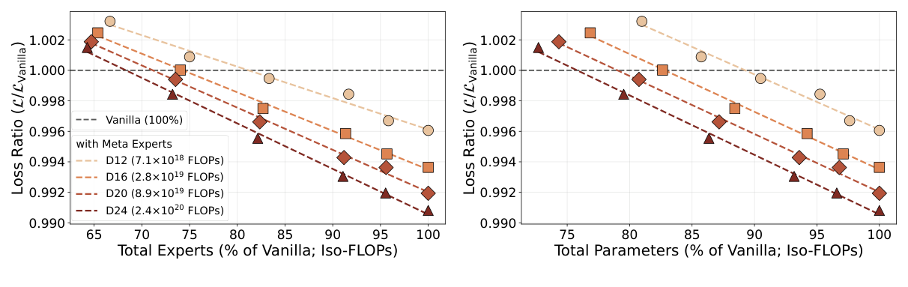
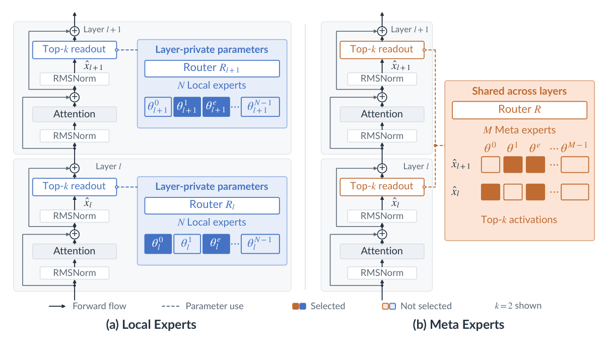
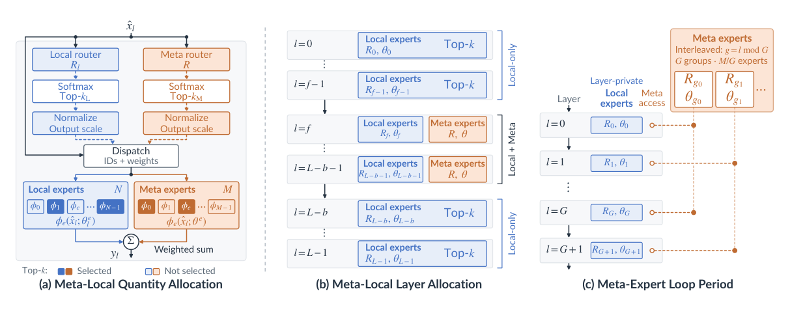
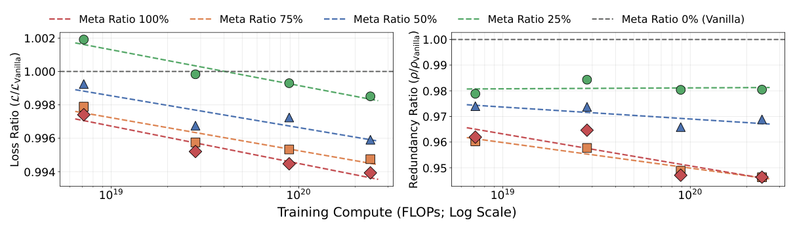
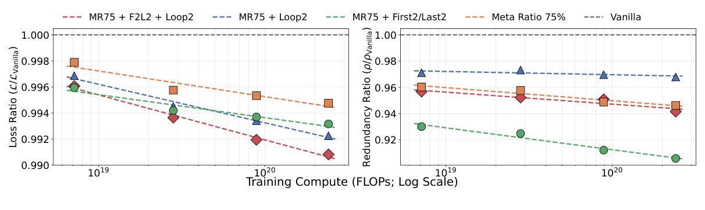

# Meta Expert 论文精读报告
> **论文**：Meta Expert: Cross-Layer Expert Sharing for Storage- and Retrieval-Efficient MoE
> **作者**：Ermo Hua, Xiangyu Hong, Baiting Wu, Che Jiang, Haozheng Hou, Yicheng Gu, Hanjing Wang, Qirui Zeng, Ming Zhang, Ning Ding, Qipeng Guo, Youbang Sun, Biqing Qi, Bowen Zhou（清华大学 C3I / InternLM 系）
> **arXiv ID**：2610.27598
> **发表时间**：2026-10-20
> **许可协议**：CC BY 4.0
> **代码仓库**：https://github.com/InternLM/Intern-S2-Mobius


## 第 1 章 概述

### 1.1 一句话定位

《Meta Expert: Cross-Layer Expert Sharing for Storage- and Retrieval-Efficient MoE》（arXiv:2610.27598，清华 C3I / InternLM 系，2026）研究的问题是：主流 MoE 模型采用分层架构，各层私有的 Local Expert 在拓扑上相互独立，但存储的内容高度相似，存在大量跨层冗余，使深度方向成为参数浪费的重灾区；论文提出用跨层共享的 Meta Expert 池替代（或部分替代）分层 Local Expert——一个共享专家池配单一 router，每一层都可以激活其中任意专家——并系统证明这一设计在专家冗余更低的同时取得更低的 cross-entropy loss 与更高的下游任务精度：在激活专家数与专家粒度固定的前提下，仅用 70–80% 的专家数即可匹配 Vanilla MoE（最优配置下相当于节省约 20–30% 专家、15–25% 参数，论文 §3.3）。

标题中的两个关键词各有所指：**storage-efficient** 对应消除层间专家冗余、提高信息存储效率（实证贡献）；**retrieval-efficient** 对应理论分析揭示的更灵活残差通路、提高信息检索效率（理论贡献）。论文最终想传达的信息是：层间冗余这一长期被视为深度 MoE 固有成本的东西，可以转化为有效容量。



*图1：Vanilla 分层 Local Expert 与跨层共享 Meta Expert 的 loss/冗余整体对比，Meta Expert 以更少专家达到同等性能*

### 论文图表总览

| 编号 | 内容 | 报告章节 |
| --- | --- | --- |
| Figure 1 | 整体 teaser：Vanilla MoE 与 Meta Expert 的 loss/参数对比 | 第 1 章 |
| Figure 2 | 架构图：(a) 分层 Local Expert（每层私有 router + N 个专家）与 (b) 跨层共享 Meta Expert（单一 router + 全层共享专家池） | 第 3 章 |
| Figure 3 | 消融设置示意：(a) Meta/Local 总数比例与每层激活比例、(b) 是否每层都含 Meta Expert、(c) Meta 池自身是否层级化组织 | 第 3 章 |
| Figure 4 | 比例消融 pilot：Meta 总数占比 0/25/50/75/100% × 激活占比 25/50/75% 下的 loss 与专家冗余 | 第 5 章 |
| Figure 5 | 比例消融 scaling ladder：每层 4 Meta + 4 Local 激活固定，总数占比 25/50/75% 在四个深度（L=12–24）上的 loss 与冗余 | 第 5 章 |
| Figure 6 | 拓扑消融 pilot：首/尾 Local-only 层（1/2/4/8 层）与 Meta 子池 loop（2/4/8 个，chunked/interleaved）对 loss 的影响 | 第 5 章 |
| Figure 7 | 拓扑消融 scaling ladder：F2L2 与 Loop2 等配置在四个深度上的补充验证 | 第 5 章 |
| Figure 8 | Overall comparison：最优组合 F2L2+Loop2 削减 Meta 宽度后，相对 Vanilla 节省 20–30% 专家 / 15–25% 参数 | 第 5 章 |
| Table 1 | 下游任务对比：6B-A1.6B、200B tokens，Vanilla 与四个 Meta 变体在 MMLU/C-Eval/CMMLU/TriviaQA/BBH/OpenBookQA 上的精度 | 第 5 章 |
| Table 2 | Scaling ladder 各深度模型结构超参（hidden size、attention heads、GDN/full-attention 配比、专家数与 FFN 宽度等） | 第 6 章 |
| Table 3 | 各深度训练配置（global batch size、训练步数、WSD 学习率、token budget、训练 FLOPs） | 第 6 章 |
| Table 4 | 架构变体目录：Ratio（MR25/50/75）、First/last local-only（F1L1/F2L2/F4L4）、Meta loop（Loop2/4/8）、Combined（F2L2+Loop2）、Pure-Meta 家族 | 第 5 章 |
| Table 5 | Param-reduction 消融：mpl90/84/72/60/48（Meta 每层宽度 96→{90,84,72,60,48}，不回填 Local） | 第 5 章 |

### 1.2 核心贡献

论文的贡献可概括为三条，分别对应"实证—理论—落地"三个层面：

**（1）系统性的实证对比。** 论文沿两个轴系统消融 Meta Expert 的引入方式：数量轴（Meta 占专家总数的比例 0–100%、每层激活中 Meta 的比例 25–75%）与拓扑轴（是否每层都含 Meta Expert、Meta 池是否再分层级化子池）。实验在 2B-A0.5B 主消融模型上展开，并在 L∈{12,16,20,24} 的 scaling ladder 上验证，全程保持总专家数 128×L（iso-param，唯一的例外是 5.4 节的 mpl 参数削减消融族）与每 token top-8 路由（iso-FLOP）两个不变量，且所有 Meta 变体直接沿用 Vanilla 的 compute-optimal 训练配置、不按变体重新调参。结论是：无论具体配置如何，引入 Meta Expert 都带来一致的改进。

**（2）残差通路视角的理论解释。** 论文对比含/不含 Meta Expert 的模型在前向 hidden-state 更新与反向参数更新上的差异，论证共享专家池为 hidden state 提供了更灵活的残差通路。Local Expert 架构中，前向只能冻结式携带浅层内容（深读浅），反向梯度高速路是参数级的、层层稀释的；而 Meta Expert 的共享池在单次前向内给出 O(1) 长度的双向通路——深层可以在写入时的同一码空间中再编码浅层内容，浅层也能读到训练期间深层写入共享池的内容。共享池因此不只是省参装置，而是层间的信息存储与检索中介。

**（3）放大落地为 Intern-S2-Mobius。** 论文本身不附带训练代码仓库，其设计已被放大为 35B 的 Intern-S2-Mobius（Mobius-v0 架构：全局共享 Memory + 多 Reasoner 迭代查询，基于 Qwen3.5-35B 续训并做 SFT/RL；代码见 github.com/InternLM/Intern-S2-Mobius，模型见 HuggingFace internlm/Intern-S2-Mobius），体现了跨层共享思想在更大规模上的工程可行性。需注意该模型的能力描述（如推理近 4x 端到端加速）来自其 README 与技术报告，不属于论文正文的实验结论。

### 1.3 关键结果速览

以下数字均来自论文正文与附录：

- **等性能下的专家节省**：激活专家数（top-8）与专家粒度固定时，含 Meta Expert 的模型仅用 70–80% 的专家数（最优配置下节省约 15–25% 参数）即可匹配 Vanilla MoE 的性能，即每个参数的有效容量更高。
- **最优配置下的显式节省**：最优组合 F2L2（首尾各 2 层纯 Local Expert）+ Loop2（Meta 池分 2 个 interleaved 子池）在 loss 上稳定超过所有单配置；在此基础上削减 Meta 池宽度（mpl 系列，不回填 Local），相对 Vanilla 节省约 20–30% 专家 / 15–25% 参数，且规模越大优势越明显。
- **比例规律**（§3.2）：Meta 总数占比越高，loss 与专家冗余越低；提高 Meta 激活占比降 loss，提高 Local 激活占比反而降冗余——Local Expert 每层只被本层激活、训练不充分，论文认为这可能是冗余的重要来源。每层 4 Meta + 4 Local 激活最优；75% 总数比在所有 Partial 配置中最好，纯 Meta 略优于 75% 但存在训练不稳定风险，故后续实验统一采用 75%。
- **拓扑规律**（§3.3）：F2L2+Loop2 最好；最浅与最深层的专家功能分化、彼此基本无冗余，因此把首尾层留给 Local Expert 不损失性能；更深模型需要更大的层级化专家拓扑，Vanilla 的全分层属于过度层级化，只能取得次优结果。
- **冗余度量**（A.2）：以 linear-CKA（专家响应中心化协方差的余弦相似度）构造专家 Gram 矩阵，取其特征谱的 Gini 系数 ρ∈[0,1] 作为专家冗余指标（均匀 rank-k 谱时 ρ=1−k/E，即塌缩方向占比）；Meta Expert 模型的 ρ 在各配置下一致低于 Vanilla。
- **下游任务**（Table 1，6B-A1.6B、200B tokens）：受预算限制，各 Meta 变体在不同数据集互有胜负，其中 MR75+Loop2 是唯一在全部六个基准上均超过 Vanilla 的变体——MMLU 上（0.4175）超过 Vanilla（0.4087），CMMLU 上（0.4344）超过 Vanilla（0.4203），BBH 上 MR75+F2L2（0.3061）超过 Vanilla（0.2972），OpenBookQA 上 MR75+Loop2（0.3640）超过 Vanilla（0.3500），TriviaQA 上 MR75+F2L2+Loop2（0.2042）超过 Vanilla（0.1924），C-Eval 上 MR75（0.4443）与 MR75+Loop2（0.4487）超过 Vanilla（0.4354）；而 MR75+F2L2 在 MMLU/C-Eval/CMMLU/OpenBookQA 四项上低于 Vanilla。论文原文将此概括为「incorporating Meta Experts consistently outperform the vanilla baseline」，相对 Table 1 的事实属于偏强的表述。

## 第 2 章 研究背景与动机

### 2.1 MoE 的兴起：以稀疏激活换参数规模

LLM 的能力随模型参数与训练数据的增长而提升（Kaplan et al., 2020; Hoffmann et al., 2022），而 FFN 占据模型参数的绝大部分，其原生稠密计算随模型变大成为训练与推理的效率瓶颈（Lepikhin et al., 2021; Fedus et al., 2022）。与此同时，可解释性研究指出一个关键错位：FFN 对给定 token 的前向计算虽然稠密，实际只有稀疏子集的参数被激活（Li et al., 2023; Mirzadeh et al., 2024），其余不活跃参数照样参与计算，造成大量浪费。MoE 正是针对这一错位的原生稀疏化设计：沿中间维度把 FFN 切成多个子网络，每个 token 只被路由到其中少数几个，从而把"总参数量"与"单 token 计算量"解耦，在保证效率的同时持续放大规模。参数稀疏化由此成为通往更大模型的重要路径。

### 2.2 知识存储视角下的跨层冗余：参数效率转向深度维度

在 MoE 框架内，参数效率的研究长期集中在宽度维度——如何设计专家数量、粒度与共享专家比例（Dai et al., 2024）；本文则把问题转向深度维度（Raposo et al., 2024）：同一份知识是否需要在每一层各存一份？

两条证据链支撑这一转向。其一，FFN 存储相对静态的知识：可解释性工作表明 FFN 的行为类似键值记忆，其参数承载事实性知识（Geva et al., 2021; Dai et al., 2022）。其二，不同层可能存储相似的知识：模型编辑与层剪枝等研究反复观察到跨层的非平凡冗余（Meng et al., 2022; Takase & Kiyono, 2023; Fan et al., 2019; Chen et al., 2025; Men et al., 2025）。既然各层 Local Expert 存储的内容高度重叠，"每层各存一份"的分层设计就是在为同一批知识支付 L 倍存储。论文的冗余度量（A.2）正是把这一直觉量化：Vanilla MoE 的专家相似度谱能量集中在少数主方向上，大量专家方向塌缩为冗余方向；Meta Expert 以跨层共享消除这份重复存储，让同一条知识只存一次、各层按需取用。

### 2.3 另一种参数循环：Looped Transformer 与 Meta Expert 的取舍

在深度维度复用参数已有成熟先例——Looped Transformer 把同一组权重在递归中反复施加，将一小组权重展开成任意深度（Dehghani et al., 2018; Giannou et al., 2023; Bai et al., 2019; Csordás et al., 2024），近期工作进一步证明紧凑的循环模型能以少得多的参数达到大模型的推理性能（Bae et al., 2025; Saunshi et al., 2025; Wang et al., 2026）。但这条收益以增加递归次数、拉长串行深度为代价，带来更高的计算与延迟成本。

Meta Expert 采取相反的取舍：保持递归次数（深度方向的前向步数）不变，转而增大每层的候选专家数，并利用 MoE 的稀疏激活保证每层激活参数与计算量都不变。换言之，Looped Transformer 是"参数不变、串行深度增加"，Meta Expert 是"深度不变、参数在层间复用"；两者共享同一动机——从固定参数预算中提取更多有效容量——但 Meta Expert 只在单次前向内复用专家块、不引入额外递归，训练与推理保留标准 Transformer 的并行度，注意力部分仍可保持层私有。这使它在存储效率与计算成本之间取得平衡。

### 2.4 相关工作定位：从统一共享到灵活拓扑

论文附录 A.1 按"跨深度复用什么"把 weight sharing 谱系组织成一条递进链，Meta Expert 是这条链上对 MoE 专家共享的推广：

- **经典 weight tying**：输入 embedding 与输出 LM head 共享（Press & Wolf, 2017; Inan et al., 2016）几乎减半对应参数且常改善困惑度，已成现代 LM 标配；跨深度复用（Dehghani et al., 2018; Lan et al., 2019）证明同一思路可以推向层间。
- **Attention weight sharing**：跨层共享注意力投影乃至整个注意力块（Xiao et al., 2019; Lan et al., 2019; Mu et al., 2026），省参可观、精度损失小，说明每层参数预算存在部分冗余——但没有回答冗余集中在哪里、同一原则是否适用于块的其他部分。
- **Attention KV-cache sharing**：共享的不是权重而是激活，长上下文与服务场景中多层复用同一份 KV 缓存（Sun et al., 2024; Brandon et al., 2024; Zuhri et al., 2025; Wu & Tu, 2024; Wu et al., 2025），通常近乎无损。这类方法作用于部署期、改的是缓存而非学到的权重；它说明各层可以容忍读同样的内容，却不说明它们应当存同样的内容。
- **FFN weight sharing**：与本文最近的路线，跨层共享 FFN 参数，或全体绑定或子集共享（Lan et al., 2019; Pires et al., 2023; Thawakar et al., 2024），但现有研究针对稠密 FFN、结果好坏参半，且几乎都对每层统一施加共享。
- **MoE weight sharing**：近期若干工作让专家跨层共享（Li et al., 2025; Tan et al., 2025; Chen et al., 2026a; Huang et al., 2026; Chen et al., 2026b; Jiao et al., 2026），但几乎都采用"每层全共享"的统一拓扑，其通信与显存开销难以扩展到更大规模。

Meta Expert 对最后两条路线的关键推广在于拓扑的灵活性：共享的不再是一个稠密 FFN 或一套全层统一的专家，而是一个可划分的专家池——边界若干层保留纯 Local Expert（F2L2），内部 Meta 池再切成 chunked 或 interleaved 子池（Loop2/4/8）。这种拓扑对通信与显存更友好，让模型自己决定哪些内容值得跨深度共享，并且如第 4 章理论所示，隐式地把共享专家变成层间的双向残差通路。与 KV-cache sharing 的"读侧"复用相对，Meta Expert 工作在"存储侧"：共享池在训练期间被每一层写入，跨层共享改变的是模型存储什么、hidden state 如何检索，而不只是推理时复用缓存。
## 第 3 章 Meta Expert 架构与机制

### 3.1 从 Local Expert 到 Meta Expert

传统 MoE（即论文中的 Vanilla / layer-wise MoE）将专家完全下放到每一层：第 $l$ 层拥有一个私有 router $R_l$ 和一个私有专家池，只为本层 token 服务。记 $\hat{x}_l$ 为第 $l$ 层经归一化后的输入，其 MoE 子层输出为式(1)：

$$
y_l \;=\; \sum_{e\,\in\,\mathrm{topk}(R_l,\,\hat{x}_l)} R_l(\hat{x}_l)_e\;\varphi_e\!\left(\hat{x}_l;\;\theta_l^{e}\right),
$$

其中 $R_l(\hat{x}_l)_e$ 是 router 给出的路由权重，$\varphi_e(\cdot;\theta_l^e)$ 是第 $l$ 层私有参数 $\theta_l^e$ 上的第 $e$ 个专家。由于下标 $l$ 同时出现在 router 与专家参数上，任一专家只能被恰好一层读写，层与层之间在参数空间中互不相通。

Meta Expert 把这两个私有构件同时提升为全局共享：整个模型只保留一个 router $R$ 和一个规模为 $M$ 的专家池 $\{\varphi_e(\cdot;\theta^e)\}_{e=0}^{M-1}$，每一层都从同一个池中激活专家，即式(2)：

$$
y_l \;=\; \sum_{e\,\in\,\mathrm{topk}(R,\,\hat{x}_l)} R(\hat{x}_l)_e\;\varphi_e\!\left(\hat{x}_l;\;\theta^{e}\right).
$$

对比式(1) 与式(2) 可见变化只在一处下标：专家参数从层私有的 $\theta_l^e$ 变为无层下标的 $\theta^e$，router 从 $R_l$ 变为全局 $R$。router 与专家池的跨层共享由此同源：同一份 router 权重对所有层的归一化输入打分，同一份专家参数对所有层选中的 token 做变换，任一专家的参数在训练中被所有层共同读写。这一改动直接命中 MoE 的存储痛点——每层各存一套池意味着专家数量随深度 $L$ 线性堆叠，而共享池让"全模型一份"替代"$L$ 份"。

值得注意的是，论文在除 mpl 参数削减消融（见 5.4 节，特意允许总数低于 128×L）外的全部消融中刻意保持两个不变量，使比较不依赖任何容量或算力的暗中让渡：其一，全模型专家总数恒为 $128\times L$（Meta 池与各层 Local 池的专家数之和不变，即 iso-param）；其二，每 token 激活专家数恒为 top-8（Meta 与 Local 各自的 top-k 之和不变，即 iso-FLOP）。换言之，Meta Expert 的收益不是靠加参数或加计算换来的，而是在同等参数量与同等激活 FLOPs 下重新分配"专家放在哪里、被谁使用"。



*图2：架构图——(a) 传统每层私有 router+专家池 vs (b) 全层共享单一 router+Meta 专家池*

### 3.2 设计空间：比例与拓扑

纯 Meta 与纯 Local 是这个设计空间的两个端点，论文在其间系统布点，把设计空间拆成两个正交维度：比例维度（Meta 与 Local 各占多少）与拓扑维度（哪些层保留 Meta、Meta 池是否层级化）。本节只描述构型本身，各构型的实证表现留待第 5 章。

**比例族。** 混合模型同时维护一个跨层共享的 Meta 池与每层私有的 Local 池，激活采取 $4+4$ 的固定切分（4 个 Meta + 4 个 Local）。按 Meta 专家占每层总专家数的比例分为三档：MR25（32 个 Meta + 96 个 Local）、MR50（64 + 64）、MR75（96 + 32）。比例族的端点是 Pure-Meta——每层 128 个专家全部来自共享池，激活为 8 个 Meta + 0 个 Local，即回到式(2) 的纯粹形态。这一族回答的问题是：专家池从"完全私有"滑向"完全共享"时，模型质量与冗余如何变化。

**首尾 Local-only 族。** 在 MR75 基础上，把模型最浅与最深的若干层退化为纯 Local 层（这些层转为 128 个纯 Local 专家、8 个激活全部交给 Local 池），其余层保持 $4+4$ 混合。按首尾各保留的纯 Local 层数分为 F1L1（首尾各 1 层）、F2L2（各 2 层）、F4L4（各 4 层）。其动机是让输入嵌入的第一跳与输出头前的最后一跳保持层私有，隔离共享池对"原始表示"与"最终读出"两端的干扰。

**Meta 子池（Loop）。** 把单一 Meta 池拆为若干个子池，各层按 interleave 方式轮流归属其中一个子池——Loop2 表示 2 个子池隔层交替，Loop4、Loop8 同理。这相当于在"全层一份共享池"与"每层私有"之间插入一个可控的层级化中间态：子池数越少，共享范围越大。Loop 可与任一比例、任一 Local-only 配置叠加以构成组合变体，论文的最终构型即 F2L2+Loop2。



*图3：比例维度（总数比/激活比）与拓扑维度（哪些层含 Meta、Meta 是否层级化）的变体示意*

两个维度合起来刻画了完整的谱系：比例维度决定"共享多深"（一条从 Vanilla 到 Pure-Meta 的连线），拓扑维度决定"共享的形状"（共享是否被首尾截断、是否按层分段）。后文的消融将沿这两条轴分别扫描，再考察其最优组合。

### 3.3 专家冗余度量

要论证"跨层共享降低冗余"，先需要一个能客观度量冗余的尺子。论文在附录 A.2 提出基于专家功能响应谱的度量，分三步构造。

第一步，把每个专家表示为其对同一共享 probe 集的功能响应：让专家 $i$ 处理 $T$ 个 L2 归一化的 token，得到响应矩阵 $Y_i\in\mathbb{R}^{T\times H}$，去除样本均值后记为 $Y_i^c$，再将其中心化协方差向量化为该专家的特征，即式(9)：

$$
\varphi_i \;=\; \mathrm{vec}\!\left(Y_i^{c\top}Y_i^{c}\right).
$$

第二步，对任意两个专家的特征计算归一化内积作为相似度核，即式(10)：

$$
K_{ij} \;=\; \frac{\varphi_i^{\top}\varphi_j}{\lVert\varphi_i\rVert_2\,\lVert\varphi_j\rVert_2}\;=\;\frac{\bigl\langle Y_i^{c\top}Y_i^{c},\;Y_j^{c\top}Y_j^{c}\bigr\rangle_F}{\bigl\lVert Y_i^{c\top}Y_i^{c}\bigr\rVert_F\,\bigl\lVert Y_j^{c\top}Y_j^{c}\bigr\rVert_F},
$$

这正是作用在专家功能响应上的 linear-CKA：它对正交变换与各向同性缩放不变，刻画的是两个专家在哪些方向上相关，而非输出的绝对取向或幅度。全部 $E$ 个专家两两配对得到 Gram 矩阵 $K\in\mathbb{R}^{E\times E}$；对 Meta 与 Local 混合的模型，两个池的专家直接拼入同一矩阵，天然落在同一尺度下比较。

第三步，把整个池的冗余压缩为一个标量：对 $K$ 做特征分解得谱 $\lambda$，用 Gini 系数度量能量在特征方向上的集中程度，即式(11)：

$$
\rho \;=\; \mathrm{Gini}(\lambda) \;=\; \frac{\sum_{i,j}\bigl|\lambda_i-\lambda_j\bigr|}{2E\sum_i\lambda_i}\;\in\;[0,1].
$$

$\rho=0$ 表示能量在所有方向上均匀铺开（专家完全互补、无冗余），$\rho\to 1$ 表示能量集中在少数方向（强冗余）。这个量有一个精确读法：对均匀的 rank-$k$ 谱（能量均分在 $k$ 个方向、其余为零），恰有 $\rho = 1 - k/E$，即 $\rho$ 等于**已塌缩为冗余的专家方向所占的比例**。$\rho$ 因此不是任意的集中度指标，而可以直接口译为"百分之多少的专家方向是多余的"。

选择这一度量而非更朴素方案的理由在于可比性。阈值法（相似度超过某个人为阈值即判冗余）的结论完全取决于阈值取值，而阈值又随专家数 $E$、模型深度与训练进度漂移，不同配置之间无法对齐；原始输出上的朴素余弦则对绝对取向与幅度敏感，且在高维下普遍趋同、区分度塌缩。相比之下，linear-CKA 的双重不变性消除了取向与规模的影响，Gini 又把整池信息压成一个有界的比例量——无论 Meta 池与 Local 池各有多少专家、模型多深、训了多久，$\rho$ 都落在同一 $[0,1]$ 尺度上可直接排序。这使得它成为论文贯穿全部消融的 headline 指标（Expert Redundancy）。

## 第 4 章 理论分析：Meta Expert 作为双向残差通路

架构层面共享了参数，但共享为什么有效？论文第 4 节给出一个残差流视角的分析：Meta Expert 在深度方向上打开了一条长度 $O(1)$ 的双向读写通路，而 layer-wise MoE 的两条既有通路都做不到这一点。本节依次梳理旧通路的局限、新通路的写入-读取机制，以及这套论证的适用边界。

约定记号：$x_l$ 为第 $l$ 层的残差流状态，$\hat{x}_l=\mathrm{RMSNorm}(x_l)$，$\gamma$ 为残差缩放系数，MoE 子层按式(3) 更新残差流：

$$
x_{l+1} \;=\; x_l + \gamma\,E_{\theta_l}\!\left(\hat{x}_l;\,R_l\right),
$$

其中 $E_{\theta_l}$ 是由 $N$ 个 SwiGLU 专家（单个专家参数维度为 $d$）构成的专家块，$R_l$ 为 router，top-$k$ 路由每 token 激活 $k$ 个专家。Layer-wise MoE 中 $\theta_l$ 与 $R_l$ 均为层私有；Meta Expert 中则是单一参数块 $\theta$ 与 router $R$ 被所有层共享。

### 4.1 Layer-wise MoE 的两条既有通路及其局限

**前向通路（read 侧）：冻结携带。** 层 $l$ 的专家输出注入第 $l$ 层的残差流后只能向前传播：隐藏状态 $x_m$ 至多包含层 $l<m$ 的内容，而且是以**冻结分量**的形式——层 $m$ 的读出算子 $(E_{\theta_m},R_m)$ 与层 $l$ 的写入算子 $(E_{\theta_l},R_l)$ 是不同的算子，深层拿到的是浅层输出的"残留物"，无法在浅层写入的同一编码空间中检索、再加工它。

**反向通路（write 侧）：被稀释的参数级高速公路。** 残差连接确实给梯度留了一条单位增益的高速公路：伴随向量 $\bar{x}_l=\partial\mathcal{L}/\partial x_l$ 经恒等分支直接继承 $\bar{x}_{l+1}$，深层的训练信号因此能无衰减地抵达浅层参数 $\theta_l$。但这条通路有三个固有局限：它是**参数级**而非激活级的（深层信号只以参数更新的形式到达浅层，从不作为浅层 readout 中的内容出现）；它落在**层私有**参数上（$\theta_l$ 只会被层 $l$ 自己读到，其他层永远访问不到这次写入）；且在一对相距 $m-l$ 跳的层之间，深层梯度分量要穿过 $|m-l|$ 个 Jacobian 链，沿途与所有中间层的训练信号混合稀释，到达 $\theta_l$ 时已不是孤立、可寻址的贡献。

**净效果：** 单次前向中，隐藏状态只含更浅层的内容；深层信号要影响浅层，只能绕道训练期的私有参数更新，且无论哪个方向都要付出 $O(|m-l|)$ 的路径长度。

### 4.2 Meta Expert 的写入与读取

Meta Expert 把写入与读取都搬到同一份共享参数上，两条方向各得其所。

**训练写入：各层叠加。** 记 $y_l=\gamma E_\theta(\hat{x}_l;R)$、$\bar{y}_l=\partial\mathcal{L}/\partial y_l$。由于所有层共享同一个池，层 $l$ 的梯度贡献为式(4)：

$$
g_l \;=\; \left(\frac{\partial y_l}{\partial\theta}\right)^{\!\top}\bar{y}_l \;=\; \left.\frac{\partial\mathcal{L}}{\partial\theta}\right|_{l}\;\in\;\mathbb{R}^{Nd},
$$

按链式法则与其他所有层的贡献累加为 $\bar{\theta}=\sum_l g_l$（router 遵循同样的累加，此处聚焦专家参数）。于是经学习率 $\eta$ 训练 $T$ 步后，共享存储中保存的是**所有层写入的叠加**，即式(5)：

$$
\theta^{(T)} \;=\; \theta^{(0)} + \sum_{l=0}^{L-1}\bar{\Delta\theta}_l,\qquad \bar{\Delta\theta}_l \;=\; -\eta\sum_{t<T}g_l^{(t)},
$$

等价地，训练步 $t$ 上层 $l$ 贡献局部更新 $\Delta\theta_l^{(t)}=-\eta g_l^{(t)}$。与 4.1 相比的关键差异在于：这次写入落在全层共享的参数上，每一层将来都会读到它。

**前向读取：一步直达。** 训练后每层从同一份 $\theta^{(T)}$ 读取，层 $m$ 计算 $y_m=\gamma E_{\theta^{(T)}}(\hat{x}_m;R)$。为刻画层 $l$ 的一次写入如何影响层 $m$ 的读出，在训练步 $t$、固定各层输入的条件下做一阶展开。定义层 $m$ 的专家块对共享参数的 Jacobian，即式(6)：

$$
J_m^{(t)} \;=\; \left.\frac{\partial\,E_\theta\!\left(\hat{x}_m^{(t)};\,R\right)}{\partial\theta}\right|_{\theta=\theta^{(t)}}\;\in\;\mathbb{R}^{H\times Nd}.
$$

由 $y_l=\gamma E_\theta(\hat{x}_l;R)$ 与式(4) 可得 $g_l^{(t)}=\gamma\,{J_l^{(t)}}^{\top}\bar{y}_l^{(t)}$，代入 $\Delta\theta_l^{(t)}$ 即得层 $l$ 的写入在层 $m$ 读出中诱导的一阶变化，即式(7)：

$$
\Delta y_{m\leftarrow l}^{(t)} \;\approx\; \gamma\,J_m^{(t)}\,\Delta\theta_l^{(t)} \;=\; -\eta\gamma^{2}\,J_m^{(t)}\,{J_l^{(t)}}^{\top}\,\bar{y}_l^{(t)}.
$$

沿训练轨迹累积这些局部一阶影响，得到层 $l$ 对层 $m$ 的总影响，即式(8)：

$$
\mathcal{I}_{m\leftarrow l} \;\coloneqq\; \sum_{t<T}\Delta y_{m\leftarrow l}^{(t)} \;\approx\; -\eta\gamma^{2}\sum_{t<T}J_m^{(t)}\,{J_l^{(t)}}^{\top}\,\bar{y}_l^{(t)}.
$$

（共享 router 的更新贡献一个类似项，因 top-$k$ 选择对 $R$ 分段常数而略去。）核心在于因子 $J_m^{(t)}{J_l^{(t)}}^{\top}$：它是共享块在**两个层之间**求值的 tangent kernel，度量层 $m$ 与层 $l$ 在共享参数空间中的耦合强度。层 $m$ 收到的总共享参数影响 $\mathcal{I}_m=\sum_{l=0}^{L-1}\mathcal{I}_{m\leftarrow l}$ 含**每一个**层的贡献——这与 4.1 中两条通路的局限形成正面对照。

**双向性。** 共享池路径的长度是 $O(1)$：从层 $l$ 一跳写入 $\theta$，再一跳读出到层 $m$，与层间距 $|m-l|$ 无关；而 layer-wise MoE 的两条既有通路都要穿过 $|m-l|$ 个 Jacobian。两个方向分别对位旧通路：

- **$l<m$（deep reads shallow）**：对照冻结前向携带——写入（层 $l$）与读出（层 $m$）是**同一个算子**的两次求值，深层在浅层内容写入时的编码空间中检索、再编码并进一步变换它，而不是被动接收残留物。
- **$l>m$（shallow reads deep）**：对照梯度高速公路——深层内容到达浅层不再以其私有参数 $\theta_m$ 更新的形式，而是作为其 readout 中的一个**激活级**项、在公共编码空间中出现，且经由一条与 $m-l$ 无关的 $O(1)$ 路径。

净效果：单次前向即沿深度方向提供双向访问——深层实时复用浅层的编码（同算子），浅层读出深层的写入（训练期经共享池携带的内容）。

### 4.3 诚实性边界

附录 A.4 为上述分析划定了两条边界，使其不至于被过度解读。

**其一，路径短不等于信号强。** 分析刻画的只是"通路存在性与路径长度"：共享池路径确实只有 $O(1)$ 跳，但有效增益由跨层 tangent 因子 $J_m^{(t)}{J_l^{(t)}}^\top$ 的谱决定——例如若两层在该因子上接近正交，信号同样可能消失。换言之，式(8) 给出的是访问权（access）与路径长度（path length）的论证，而非"信号不衰减"的保证。

**其二，因果方向未变。** 单次前向内 $\hat{x}_m$ 仍不依赖更深层在同一次前向中的激活：浅层读到的深层内容，是**训练期间**深层写入共享池的内容（式(5) 的 $\sum_l\bar{\Delta\theta}_l$）。这与任何训练过的权重都携带其训练数据的信息是同一回事；区别仅在于这里的载体沿深度共享，使得该信息在公共编码空间中对每一层都可及。

最后，论文指出这套框架还能反过来解释一类训练干预：对共享参数做层级梯度重加权 $\bar{\theta}=\sum_l\alpha_l g_l$（如范数均衡或冲突投影），等价于对这条反向通路**门控**——系数 $\alpha_l$ 调制层 $l$ 的写入 $\Delta\theta_l^{(t)}$ 被允许影响其他层读取的份额。通路分析与训练动力学由此接续起来：谁能写入共享池、写入多少，本身就是一个可调节的自由度。
## 第 5 章 实验结果与分析

### 5.1 实验设置与公平性保障

所有实验在 NVIDIA H200 GPU 上基于 Megatron-LM 从零训练。主消融在 2B-A0.5B 的 sweep 模型上完成全部变量扫描，随后将较优配置放入四档深度的 scaling ladder（$L \in \{12, 16, 20, 24\}$，hidden size 768/1024/1280/1536，宽度随深度联合放大以保持近似 compute-optimal）验证。

两个设计不变量贯穿除 mpl 参数削减消融外的全部对比（mpl 族特意允许总数低于 128×L，见 5.4 节），是公平性的核心：

1. **iso-param**：总 routed expert 数固定为 $128 \times L$（共享的 Meta 池只计数一次）；
2. **iso-FLOP**：每 token 激活 top-8 专家固定不变，且所有 Meta 变体直接沿用 Vanilla 基线的 compute-optimal 训练配置（batch size、学习率、token 预算均不按变体重调）。

因此同一 rung 上所有变体共享同一计算坐标，唯一的自由变量是 loss。L=16 的 Vanilla 骨干约 1.96B 总参数、每 token 激活约 449M 参数。注意力为 period-4 混合结构（3 层 gated-delta-net 线性注意力 + 1 层 full attention），完整超参见第 6 章 6.2/6.3 节（论文 Table 2 与 Table 3）。

评估指标除了 cross-entropy loss（最终 10 个训练步的平均训练 loss）与下游任务精度，还包括论文提出的专家冗余度 $\rho$（见第 3 章 3.3 节）。

### 5.2 比例消融：Meta/Local 数量比与激活比

论文首先在 2B-A0.5B 上扫描 Meta 专家总数占比（0%/25%/50%/75%/100%）与每层激活占比（25%/50%/75%）的组合（Figure 4），再固定最优激活比 4 Meta + 4 Local 进入 scaling ladder（Figure 5）。



*图5：75% Meta 配比在所有计算预算下均为 Partial-Meta 中最优，loss 与专家冗余同步下降；纯 Meta 略优于 75% 但存在训练不稳定风险*

核心观察（论文 §3.2）：

- Meta 总数占比越高，loss 与专家冗余**一致下降**；提高 Meta 激活占比同样降 loss；
- 反直觉的一点：提高 Local 激活占比虽然使 loss 变差，却**降低**冗余度。论文对此的解释是——每层独占的 Local Expert 训练机会不足（欠训练），论文认为这种欠训练可能正是冗余的来源；
- 75% 配比（96 Meta + 32 Local，激活 4+4）在所有 Partial 设置中最好；纯 Meta（100%）loss 略优但存在训练不稳定风险，故后续实验统一采用 75%。

### 5.3 拓扑消融：边界层与子池划分

第二个轴是 Meta 池的拓扑（Figure 6 为 pilot、Figure 7 为 scaling ladder）：是否让部分层退回纯 Local（F1L1/F2L2/F4L4，即首尾各 1/2/4 层不用 Meta），以及是否把单一全局 Meta 池拆成 2/4/8 个 interleave 子池（Loop2/4/8）。

结论有三层：

1. 大幅干预（更多 Local-only 层、更强层级化）普遍损失性能，再次印证 Meta 的价值；
2. 轻度干预反而略有增益：仅首尾各 2 层用纯 Local（F2L2）+ Meta 池拆成 2 个子池（Loop2）是所有配置中最优的——浅层与深层专家功能高度分化、彼此几乎无冗余，值得独占；中间层则应尽量共享；
3. 模型越深，需要的层级化专家拓扑越大；Vanilla 架构的问题是"过度层级化"——全部 L 层都私有——因此只能取得次优结果。

### 5.4 整体对比：参数节省的来源

将两个轴的最优配置组合（F2L2 + Loop2）后，论文进一步**削减 Meta 池宽度**（96 → {90, 84, 72, 60, 48}，不回填 Local，即 mpl 变体族），得到参数节省曲线（Figure 1 与 Figure 8）。



*图8：F2L2+Loop2 组合在全部计算预算下 loss 稳定低于 Vanilla；再削减 Meta 宽度后，相对 Vanilla 节省约 20–30% 专家数（15–25% 参数）仍保持同等性能*

mpl 族的具体配置（论文 Table 5；「Meta 池大小」列为名义槽位和，= 12 个含 Meta 层（L=16 减去 F2L2 的 4 个 Local-only 层）× 每层 Meta 宽度，照论文原表口径）：

| 变体 | Meta/层 | Local | Top-k (m+l) | Meta loop | Meta 池大小 (L=16) |
|:---|:---:|:---:|:---:|:---:|:---:|
| mpl90 | 90 | 32 | 4+4 | 2 | 1080 |
| mpl84 | 84 | 32 | 4+4 | 2 | 1008 |
| mpl72 | 72 | 32 | 4+4 | 2 | 864 |
| mpl60 | 60 | 32 | 4+4 | 2 | 720 |
| mpl48 | 48 | 32 | 4+4 | 2 | 576 |

汇总表述：在激活专家数与专家粒度固定的条件下，含 Meta Expert 的模型以 **70–80% 的专家数**（最优配置下节省约 **15–25% 的参数**）匹配 Vanilla MoE 的性能，且节省幅度随模型加深变大——跨层冗余被转化为了有效容量。

完整变体目录（论文 Table 4）供对照：

| 族 | 变体 | Meta/层 (占比) | Local | Top-k (m+l) | Local-only 层 | Meta loop |
|:---|:---|:---:|:---:|:---:|:---:|:---:|
| Vanilla | — | — (0%) | 128 | 0+8 | — | 1 |
| Ratio | MR25 | 32 (25%) | 96 | 4+4 | — | 1 |
| Ratio | MR50 | 64 (50%) | 64 | 4+4 | — | 1 |
| Ratio | MR75 | 96 (75%) | 32 | 4+4 | — | 1 |
| First/last local-only | F1L1 | 96 (75%) | 32 | 4+4 | 首尾各 1 | 1 |
| First/last local-only | F2L2 | 96 (75%) | 32 | 4+4 | 首尾各 2 | 1 |
| First/last local-only | F4L4 | 96 (75%) | 32 | 4+4 | 首尾各 4 | 1 |
| Meta loop | Loop2 | 96 (75%) | 32 | 4+4 | — | 2 |
| Meta loop | Loop4 | 96 (75%) | 32 | 4+4 | — | 4 |
| Meta loop | Loop8 | 96 (75%) | 32 | 4+4 | — | 8 |
| Combined | F2L2+Loop2 | 96 (75%) | 32 | 4+4 | 首尾各 2 | 2 |
| Pure-Meta | Meta-only | 128 (100%) | 0 | 8+0 | — | 1 |

### 5.5 下游任务性能

论文以 6B-A1.6B 模型训练 200B token，比较五个变体在六个基准上的表现（论文 Table 1，数值为精度，均为论文原文精确值）：

| 数据集 | Vanilla | MR75 | MR75+Loop2 | MR75+F2L2 | MR75+F2L2+Loop2 |
|:---|:---:|:---:|:---:|:---:|:---:|
| MMLU | 0.4087 | 0.4120 | 0.4175 | 0.3928 | 0.4052 |
| C-Eval | 0.4354 | 0.4443 | 0.4487 | 0.4160 | 0.4302 |
| CMMLU | 0.4203 | 0.4161 | 0.4344 | 0.4198 | 0.4249 |
| TriviaQA | 0.1924 | 0.1964 | 0.1932 | 0.2014 | 0.2042 |
| BBH | 0.2972 | 0.2912 | 0.3030 | 0.3061 | 0.2984 |
| OpenBookQA | 0.3500 | 0.3380 | 0.3640 | 0.3320 | 0.3540 |

逐列对照的诚实解读（论文自述训练预算有限，各变体在不同数据集各有胜负）：

- **C-Eval**：MR75（0.4443）与 MR75+Loop2（0.4487）超过 Vanilla（0.4354），F2L2 系两变体（0.4160/0.4302）低于 Vanilla；
- **MMLU**：MR75（0.4120）与 MR75+Loop2（0.4175）高于 Vanilla（0.4087），MR75+F2L2（0.3928）明显偏低；
- **CMMLU**：MR75（0.4161）低于 Vanilla（0.4203），其余三个 Meta 变体中 MR75+Loop2（0.4344）最高；
- **TriviaQA**：MR75+F2L2+Loop2（0.2042）最高，较 Vanilla（0.1924）提升 1.18 pp（0.2042 − 0.1924 = 0.0118）；
- **BBH**：MR75+F2L2（0.3061）与 MR75+Loop2（0.3030）高于 Vanilla（0.2972）；
- **OpenBookQA**：MR75+Loop2（0.3640）最高，较 Vanilla（0.3500）提升 1.40 pp（0.3640 − 0.3500 = 0.0140）。

总体上多数 Meta 变体在多数基准上占优（其中 MR75+Loop2 六项全胜），但单变体并非全面占优——MR75+F2L2 在 MMLU/C-Eval/CMMLU/OpenBookQA 四项上是净损失，这与其在 scaling ladder 上的 loss 优势形成张力；论文原文以「incorporating Meta Experts consistently outperform the vanilla baseline」概括全局，相对 Table 1 的事实偏强，并据此明确指出需要更大规模的下游验证（该方向由 Intern-S2-Mobius 承接，见第 6 章）。

## 第 6 章 代码实现与落地系统

### 6.1 开源状态

论文本身**未放出训练代码**（复现性声明中说明基于 Megatron-LM 实现，附录 A.3 给出完整配置）。落地产物是 35B 的 **Intern-S2-Mobius**（GitHub: `InternLM/Intern-S2-Mobius`，权重: `internlm/Intern-S2-Mobius`），将 Meta Expert 思想放大为"全局共享 Memory + 多 Reasoner"的 Mobius-v0 架构：由 Qwen3.5-35B 续训（continual pre-training）而来，再经 SFT 与 RL 后训练。

### 6.2 训练配置（论文 Table 2：骨干架构）

| 超参数 | L=12 | L=16 | L=20 | L=24 |
|:---|:---:|:---:|:---:|:---:|
| Hidden size | 768 | 1024 | 1280 | 1536 |
| 注意力头数 | 6 | 8 | 10 | 12 |
| GQA query groups | 1 | 1 | 1 | 2 |
| Full-attention 层数 (L/4) | 3 | 4 | 5 | 6 |
| GDN key/value heads | 6/12 | 8/16 | 10/20 | 12/24 |
| Routed experts | 128 | 128 | 128 | 128 |
| Routed-expert FFN width | 192 | 256 | 320 | 384 |
| Shared-expert FFN width | 192 | 256 | 320 | 384 |
| Router top-k | 8 | 8 | 8 | 8 |

注意力堆栈为 period-4 混合：每 4 层中 3 层是 gated-delta-net（GDN）线性注意力（key/value head dim 128、depthwise causal conv kernel 4），1 层 full softmax attention（GQA、head dim 256）。每个 block 的 FFN 为 128 routed experts + 1 gated shared expert，pre-softmax gating。

### 6.3 训练配置（论文 Table 3：训练日程）

| 设置 | L=12 | L=16 | L=20 | L=24 |
|:---|:---:|:---:|:---:|:---:|
| Global batch size (seqs) | 96 | 160 | 256 | 384 |
| Micro-batch size | 2 | 2 | 2 | 2 |
| Training steps | 6747 | 8436 | 9763 | 11101 |
| Warmup steps | 43 | 26 | 16 | 11 |
| WSD-decay steps | 675 | 844 | 976 | 1110 |
| Peak LR (×10⁻³) | 1.970 | 1.664 | 1.444 | 1.278 |
| Min LR (×10⁻⁴) | 1.970 | 1.664 | 1.444 | 1.278 |
| Token budget (B) | 5.31 | 11.06 | 20.47 | 34.92 |
| Training FLOPs | 7.135×10¹⁸ | 2.813×10¹⁹ | 8.895×10¹⁹ | 2.413×10²⁰ |

优化器为 Muon（extra scale factor 0.2），WSD（warmup–stable–decay）调度 + inverse-sqrt 衰减形态，序列长度 8192。并行策略：tensor/pipeline/context-parallel 均为 1，L=12/16 用 expert-parallel 1 + all-gather dispatcher，L=20/24 用 expert-parallel 8 + all-to-all dispatcher + 最后 4 层重计算，全程启用 grouped GEMM 与 permute 融合。基线超参遵循 compute-optimal 实践并在各变体间**完全不重调**（论文引用的证据：最优 LR/BS 主要由算力预算决定，对 MoE 结构变化不敏感）。

### 6.4 Intern-S2-Mobius 推理侧（来自官方 README，非论文正文）

以下内容来自 GitHub 仓库 README，属于工程部署信息：

- 特性：知识-推理解耦（共享 Memory 替代逐层 FFN 存储）、Backward Residual Connection（跨层访问知识）、Dynamic Latent Reasoning（连续隐状态迭代内化深思）、推理侧近 4× 端到端加速（配合 MTP 投机解码），以及在 Biology-Instructions / Mol-Instructions / MolecularIQ 等科学任务上的大幅提升；
- 仓库文件：`modeling_interns2_mobius.py`（模型实现）、`configuration_interns2_mobius.py`（配置）、`Technical_Report_Intern_S2_Mobius.pdf`（技术报告）；
- 部署：支持 LMDeploy / Transformers / vLLM / SGLang，需 `--trust-remote-code`；推荐采样参数 `top_p=1, top_k=50, temperature=0.8`；SGLang MTP 投机解码示例：

```bash
sglang serve \
  --model-path internlm/Intern-S2-Mobius \
  --trust-remote-code \
  --tp 2 \
  --speculative-algorithm NEXTN \
  --speculative-num-steps 3 \
  --speculative-eagle-topk 1 \
  --speculative-num-draft-tokens 4
```

需要强调：README 的评测表与论文实验口径不同（不同基线与基准），本报告未将其数值与论文 Table 1 混用。

## 第 7 章 局限性与延伸阅读

### 7.1 局限性

1. **下游验证预算有限**：Table 1 仅 200B token 训练，各 Meta 变体在不同基准各有胜负（如 MR75+F2L2 在 MMLU 上 0.3928 低于 Vanilla 0.4087），论文自己承认需要更大规模实验确认下游优势；
2. **理论是一阶近似**：§4 的分析基于一阶 Taylor 展开（式 7-8），刻画的是"通路存在性与路径长度"而非信号强度保证，作者在 A.4 中明确说明不保证不消失（vanishing 仍由 tangent kernel $J_m^{(t)}{J_l^{(t)}}^\top$ 的谱决定）；
3. **浅层读深层 ≠ 因果反转**：单次前向的因果方向不变，浅层访问的是训练期间深层写入共享池的内容——这与"浅层实时看到深层激活"有本质区别，引用时不可过度引申；
4. **开放问题**：轻度层级化的 Meta（Loop2）相对单一共享池（Loop1）会引入专家冗余，但该冗余**并未**转化为更高的 loss，机制尚不明确；
5. **纯 Meta 训练不稳定**：100% Meta 虽 loss 略优，论文因稳定性放弃，未给出不稳定的定量刻画。

### 7.2 延伸阅读

- **参数节省的对照路径**：Looped Transformers（Dehghani et al. 2018；Bae et al. 2025；Saunshi et al. 2025）——同参数多递归 vs 本文的单次前向跨层共享；
- **跨层共享谱系**：ALBERT（Lan et al. 2019，dense FFN 全共享，效果混合）→ MoE 层间共享（Li et al. 2025；Tan et al. 2025 等，几乎全为 every-layer 拓扑）→ 本文的灵活拓扑（边界 Local 层 + 子池划分）；
- **KV-cache 跨层共享**：推理期激活级共享近乎无损，与本文训练期存储级共享形成"读同一内容 vs 存同一内容"的对照；
- **scaling law 依据**：Chinchilla（Hoffmann et al. 2022）等 compute-optimal 工作与 MoE scaling laws 支撑了"超参不随 MoE 结构重调"的实验设计；
- **规模放大**：Intern-S2-Mobius 技术报告（仓库内 PDF）是本工作 35B 落地的第一手材料。
