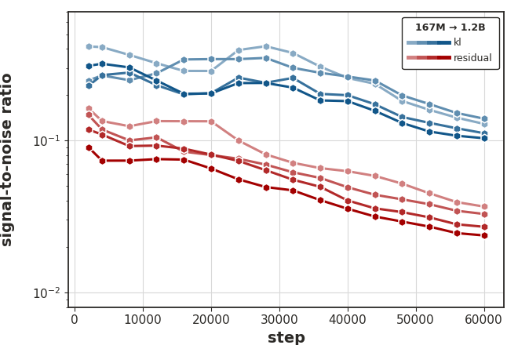
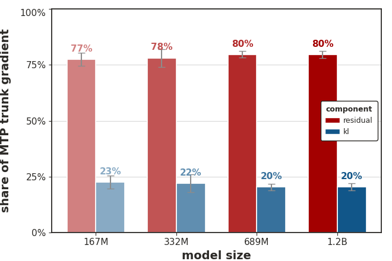
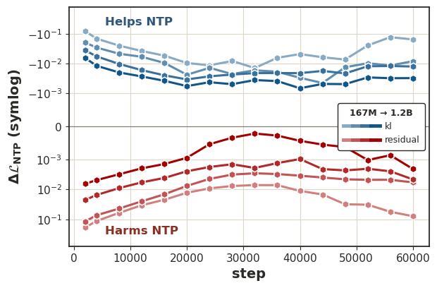
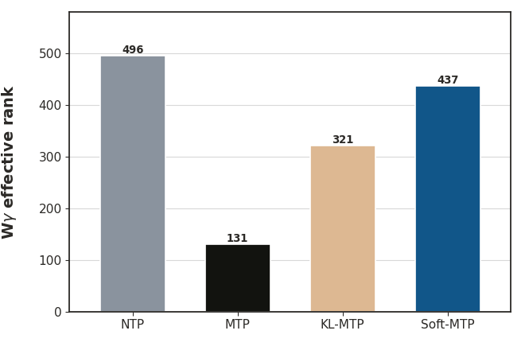

# Multi-Token Prediction Done Right（Soft-MTP）深度精读

> **论文**：Multi-Token Prediction Done Right
> **作者**：Jayden Teoh（独立研究者，单作者；实验自费租用 8×RTX PRO 6000 完成）
> **arXiv ID**：2610.38331
> **发表时间**：2026-10-28
> **代码仓库**：https://github.com/JaydenTeoh/Soft-MTP

## 第 1 章 概述

### 1.1 一句话定位

本文指出标准 Multi-Token Prediction（MTP）训练中交叉熵梯度可精确分解为「KL 自蒸馏项 + 低信噪比残差」，并提出 KL 梯度恢复技巧（KL gradient-recovery trick）：仅用一行 straight-through 梯度路由代码，从标准 MTP 已有的交叉熵梯度中精确恢复 KL 自蒸馏梯度、剔除噪声残差，得到 Soft-MTP——零新增参数、零可测开销、兼容 fused cross-entropy kernel，在 167M–1.2B 全部规模上全面优于标准 MTP。

### 论文图表总览

| 编号 | 内容 | 章节 |
|------|------|------|
| **Figure 1** | Soft-MTP straight-through 梯度路由示意与一行代码改动 | 第 4 章 |
| **Figure 2** | 位置对齐 NTP 分布示意（K=2） | 第 3 章 |
| **Figure 3** | 梯度 SNR 跨规模对比（a/b）与残差占 MTP 梯度份额（c） | 第 5 章 |
| **Figure 4** | 各梯度分量对 NTP 损失的 help/harm 代理（a）、NTP/MTP 损失曲线（b/c） | 第 5 章 |
| **Figure 5** | λ_MTP 与 horizon K 扫描的 Pareto 曲线（a-d） | 第 5 章 |
| **Figure 6** | 各目标函数下 logit 读出层有效秩对比（1.2B） | 第 5 章 |
| **Figure 7** | Meta 式 MTP 332M 的 NTP/MTP 损失曲线（附录 C） | 第 5 章 |
| **Table 1** | 三种 MTP 目标的梯度路由剖析 | 第 4 章 |
| **Table 2** | 五域投机解码：KL/TV/加速比/接受长度（四规模） | 第 5 章 |
| **Table 3** | 困惑度与 zero-shot 准确率（四规模 × 9 基准） | 第 5 章 |
| **Table 4** | 1.2B 数学/代码微调后 HumanEval/MBPP/GSM8K/MATH-500 | 第 5 章 |
| **Table 5** | 四目标训练开销：FLOPs/吞吐/MFU/峰值内存（1.2B） | 第 5 章 |
| **Table 6** | NTP/MTP/KL-MTP/Soft-MTP 全指标对比（1.2B） | 第 5 章 |

### 1.2 核心贡献

1. **MTP 梯度的精确分解**：证明标准 MTP 交叉熵对第 k 个 MTP 隐状态的梯度恒等分解为 KL 自蒸馏分量（把 MTP 头拉向模型自身位置对齐的 NTP 分布）与残差分量（对齐 NTP 隐状态上的交叉熵梯度），且该分解对 parallel（Meta 式）与 sequential（DeepSeek 式）MTP 架构均成立。
2. **残差有害的实证刻画**：残差分量信噪比比 KL 分量低约 4×（167M 时 4.1×，1.2B 时 4.6×，随规模扩大），却占到达共享主干梯度的 ~80%；沿残差方向走一步会升高 NTP 损失——它不仅噪声大，还与 NTP 优化方向反协同。
3. **KL 梯度恢复技巧**：当教师/学生共享线性输出头时，前向 KL 的梯度可由两者交叉熵梯度经 straight-through 路由精确恢复，无需 materialize 词表级 logits，天然兼容 fused CE kernel 与前沿预训练并行策略。
4. **Soft-MTP**：上述技巧的工程化落地——一行代码改动，输出头仍用 CE 训练、MTP 头与主干只收 KL 梯度；在困惑度、投机解码、zero-shot、数学/代码微调上全面超越标准 MTP，并在多数指标上追平或超过昂贵的显式 KL 自蒸馏（KL-MTP）。

### 1.3 关键结果速览

| 维度 | 结果（Soft-MTP vs 标准 MTP） | 来源 |
|------|------------------------------|------|
| NTP 困惑度（1.2B） | WikiText 17.489 vs 18.156；LAMBADA 14.073 vs 14.996（均同时优于 NTP 基线 17.503/14.159） | Table 3 |
| Zero-shot 平均准确率 | 每个规模都提升：+0.07 pp（167M）、+0.08 pp（332M）、+0.54 pp（689M）、+0.51 pp（1.2B）；689M 起超过 NTP 基线 | Table 3 |
| 投机解码（五域平均） | 接受长度 +1.8%–2.2%，加速比 +1.4%–1.5%；与验证器 KL 从 0.384 降至 0.364（1.2B） | Table 2 |
| 数学微调（1.2B） | GSM8K 49.66% vs 48.60%（+1.1 pp）；MATH-500 25.00% vs 23.20%（+1.8 pp） | Table 4 |
| 代码微调（1.2B） | HumanEval pass@64 43.90% vs 40.85%（+3.1 pp）；MBPP pass@64 61.00% vs 59.80%（+1.2 pp）；8 个指标中 7 个领先 | Table 4 |
| 训练开销（1.2B） | FLOPs 10.28 GFLOP/token 与 MTP 持平；吞吐 49,748 tok/s（仅低 0.07%）；fused CE 峰值内存 107.0 GB 持平；KL-MTP 则吞吐 −5.6%、内存 +21.1 GB | Table 5 |
| 读出层有效秩（1.2B） | NTP 496 / MTP 131 / KL-MTP 321 / Soft-MTP 437——Soft-MTP 最大限度避免了读出层坍缩 | Figure 6 |

## 第 2 章 背景与相关工作

### 2.1 MTP 的定义与两种主流架构

Next-Token Prediction（NTP）用前缀隐状态 $\mathbf{h}_t^{(0)} \in \mathbb{R}^d$ 经共享线性输出头 $W_\theta \in \mathbb{R}^{V \times d}$ 预测下一 token 分布：

$$p_t^{(0)} = \mathrm{softmax}\left(W_\theta \mathbf{h}_t^{(0)}\right)$$

$$\mathcal{L}_{\text{NTP}} = \sum_{t=1}^{T-1} \mathrm{CE}\left(x_{t+1}, p_t^{(0)}\right) = -\sum_{t=1}^{T-1} \log p_t^{(0)}(x_{t+1})$$

MTP 额外引入 $K$ 个预测头，第 $k$ 个头在每个位置产出隐状态 $\mathbf{h}_t^{(k)}$，经**共享的** $W_\theta$ 生成 $p_t^{(k)} = \mathrm{softmax}(W_\theta \mathbf{h}_t^{(k)})$ 去预测 $x_{t+k+1}$。总目标为：

$$\mathcal{L}_{\text{MTP}} = \mathcal{L}_{\text{NTP}} + \lambda_{\text{MTP}} \cdot \frac{1}{K} \sum_{k=1}^{K} \mathcal{L}_{\text{MTP}}^{(k)}$$

其中 $\mathcal{L}_{\text{MTP}}^{(k)} = -\sum_{t=1}^{T-k-1} \log p_t^{(k)}(x_{t+k+1})$。两种主流实现：

- **Meta 式（parallel）**：Gloeckle et al. (2024)，多个并行输出头，对代码等长程任务增益显著；
- **DeepSeek 式（sequential）**：DeepSeek-V3 起被广泛采用——Nemotron 3、GLM-5、Kimi K3、Qwen、LongCat、MiniMax、小米等相继跟进，MTP 头与输出头同层放置以便共享 $W_\theta$。

MTP 的两大价值：缓解 next-token 监督的短视性（math/code 等长程域收益），以及 MTP 头可直接作为投机解码的 drafter 加速推理（也是 RL post-training rollout 生成的关键加速器）。

### 2.2 投机解码机制回顾

投机解码用轻量 drafter 一次草拟多个 token，再由目标模型并行验证（Leviathan et al. 2022；Chen et al. 2023 的投机采样保证分布不变）。MTP 头天然就是 drafter：每个位置向前预测 $K$ 个 token 形成草案，验证器就是模型自身的 NTP 头。**草案 token 只有与模型自身 NTP 预测一致时才被接受**——这是全文逻辑的起点：既然接受与否由 MTP 分布与 NTP 分布的距离决定，训练目标就应当显式对齐这两者。验收长（acceptance length，每步验证平均接受的 token 数）与加速比（相对自回归采样的倍数）是核心度量，两者的差距由拒绝后的重算决定。

### 2.3 自蒸馏路线与本文位置

投机解码中 MTP 草案只有在与模型自身 NTP 验证器一致时才被接受——那为什么不直接让 MTP 头自蒸馏匹配 NTP 分布？先行工作正是这么做的：Teoh et al. (2025) 显式计算 KL（需 materialize 全词表 logits，内存昂贵）；Zhao et al. (2026a) 用 top-k logits 近似；Kirchenbauer et al. (2026) 用 argmax 预测；Chang & gpt-5.5-xhigh (2026) 缓存教师对 KL 梯度的贡献但要求冻结学生输出头。NVIDIA Nemotron 3 Ultra 的 MTP Boosting 则在 post-training 阶段用温度缩放前向 KL 对齐 MTP 头。实践中，前沿模型预训练仍用对数据的标准交叉熵训练 MTP 头。

本文的关键洞察是：**标准 MTP 交叉熵梯度里本来就藏着自蒸馏信号**——无需额外计算 KL，只需把淹没它的噪声残差剔除。

## 第 3 章 MTP 梯度分解

### 3.1 Hard MTP 梯度

定义第 $k$ 个 MTP 隐状态上的标准 MTP 交叉熵梯度为 hard MTP 梯度：

$$g_{\text{hard}} \coloneqq \nabla_{\mathbf{h}_t^{(k)}} \mathrm{CE}\left(x_{t+k+1}, p_t^{(k)}\right) = W_\theta^{\intercal}\left(p_t^{(k)} - x_{t+k+1}\right)$$

其中用到 softmax 交叉熵的 logit 梯度恒等式与链式法则。logit 梯度恒等式的推导：由 $\log p_v = z_v - \log \sum_u e^{z_u}$ 且 $\sum_v y_v = 1$，

$$\mathrm{CE}(y, p) = -\sum_v y_v \log p_v = -y^{\intercal} z + \log \sum_u e^{z_u}$$

对 $z_v$ 求导得 $\partial \mathrm{CE}/\partial z_v = -y_v + e^{z_v}/\sum_u e^{z_u} = p_v - y_v$，即

$$\nabla_z \mathrm{CE}\left(y, \mathrm{softmax}(z)\right) = p - y$$

再由 MTP logits $z_t^{(k)} = W_\theta \mathbf{h}_t^{(k)}$ 对隐状态的 Jacobian 为 $W_\theta$，链式法则给出 $g_{\text{hard}} = W_\theta^{\intercal}(p_t^{(k)} - x_{t+k+1})$。这一梯度是「硬」的：监督信号是数据的 one-hot 目标，故称 hard MTP 梯度；下文的 KL 分量以连续的模型自身分布为监督，与之形成「hard/soft」对照（类比蒸馏文献中的 hard/soft targets）。

### 3.2 位置对齐 NTP 分布与精确分解

关键构造是**位置对齐 NTP 分布**：与 $p_t^{(k)}$ 预测同一目标 token $x_{t+k+1}$ 的 NTP 分布为

$$q_t^{(k)} \coloneqq p_{t+k}^{(0)} = \mathrm{softmax}\left(W_\theta \mathbf{h}_{t+k}^{(0)}\right)$$

在 $g_{\text{hard}}$ 中加减 $q_t^{(k)}$ 即得**精确**（逐 batch 成立、无近似）的分解：

$$g_{\text{hard}} = \underbrace{W_\theta^{\intercal}\left(p_t^{(k)} - q_t^{(k)}\right)}_{g_{\mathrm{KL}}} + \underbrace{W_\theta^{\intercal}\left(q_t^{(k)} - x_{t+k+1}\right)}_{g_{\text{res}}}$$

### 3.3 两个分量的含义

**KL 自蒸馏分量**：把 $q_t^{(k)}$ 视为 stop-gradient 教师，前向 KL 的梯度恰好是

$$\nabla_{\mathbf{h}_t^{(k)}} D_{\mathrm{KL}}\left(\mathrm{sg}(q_t^{(k)}) \,\|\, p_t^{(k)}\right) = W_\theta^{\intercal}\left(p_t^{(k)} - q_t^{(k)}\right) = g_{\mathrm{KL}}$$

推导利用了 stop-gradient 教师下 $D_{\mathrm{KL}}(\mathrm{sg}(q)\|p) = -H(q) + \mathrm{CE}(q, p)$，熵项不依赖学生隐状态。即标准 MTP 的部分梯度已经在隐式做自蒸馏，把 MTP 头拉向模型自身的 NTP 预测。

**残差分量**：$g_{\text{res}}$ 恰是对齐 NTP 隐状态 $\mathbf{h}_{t+k}^{(0)}$ 上的交叉熵梯度（对数据）。由于反传对到达 $\mathbf{h}_t^{(k)}$ 的梯度是线性的，该分解精确传递到 MTP 头与共享主干中的每一个上游参数，对 parallel 与 sequential 头均成立（sequential 只改变 Jacobian，不改变线性性）。

## 第 4 章 Soft-MTP 方法

### 4.1 KL 梯度恢复技巧

朴素做法是显式最小化 $D_{\mathrm{KL}}(\mathrm{sg}(q)\|p)$，但需同时 materialize 教师/学生的 $T \times V$ logits（现代词表下内存高昂），且与避免物化 logits 的 fused CE kernel 不兼容。本文的技巧**完全不碰 logit 空间**：

**增广 NTP 隐状态**（前向数值恒等；主文推导不含损失加权，缩放系数见后文 B.5 说明）：

$$\tilde{\mathbf{h}}_t = \mathbf{h}_t^{(0)} + \underbrace{\sum_{k=1,\, t-k \geq 1}^{K} \left[\mathrm{sg}(\mathbf{h}_{t-k}^{(k)}) - \mathbf{h}_{t-k}^{(k)}\right]}_{=\,0}$$

增广 NTP 损失 $\tilde{\mathcal{L}}_{\text{NTP}} = \sum_t \mathrm{CE}(x_{t+1}, \mathrm{softmax}(W_\theta \tilde{\mathbf{h}}_t))$ 与原 NTP 损失**数值相同、NTP 侧梯度不变**，但对 MTP 隐状态注入了额外梯度：

$$\nabla_{\mathbf{h}_t^{(k)}} \tilde{\mathcal{L}}_{\text{NTP}} = -W_\theta^{\intercal}\left(q_t^{(k)} - x_{t+k+1}\right) = -g_{\text{res}}$$

与 MTP 损失的 hard 梯度相加，残差精确抵消：

$$\nabla_{\mathbf{h}_t^{(k)}} \left(\tilde{\mathcal{L}}_{\text{NTP}} + \mathcal{L}_{\text{MTP}}^{(k)}\right) = g_{\text{hard}} - g_{\text{res}} = g_{\mathrm{KL}}$$

这就是 straight-through 梯度路由的实质：借鉴 Bengio et al. (2013) 的 stop-gradient 技巧，但目的不是近似不可得梯度，而是**解析地恢复另一个精确梯度量**。实现上即一行代码：`h0[:, k:] += hk.detach() - hk`。完整训练循环骨架（论文首页代码，标签已预移位）：

```python
z = shared_trunk(x)          # 共享主干
h0 = ntp_head(z)             # NTP 隐状态

for k in range(1, K+1):
    hk = mtp_head[k-1](z, x)             # 第 k 个 MTP 头（sequential 头接收 x）
    loss_mtp += ce(lm_head, hk, y[k])    # 标准 MTP 交叉熵（fused CE kernel）

    # straight-through 梯度路由：h0 数值不变
    h0[:, k:] += hk.detach() - hk

# NTP 损失与前向数值均不变
loss_ntp = ce(lm_head, h0, y[0])

# NTP 损失的负梯度进入 hk，恰好恢复 KL 梯度
(loss_ntp + loss_mtp).backward()
```

附录 B.5 进一步说明：实现中各损失按自身目标数归一（$N_0 = T$，$N_k = T-k$），straight-through 项需按 $s_k = \lambda_{\text{MTP}} T / (K(T-k))$ 缩放，才能与加权后的 KL 目标 $\frac{\lambda_{\text{MTP}}}{K}\sum_k \frac{1}{N_k}\sum_t D_{\mathrm{KL}}(\mathrm{sg}(q_t^{(k)}) \| p_t^{(k)})$ 逐点等价；论文附录 A 给出了含该缩放的完整 PyTorch 实现。


*图1：Soft-MTP 方法总览——MTP 头正常计算 CE 损失，同时把 MTP 隐状态以 stop-gradient 差的形式加到未来 NTP 隐状态上，使 NTP 损失的反向传播向 MTP 隐状态注入 −g_res，与 MTP 自身的 g_hard 相消后仅剩 g_KL*

### 4.2 梯度路由剖析

| 方法 | 输出头 $W_\theta$ | MTP 头与共享主干 |
|------|:---:|:---:|
| Standard MTP | CE 梯度 | CE 梯度 |
| KL-MTP | KL 梯度 | KL 梯度 |
| Soft-MTP | CE 梯度 | KL 梯度 |

（来源：论文 Table 1）

Soft-MTP 独特的混合路由：输出头继续用交叉熵拟合数据分布；MTP 头与主干只接收高信噪比的自蒸馏梯度。第 5 章将看到，这一设计同时避免了标准 MTP 的梯度污染与 KL-MTP 的读出层坍缩。

### 4.3 残差的偏置–方差视角

只有 $g_{\text{res}}$ 依赖采样的 one-hot 目标；$g_{\mathrm{KL}}$ 完全由模型自身预测决定。设 $\pi_t^{(k)}$ 为真实下一 token 分布，则

$$g_{\text{res}} = \underbrace{W_\theta^{\intercal}\left(q_t^{(k)} - \pi_t^{(k)}\right)}_{\text{NTP 误差（偏差）}} + \underbrace{W_\theta^{\intercal}\left(\pi_t^{(k)} - x_{t+k+1}\right)}_{\text{one-hot 采样噪声（方差）}}$$

采样噪声零均值但**不可约**；NTP 误差随模型规模与训练时长**单调缩小**。因此剔除 $g_{\text{res}}$ 的「用偏差换方差」交易在规模扩大时越来越划算——这解释了后文 SNR 差距随规模拉大的现象。而且由于 MTP 的主要用途是投机解码，把 MTP 头偏向 NTP 验证器分布本就是 desirable 的（KL 经 Pinsker 不等式间接上界 TV 距离，且在 MTP 头低估的 token 上保持非消失梯度）。

## 第 5 章 实验分析

### 5.1 实验设置

LLaMA 式架构（RMSNorm、RoPE、SwiGLU、pre-norm），DeepSeek 式 sequential MTP，$K=3$，$\lambda_{\text{MTP}}=1.0$，每个 MTP 头固定为主干非嵌入参数的 3.2%。四档规模（固定 36 层，只变宽度）：

| | 167M | 332M | 689M | 1.2B |
|:---|:---:|:---:|:---:|:---:|
| 总参数量 | 178.4M | 356.9M | 745.0M | 1273.0M |
| NTP 路径参数 | 167.2M | 332.1M | 689.3M | 1173.9M |
| MTP 头参数 | 11.2M | 24.8M | 55.8M | 99.1M |

数据 FineWeb-Edu，60,000 步 × 524,288 tokens/步（256 序列 × 2048 长度），共约 31.5B tokens（对最大模型约 1.3× Chinchilla 最优）。优化器为 Muon（momentum 0.95、Nesterov、5 步 Newton–Schulz、update-RMS 缩放），embedding/输出头/范数层用 AdamW（$\beta_1=0.9, \beta_2=0.95$），峰值学习率为对应规模 GPT-3 值的 5×（2e-3/1.5e-3/1.25e-3/1e-3），cosine 衰减至 1e-5，warmup 2000 步，权重衰减 0.1，梯度裁剪 1.0。词表 50,304（GPT-2 BPE 填充），untied embedding。

### 5.2 残差如何干扰学习（Question 1）

**梯度 SNR 测量**（256 个独立批，每批 4 序列 × 2048；signal = 批均值梯度范数平方，noise = 总方差，用无偏估计器）：

SNR 的定义与估计细节（附录 E）：对某梯度分量在数据批 $\xi$ 上的 $g_c^{\theta}(\xi)$，signal 取期望方向的平方范数 $S_c = \lVert \mathbb{E}_\xi[g_c^{\theta}] \rVert^2$，noise 取绕该方向的总方差 $N_c = \mathbb{E}_\xi \lVert g_c^{\theta} \rVert^2 - S_c = \mathrm{tr}(\Sigma_c)$，$\mathrm{SNR}_c = S_c / N_c$——它正是 McCandlish et al. (2018) 梯度噪声尺度的倒数（固定批大小下差一个常数因子）。用 $M=256$ 个独立批估计时，朴素 signal 估计偏高 $\mathrm{tr}(\Sigma)/M$、noise 偏低 $(M-1)/M$，论文全程报告去偏值。梯度份额则按投影定义 $\mathrm{share}_c = \langle g_{\text{hard}}, g_c \rangle / \lVert g_{\text{hard}} \rVert^2$（两份额之和恒为 1，且可为负——当两分量反向时）。help/harm 代理为 $\Delta\mathcal{L}_{\text{NTP}}^{(c)} = \mathcal{L}_{\text{NTP}}(\mathrm{RMSNorm}(H - g_c)) - \mathcal{L}_{\text{NTP}}(\mathrm{RMSNorm}(H))$，正值即损害。

- 残差分量 SNR 全程比 KL 分量低约 **4×**，且随规模恶化：167M 时 4.1×，1.2B 时 4.6×；
- 尽管低 SNR，残差却占到达共享主干 MTP 梯度的 **~80%**——高信噪比的自蒸馏信号被高方差更新淹没，导致整体 hard-MTP 梯度 SNR 反而低于纯 KL 分量。



*图3(a)：KL 分量（蓝）与残差分量（红）在四个规模上训练全程的梯度 SNR——残差始终低约 4×，且规模越大差距越大（对数轴）*



*图3(c)：按投影份额度量，残差占到达共享主干 MTP 梯度的约 80%——即标准 MTP 中八成梯度流量来自低信噪比分量*

**Help/harm 代理实验**：沿某分量梯度（从 MTP 头反传到主干隐状态）走单位步长再经冻结输出头重估 NTP 损失。KL 分量的步长**持续降低** NTP 损失（自蒸馏信号与 NTP 目标协同），残差分量的步长**持续升高** NTP 损失——残差不仅噪声大，方向上还与 NTP 优化对抗。



*图4(a)：KL 分量一步降低 NTP 损失（help），残差分量一步升高 NTP 损失（harm），该行为贯穿训练全程且跨规模一致*

对应训练曲线：Soft-MTP 的 NTP 损失在每个规模都低于标准 MTP（差距随规模拉大）；从 689M 起 MTP 损失也更低。

### 5.3 Soft-MTP 全面超越标准 MTP（Question 2）

**投机解码**（每域 256 条 512-token 前缀生成 512-token 续写，K=3 起草 + 自验证，Leviathan et al. 2022 投机采样）。Soft-MTP 在**每个规模、每个域**都产生更优草案与更快解码。以 1.2B 为例（五域中挑 FineWeb-Edu 与 Math，完整表见论文 Table 2）：

| 规模 | 模型 | KL ↓ | TV ↓ | FW-Edu 加速比 | Math 加速比 | Math 接受长度 |
|------|------|:---:|:---:|:---:|:---:|:---:|
| 167M | MTP | 0.485 | 0.305 | 1.90 | 1.76 | 1.36 |
| 167M | Soft-MTP | 0.470 | 0.300 | 1.92（+1.1%） | 1.81（+2.8%） | 1.41（+3.7%） |
| 332M | MTP | 0.448 | 0.288 | 1.96 | 1.87 | 1.47 |
| 332M | Soft-MTP | 0.430 | 0.282 | 1.98（+1.0%） | 1.93（+3.2%） | 1.53（+4.1%） |
| 689M | MTP | 0.410 | 0.271 | 1.88 | 1.81 | 1.57 |
| 689M | Soft-MTP | 0.390 | 0.265 | 1.90（+1.1%） | 1.84（+1.7%） | 1.60（+1.9%） |
| 1.2B | MTP | 0.384 | 0.260 | 1.74 | 1.70 | 1.60 |
| 1.2B | Soft-MTP | 0.364 | 0.253 | 1.76（+1.1%） | 1.73（+1.8%） | 1.64（+2.5%） |

（数据来源：论文 Table 2；五域平均接受长度提升 1.8%–2.2%、加速比提升 1.4%–1.5%。Math 域的相对增益总体最大（加速比 +1.7%–3.2%、接受长度 +1.9%–4.1%；其中 167M/332M 档 Math 领先所有域，689M 档接受长度上 FW-Edu/Books 的相对增益更高），与偏置–方差分析一致：MTP 头被拉向 NTP 验证器，直接提高草案接受率）

1.2B 全五域明细（Table 2 末组）：

| 模型 | 指标 | FW-Edu | Wikipedia | Books | Science | Math |
|------|------|:---:|:---:|:---:|:---:|:---:|
| MTP | 加速比 | 1.74 | 1.72 | 1.71 | 1.72 | 1.70 |
| Soft-MTP | 加速比 | 1.76（+1.1%） | 1.74（+1.2%） | 1.74（+1.8%） | 1.75（+1.7%） | 1.73（+1.8%） |
| MTP | 接受长度 | 1.67 | 1.63 | 1.62 | 1.65 | 1.60 |
| Soft-MTP | 接受长度 | 1.70（+1.8%） | 1.66（+1.8%） | 1.67（+3.1%） | 1.68（+1.8%） | 1.64（+2.5%） |

**Zero-shot 下游**（LM Evaluation Harness，9 个基准）。各规模平均准确率：

| 规模 | NTP | MTP | Soft-MTP |
|------|:---:|:---:|:---:|
| 167M | 47.42% | 46.84% | 46.91% |
| 332M | 50.79% | 50.38% | 50.46% |
| 689M | 54.79% | 54.47% | **55.01%** |
| 1.2B | 56.75% | 56.80% | **57.31%** |

（来源：论文 Table 3 平均列。注意与 Gloeckle et al. 2024 一致，标准 MTP 在小规模并不改善选择题准确率；Soft-MTP 每档都超过标准 MTP，增益随规模扩大：约 +0.1 pp（167M/332M）→ 约 +0.5 pp（689M/1.2B），并从 689M 起反超 NTP 基线）

1.2B 的困惑度细节（Table 3）：Soft-MTP 在 WikiText（17.489 vs MTP 18.156 vs NTP 17.503）与 LAMBADA（14.073 vs 14.996 vs 14.159）上均为三者最佳，FineWeb-Edu 为 10.741（NTP 10.572 最佳、MTP 10.891）。

1.2B 全基准明细（acc 为准确率、acc_n 为长度归一化准确率，单位 %）：

| 模型 | FW-Edu ppl | Wiki ppl | LAMB. ppl | LAMB. acc | PIQA | HellaS. | Wino. | ARC-e | ARC-c | OBQA | SciQ | 平均 |
|------|:---:|:---:|:---:|:---:|:---:|:---:|:---:|:---:|:---:|:---:|:---:|:---:|
| NTP | 10.572 | 17.503 | 14.159 | 46.81 | 73.12 | 55.95 | 57.22 | 71.17 | 37.46 | 27.20 | 85.10 | 56.75 |
| MTP | 10.891 | 18.156 | 14.996 | 45.86 | 71.55 | 55.91 | 57.46 | 70.75 | 37.97 | 29.60 | 85.30 | 56.80 |
| Soft-MTP | 10.741 | 17.489 | 14.073 | 46.48 | 72.03 | 55.91 | 58.01 | 71.97 | 37.54 | 30.60 | 85.90 | 57.31 |

逐格核对（Soft-MTP vs MTP）：11 项中 9 项更优（FW-Edu/Wiki/LAMBADA ppl、LAMBADA acc 46.48 vs 45.86、PIQA 72.03 vs 71.55、Wino 58.01 vs 57.46、ARC-e 71.97 vs 70.75、OBQA 30.60 vs 29.60、SciQ 85.90 vs 85.30），1 项持平（HellaSwag 55.91），仅 ARC-c 略低（37.54 vs 37.97，−0.43 pp）。689M 组的对应平均为 54.47→55.01（+0.54 pp），也是 Soft-MTP 首次同时超过 NTP（54.79）的规模档。

**数学/代码微调**（1.2B 主干，丢弃 MTP 头后仅用 NTP 微调；数学 = 4.2B tokens OpenMathInstruct-2，代码 = 21.0B tokens Stack-Edu Python 子集）：

| 模型 | HumanEval pass@16 | pass@32 | pass@64 | MBPP pass@16 | pass@32 | pass@64 | GSM8K | MATH-500 |
|------|:---:|:---:|:---:|:---:|:---:|:---:|:---:|:---:|
| NTP | 28.89% | 33.77% | 39.02% | 47.83% | 53.65% | 58.80% | 47.69% | 24.80% |
| MTP | 31.70% | 36.37% | 40.85% | 48.28% | 54.56% | 59.80% | 48.60% | 23.20% |
| Soft-MTP | 31.99% | 37.26% | 43.90% | 47.88% | 54.59% | 61.00% | 49.66% | 25.00% |

（来源：论文 Table 4；pass@k 后括号内为所选采样温度，此处略。Soft-MTP 在 8 个对比格中 7 个领先标准 MTP，且是唯一从不低于 NTP 基线的目标；代码优势随采样预算增长：HumanEval pass@64 +3.05 pp、MBPP pass@64 +1.20 pp；数学 +1.06 pp / +1.80 pp）

各目标所选采样温度明细（BigCode Evaluation Harness，按验证集挑选）：NTP 的 HumanEval 三档为 T=0.5/0.6/0.6、MBPP 全部 T=0.5；MTP 的 HumanEval 为 T=0.5/0.5/0.7、MBPP 为 T=0.5/0.5/0.6；Soft-MTP 的 HumanEval 为 T=0.5/0.5/0.6、MBPP 为 T=0.5/0.6/0.7。微调配置：数学侧在 OpenMathInstruct-2 上 8,000 步（约 4.19B tokens）、峰值学习率 4e-5、warmup 800 步；代码侧在 Stack-Edu Python 上 40,000 步（21.0B tokens）、峰值 5e-5、warmup 2,000 步；两者 cosine 衰减至峰值的 10%，梯度裁剪 1.0，均用 Muon 且**丢弃 MTP 头、仅以 NTP 损失微调**——即下游增益全部来自预训练目标对主干表征的塑造，与 MTP 头的推理期使用无关。

**超参数鲁棒性**（332M，7.3B tokens）：$\lambda_{\text{MTP}}$ 从 0.25 扫到 1.0、horizon $K$ 从 3 扫到 8，Soft-MTP 在每个配置下 NTP 与 MTP 损失均低于标准 MTP（对 NTP 损失 vs 对验证器 KL 同样 Pareto 支配），说明优势不依赖特定超参。

**Meta 式架构验证**（附录 C）：332M parallel 头、K=3、λ=1.0、7.3B tokens 下，Soft-MTP 的 NTP 与 MTP 损失同样更低——分解与技巧不绑定 DeepSeek 式实现。

### 5.4 对比显式 KL 自蒸馏：更高效（Question 3）

**训练开销**（1.2B）：

| 目标 | matmul FLOPs（GFLOP/token） | 吞吐（tok/s） | MFU | 峰值内存 naive CE（GB） | fused CE（GB） |
|------|:---:|:---:|:---:|:---:|:---:|
| NTP | 8.16 | 62,851 | 51.9% | 98.3 | 95.5 |
| MTP | 10.28 | 49,783 | 51.7% | 120.7 | 107.0 |
| KL-MTP | 10.43 | 46,990 | 49.6% | 129.8 | 128.1 |
| Soft-MTP | 10.28 | 49,748 | 51.7% | 121.0 | 107.0 |

（来源：论文 Table 5。Soft-MTP 与标准 MTP 的 FLOPs、MFU、fused-CE 峰值内存完全持平，吞吐差仅 0.07%。KL-MTP 需 materialize 师生全词表分布：FLOPs +1.5%、相对 MTP 吞吐 −5.6%、峰值内存 +21.1 GB，且几乎无法受益于 fused CE kernel）

**效果对比**（1.2B，论文 Table 6）：

| 维度 | 指标 | NTP | MTP | KL-MTP | Soft-MTP |
|------|------|:---:|:---:|:---:|:---:|
| 语言建模 | FW-Edu ppl ↓ | 10.57 | 10.89 | 10.74 | 10.74 |
| | WikiText ppl ↓ | 17.50 | 18.16 | 17.53 | **17.49** |
| | LAMBADA ppl ↓ | 14.16 | 15.00 | 14.30 | **14.07** |
| | 平均准确率 ↑ | 56.75% | 56.80% | 57.22% | **57.31%** |
| 投机解码 | KL ↓ / TV ↓ | – | 0.384 / 0.260 | 0.363 / 0.252 | 0.364 / 0.253 |
| | 接受长度 ↑ / 加速比 ↑ | – | 1.67 / 1.74 | 1.71 / 1.76 | 1.70 / 1.76 |
| 数学 | GSM8K ↑ | 47.69% | 48.60% | **50.34%** | 49.66% |
| | MATH-500 ↑ | 24.80% | 23.20% | **26.00%** | 25.00% |
| 代码 | HumanEval pass@64 ↑ | 39.02% | 40.85% | 41.46% | **43.90%** |
| | MBPP pass@64 ↑ | 58.80% | 59.80% | 59.60% | **61.00%** |

Soft-MTP 在全部困惑度指标追平或超过 KL-MTP、平均准确率更高、代码微调 6 项全胜；KL-MTP 仅在数学微调（GSM8K 50.34% vs 49.66%、MATH-500 26.00% vs 25.00%）领先。投机解码两者几乎持平（KL-MTP 至多领先 0.01）——符合预期：两者向 MTP 头与主干发送相同的 KL 梯度，草案质量理应相当。

**为什么输出头要保留交叉熵？** 共享的 $W_\theta$ 同时映射 NTP 与 MTP 隐状态，任何 MTP 损失梯度都会塑造 NTP 读出。KL-MTP 用自蒸馏梯度训练 $W_\theta$，制造了捷径：KL 可以不靠改进 MTP 隐状态、而靠让共享读出对「MTP 与 NTP 隐状态差异方向」不敏感来下降（教师分布本身也由 $W_\theta$ 计算）。交叉熵目标不依赖 $W_\theta$，无此捷径。后果体现在读出几何——logit 映射 $W\gamma$（unembedding × 最终 RMSNorm 增益）的有效秩：



*图6：1.2B 模型 logit 读出层有效秩——NTP 496、标准 MTP 131（坍缩至约四分之一）、KL-MTP 321（约三分之二）、Soft-MTP 437（最接近 NTP 基线）*

梯度路由视角的归因：Soft-MTP 与 KL-MTP 仅在输出头处不同（437 vs 321 的差距来自保留 CE）；Soft-MTP 与标准 MTP 仅在主干处不同（437 vs 131 的巨大差距来自剔除残差）。Soft-MTP 组合了两个世界的最优路由，也是困惑度与下游准确率最强的目标。

## 第 6 章 实现细节与前沿规模兼容性

### 6.1 与并行策略的兼容性

KL 梯度恢复技巧在应用点只需两样东西：同一设备上的 $\mathbf{h}_{t+k}^{(0)}$ 与 $\mathbf{h}_t^{(k)}$，以及从 $\mathcal{L}_{\text{NTP}}$ 到 $\mathbf{h}_t^{(k)}$ 的反向路径。本身**零新增通信、零同步**：

- **数据并行 / ZeRO / 专家并行**：完全不受影响（如 DeepSeek-V3、Kimi K3 的配置）；
- **流水线并行**：只需 MTP 模块与输出头同 stage——DeepSeek 式 MTP 为共享输出头本就如此设计；
- **序列分片（context parallelism / ring attention / sequence parallelism）**：唯一需要额外通信的轴——技巧读取前方 k 个 token 的隐状态，代价是每个分片边界至多交换 K 个隐状态梯度的反向通信，与序列长度无关。

### 6.2 与显式 KL 的工程对比

显式 KL 需要师生全词表分布同时在场，fused CE kernel 无法在不物化 logits 的情况下计算；对不使用张量并行的模型（如 DeepSeek-V3，词表维无法分片）尤其昂贵。自定义 fused KL kernel 可以避免物化，但要么重算 NTP 损失已算过的教师 logits，要么把 NTP CE 与全部 MTP KL 融进单一自定义 kernel。恢复技巧把 KL 梯度藏在隐状态里传递，每个头保持标准 kernel-fused CE，除标准 MTP 已有张量外不新增任何词表级张量。

### 6.3 技巧的普适性

只要教师与学生共享线性输出头，前向 KL 梯度就可从两者交叉熵梯度恢复——适用范围超出预训练 MTP：MTP Boosting（Nemotron 3 Ultra 的 post-training 阶段）、on-policy 自蒸馏（OPSD）、off-policy RL 的 score centering 等所有计算这类 KL 的方法，都可借此规避 top-k 近似或全词表物化的成本；对已冻结输出头的方法（如 Next-Latent Prediction）更是只需隐状态侧 KL 梯度，完全适配。注意事项：仅 MTP 头与共享主干收到精确 KL 梯度，共享输出头仍以交叉熵更新。

## 第 7 章 讨论与批判性分析

### 7.1 论文自陈的边界

- **MTP 的长期地位不确定**：DeepSeek-V4.1-Flash 已弃用 MTP 转向 DSpark（pre-training 后训练的投机解码器）。后训练 drafter（Medusa、EAGLE、DFlash、DSpark）部署方便，但「基模型从未通过 MTP 形成未来 token 的预测性表征时，这些 drafter 表现如何」仍是开放问题。MTP 是否会因其相对 NTP 的下游准确率优势（且 FLOPs 增幅极小）而保留在预训练配方中，尚无定论。
- **数学微调上 KL-MTP 仍最强**（GSM8K 50.34%、MATH-500 26.00%）：纯粹的 KL 路由（含输出头）在该域有真实优势，Soft-MTP 用混合路由以极小差距（−0.68 pp / −1.00 pp）换取了零开销与代码域的全胜。

### 7.2 本报告补充的批判性观察

1. **规模天花板 1.2B**：所有结论建立在 167M–1.2B、31.5B tokens 的自费算力上。「残差噪声随规模恶化、Soft-MTP 优势随规模扩大」的趋势（4.1×→4.6×、avg acc +0.1→+0.5 pp）方向明确，但外推到数十 B 参数、数 T tokens 的前沿规模仍是外推——论文未提供 >1.2B 的任何数据点，Muon 优化器与 5× 学习率等现代配方下的结论是否在 AdamW 主流栈中保持也未验证。
2. **偏置–方差故事的完整版**：论文强调「偏差随规模缩小、方差不可约」，但 $g_{\mathrm{KL}}$ 把 MTP 头拉向的 $q_t^{(k)}$ 是**当前** NTP 模型的预测——教师会随训练漂移，自蒸馏存在自我强化风险（与 KL-MTP 一节观察到的读出层捷径同源）。论文通过 help/harm 代理（图 4a）与最终下游成绩间接反驳了这一担忧，但没有直接测量「MTP 头—NTP 分布差距在训练后期是否系统性滞后于数据分布」。
3. **投机解码增益的量级**：接受长度 +1.8–2.2%、加速比 +1.4–1.5% 属于「免费但小额」的改进；对部署侧，1.70→1.73 的加速比差异远小于 drafter 架构本身的差异。Soft-MTP 的真正卖点应理解为「在不付任何代价的前提下消除一个已证明有害的梯度分量」，而非投机解码的跨越式改进。
4. **单作者自费研究的可复现性**：全部实验由第一作者独立完成（租用 8×RTX PRO 6000），代码已在 GitHub 开源，HF 论文页另挂有 ntp/hard-mtp/soft-mtp-167m 与 hard-mtp-332m 等训练检查点，这是可复现性的正面信号；但每配置单 seed、无误差棒在 0.1 pp 量级的对比（如 167M/332M 平均准确率）下需谨慎解读，论文未报告方差。
5. **与评估协议的细节**：zero-shot 平均混合了 acc 与 length-normalized acc_n；HumanEval/MBPP 的 pass@k 配了按模型挑选的采样温度（如 Soft-MTP pass@64 用 T=0.6/0.7）——这是常见做法但引入了轻微的选择自由度，复现时需对照论文附录 D。
6. **80% 份额的解读**：残差占梯度 ~80% 且 SNR 低 4×，并不意味着标准 MTP「八成梯度是浪费」——份额按投影定义（可为负），残差中仍含 NTP 误差这一有信号成分；准确的表述是「低 SNR 分量主导了梯度范数，淹没了高 SNR 的自蒸馏信号」。

### 7.3 实践启示

- 对**正在训练或计划训练 MTP 模型的团队**：Soft-MTP 是罕见的「纯收益」改动——一行代码、零参数、零开销、兼容现有 kernel 与并行栈，且 λ_MTP 与 K 无需重调。风险下界由「NTP 侧梯度数学上严格不变」保证。
- 对**post-training 阶段计算师生共享输出头的 KL**（MTP Boosting、OPSD 等）的团队：KL 梯度恢复技巧可直接迁移以规避全词表物化。
- 对**评估 MTP 消融的研究者**：读出层有效秩（131 vs 437 vs 496）提供了一个廉价、可解释的诊断量，比单纯看 MTP 损失更能区分「梯度路由」与「表征质量」两个因素。

### 7.4 与相关工作的差异化定位

| 方法 | KL 信号来源 | 输出头梯度 | 额外开销 | 阶段 |
|------|------------|:---:|------|------|
| Standard MTP（DeepSeek-V3/GLM-5/Kimi K3 等） | 隐式（被残差淹没） | CE | 无 | 预训练 |
| 显式 KL 自蒸馏（Teoh et al. 2025） | 显式计算 | KL | 物化全词表 logits | 预训练 |
| top-k / argmax 近似（Zhao 2026a；Kirchenbauer 2026） | 近似 | KL/近似 | 部分 | 预训练 |
| MTP Boosting（Nemotron 3 Ultra） | 显式（温度缩放前向 KL） | KL | 需 KL 计算 | post-training |
| Soft-MTP（本文） | 精确恢复 | CE | 无 | 预训练 |

差异化要点在于：既有工作在「要不要自蒸馏」与「怎么廉价地自蒸馏」之间做取舍，Soft-MTP 证明了标准 MTP 梯度中已含精确的自蒸馏项，问题只是把它从噪声中「捞」出来——因此它是唯一同时满足「零开销 + 精确 KL + 输出头保持 CE 监督」三个条件的方案。与冻结输出头的方法（Next-Latent Prediction）相比，恢复技巧只需隐状态侧梯度，天然兼容；与 post-training 阶段的 MTP Boosting 相比，它把对齐提前到预训练全程，避免了事后纠偏的额外训练阶段。

## 第 8 章 结论

本文的核心贡献是把一个被业界默认接受的训练目标（标准 MTP 交叉熵）拆开检查，发现其梯度中约八成流量来自一个信噪比低约 4×、且与 NTP 优化对抗的残差分量，同时证明有用的 KL 自蒸馏信号无需额外计算——它已隐含在既有交叉熵梯度中，一行 straight-through 路由即可精确恢复。由此得到的 Soft-MTP 在 167M–1.2B 全规模上同时改善 NTP/MTP 困惑度、投机解码、zero-shot 准确率与数学/代码微调，在多数指标上追平或超过昂贵的显式 KL 自蒸馏，而训练开销与标准 MTP 完全相同。混合梯度路由（输出头用 CE、上游用 KL）避免读出层有效秩坍缩的设计，也给出了「共享输出头的多目标训练应如何分配梯度」的一般性教训。在 MTP 于前沿预训练中存废未决的当下，这篇论文把「怎么训 MTP」这一问题的理论理解与工程答案同时推进了一步：如果 MTP 继续被采用，Soft-MTP 很可能成为其默认形态；即使 MTP 被 post-training drafter 取代，KL 梯度恢复技巧作为通用的免物化 KL 优化原语仍有独立价值。
