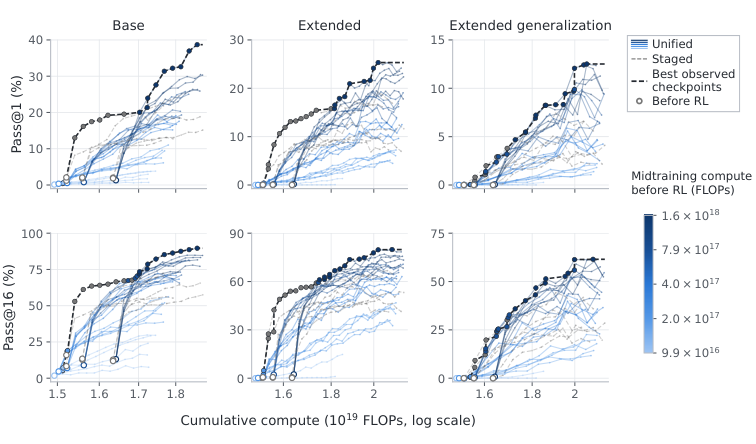

# 精读：Training Foundation Models with a Single Algorithm

> **论文**：Training Foundation Models with a Single Algorithm
> **作者**：Yuda Song、Alvin Zhang、Fahim Tajwar、Daman Arora、Jeff Schneider、Daniel Khashabi、Ruslan Salakhutdinov、J. Andrew Bagnell、Aarti Singh、Andrea Zanette（CMU / Meta）
> **arXiv ID**：2610.40564
> **发表时间**：2026-10-29（preprint，67 页 / 31 图 / 22 表；HuggingFace Daily Papers 2026-11-01 收录）
> **许可协议**：代码 Apache 2.0
> **代码仓库**：https://github.com/yudasong/unified-training

## 第 1 章 概述

### 1.1 一句话定位

论文证明 foundation model 的 pretraining / midtraining / SFT / RL 四阶段算法分离并非本质：将 RL 目标（MaxRL / TailRL）导出为对「模型生成的目标分布」的极大似然拟合后，全生命周期可以统一为单一似然算法（unified training），训练设计问题随之转化为「用什么数据、什么比例、什么时机」的数据配比问题。

### 论文图表总览

| 编号 | 内容 | 报告章节 |
|------|------|---------|
| **Figure 1** | unified training 循环总览与 vs staged 对比 | 第 2 章 |
| **Figure 2** | 系统架构：generator / shared buffer / 异步 trainer 与统一数据格式 | 第 4 章 |
| **Figure 3** | staged 与 unified 的数据暴露调度示意 | 第 5 章 |
| **Figure 4** | 124M 受控设置下混合配置 × 最终精度/覆盖 | 第 5 章 |
| **Figure 5** | 受控设置 compute–accuracy 前沿（报告引用原图） | 第 5 章 |
| **Figure 6** | RL 前初始化的 retention 对比（held-out loss + 5 基准均值） | 第 5 章 |
| **Figure 7** | 0.76B 真实数据：混合比例 0–5% 扫描 | 第 6 章 |
| **Figure 8** | 0.76B 真实数据：四种混合调度对比 | 第 6 章 |
| **Figure 9** | 数学 RL 后接 coding RL 的持续学习曲线 | 第 6 章 |
| **Table 12/13**（App D.1） | 0.76B 基座预训练/midtraining 配置与 RL 超参 | 第 6 章 |
| **Table 14**（App D.1） | base model RL 前基线成绩 | 第 6 章 |
| **Table 15/16**（App D.2） | 混合比例 0–5% 全扫描（数学/覆盖/保持双表） | 第 6 章 |
| **Table 17**（App D.3） | 等均值 0.5% 的四种调度 | 第 6 章 |
| **Table 18**（App D.4） | 代码数据消融（去除/替换代码源） | 第 6 章 |
| **Table 19/20**（App D.5） | MaxRL vs REINFORCE | 第 6 章 |
| **Table 22**（App D.7） | coding 持续学习最终成绩 | 第 6 章 |

（总览仅列报告正文直接引用的关键图表；论文共 31 图 / 22 表，其余附录图表未逐一列出。）

### 1.2 核心贡献

1. **统一定理层**：以 MaxRL 梯度恒等式为基础，把任意固定生成策略 ν 下的 RL 目标写成对目标分布 $q=\rho\circ\nu^{+}$ 的极大似然拟合，REINFORCE 是 $\nu=\pi_\theta$、单样本采样（binary reward 下）的特例，连续奖励经 TailRL 的阈值积分 $\nu_{\mathrm{Tail}}=\int_0^1\nu^+_\tau\,d\tau$ 纳入同一框架；staged training 退化为「数据比例突变」的特例。
2. **系统层**：一套共享数据格式（token 序列 + 权重向量）、一个加权似然损失、一个 trainer 同时吃静态语料与 RL 生成数据；generator 与 trainer 异步运行（trainer 每 4 updates 发布权重，实测生成策略落后 12–44 updates）。
3. **实证层**：124M 受控实验中，最优统一配置在 Base / Extended / Extended generalization 三种设定的精度全面超过 staged，且在算力两端预算下精度更优；0.76B 真实数据实验中，统一训练以所有非零（0.1–5%）midtraining 混合把 held-out loss 从上升 +0.074 nats/token（纯 RL）扭转为下降（0.5–5% 幅度 −0.087 ~ −0.147），数学平均精度基本持平（GSM pass@1 从 32.68% 小幅降至 30.80%），并使后续 coding RL 获得更优起点——5% 混合模型的 HumanEval+/MBPP+ pass@1 与 pass@16 四项全部超过 staged（HumanEval+ pass@1 24.96% vs 22.94%；较小混合的 HumanEval+ 覆盖则与 staged 持平或略低）。
4. **科学议程**：把「数据复用轮数、混合比例、调度形状、算力分配」变成可联合研究的变量，为建立贯穿全生命周期的训练轨迹科学（science of training trajectories）提供载体。

### 1.3 关键结果速览

| 结果 | 数值 | 来源 |
|------|------|------|
| 0% 混合（纯 RL 控制）vs staged 数学精度（0.76B） | Math pass@1 24.75% vs 24.16% | Figure 7 |
| 混入 5% midtraining 后 held-out loss 变化 | −0.1474 nats/token（0% 时 +0.0737，staged +0.0472） | Table 16（App D.2） |
| 混合比例上升时 SciQ 变化（0% → 5%） | 50.20% → 65.10%（staged 53.00%） | Table 16（App D.2） |
| Coding 精度/覆盖的取舍（5% vs 0%） | pass@1 下降（MBPP+ 20.97% vs 25.41%），pass@32 上升（45.17% vs 44.62%） | App D.2 |
| 半程退火调度的 Coding 精度（Half anneal 2%） | 18.85%（constant 0.5% 为 16.51%），Math pass@1 24.80% 持平 | Table 17（App D.3） |
| REINFORCE vs MaxRL（2% 混合） | Math pass@1 24.81% vs 23.99%；MaxRL 覆盖更高（pass@32 69.61% vs 67.70%） | Table 19（App D.5） |
| 持续学习（coding RL 4000 updates 后） | Unified 5%：HumanEval+ 24.96% / MBPP+ 32.69% vs Staged 22.94% / 29.81% | Table 22（App D.7） |
| 训练吞吐（0% 混合统一 vs staged） | 3.7 s/update vs 28.8 s/update = 7.8×（24 vs 16 GPUs） | App D.6 |

## 第 2 章 研究背景与动机

### 2.1 Staged training 的现状

当前基础模型的公开训练配方（DeepSeek-V3、OLMo-3 等）均按 pretraining → midtraining → SFT → RL 的顺序组织，相邻阶段同时更换两样东西：训练数据与学习算法。

前三阶段实际共用同一个算法——next-token 的极大似然估计（MLE），差异只在数据：pretraining 用空 prompt 拟合通用语料，midtraining 用空 prompt 拟合精选语料（论文称之为 *static data*），SFT 拟合指令-示范对 (x,y)。RL 阶段则切换为 policy optimization：以期望奖励为目标，REINFORCE 用采样 completion 估计期望，PPO 与 GRPO 进一步引入 advantage 估计、reward normalization、策略更新约束等设计选择。算法层面的断裂使 RL 看起来不属于前三阶段的似然框架。

这种阶段划分已经固化到专门的训练配方与基础设施（specialized training recipes and infrastructure）之中，各阶段被当作独立的学习问题对待：各自调参、各自定义成功指标（pretraining 看 held-out loss，RL 看 pass@k），阶段之间的衔接依赖工程惯例而非统一原理。

### 2.2 认知缺口：按阶段割裂的理解

对训练的科学理解同样是按阶段分头发展的：

- **Pretraining scaling laws**（Kaplan et al. 2020；Hoffmann et al. 2022 的 compute-optimal 分析）刻画了数据量、计算量与模型性能的关系；
- **RL scaling**（Nimmaturi et al. 2025；Khatri et al. 2026；Tan et al. 2026）研究 RL 阶段内部的 scaling 行为；
- **跨阶段 transfer 与交互**（Hernandez et al. 2021 的 transfer 研究；Isik et al. 2025；Runwal et al. 2026；Shen et al. 2026）表明早期训练决策会影响后续学习。

结果是：对「整个训练生命周期中的决策如何**联合**决定最终模型能力」所知甚少——每个阶段内部有局部规律，但缺少一个能把全流程决策放在一起评判的框架。论文原文的表述是：现有理解按阶段发展，"we know much less about how decisions made throughout training jointly determine the capabilities of the final model"。

### 2.3 MaxRL 似然解释脉络

统一的切入点是 MaxRL（Tajwar et al. 2026，本文作者 Fahim Tajwar 即 MaxRL 原作者）。在 binary reward r(x,y)∈{0,1} 设定下，MaxRL 证明了成功概率 p_θ(x) 的对数梯度恒等于成功条件分布下 score 函数的均值（恒等式见第 3 章 §3.3），因此一次 MaxRL 更新可以等价地写成对当前策略成功条件分布 π_θₜ⁺ 的 MLE 拟合。这第一次把 policy optimization 形式的 RL 放回了与 pretraining/SFT 相同的 likelihood-fitting 形式。

但原始 MaxRL 的似然解释局限于 **on-policy**（生成策略 = 当前被优化的策略）与 **binary reward** 两种设定。本文在其基础上做了三步扩展（第 3 章展开）：

1. 生成策略推广为任意固定策略 ν，得到统一似然目标 q = ρ∘ν⁺，使数据生成与参数优化可以解耦异步执行；
2. 覆盖其他 policy gradient 目标：REINFORCE 成为该框架在 N=1 时的特例；
3. 通过 TailRL 覆盖 [0,1] 连续奖励。

### 2.4 核心主张：阶段分离不是本质性的

论文用 Figure 1 的统一训练循环给出总览：学习算法自始至终不变，变化的是训练数据分布——静态语料、示范与经可验证奖励筛选的模型生成数据成为同一学习过程的不同数据源。

论文的中心论断（Introduction 中的斜体原文）：

> *Foundation-model training can be viewed as a single learning objective driven by an evolving distribution of training data.*

（基础模型训练可以看成单一学习目标，由不断演化的训练数据分布驱动。）

由此，设计问题的重心发生转移：学习算法从 pretraining 到 RL 全程不变，中心设计选择变成训练数据分布的演化——**选哪些数据、按什么比例、在什么时机**。Pretraining 文本、SFT 示范、经 verifiable reward 筛选的模型生成物，都变成同一底层学习过程的不同数据源。

在此视角下，staged training 不是默认范式，而是一个特例：混合权重 λ_s,t 在同一时刻全部压在单一数据源上，从一个阶段到下一个阶段发生**突变**（第 3 章 §3.4）；unified training 允许数据源重叠、比例随时间连续变化。

论文将该框架落地为单一 trainer 混合静态数据与 RL 生成数据的系统（第 4 章），并在两个规模上实例化验证：受控设定 124M 模型（123,587,328 参数，固定 20B-token pretraining 语料 + 510M-token midtraining 语料，语料含 796,175 条 reasoning traces / 509,942,713 tokens）；真实数据设定 0.76B 模型（756,819,456 参数，ClimbMix 354.53B tokens pretraining + OLMo-3 Dolmino 17.73B tokens midtraining，RL 期另混入 240M-token / 24 组件语料）。

### 2.5 科学问题

统一形式把三个原本分散的设计维度放进同一框架：

- **数据组成（composition）**：训练数据中各源（静态语料 vs 模型生成物）各占多少；
- **时机（timing）**：某一数据源何时进入、何时退出、比例如何调度；
- **算力分配（compute allocation）**：pretraining / midtraining / RL 三段如何瓜分总预算。

论文主张，这三个维度应当由它们对**最终模型**的作用联合评判，而不是由阶段内指标评判——midtraining 的价值要看它对后续 RL 学习的支持（论文 §5.1.4 的实证：staged 初始化在 RL 前 Base pass@1 更高，但 RL 后被统一初始化反超）。这为论文所称的 "a science of training trajectories"（训练轨迹科学）奠基：即关于数据与计算应如何随基础模型生命周期演化的原理性研究。

## 第 3 章 统一似然框架

### 3.1 记号与 MLE 损失

π_θ(y∣x) 表示参数为 θ 的模型在 prompt x 下对 completion y 的分布。每个训练样本为 prompt-completion 对 (x,y)，prompt 可为空。ρ(x) 为 prompt 分布，μ(y∣x) 为训练数据中的条件 completion 分布，其联合分布记为 ρ∘μ。MLE 最小化负对数似然：

$$
\mathcal{L}(\theta;\rho\circ\mu) \vcentcolon= -\mathbb{E}_{x\sim\rho}\,\mathbb{E}_{y\sim\mu(\cdot\mid x)}\left[\log\pi_{\theta}(y\mid x)\right].
$$

Pretraining、midtraining、SFT 全部使用该目标，只是 (ρ,μ) 不同：前两者 prompt 为空、μ 分别取通用与精选语料的分布，SFT 取指令分布 ρ_sft 与示范分布 μ_sft。

对固定训练数据分布，该损失与期望 forward KL 散度 $\mathbb{E}_{x\sim\rho}[\mathrm{KL}(\mu(\cdot\mid x)\,\|\,\pi_{\theta}(\cdot\mid x))]$ 只差一个与 θ 无关的常数，故梯度相同：

$$
\nabla_{\theta}\mathcal{L}(\theta;\rho\circ\mu) = -\mathbb{E}_{x\sim\rho}\,\mathbb{E}_{y\sim\mu(\cdot\mid x)}\left[\nabla_{\theta}\log\pi_{\theta}(y\mid x)\right].
$$

即 MLE 与最小化 forward KL 在优化上等价，最小化的是同一组 score 期望的负值。

### 3.2 RL 的标准形式

RL 阶段以期望奖励为目标（先取 binary reward，连续奖励见 §3.6）：

$$
J(\theta) \vcentcolon= \mathbb{E}_{x\sim\rho}\,\mathbb{E}_{y\sim\pi_{\theta}(\cdot\mid x)}\left[r(x,y)\right],
$$

其 policy gradient（论文式 1）：

$$
\nabla_{\theta}J(\theta)=\mathbb{E}_{x\sim\rho}\,\mathbb{E}_{y\sim\pi_{\theta}(\cdot\mid x)}\left[r(x,y)\,\nabla_{\theta}\log\pi_{\theta}(y\mid x)\right].
$$

REINFORCE 用采样 completion 估计该期望；PPO、GRPO 在此之上引入 advantage 估计、reward normalization 与更新约束。表面上看，这是与 §3.1 不同的优化形式。

### 3.3 MaxRL 梯度恒等式

定义 prompt x 上的成功概率与成功条件分布：

$$
p_{\theta}(x) \vcentcolon= \mathbb{E}_{y\sim\pi_{\theta}(\cdot\mid x)}[r(x,y)], \qquad \pi_{\theta}^{+}(y\mid x) \vcentcolon= \pi_{\theta}(y\mid x, r=1).
$$

Tajwar et al. (2026) 证明 MaxRL 梯度可写为：

$$
\nabla_{\theta}\log p_{\theta}(x)=\mathbb{E}_{y\sim\pi_{\theta}^{+}(\cdot\mid x)}\left[\nabla_{\theta}\log\pi_{\theta}(y\mid x)\right].
$$

含义：成功概率对数的梯度恰好等于「成功 completion 条件分布下 score 函数的均值」——采样自 π_θ⁺ 而非 π_θ。因此在第 t 次迭代，一次 MaxRL 更新等价于把 π_θₜ⁺ 当作固定目标分布做 MLE 拟合：

$$
\mathcal{L}(\theta;\rho\circ\pi_{\theta_t}^{+}) = -\mathbb{E}_{x\sim\rho}\,\mathbb{E}_{y\sim\pi_{\theta_t}^{+}(\cdot\mid x)}\left[\log\pi_{\theta}(y\mid x)\right].
$$

RL 由此进入与 pretraining / midtraining / SFT 完全相同的 likelihood-fitting 形式：区别只在于目标分布来自模型自身的成功生成，且每次迭代后被重新固定。

### 3.4 统一目标：混合分布 q_t

四个阶段现在都能写成 likelihood fitting。把迭代 t 的每个数据源 s 表示为 prompt 分布 ρ_s,t 与目标分布 μ_s,t，混合权重 λ_s,t ≥ 0 且 ∑_s λ_s,t = 1。全部源合成单一训练样本联合分布：

$$
q_t \vcentcolon= \sum_{s}\lambda_{s,t}\,(\rho_{s,t}\circ\mu_{s,t}).
$$

unified training 对该混合分布施加同一个似然损失：

$$
\mathcal{L}(\theta,q_t) = -\mathbb{E}_{(x,y)\sim q_t}\left[\log\pi_{\theta}(y\mid x)\right].
$$

各源在论文 Table 1 中的取值：

| 数据源 | Prompts ρ_s,t | Target μ_s,t |
| --- | --- | --- |
| Pretraining | 空 | μ_pre |
| Midtraining | 空 | μ_mid |
| SFT | ρ_sft | μ_sft |
| RL | ρ_rl | π_θₜ⁺ 或 ν⁺ |

三条实现性说明：

- 求导时源分布与混合权重**视为固定**（不参与微分），等价于先以概率 λ_s,t 采样源 s、再从该源抽样本、最后施加同一似然损失；
- 源分布与混合权重都允许随训练演化——变化的是喂给模型的数据分布，学习规则本身不变；
- staged training 是「同一时刻全部 λ_s,t 集中于单一源」的特例，unified training 额外允许源重叠与比例连续变化。

### 3.5 任意固定生成器：统一目标 q = ρ∘ν⁺

似然形式不要求 RL 数据由当前被优化的模型生成。设 completion 由一个在构造训练目标期间保持固定的生成策略 ν 产生，其成功 completion 定义目标分布：

$$
\nu^{+}(\cdot\mid x) \vcentcolon= \nu(\cdot\mid x, r=1).
$$

trainer 用同一个 MLE 损失拟合它：

$$
\mathcal{L}(\theta;\rho\circ\nu^{+}) = -\mathbb{E}_{x\sim\rho}\,\mathbb{E}_{y\sim\nu^{+}(\cdot\mid x)}\left[\log\pi_{\theta}(y\mid x)\right].
$$

两个极端情形界定了该目标的位置：

- **ν = π_θₜ**：恢复 §3.3 的 on-policy MaxRL 更新；
- **ν ≠ π_θₜ**：trainer 拟合的是那个生成器的成功条件分布，更新一般**不再**是当前策略的 MaxRL 梯度，但训练规则不变。

这一步是第 4 章异步系统（生成与优化解耦、各自独立推进）的理论许可。

### 3.6 REINFORCE 特例与连续奖励扩展

**REINFORCE 作为特例。** 在 binary reward 下，REINFORCE 拟合与 MaxRL 相同的目标分布 π_θₜ⁺，差别在有效 prompt 分布：

$$
\rho_{\mathrm{RF}}(x) \propto \rho(x)\,p_{\theta_t}(x).
$$

即 REINFORCE 给成功概率高的 prompt 更大权重，MaxRL 保持 ρ 不变。另一视角（第 4 章 §4.2 的有限样本分析）：生成策略 ν 每 prompt 采 N 条、prompt 有效权重为 1−(1−p_ν(x))ᴺ；N=1 时权重退化为 p_ν(x)。因此 **REINFORCE = 统一框架在 ν=π_θ 且 N=1 时的特例**；N→∞ 时权重趋于 1，prompt 分布回到 ρ 本身（MaxRL 总体形式）。

**连续奖励扩展（TailRL）。** 框架兼容归一化到 [0,1] 的奖励。TailRL（Ramasubramanian et al. 2026）的目标分布是阈值条件分布的积分混合：对阈值 τ∈[0,1]，记 ν_τ⁺(⋅∣x) := ν(⋅∣x, r>τ)，则

$$
\nu_{\mathrm{Tail}}(\cdot\mid x) \vcentcolon= \int_{0}^{1}\nu_{\tau}^{+}(\cdot\mid x)\,d\tau,
$$

on-policy 时即论文 Table 2 中的 $\int_0^1 \pi_{\theta_t}(\cdot\mid x, r>\tau)\,d\tau$，此时有效 prompt 分布保持 ρ(x)。

论文 Table 2 汇总的四个 on-policy 目标：

| 方法 | Reward | Target μ_s | 有效 Prompts ρ_s |
| --- | --- | --- | --- |
| MaxRL | binary | π_θₜ⁺ | ρ(x) |
| REINFORCE | binary | π_θₜ⁺ | ∝ ρ(x) p_θₜ(x) |
| TailRL | [0,1] | $\int_0^1 \pi_{\theta_t}(\cdot\mid x, r>\tau)\,d\tau$ | ρ(x) |
| REINFORCE | [0,1] | $\dfrac{\pi_{\theta_t}(y\mid x)\,r(x,y)}{\mathbb{E}_{y'\sim\pi_{\theta_t}(\cdot\mid x)}[r(x,y')]}$ | $\propto \rho(x)\,\mathbb{E}_{y\sim\pi_{\theta_t}(\cdot\mid x)}[r(x,y)]$ |

四个目标全部落入 §3.4 的统一形式：区别只体现为 (μ_s, ρ_s) 的不同取值，学习规则仍是同一个 $\mathcal{L}(\theta,q_t)$。推导细节在论文 Appendix F。

## 第 4 章 系统实现

### 4.1 统一数据格式 (z,w) 与加权损失

§3 的统一目标落地为一个共享数据格式（系统整体结构见论文 Figure 2：generator 向 shared buffer 追加生成数据，异步 trainer 从中采样并同时消费静态数据，右侧为统一的 (z,w) 数据表示）：每个训练样本是一个二元组 (z,w)，其中 z=(z_1,…,z_L) 为 token 序列，$w\in\mathbb{R}^{L}_{\geq 0}$ 为对其各 token 负对数似然的权重向量。各源的权重赋值：

- **Pretraining / midtraining**：语料 token 全部取单位权重；
- **SFT**：示范 token 单位权重，prompt token 权重为 0（prompt 掩码）；
- **RL**：同样的 prompt 掩码，completion 各 token 乘以响应权重 A（由 reward 与 pass rate 计算，见 §4.2）。

于是一个 batch 上的统一损失（论文式 2）：

$$
\hat{\mathcal{L}}(\theta;B) \vcentcolon= -\,\frac{1}{T_{B}}\sum_{(z,w)\in B}\sum_{\ell=1}^{L}w_{\ell}\log\pi_{\theta}(z_{\ell}\mid z_{<\ell}),
$$

其中 T_B 为 batch 内非 prompt token 总数。实现上这是一个 token 级均值：各源对损失的相对贡献由 token 混合比例直接决定，无需额外的损失系数。论文 Appendix C.9 与之对照测试了「各源分别归一化、再乘固定系数 α∈{0.1, 0.5} 相加」的替代方案（Extended 的 2.14B 初始化下另加测 α=1，未改善两套 Extended 测试的最高精度/覆盖），最优 α 随配置变化，需要额外调参；统一损失在该对照中取得了 Base 与 Extended generalization 上最高的最终精度与覆盖，但在初始化与数据混合匹配时并不一致占优——分别归一方案在 Extended 上常取得更高精度与覆盖。

真实数据实验（0.76B）中的两个归一化细节：RL response 的 token 似然在当前策略 top-k=50 / top-p=0.95 截断分布下计算，落在支撑之外的 token 同时从损失与归一化 token 计数中剔除；归一化分母 T_B 计入**未成功** response 的 token 与 midtraining token，midtraining token 似然则使用全词表。

### 4.2 生成器：每 prompt 采 N 条与权重 A=1/p̂

生成器对每个 prompt x 从近期权重副本 π_θₛ 采样 N 条 completion：y_1,…,y_N ∼ π_θₛ(⋅∣x)，并用

$$
\hat{p} \vcentcolon= \frac{1}{N}\sum_{i=1}^{N}r(x,y_i)
$$

估计 pass rate。权重规则：**正确的 completion 在其 response token 上获得权重 A := 1/p̂，错误的 completion 权重为 0**。

该加权是 MaxRL 的有限样本形式。对一个 prompt 的 N 条样本取加权 score 平均：

$$
\frac{1}{N}\sum_{i=1}^{N}\frac{r(x,y_{i})}{\hat{p}}\,\nabla_{\theta}\log\pi_{\theta}(y_{i}\mid x)=\frac{1}{N\hat{p}}\sum_{i:\,r(x,y_{i})=1}\nabla_{\theta}\log\pi_{\theta}(y_{i}\mid x),
$$

即恰好等于「正确 completion 的 score 平均」；N 条全错时该 prompt 的更新为零。

取期望后，该估计器与第 3 章 $-\nabla_{\theta}\mathcal{L}(\theta;\rho\circ\nu^{+})$ 共享同一 completion 目标分布 ν⁺，但每个 prompt x 的有效权重变为（即对 prompt 重加权后的目标无偏，仅 N→∞ 时回到原目标分布）：

$$
1-(1-p_{\nu}(x))^{N},
$$

其中 p_ν(x) 是生成策略的成功概率——这正是「N 条采样中至少一条正确」的概率。三个极限行为：

- **N=1**：权重 = p_ν(x)，恢复 REINFORCE（§3.6）；
- **N→∞**：权重 → 1，所有 prompt 等权进入（MaxRL 总体形式）；
- **一般 N**：目标分布 ν⁺ 不变，有限 N 只是把生成策略**很少解出**的 prompt 降权。

与 staged MaxRL 的权重差异：unified 用 r/p̂ 且**不做 baseline 减法**；staged MaxRL 用 (r−p̂)/p̂。由于 $\mathbb{E}_{y\sim\pi_{\theta}(\cdot\mid x)}[\nabla_{\theta}\log\pi_{\theta}(y\mid x)]=0$，减去随 prompt 变化的 baseline 不改变 on-policy 期望梯度，但两者有限样本更新不同，且该恒等式对「由较早策略生成的 response」并不原样成立。

实验中的具体配置：受控设定每 update 采 32 prompts × 16 generations（MaxRL Base 6000 updates / Extended 12000 updates）；真实数据设定每 update 512 条 RL response、每 prompt 16 条，共 12000 updates，AdamW（β₁,β₂)=(0.9, 0.999)，恒定学习率 10⁻⁶，无 warmup 与衰减，temperature / top-k / top-p = 1 / 50 / 0.95，prompt+response 上限 2048 tokens、response 上限 1024 tokens。

### 4.3 token 级数据混合：按 f_s/T_s 采样

trainer 通过共享 buffer 同时采样静态数据与 RL 生成数据来实施数据混合。对来自源 s 的目标 token 分数 f_s，样本的采样速率正比于：

$$
f_s / T_s,
$$

其中 T_s 是源 s 每个样本的平均 token 数（语料 token 或 response token）。转换的必要性在于 token 分数按 token 计而样本长度不一；混合也可以直接按各源的样本数指定。两套实验的两种用法：

- **真实数据实验**按 token 分数控制：$f = T_{\mathrm{mid}}/(T_{\mathrm{mid}}+T_{\mathrm{rl}})$，其中 T_rl 计入成功与未成功的全部 response token。实现时用**训练前**测得的平均样本长度把目标分数换算为每 update 添加的样本数，非整数部分跨 update 累计取整，长度估计全程固定——因此恒定配置分数并不保证实际 batch 的 token 分数恒定：RL response 变长或变短时实际分数随之漂移。实验扫描了 0%–5% 的恒定比例与四种调度（Constant 0.5% / Full anneal / Ramp / Half anneal，平均配置比例均为 0.5%）。
- **受控实验**直接指定样本数：pretraining 末段 8147 个 update 中，保持 256 条 pretraining packed 序列（长 2048 tokens）不变，额外加入 k∈{8,16,32,64,128} 条 midtraining 序列，对应 midtraining token 分数 k/(256+k) = 3.03% / 5.88% / 11.11% / 20.00% / 33.33%；RL 阶段每 update 额外加入 m∈{4,8,16,32,64} 条 midtraining 例。

掩码约定随阶段不同：pretraining 期混入的 midtraining 序列中 prompt / response / end-of-sequence token 全部计入损失；RL 期混入的 midtraining 例则掩码 prompt token，仅 response 与 end-of-sequence token 计入。

### 4.4 异步架构与实测 staleness

系统由三类组件构成（论文 Fig. 2）：**生成器**（generators）产出 RL 生成及其权重并追加到**共享 buffer**（buffer 同时存放静态数据），**trainer** 从 buffer 采样并更新模型。生成与优化异步并行：

- trainer 每 k 个 update 发布一次权重（实验中 k=4），生成器在 batch 之间加载新权重；
- buffer 保留每个生成器**最新完成的一轮**数据，即使该轮的生成策略已落后超过 4 个 update——发布间隔 k=4 不是数据年龄的上界。

数据陈旧度（policy staleness）实测：在训练中的两个时间点检查 8 个生成器各自最新完成的一轮，其生成策略落后最新已记录 trainer step **12–44 个 optimizer update**。该数字描述的是 buffer 中可用数据的陈旧度；trainer 实际消费的样本的生成策略版本未被记录，因此这不构成训练数据年龄的精确分布。

与同步式 staged RL 的吞吐对比（12000 updates 的生产日志）：unified（0% 混合，24 GPUs）约 **3.7 s/update**，staged RL（16 GPUs）**28.8 s/update**，优化吞吐相差 **7.8×**。该计时排除 launch 与 restart 停机，且异步 trainer 可跨 update 复用已有 response，因此度量的是优化吞吐而非新 rollout 生成速率。staged RL 每 update 消耗 32 个新 prompt 并在优化前收集当前策略的 response；两个实现还有一处算法差异——staged 有 baseline 减法（§4.2），unified 没有。

## 第 5 章 受控实验：124M 模型上的全流程统一训练

### 5.1 实验设置

受控设定用一个 123,587,328 参数（12 层、hidden 768、12 注意力头、GPT-2 tokenizer、上下文 2048、tied embeddings + RoPE + RMSNorm）的模型从零训练，固定 20B token 预训练语料 + 510M token midtraining 语料（38,147 updates，batch 256×2048 tokens，AdamW，峰值学习率 $6\times10^{-4}$）。

任务为 Reasoning Gym 风格的自然语言推理谜题，答案可验证、难度可控。midtraining 语料含 oracle 生成的解法（展示底层推理操作），RL 阶段引入这些操作的**新组合**：

- **Base**：RL 训练与评测的谜题规模都在 midtraining 覆盖范围内；
- **Extended**：RL 加入更大规模谜题并评测同规模留出集；
- **Extended generalization**：用 Extended 模型评测训练中从未出现过的更大谜题。

staged 顺序消费两个语料后进入 RL；unified 把 midtraining 数据混入预训练尾部与整个 RL 阶段（Figure 3）。两边 RL 都用 MaxRL：Base 6000 updates、Extended 12000 updates，每 update 32 prompts × 16 generations。评测 pass@1（精度）与 pass@16（覆盖），RL 结果为两个训练种子平均。

### 5.2 精度与泛化：统一配置全面占优

Figure 4 对比各数据配置的最终精度：**最优统一配置在 Base、Extended、Extended generalization 三种设定下全部超过 staged**，包括评测分布外更大谜题的泛化设定。

数据复用方面有两个值得注意的发现：

1. 统一训练从「预训练期混入更多 midtraining tokens」持续获益——两个最优配置分别对 510M midtraining 语料做了 2 和 4 个 epoch 的复用；
2. staged 训练对 midtraining 预算高度敏感：超过最优预算后最终精度反而下降（App C.6），而统一训练在更大的 midtraining 预算下仍能获益或持平。

### 5.3 算力最优性：在预算两端占优

Figure 5 把每个配置的整条 RL 轨迹放到「总训练算力（含预训练 + midtraining + RL）」轴上：

*图1：Base 与 Extended 设定下精度/覆盖随总算力的变化。彩色曲线为统一训练各配置，灰色为 staged，黑色曲线连接每个预算下的最优 checkpoint。accuracy 上统一训练在最大与最小预算两端取得最优，Extended generalization 设定下几乎全预算最优；coverage（pass@16）上 staged 整体更为算力最优（论文 Figure 5 原图）。*

结论：staged 只在中间预算区间是精度-算力最优的；**统一训练在最大预算与最小预算两端都取得更高精度**，并且在 Extended generalization（最重要的泛化设定）下几乎在所有预算上同时取得最佳精度与覆盖。coverage（pass@16）单独看时 staged 整体更算力最优——精度与覆盖的算力最优性并不总在同一边。

### 5.4 能力保持：混合训练显著缓解遗忘

RL 开始前，统一初始化（五种混合强度全部）在 held-out 预训练损失与五个通用基准均值上都保持在与 pretrain-only 模型相当的水平，数据量增大后也不恶化——held-out loss 保持 2.537–2.540，基准均值与参考差距 ≤0.52 pp（该优势是均值口径，论文明确不适用于每个单项基准，如 TruthfulQA MC2 上 staged midtraining 相对 pretraining-only 反而改善）；而**所有 staged 配置中 retention 最好的那个**（六种变体中选出）held-out loss 明显更高、基准均值更低（Figure 6，App C.10）。这说明把 midtraining 数据混进预训练，可以在学推理技能的同时大幅减少对预训练能力的遗忘。

### 5.5 RL 前的视角：midtraining 的价值在「支持后续学习」

RL 前的直接评测（App C.5）给出一个反直觉对照：staged 模型在 Base 精度上高于任何统一初始化，但 RL 后被统一训练反超；统一初始化在 RL 前对更大谜题的泛化也有限（最大混合仅 2.34% 与 0.75% pass@16）。**用 RL 前精度评价 midtraining 质量会得出与最终结果相反的结论**——必须看它对后续学习的支持程度，这正需要统一框架提供的联合视角。

### 5.6 损失组合方式与预训练数据回放

- **组合方式**（App C.9）：固定初始化与样本数，统一损失（token 混合决定相对贡献）对照「midtraining 与 RL 损失各自归一后按固定系数相加」。统一损失在 Base 与 Extended generalization 上取得最高精度与覆盖；固定系数方案在 Extended 有时更好，但最优系数随配置漂移、需要更多调参。
- **RL 期回放预训练数据**（App C.8）：回放降低 held-out 预训练损失，但大多数配置下推理精度与覆盖（含 Extended generalization）下降，通用基准仅有小幅改善——与混入 midtraining 数据的收益结构不同。

## 第 6 章 真实数据实验：0.76B 模型上的数学 RL

### 6.1 实验设置

**基座**：756,819,456 参数（24 层、hidden 1536、12 注意力头 + 12 KV 头、上下文 2048），从零训练：ClimbMix 354.53B token 预训练（84,527 updates）+ OLMo-3 Dolmino 17.73B token midtraining（4,226 updates）。论文明确说明因算力限制未在此尺度做预训练期统一混合，统一训练从 base model 起步。

**数学 RL**：Math12K（长度过滤后 11,977 prompts），veRL 的 reward 函数；12,000 optimizer updates × 每 update 512 responses（32 prompts × 16 generations），学习率 $10^{-6}$ 恒定，AdamW $(0.9, 0.999)$，无 KL 惩罚、无熵奖励。

**附加 midtraining 语料**：240M token、24 个组件（网页、数学、代码、QA、推理轨迹）。统一训练在 RL 期间按目标 token 比例混入该语料；staged 基线则在 RL 前先吃完这 240M token。统一训练无 baseline 减法（权重 $r/\hat{p}$），staged MaxRL 有（$(r-\hat{p})/\hat{p}$）——两者在总体梯度上等价（score 函数期望为 0），仅有限样本与 off-policy 时不同。

**base model（RL 前）基线**（Table 14）：

| 基准 | Pass@1 | Pass@32 |
|:-----|:---:|:---:|
| MATH-500 | 6.54% | 43.76% |
| GSM8K | 17.84% | 71.63% |
| Math（两基准均值） | 12.19% | 57.69% |
| HumanEval+ | 11.97% | 32.32% |
| MBPP+ | 21.05% | 57.14% |
| Coding（两基准均值） | 16.51% | 44.73% |

通用能力：MMLU 37.00%、SciQ 51.00%、ARC-Challenge 31.23%、held-out midtraining loss 1.4352 nats/token（24 组件等权平均，360 万评测 token）。

### 6.2 混合比例扫描：精度不掉、保持单调改善

App D.2 把混合比例从 0% 扫到 5%（0% 是「同一异步 trainer、零混合」的纯 RL 控制组）：

**数学与覆盖**（Table 15）：

| 混合 | MATH pass@1 | GSM pass@1 | MATH pass@64 | GSM pass@64 | MATH pass@256 | GSM pass@256 |
|:----|:---:|:---:|:---:|:---:|:---:|:---:|
| 0% | 16.83% | 32.68% | 66.73% | 83.88% | 78.20% | 91.81% |
| 0.1% | 16.90% | 32.14% | 65.75% | 85.56% | 77.00% | 93.03% |
| 0.2% | 16.56% | 32.35% | 65.03% | 84.74% | 76.20% | 92.49% |
| 0.5% | 16.83% | 31.71% | 65.60% | 84.06% | 77.20% | 91.81% |
| 1% | 16.11% | 31.61% | 65.85% | 83.71% | 76.00% | 91.74% |
| 2% | 16.68% | 31.30% | 67.51% | 84.90% | 78.40% | 93.03% |
| 5% | 16.91% | 30.80% | 67.45% | 85.15% | 77.20% | 92.72% |
| Base model | 6.54% | 17.84% | 53.67% | 80.15% | 70.20% | 91.51% |
| Staged | 16.98% | 31.35% | 66.17% | 84.50% | 78.00% | 92.34% |

**保持与通用能力**（Table 16）：

| 混合 | Δloss ↓ | MMLU | SciQ | ARC-C | MBPP+ | HumanEval+ |
|:----|:---:|:---:|:---:|:---:|:---:|:---:|
| 0% | +0.0737 | 37.12% | 50.20% | 27.90% | 25.41% | 15.17% |
| 0.1% | −0.0154 | 39.30% | 54.60% | 29.69% | 24.82% | 14.44% |
| 0.2% | −0.0516 | 40.04% | 54.30% | 31.06% | 23.71% | 13.76% |
| 0.5% | −0.0871 | 39.99% | 62.00% | 32.34% | 21.05% | 11.97% |
| 1% | −0.1076 | 40.54% | 66.10% | 33.53% | 19.31% | 11.66% |
| 2% | −0.1269 | 40.66% | 67.00% | 34.22% | 19.23% | 11.55% |
| 5% | −0.1474 | 40.77% | 65.10% | 30.12% | 20.97% | 10.90% |
| Base model | 0 | 37.00% | 51.00% | 31.23% | 21.05% | 11.97% |
| Staged | +0.0472 | 37.46% | 53.00% | 31.48% | 25.74% | 15.51% |

（Base model 行与 0.5% 行的 MBPP+ 21.05%、HumanEval+ 11.97% 数值相同，为论文原文照录——App D.2 正文亦确认 0.5% 混合下 Coding 精度相对 base model 不变。）

三个结构性结论：

1. **数学精度对混合比例较不敏感**：Math 平均 pass@1 在全部七个比例下处于 23.9–24.8% 窄区间（GSM pass@1 从 32.68% 小幅降至 30.80%）；0% 与 staged 之间几乎无差（Figure 7 口径：24.75% vs 24.16%；0% 的 pass@32 覆盖 68.88% vs staged 68.56%）；
2. **保持收益幅度大（held-out loss 单调）**：held-out loss 从 0% 的 +0.0737 nats/token 单调降至 5% 的 −0.1474，所有非零混合都把 loss 压到 base model 以下，staged 反而升高；SciQ 总体上升（50.20% → 65.10%，峰值在 2% 的 67.00%；staged 仅 53.00%）、MMLU 从 37.12% 升至 40.77%（staged 37.46%），但单项并非全部单调（ARC-C 在 5% 回落到 30.12%）；
3. **精度-覆盖取舍出现在 coding 上**：Coding pass@1 总体低于 0% 基线但非严格单调（HumanEval+ 单调下降 15.17% → 10.90%；MBPP+ 先降至 2% 的 19.23%、5% 回升到 20.97%），而 Coding 覆盖在每个非零比例都超过 0% 基线（App D.2 正文：5% 时 pass@32 45.17% vs 44.62%）。

### 6.3 混合调度：形状决定「保什么、舍什么」

App D.3 在平均配置比例 0.5% 下比较四种调度（Table 17）：

| 调度 | Math pass@1 | Math pass@32 | Coding pass@1 | Coding pass@32 | Δloss ↓ | MMLU |
|:-----|:---:|:---:|:---:|:---:|:---:|:---:|
| Constant 0.5% | 24.27% | 68.32% | 16.51% | 46.38% | −0.0871 | 39.99% |
| Full anneal 1% | 24.70% | 68.94% | 17.76% | 46.16% | −0.0833 | 39.96% |
| Ramp to 1% | 24.01% | 68.94% | 16.33% | 46.55% | −0.0872 | 40.17% |
| Half anneal 2% | 24.80% | 68.49% | 18.85% | 46.93% | −0.0634 | 40.14% |

Math 与 MMLU 在四种调度间基本持平（Math pass@1 跨度 24.01–24.80%，MMLU 39.96–40.17%）；**半程退火（Half anneal 2%）拿到最高 Coding pass@1（18.85%）与 Math pass@1（24.80%），且保留大部分 SciQ 增益，但 held-out loss 回升到 −0.0634**。调度是混合比例之外的第二个设计旋钮；其与比例、语料成分之间的交互原文未做系统分析（作者明确留作 future work）。

### 6.4 语料成分：去掉代码源反而提高 Coding 精度

App D.4 消融 midtraining 语料中的三个代码源（CraneCode、StackEdu-FIM、Code Meta-Reasoning，合计 24.8% token）。constant 0.5% 下去除代码源使 Coding pass@1 从 16.51% 升至 18.65%（MBPP+ 21.05%→23.66%、HumanEval+ 11.97%→13.64%）；full anneal 下几乎无影响；替换为 OpenCodeInstruct 执行验证答案提高退火下的覆盖但不提高精度（Table 18）。语料成分的效果**依赖于混合调度与评测指标**（schedule 与 metric）——再次说明比例、时机、成分必须联合设计。

### 6.5 RL 目标选择：MaxRL vs REINFORCE

App D.5 在同数据混合下对比两种目标（统一框架内二者都是似然拟合的特例）。constant 2% 时（Table 19）：REINFORCE 的 Math pass@1 更高（24.81% vs 23.99%）、held-out loss 更低（−0.157 vs −0.127 nats/token）、SciQ（71.70% vs 67.00%）与 ARC-C（36.43% vs 34.22%）更高；MaxRL 的数学覆盖更高（pass@32 69.61% vs 67.70%）。覆盖与 retention 的差异在全部六个混合设定中稳定复现（Table 20）：**MaxRL 换数学覆盖，REINFORCE 换更低 held-out loss 与更高 SciQ/ARC-C**；数学精度与 coding 的方向则随混合比例和调度变化（论文原文明确：effects on mathematical accuracy and coding depend on the mixing proportion and schedule）——RL 目标本身就是统一框架内的一个可调数据/目标选择。

### 6.6 KL 正则替代不了数据混合

App E 试图用对 base model 的 KL 惩罚复现混合 midtraining 的收益：加大惩罚确实缓解 held-out loss 恶化，但最强惩罚显著伤害数学精度与覆盖；没有任何测试惩罚强度能同时复现「数学性能不降 + loss 下降 + SciQ/MMLU 上升」的组合。**混合真实数据 ≠ 约束在 base model 附近**，前者保留了学习新分布的自由度。

### 6.7 持续学习：统一训练是更好的起点

App D.7 从各数学模型（staged + 统一 0.5/1/2/5%）的最终 checkpoint 出发，做完全相同的 coding RL（KodCode-V1 20,000 题：10,000 medium + 10,000 hard；reward 为通过全部单元测试；4,000 updates，lr $10^{-6}$，fresh AdamW，32 prompts × 16 responses/update）。尽管统一模型初始 coding 精度更低，5% 混合模型最终在四项指标上全部反超、较小混合的 HumanEval+ pass@16 与 staged 持平或略低（Table 22）：

| 数学训练历史 | HumanEval+ pass@1 | HumanEval+ pass@16 | MBPP+ pass@1 | MBPP+ pass@16 |
|:------------|:---:|:---:|:---:|:---:|
| Staged | 22.94% | 45.12% | 29.81% | 52.12% |
| Unified 0.5% | 23.67% | 43.90% | 30.31% | 52.91% |
| Unified 1% | 23.70% | 45.12% | 29.94% | 54.76% |
| Unified 2% | 24.09% | 44.51% | 31.76% | 56.88% |
| Unified 5% | **24.96%** | **46.95%** | **32.69%** | **58.47%** |

5% 混合模型在全部四个指标上最优：HumanEval+ pass@1 领先 staged 2.02 pp、MBPP+ pass@1 领先 2.88 pp。coding RL 后统一模型的 MMLU/SciQ 仍更高、held-out loss 增幅更小；WebInstruct RL 的持续学习实验（App D.8）给出方向一致的结论（两个统一模型 3000 updates 后精度均超过 staged；2% 模型 test pass@64 更高，5% 模型在该指标上仍略低于 staged）。**前一段训练中混入的通用数据，转化为后续新任务学习的更好起点。**

### 6.8 异步系统的吞吐与陈旧度

0% 混合统一训练 3.7 s/update，staged RL 28.8 s/update（生产日志、12,000 updates 平均，不含启动/重启；分别使用 24 与 16 GPU），**update 吞吐差 7.8×**——异步 trainer 可跨 update 复用已生成 responses，该数字衡量优化吞吐而非新鲜 rollout 生成速率。代价是策略陈旧度：trainer 每 4 updates 发布权重，但实测八台 generator 的最新完成轮落后最新 trainer step 12–44 updates。在此配置下 0% 混合与 staged 的数学精度几乎一致（Math pass@1 24.75% vs 24.16%）——论文明确该对比混合了异步陈旧度与 baseline 减法两个算法差异、未逐一分离，但至少说明该实现的开销-收益权衡在当前尺度是良性的。

## 第 7 章 代码实现与开源资源

官方仓库 `yudasong/unified-training`（Apache 2.0，release 分支）完整开源：

| 资源 | 位置 | 内容 |
|------|------|------|
| 统一训练系统 | `src/unified_training/` | trainer、generator、rewards、data tools（`tools/`）、benchmark harness（`evals/`） |
| 推理谜题环境 | `src/nl_tower/` | 受控实验的谜题环境、数据构建器、pass@k 评测器 |
| 实验配置 | `experiments/controlled`、`experiments/realworld` | 分别对应论文 §5.1（124M）与 §5.2（0.76B）的全部 run 配置 |
| RL 基线 | `third_party/nemo-rl/` + patch | §5.2 的 staged 数学 RL 与后续 coding RL 用 NeMo-RL（pinned commit + 官方 patch） |
| Checkpoints | HF `sfanm/unified-training` | `controlled/*`（124M 系列）与 `realworld/*`（0.76B 系列）起点模型 |
| 数据 | HF dataset `sfanm/unified-training` | midtraining 语料与 held-out 集 |

工程要点（README）：需 `uv` 安装（pip 无 `--override`）、NVIDIA 驱动 ≥ 580（torch 2.11.0 wheel 基于 CUDA 13.0）；集群上 `HF_HOME`/`TRITON_CACHE_DIR`/`VLLM_CACHE_ROOT`/`TMPDIR` 应放节点本地盘；vLLM 需整卡（A100 MIG 切片上会挂起），FlashInfer sampler 构建失败时设 `VLLM_USE_FLASHINFER_SAMPLER=0`。全部 run 用 `UNIFIED_*` 环境变量配置（见 `docs/configuration.md`），单机（generator/trainer 分卡或共卡）或多机 `HOSTFILE` 启动；CPU 单元测试在 `tests/`（pytest）。

复现入口：`experiments/controlled`（§5.1 + App A–C）、`experiments/realworld`（§5.2 + App D–E），各目录 README 描述训练阶段、run 配置与评测流程。

## 第 8 章 局限性与延伸阅读

### 8.1 论文自述局限

1. **混合比例/调度尚无系统选择原则**：实验刻画了精度-覆盖-保持的取舍，但没有给出普适最优混合或调度，compute 研究也未建立有预测力的 scaling law；
2. **优化器与数据调度的耦合未深入**：不同混合/调度下优化器应如何变化（引用 wen2026data）留作 future work；
3. **尺度与任务范围有限**：模型最大 0.76B，多数 run 单次只优化一个 RL 任务；多任务并行的竞争学习动态未验证；
4. **不能彻底消灭「阶段」**：下游适配新任务仍会形成新阶段——论文的主张是训练生命周期的主体可统一，而非阶段概念完全消失；持续学习优势在更长任务序列下的表现待验证。

### 8.2 方法论层面的批判性观察

- 统一训练的结论建立在「staged 基线也用 MaxRL（而非 PPO/GRPO）」的对照上，作者自陈这是为了干净对比，其他 RL 目标仅有 MaxRL vs REINFORCE 的初步分析；
- 124M 受控实验的谜题分布可控但合成，0.76B 实验的 RL 数据只有 Math12K（12K prompts）——在更大 RL 任务池与更大模型上，「混合改善保持且不伤精度」是否仍成立是关键开放问题；
- 7.8× 吞吐对比中统一训练用 24 GPU、staged 用 16 GPU，且比较的是 update 吞吐而非端到端墙钟时间与总 GPU 时，直接引用时需注明口径；
- Coding pass@1 随混合上升总体下降且非单调（5% 时 MBPP+ 20.97% vs 0% 的 25.41%，最低点在 2% 的 19.23%）说明「免费午餐」不存在：保持通用能力与目标任务精度的权衡仍需调度（如半程退火）或语料设计（如去代码源）来精细管理。

### 8.3 延伸阅读

- **MaxRL**（Tajwar et al., 2026）：本文理论基石，RL 目标的极大似然解释；
- **TailRL**（Ramasubramanian et al., 2026）：连续奖励下的阈值条件分布族，本文 §3.2 的连续奖励扩展来源；
- **OLMo 3 / Tulu 3 / DeepSeek-V3**：staged 训练管线的代表与公开 recipe；
- **LUFFY / UFT / SRFT / CHORD**：在 RL 损失上加监督项的混合方法——与本文「共享单一似然目标、比例由数据混合决定」形成方法论对照；
- **AReaL / StaleFlow / PipelineRL / StreamRL**：异步 RL 系统中限制策略滞后的不同手段，与本文 §4.3 的异步设计同族；
- **InstructGPT**：早期在 PPO 目标中加预训练似然项以防止能力回退的代表先例（App E 的 KL 正则对照是其精神续作）。
