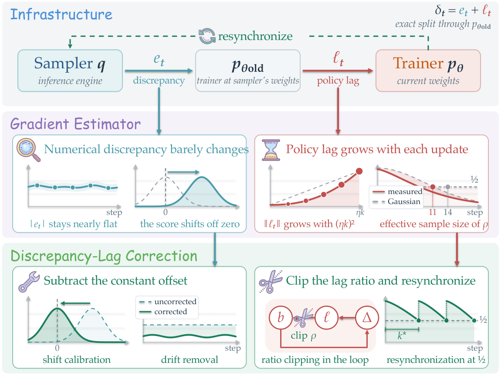
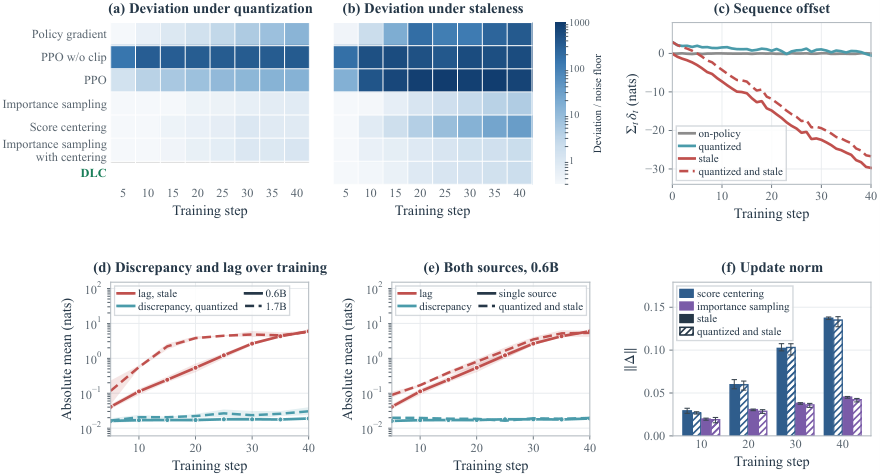
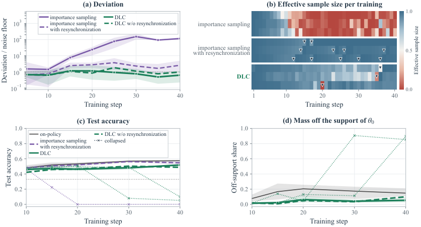

# On the Origin and Evolution of Training-Inference Mismatch in LLM Reinforcement Learning 深度精读

> **论文**：On the Origin and Evolution of Training-Inference Mismatch in LLM Reinforcement Learning
> **作者**：Yu Li（George Washington University）、Yufa Zhou（Duke University）、Tian Lan（George Washington University）
> **arXiv ID**：2610.40945
> **发表时间**：2026-11-03（arXiv v1；HuggingFace Daily Papers 2026-11-03 收录）
> **许可协议**：arXiv 默认许可（论文未声明开源代码）
> **代码仓库**：无官方实现（论文使用 verl + vLLM 训练栈复现）

## 第 1 章 概述

### 1.1 一句话定位

这篇论文回答了一个 LLM 强化学习训练系统中最基础却常被回避的问题：**当推理引擎（vLLM）与训练器（trainer）之间存在概率分布差异时，这个"训练-推理失配"究竟由什么构成、如何随训练演化、以及为什么同一修正方法在不同失配来源下表现相反**——作者将采样 token 误差精确分解为"数值差异"（近似恒定）与"策略滞后"（自诱导增长、形成反馈环）两个分量，据此提出 DLC 修正，使异步（stale sampler）训练与 on-policy 训练的偏差稳定在噪声底板的 2 倍以内。

### 论文图表总览

| 编号 | 内容 | 章节 |
|------|------|------|
| **Figure 1** | 训练-推理失配的起源、演化与修正总览概念图 | 第 1 章 |
| **Figure 2** | 各修正方法偏差热图 + 数值差异/策略滞后增长曲线（panels a-f） | 第 4 章 |
| **Figure 3** | 训练闭环三环节测量（mean lag、偏置范数、loop gain、ηk 标度） | 第 5 章 |
| **Figure 4** | 重要性加权的有效范围（ratio 重尾、ESS 交叉、IS 偏差离地） | 第 6 章 |
| **Figure 5** | DLC 与 IS / IS+resync / DLC w/o resync 对比（Qwen3-1.7B） | 第 8 章 |
| **Table 1** | 失配的两层分类（基础设施层 5 项 + 算法层 2 项） | 第 2 章 |
| **Table 2** | 三种失配源下各修正的偏差与精度（Qwen3-0.6B） | 第 4 章 |
| **Table 3** | 各修正方法的逐 token 梯度 / ratio 分母 / centering / 自适应控制对比 | 第 7 章 |
| **Table 4** | Stale sampler 下逐 step 偏差与精度（0.6B 与 1.7B） | 第 8 章 |
| **Table 5** | 符号表（Appendix A） | — （仅参考） |
| **Table 6** | 两种统计口径的 deviation（Appendix B） | 第 8 章 |
| **Table 7** | Qwen3-1.7B 每步耗时分解（Appendix C） | 第 8 章 |
| **Table 8** | Qwen3-8B 各修正偏差与精度（Appendix C） | 第 8 章 |
| **Table 9** | 连续异步训练各修正对比（Appendix C） | 第 8 章 |
| **Table 10** | 线性化 vs 精确权重重算的偏置预测（Appendix G） | 第 5 章 |

*图1：论文的总览概念图——trainer 在 sampler 权重处的 forward pass 将采样 token 误差一分为二：源自引擎数值的 numerical discrepancy（训练中近似恒定，用 centering 消除 drift）与源自 trainer 自身更新的 policy lag（随累积更新增长并形成反馈环，用 clip + 重同步切断），DLC 按此分解逐项分配修正层。*

### 1.2 核心贡献

1. **精确分解（Eq 2）**：在 sampler 权重 $\theta_{\mathrm{old}}$ 处评估 trainer，将采样 token 误差 $\delta_t = \log p_\theta - \log q$ 精确拆为 policy lag $\ell_t$ 与 numerical discrepancy $e_t$；该分解是 importance ratio 在 sampler 权重处因式分解的对数形式。实测 $e_t$ 在训练中近似恒定（约 0.02 nats/token），$\ell_t \approx \Delta^\top s_t$ 随累积更新自诱导增长。
2. **策略滞后的训练闭环（Eq 3-5）**：残余偏置 $b_k$ 线性于累积更新（$b \approx -M\Delta$），进入下一更新后放大下一 lag，形成正反馈环；score centering 的超额更新范数含正的 $(\eta k)^2$ 二次项（实测 $c = 0.52$，$R^2 = 0.987$），解释了 centering 在 staleness 下的逐步恶化。
3. **重要性加权的有效范围**：Gaussian lag 下有效样本量 $\mathrm{ESS} = e^{2\mu}$ 在 $\mu = -\frac{1}{2}\log 2 \approx -0.35$ nats 处跌破 1/2；实测重尾使该交叉提前——Qwen3-1.7B 上 step 11（$\mu = -0.15$ nats）即失效，比 Gaussian 预测（step 14）早 3 步，IS 偏差随后在 step 30 达 152 倍底板。
4. **DLC 修正方法**：centering 消数值差异的 drift + 以 sampler 权重为参考 clip lag ratio（$\varepsilon = 0.2$，dual-clip $c = 3$）+ ESS < 1/2 时重同步 sampler；在 Qwen3-0.6B/1.7B/8B 的 stale 及连续异步设定下把偏差压至 0.6–3.1 倍底板，且重同步阻止了 per-token 修正无法察觉的 off-support 崩溃。

### 1.3 关键结果速览

| 设定 | 关键数值 | 来源 |
|------|---------|------|
| Qwen3-0.6B stale、step 40 | DLC 偏差 **1.9×floor**、精度 **31.7%**（on-policy 46.5%，score centering 12.2%，IS+centering 32.0%） | Table 2/4 |
| Qwen3-1.7B stale、step 40 | DLC 偏差 **0.6×floor**、精度 **51.9%**（on-policy 57.6%）；IS 在 step 30 达 **152×floor**、精度 0.5% | Table 4 |
| IS 失效点（1.7B） | ESS 跌破 1/2 于 **step 11**（mean lag −0.15 nats/token），Gaussian 预测 step 14 | §6.1 |
| Qwen3-8B stale、step 40 | DLC **3.1×floor / 49.6%**；score centering 89.1×floor；M2PO 10768×floor、精度 0.0% | Table 8 |
| 连续异步（1.7B，max gap 4） | DLC **1.2×floor / 55.9%**（on-policy 56.8%）；admission 变体 0.8×floor / 55.3% | Table 9 |
| 数值差异 vs 策略滞后 | $e_t \approx 0.02$ nats/token 恒定；stale sequence offset 每步增长约 0.7 nats | §4.2 |
| DLC 额外开销（1.7B） | 每步 113.2 s vs on-policy 50.4 s（约 2.2 倍）；重同步拷贝 ≤1.5 s/次，每 40 步仅 1 次 | Table 7 |

## 第 2 章 背景与问题

### 2.1 on-policy RL 的工程现实与训练-推理失配

LLM 的 on-policy 强化学习在理论上有一个朴素假设：训练响应采样自当前策略，梯度是在"此刻的策略"产生的数据上计算的。
工程实践中，RL 系统通常在同一份权重上运行两套系统：vLLM（Kwon et al., 2023）这类推理引擎负责采样响应，一个独立的 trainer 负责在其上计算 policy gradient。
这套"sampler + trainer"的分工正是当前主流训练栈（如 verl + vLLM）的默认形态，也正是失配的温床。
论文从中辨认出两个失配来源。

第一个来源是**引擎数值（engine numerics）**。
推理引擎用自己的一套 kernel 和数值精度计算 token 概率，因此即使权重完全相同，引擎给出的分布 $q$ 与 trainer 的分布 $p$ 也不一致。
Yao et al. (2025) 首次报告 vLLM 与 FSDP 在相同权重下给出不同的 token 概率，Liu et al. (2025a) 进一步把这一差距追溯到引擎数值、量化与 kernel 实现的差别。
低精度 sampler 会进一步拉大这个差距。

第二个来源是**异步采样的过期权重（stale weights）**。
AReaL（Fu et al., 2025）、PipelineRL（Piché et al., 2025）等异步系统引入了第二类失配：sampler 持有上一次同步时的权重，而 trainer 持续向前更新，于是采样权重 $\theta_{\mathrm{old}}$ 系统性地落后于训练权重 $\theta$。
两个来源常常同时在场：异步系统里的 sampler 既持有旧权重、又运行在引擎自己的数值上。

在这两个来源的作用下，"用 $q$ 的样本、按 $p$ 计算梯度"的训练实际上已经是 off-policy 学习。
论文把 $q$ 与 $p$ 之间由全部来源造成的总差距统称为 **training-inference mismatch（训练-推理失配）**。
麻烦在于，失配不是单一对象：一个能在某种来源下稳定训练的修正方法，换一种来源就可能失效（详见 2.2 节的源依赖现象）。
找出"失配源的哪种性质决定了它需要何种修正"，构成了全文的出发点。

### 2.2 三类现有修正与源依赖现象

要刻画修正方法的作用方式，先看单个 prefix 处的更新如何分解。
设 $s_t=\nabla_\theta\log p_\theta(y_t\mid h_t)$ 为采样 token 的 score，$a$ 为 token 之后该 prefix 上的期望 advantage，$\bar{a}=\mathbb{E}_q[a]$、$\bar{s}=\mathbb{E}_q[s]$ 为 sampler 下的均值。
on-policy 时 mean score 为零（概率对全词表求和为一），因此 prefix 上恒定的 advantage 期望贡献为零。
在 sampler 下，更新按 Marek & Ryabinin (2026) 分解为

$$\mathbb{E}_q[a\,s]=\mathbb{E}_q[a]\,\mathbb{E}_q[s]+\mathrm{Cov}_q(a,s),\qquad \mathbb{E}_q[s]=\mathbb{E}_q[s]-\mathbb{E}_p[s]=-\nabla_\theta\,\mathrm{KL}(q\,\|\,p_\theta).$$

第一项 $\bar{a}\bar{s}$ 称为 **drift**：一个只通过 advantage 均值依赖 advantage 的项。
由第二行可知，drift 恰好是以 $\bar{a}$ 为步长、沿 $\mathrm{KL}(q\|p_\theta)$ 梯度方向的一步——在期望 advantage 为正的 prefix 上把 trainer 蒸馏向 sampler，在期望 advantage 为负的 prefix 上把 trainer 推离 sampler。
GRPO 式 group centering 只把每个 prompt 内的平均 advantage 置零，而通往正确答案途中的 prefix 期望 advantage 为正、出错之后的 prefix 为负，所以在携带学习信号的 prefix 上 drift 并不为零。

针对失配，现有工作提出三类逐 token 的修正：

- **截断 importance sampling**：每个采样 token 乘上截断比值 $\min(p/q,\,2)$（Yao et al., 2025）。
  未截断的比值本可把 drift 完全消去，但对稀有 token 的截断会把一部分 drift 带回来。
- **score centering**：把 $s_t$ 换成 $s_t-\bar{s}_t$，即在每个 prefix 减去 sampler 的 mean score（Marek & Ryabinin, 2026）。
  centered 更新恰好等于上述分解在 $q$ 下的 covariance 项，从而把 drift 整体移除。
  实现上 sampler 只在其 top-128 head 上上报 log-probabilities，尾部概率以尾质量比 $\kappa=(1-\sum_{H}q_v)/(1-\sum_{H}p_v)$ 估计；由于全词表 mean score 在 $p$ 下为零，centering 所减的均值可写成 $\hat{s}_t=\sum_{v\in H}(q_v-\kappa p_v)\,s_v$。
- **PPO clip**：把 $p_\theta$ 对某个参考策略的比值截断（Schulman et al., 2017）。
  参考策略有两种取法——sampler 权重处的 trainer，或每个 batch 之前的 trainer（decoupled PPO，Hilton et al., 2022；AReaL，Fu et al., 2025）——这个选择的影响将在论文 §6.2 揭示。

此外，importance sampling 与 centering 可以组合（IS + centering）：按 IS 的方式加权每个 token，再减去 sampler 下加权 score 的均值。

Marek & Ryabinin (2026) 观察到的**源依赖（source dependence）现象**是本文最直接的动机：

- quantized sampler 下，score centering 单独训练效果最好；
- 每 64 步同步一次的 sampler（stale）下，importance sampling + centering 能继续训练，而 score centering 单独掉队；
- PPO 在 staleness 下存活，却在量化以及合成权重噪声下崩溃。

他们对前两者的解释是 score centering 在 sampler 分布下取到的 covariance，对第三者的解释是 PPO 的 clip 本为"policy movement 产生的比值"设计。
换言之，这些解释是逐个修正、逐个来源给出的，尚无统一机理说明为什么同一个修正换个来源就失效。
旁证还有两条：异步 GRPO 的崩溃规模随 staleness 与 learning rate 的乘积增长（Song et al., 2026）；importance 加权的异步训练在真正发散之前就先丢掉 effective sample size（Huang et al., 2026）。
这些现象共同说明，修正的行为取决于估计器与产生失配的过程两个方面，而不是估计器单独决定的。
本文的视角转变在于：把 sampler 放回训练环内部——sampler 是 trainer 的一个有偏副本，且会周期性地同步回去，因此失配不是一个静态噪声源，而是随训练演化的对象。

从更长的相关研究脉络看，截断与截幅的重要性加权在 off-policy RL 中有悠久传统（Ionides, 2008；Munos et al., 2016；Espeholt et al., 2018），ACER 将截断与全动作集上的偏差修正项结合（Wang et al., 2017），GSPO 把 clip 移到序列层（Zheng et al., 2025c）。
面向 stale sampler 的方法还包括 M2PO（约束重要性权重的二阶矩，Zheng et al., 2025a）、VCPO（按 effective sample size 缩放学习率，Huang et al., 2026）、GAC（把更新投影到远离 stale 对齐方向，Xu et al., 2026）、SAT（用 log-ratio 作 staleness 代理收缩 PPO 信任区域，Yang et al., 2026）与 GMC-GRPO（按组约束重要性质量，He et al., 2026）。
但后三者在不做 centering 的前提下分析更新，且未把 policy lag 与 numerical discrepancy 分开。
面向 quantized sampler 的方法（AIS、QaRL：Zhou et al., 2026b；Gu et al., 2026）把 discrepancy 因子与 PPO 比值分开加权，Chen et al. (2026) 按量化噪声校准 clip 范围。
这些方法各自针对一个源，缺少一个统一判据来说清"哪个源需要哪种修正"。

### 2.3 失配的两层分类

论文的 Table 1 按"由哪一层负责修正"把失配分成两层：基础设施层决定 sampler 能偏离 trainer 多远，算法层修正实际到达梯度的部分。
一旦基础设施对齐了采样、上报与 token 序列，到达算法层的只剩权重版本与引擎数值两项。
而其中只有权重版本随训练更新变化——基础设施层五项里，唯有它与训练动态耦合，其余四项要么恒定、要么可以通过配置消除。

| 层级 | 失配 | 来源 | 修正 |
|---|---|---|---|
| 基础设施层 | Weight version（权重版本） | 异步 rollout | 同步、有界 staleness（Fu et al., 2025；Piché et al., 2025） |
| 基础设施层 | Engine numerics（引擎数值） | 低精度、kernel | batch-invariant kernels（He and Thinking Machines Lab, 2025）、FP16 训练（Qi et al., 2025） |
| 基础设施层 | Sampling and reporting（采样与上报） | top-p、处理后的 log-probabilities | 上报实际抽样的分布 |
| 基础设施层 | Sequence identity（序列一致性） | 重新 tokenize | 向 trainer 传 token ids |
| 基础设施层 | Response selection（响应选择） | 按 reward 过滤、部分 rollout | 与结果无关的组批（outcome-independent batching） |
| 算法层 | Policy lag $\ell_t$ | 权重版本，随更新增长 | decoupled PPO（Hilton et al., 2022）、M2PO（Zheng et al., 2025a）、VCPO（Huang et al., 2026） |
| 算法层 | Numerical discrepancy $e_t$ | 引擎数值，训练中近似恒定 | 截断 importance sampling（Yao et al., 2025）、score centering（Marek and Ryabinin, 2026） |

算法层两项的动力学差异是全文的骨架。
权重版本失配给出 **policy lag**：

$$\ell_t=\log p_\theta(y_t\mid h_t)-\log p_{\theta_{\mathrm{old}}}(y_t\mid h_t),$$

它随 trainer 的更新而增长，由"以 sampler 权重为比值分母"一类的方法（decoupled PPO、M2PO、VCPO）处理。
引擎数值失配给出 **numerical discrepancy**：

$$e_t=\log p_{\theta_{\mathrm{old}}}(y_t\mid h_t)-\log q(y_t\mid h_t),$$

它在训练中近似恒定，由逐 token 的截断 importance sampling 与 score centering 处理。
于是在 sampler 权重 $\theta_{\mathrm{old}}$ 处以 trainer 数值引入第三个 log-probability、每次只改变一个属性，采样 token 误差 $\delta_t=\log p_\theta(y_t\mid h_t)-\log q(y_t\mid h_t)$ 被精确拆成两项之和：

$$\delta_t=\ell_t+e_t.$$

这正是 importance ratio 在 sampler 权重处因式分解为"policy staleness 因子 × training-inference discrepancy 因子"的对数形式（Guan et al., 2026）。
实现上，这个中间项由 trainer 在 $\theta_{\mathrm{old}}$ 处的一次参考 forward 提供，代价将在论文 §7 讨论。

基础设施层其余三行关心的则是 sampler 上报什么、trainer 收到什么。
top-p 采样与处理后的 log-probabilities 会使上报的 $q$ 偏离实际抽出 token 的分布，修正方法是直接上报被抽样的分布。
解码文本的重新 tokenize 会改变 token 序列，修正方法是向 trainer 传 token ids。
按 reward 过滤响应、部分 rollout 中推迟长响应，会使 batch 的组成依赖结果，修正方法是 outcome-independent batching。
论文明确说明：这三项失配在其 §3 的实验配置下全部消失（具体见本报告第 3 章），因此算法层只需面对权重版本与引擎数值两个源。
此外，工程侧还发展出一批数值治理手段：batch-invariant kernels、跨 tensor-parallel 尺寸的确定性推理（Zhang et al., 2025）、FP16 训练、FP32 language-model head（MiniMax, 2025）、MoE 的 router replay（Ma et al., 2025）。
Zhong et al. (2026) 用 bitwise 对齐的参考引擎隔离数值失配，Yu et al. (2026) 将其建模为 logits 位移并据此校准重要性权重。
本文的贡献不在表格右列里再添一项，而是给出统一判据：把每个失配源归到 $\ell_t$ 或 $e_t$，再按其动力学性质分配修正。

### 2.4 核心研究问题

论文的关键观察是：在单个 prefix 处，未截断比值与 score centering 都能移除 drift。
因此失配来源必须通过两条途径起作用——**每个修正在 drift 之后还留下了什么**，以及**这个剩余部分在训练过程中如何演化**。
由此提出核心研究问题：

> **mismatch 源的哪个性质决定了它需要何种修正？**
> （Which property of a mismatch source decides the correction it needs?）

这个问题可以拆成三问，分别对应失配的起源、演化与修正分配：

1. **起源**（论文 §4）：在 sampler 权重处评估 trainer，把每个采样 token 误差精确分解为 numerical discrepancy 与 policy lag。
   前者源自引擎，训练中近似固定；后者源自 trainer 自身的更新，随累积更新增长。
2. **演化**（论文 §4、§5）：numerical discrepancy 以近似固定的量偏置每一步更新、不反馈进后续误差，故移除其主导偏置（drift）即可。
   policy lag 则构成训练环——修正留下的残余偏置进入下一更新，下一更新又放大下一 lag，形成正反馈。
3. **修正分配**（论文 §6、§7）：ratio weighting 能切断这个环，但仅当 lag ratio 保持集中（effective sample size 高于 1/2）。
   越过有效范围后，算法够不到的部分要交还基础设施，通过重同步 sampler 解决。

这条思路最终凝结为论文提出的 discrepancy-lag correction（DLC）：
对 numerical discrepancy 做 centering、以 sampler 权重为参考对 lag ratio 做 PPO clip、并在 lag ratio 的 effective sample size 跌破 1/2 时重同步 sampler。
后续各章将看到，这个组合里的每个部件都精确对应上述分解中的一个项。

## 第 3 章 实验设置

### 3.1 四种 sampler：受控的失配源

实验设计的核心，是把 Table 1 基础设施层的失配压缩为两个可独立开关的源——引擎数值与权重版本——并按 2×2 组合构造四种 sampler：

| Sampler | 权重与同步 | 引擎与精度 | 引入的失配 |
|---|---|---|---|
| reference | 当前权重 $\theta$（与 trainer 同步） | vLLM BF16 + CUDA graphs | 无（on-policy 基准） |
| quantized | 当前权重 $\theta$（与 trainer 同步） | 权重 FP8（128×128 blocks）+ 动态激活量化 + FP8 KV cache | 仅引擎数值 $e_t$ |
| stale | 初始权重 $\theta_0$（每 64 步同步一次） | vLLM BF16 | 仅权重版本（policy lag $\ell_t$） |
| quantized+stale | 初始权重 $\theta_0$（每 64 步同步一次） | FP8（同 quantized） | $e_t$ 与 $\ell_t$ 叠加 |

- **reference**：vLLM 以 BF16 运行并启用 CUDA graphs，与 trainer 保持对齐（每步训练后同步一次权重），给出 on-policy 训练，是所有比较的基准。
- **quantized**：权重以 FP8（Micikevicius et al., 2022）按 128×128 分块存储，激活做动态量化，KV cache 亦为 FP8，单独隔离引擎数值失配。
- **stale**：BF16 运行，每 64 步才同步一次权重。
  由于训练全程只有 40 步，sampler 在整个训练中始终持有初始权重 $\theta_0$，单独隔离权重版本失配。
  此时 version gap 恰为累积更新 $\Delta=\theta-\theta_0$，随训练逐步增长。
- **quantized+stale**：对 stale 持有的 $\theta_0$ 做同样的 FP8 量化，两个源叠加，用于检验分解的可加性（论文 §4.2）。

四种 sampler 都以温度 1 采样、不做截断（无 top-p），并直接向 trainer 传递 token ids。
配合对 batch 组成不做基于结果的干预，Table 1 基础设施层的后三项失配（采样与上报、序列一致性、响应选择）在该配置下全部消失。
于是到达算法层的失配只剩权重版本与引擎数值两项，正好对应第 2 章的两类算法层修正对象。
四种 sampler 提供了这两个源的单独对照与叠加组合，论文 §4.1 的 Table 2 即按 quantized / stale / quantized+stale 三列报告各修正的表现。

### 3.2 训练协议

| 项目 | 配置 |
|---|---|
| 模型 | Qwen3-0.6B / Qwen3-1.7B（Qwen Team, 2025），非思考（non-thinking）模式 |
| 任务与奖励 | Countdown，reward $\pm 1$ |
| 批次 | 每步 64 个 prompt × 每个 8 个样本 |
| 长度上限 | 135 prompt tokens / 377 response tokens |
| advantage | reward 减 group mean，无 std 归一化 |
| 优化器 | SGD，learning rate $10^{-2}$，无动量、无 warmup、无权重衰减，每 batch 一步更新 |
| 训练规模 | 每配置 3 runs × 40 steps |
| 框架 | verl（Sheng et al., 2024）+ FSDP2，BF16 compute、FP32 master weights，vLLM sampler |

训练协议刻意保持极简，以隔离失配本身的作用。
模型为 Qwen3-0.6B 与 Qwen3-1.7B 的非思考模式，任务为 Countdown，奖励为 $\pm 1$。
advantage 取 reward 减去同 prompt 组内均值，不做标准差归一化；loss 对 token 取平均。
每步采 64 个 prompt、每个 8 个样本，prompt 最长 135 tokens、响应最长 377 tokens。
优化器为纯 SGD：learning rate $10^{-2}$，无动量、无 warmup、无权重衰减，每个 batch 只做一步更新。
PPO 基线是唯一例外：它每个 batch 做 4 次更新，clip 亦按此设置（论文 §6.2）。
每个配置独立训练 3 次、每次 40 步，全部运行在 verl + FSDP2 上，compute 为 BF16、master weights 为 FP32，采样由 vLLM 完成。
两个附加协议服务于后续章节的机理分析：
为检验偏置累积，stale 下的 score centering 与 importance sampling 以减半的 learning rate $5\times 10^{-3}$ 重复运行（论文 §5.3）；
Qwen3-1.7B 每 5 步保存 checkpoint，供离线测量使用。
40 步的短训练同样是有意为之：配合在共享 checkpoint 上重放 sampler，使各项测量都落在尚未崩溃的训练轨迹上。
在线训练与离线测量是分开的：训练只产出 checkpoint，全部失配度量（deviation、误差分解等）都在固定的 checkpoint 与固定的 probe prefixes 上离线完成。

### 3.3 度量协议

**deviation（偏离度）** 衡量"一个失配源 + 一种修正"把训练带偏离 on-policy 多远。
定义为训练后模型与同配置 on-policy 训练所得模型之间的全词表 next-token KL，再按 noise floor 归一化：

$$\text{deviation}=\frac{\operatorname{KL}\big(p_{\text{trained}}\,\|\,p_{\text{on-policy}}\big)\ \text{（全词表，固定 probe prefixes，3 对平均）}}{\text{noise floor}}$$

其中 probe prefixes 固定为由初始模型 $\theta_0$ 对固定 prompt 集合生成的响应的各前缀。
该配置的 3 个 runs 与对应的 3 个 on-policy runs 两两配对，KL 取 3 对平均。
noise floor 定义为两次独立 on-policy 训练之间的平均 KL。
deviation 的单位是 ×floor（noise floor 的倍数）：1 ×floor 表示偏离与"两次正常 on-policy 训练彼此之间的差异"同量级，on-policy 基准按构造即为 1.00 ×floor。
以 noise floor 归一化使不同配置、不同模型规模下的结果直接可比。
论文把 stale sampler 下保持在 2 ×floor 以内作为 DLC 的设计目标（论文 §7）。
统计口径上，附录 B 同时报告"均值之比"（正文采用）与"逐 run 比值的均值"两种算法，二者结论一致。

**test accuracy（测试正确率）** 在 64 道训练集之外的 Countdown 测试题上测量，每题采 8 个样本，报告正确率（单位 %）。
两组锚点数字便于定位各方法的位置：
Qwen3-0.6B 上初始模型 $\theta_0$ 为 8.2%、on-policy 训练 40 步后为 46.5%；
Qwen3-1.7B 上分别为 33.4% 与 57.6%。
任何修正方法的表现都落在这两个锚点之间——下界是"不训练"，上界是"完美修正"。
deviation 衡量训练轨迹的保真度，accuracy 衡量最终模型的可用性。
论文 §7 的结果显示两者排序大体一致，但也存在 deviation 保持在 floor 而 accuracy 已崩溃的情形——那正是"逐 token 修正只作用于 sampler 抽到的 token"这一限制的体现（论文 §7.3）。
## 第 4 章 误差的精确分解：数值差异与自诱导策略滞后

### 4.1 修正方法的源依赖现象（Table 2）

论文首先用 40 步训练复现了 Marek & Ryabinin (2026) 报告的源依赖现象。在 **Qwen3-0.6B** 上，三种失配源（量化 / 过期 / 量化+过期）下各修正的偏差（以 noise floor 为单位）与测试精度如下（偏差为 step 20 / step 40，精度为 %）：

| 修正方法 | Quantized（20/40, 精度%） | Stale（20/40, 精度%） | Quantized+Stale（20/40, 精度%） |
|:---|:---:|:---:|:---:|
| 初始模型 $\theta_0$ | – / – , 8.2 | – / – , 8.2 | – / – , 8.2 |
| On-policy 训练 | 1.00 / 1.00, 46.5 | 1.00 / 1.00, 46.5 | 1.00 / 1.00, 46.5 |
| Policy gradient | 1.59 / 12.7, 26.4 | 178 / 345, 0.2 | 45.0 / 107, 0.2 |
| PPO w/o clip | 314 / 336, 0.0 | 466 / 534, 0.0 | – |
| PPO（batch 参考策略） | 7.52 / 14.3, 26.2 | 817 / 699, 0.0 | – |
| Importance sampling | 0.43 / 0.74, 43.2 | 1.16 / 4.50, 20.9 | 1.25 / 3.91, 27.1 |
| Score centering | 0.53 / 0.80, 46.5 | 3.91 / 31.7, 12.2 | 4.19 / 28.1, 18.4 |
| IS + centering | 0.53 / 1.11, 46.0 | 0.86 / 2.10, 32.0 | 1.20 / 2.61, 30.5 |
| **DLC（本文）** | – | **0.86 / 1.93, 31.7** | **0.96 / 2.17, 30.3** |

三个规律值得注意：① 量化源下 centering 一枝独秀（精度 46.5% 与 on-policy 完全持平）；② 过期源下 centering 恶化到 31.7×floor、精度 12.2%，而 IS+centering 保持 2.1×floor、32.0%；③ PPO 在本文实现（每 batch 4 次更新、batch 参考策略）下两种源都失败——量化下与 policy gradient 同级（14.3 vs 12.7×floor），过期下达 699×floor。

### 4.2 精确分解：policy lag 与 numerical discrepancy

在同一权重下，引擎分布 $q$ 与 trainer 分布 $p_\theta$ 因 kernel 与精度而不同；异步采样又使 sampler 停留在旧权重。引入第三个对数概率——**trainer 的 numerics 在 sampler 权重 $\theta_{\mathrm{old}}$ 处求值**——即可逐属性拆分误差：

$$
\delta_t = \log p_\theta(y_t \mid h_t) - \log q(y_t \mid h_t) = \underbrace{\log p_\theta(y_t \mid h_t) - \log p_{\theta_{\mathrm{old}}}(y_t \mid h_t)}_{\ell_t \; \text{(policy lag)}} + \underbrace{\log p_{\theta_{\mathrm{old}}}(y_t \mid h_t) - \log q(y_t \mid h_t)}_{e_t \; \text{(numerical discrepancy)}}
$$

这正是 importance ratio $\frac{p_\theta}{q} = \frac{p_\theta}{p_{\theta_{\mathrm{old}}}} \cdot \frac{p_{\theta_{\mathrm{old}}}}{q} = e^{\ell_t} e^{e_t}$ 的对数形式；trainer 在 $\theta_{\mathrm{old}}$ 处的一次参考 forward pass 即可同时给出两项。

**两个分量遵循完全不同的动力学**（Figure 2 panels c-f）：

- **数值差异近似恒定**：量化 sampler 的误差即数值差异，全程约 **0.02 nats/token**；对整个 response 求和得到恒定的 sequence offset（长 response 上约 8.9 nats）。它不依赖累积更新 $\Delta$，因此每一步以几乎相同的量偏置更新，不会反馈进后续误差——**在每个 prefix 上 centering 掉其 drift 即可消除一阶偏置**。
- **策略滞后自诱导增长**：stale sampler 的数值差异低于 $10^{-3}$ nats，其误差几乎全是 policy lag；一阶展开 $\ell_t \approx \Delta^\top s_t$ 表明 lag 完全来自 trainer 自己的移动。其 sequence offset 每步增长约 **0.7 nats**。量化与过期两类误差在 step 5 即清晰分离（Figure 2d）。
- **组合源的检验**：quantized+stale 的数值差异保持量化单独作用的值，其累积更新与纯 stale run 的差距在 10% 以内（对 centering 与 IS 都是），偏差保持 stale 的排序——证明两个分量可叠加处理，分解是"正交"的。

### 4.3 更新在 prefix 处的结构：drift 与协方差

在单个 prefix 上，sampler 下的期望更新分解为（Eq 1）：

$$
\mathbb{E}_q[a\,s] = \mathbb{E}_q[a]\,\mathbb{E}_q[s] + \mathrm{Cov}_q(a,s), \qquad \mathbb{E}_q[s] = -\nabla_\theta\, \mathrm{KL}(q \,\|\, p_\theta)
$$

第一项 $\bar{a}\bar{s}$ 即 **drift**：它等于以 $\bar{a}$ 为步长、朝 $\mathrm{KL}(q\|p_\theta)$ 梯度方向的一步——在期望优势为正的 prefix 上把 trainer 蒸馏向 sampler，在期望优势为负的 prefix 上推离。由于 group centering 只把每个 prompt 的平均 advantage 置零，通往正确答案途中的 prefix（正期望优势）与出错之后的 prefix（负期望优势）依然承载非零 drift。未截断 ratio 与 centering 都能在单 prefix 处精确消掉 drift，因此**各修正的差异在于它们消掉 drift 之后剩下什么、以及剩余部分如何随训练演化**——这是全文分析的主线。

*图2：panels a-b 为各修正随训练步数的偏差曲线（量化与过期源下排序相反）；panels c-f 证明分解的二分动力学——量化误差恒定在约 0.02 nats/token，stale 的 sequence offset 每步增长约 0.7 nats，二者在 step 5 分离；组合源的数值差异与累积更新分别保持量化单独作用与 stale 单独作用的水平。*

## 第 5 章 策略滞后的训练闭环

### 5.1 闭环的三环节

Staleness 下 sampler 停在 $\theta_0$，版本差等于累积更新 $\Delta$。一个训练步经过三个环节：**lag 增长**（$\Delta_k$ 决定每个采样 token 的 lag）→ **残余偏置**（lag 决定修正方法留下的偏置 $b_k$）→ **偏置累积**（偏置进入下一更新）：

$$
\Delta_{k+1} = \Delta_k + \eta\,(g_k + b_k) \approx (I - \eta M)\,\Delta_k + \eta\, g_k, \qquad b_k \approx -M\Delta_k
$$

其中 $g_k$ 是 on-policy 梯度，$M$ 收集修正方法留下的 per-token 权重。沿 $M$ 的特征值 $\lambda < 0$ 的方向，每步将偏置驱动的部分乘以 $1 - \eta\lambda > 1$——**放大持续到下一次同步把 $\Delta$ 重置为零**。这就是异步 GRPO 崩溃随"staleness × 学习率"乘积标度的微观机制（与 Song et al. 2026 的稳定性边界一致）。

### 5.2 残余偏置的精确结构（Eq 4-5）

Centering 精确消掉 drift 后剩下的偏置可写为四项（Eq 4）：**prefix 项**（prefix 分布 $\mu^q_t$ 与 $\mu^p_t$ 之差）、**continuation 项**（token 之后的 continuation 期望优势之差）、**token 项**（$q$ 与 $p$ 下协方差之差）、**tail 项**（sampler 只报告 top-128 head 带来的估计误差，由基础设施决定）。前三项都来自 $\delta_t = \ell_t + e_t$：数值差异给它们每步同样的大小，策略滞后给它们一个随 $\Delta$ 增长的部分。

一阶展开下（staleness，$\ell_t \approx \Delta^\top s_t$，$S_t = \sum_{t' < t} \ell_{t'}$）：

$$
b_{\mathrm{c}} \approx -\sum_t \mathbb{E}\big[\big((A_t - \bar{A}_t)\,\ell_t + A_t S_t\big)\,s_t\big] \approx -M_{\mathrm{c}}\,\Delta, \qquad
b_{\mathrm{w}} \approx -\sum_t \mathbb{E}\big[A_t\,(S_t + \max(e^{\ell_t} - 2, 0))\,s_t\big] \approx -M_{\mathrm{w}}\,\Delta
$$

两者的差是一个对称矩阵（Eq 23）：

$$
M_{\mathrm{c}} - M_{\mathrm{w}} = \sum_t \mathbb{E}\big[(A_t - \bar{A}_t)\,s_t s_t^\top\big]
$$

其二次型在"优势低于 prefix 均值的 token 的 score"主导的方向上为负——这正是 $M$ 的负特征值（闭环放大方向）的来源。**Score centering 保留 token 项 $(A_t - \bar{A}_t)\ell_t$，而 importance sampling 在 ratio < 2 的 token 上把它消掉**——两种修正的差异被压缩到这一个矩阵差上。

### 5.3 闭环的实测验证

论文对三个环节逐一给出测量（Figure 3，均为 stale sampler、Qwen3-0.6B）：

| 环节 | 实测结果 | 数据来源 |
|------|---------|---------|
| lag 增长 | step 20 前 mean lag 幅度保持 $\|\Delta\|^2$ 的 110–150 倍（两种修正相同） | Fig 3a |
| 残余偏置 | centering 的 $\|b\|$ 随 $\|\Delta\|$ 线性增长（每 run $R^2 = 0.95$–$0.99$），step 40 达 2.5 倍梯度噪声；IS 的 $\|b\|$ 保持在噪声内 | Fig 3c |
| 偏置预测 | Eq 5 权重从单次 backward 预测 $b$，与实测 bias 余弦最高 0.55（噪声对照 ≤0.07），主要来自 prefix 项 | Fig 3d + Table 10 |
| 闭环增益 | step 20 时 centering 下负优势 token 平均 lag −0.66 nats、正优势 token −0.37 nats；IS 下两组一致 | Fig 3b |
| $\eta k$ 标度 | 半学习率的 run 落在全学习率曲线上；拟合 $E = a\,\eta k + c\,(\eta k)^2$ 给 $c = 0.52$、$R^2 = 0.987$（纯线性只有 0.90），六组拟合二次系数全为正 | Fig 3e/f |

Table 10（Appendix G）进一步比较线性化权重与精确权重的偏置重算：centering 线性化范数比在 step 40 高估至 3399 倍，用精确权重 $A_t(1 - e^{S_t})$ 等替换后降到 6.1 倍，余弦 0.09–0.28 仍高于噪声——说明线性化高估范数（线性 prefix 权重 $S_t$ 随位置增长而精确权重 $e^{S_t} - 1$ 保持在 −1 以上），但方向预测有效。

闭环的适用边界也很明确：step 20 之后 centering 的 lag 超过 1 nat，一阶分析失效；且 lag 逐渐扩散——lag 最大的 1% token 携带的 lag 总量从 step 5 的 78% 降到 step 40 的 11%。

## 第 6 章 重要性加权的有效范围

### 6.1 Ratio 的重尾与有效样本量

Staleness 下 token 的 importance ratio 是 $\rho_t = e^{\ell_t}$，在 $q$ 下均值为 1。Gaussian lag（$\ell \sim \mathcal{N}(\mu, \sigma^2)$，均值约束 $\mu = -\sigma^2/2$）下：

$$
\mathbb{E}[\rho^2] = e^{-2\mu}, \qquad \mathrm{ESS} = \frac{1}{\mathbb{E}[\rho^2]} = e^{2\mu}
$$

即 ESS 在 $\mu = -\frac{1}{2}\log 2 \approx -0.35$ nats 处跌破 1/2。**实测重尾使交叉显著提前**（Figure 4）：

- **Qwen3-1.7B**：训练日志逐步给出 ratio 二阶矩，实测 ESS 在 **step 11** 跌破 1/2（此时 mean lag 仅 **−0.15 nats/token**），Gaussian 预测要到 step 14（−0.35 nats）。用累积量展开 $\log \mathbb{E}[\rho^2] = -2\mu + \frac{2}{3}\nu_3 + \frac{1}{2}\nu_4 + \cdots$，实测交叉意味着高阶累积量贡献约 $\log 2 - 0.30 \approx 0.39$——lag 集中在少数 ratio 巨大的 token 上。越过该点后 IS 的偏差立即离地，**step 30 达 152 倍底板**，step 40 仍有 115 倍、精度掉到 0.5%（Table 4）。
- **Qwen3-0.6B**：更新更小，IS 的 mean lag 全程低于 0.3 nats，ESS 不越界，IS 偏差最多 4.5×floor——与 1.7B 形成对照，说明有效范围由"更新步长 × 模型尺度"共同决定。

另一个 Gaussian 失准的证据：step 40 时 Gaussian 预测 28% 的 token ratio < 0.5，实测只有 11%（0.6B）——多数 token 的 ratio 仍贴着 1，lag 集中在极少数 token 上。

### 6.2 PPO 参考策略的位置解释了源依赖

同一分解直接解释了 PPO 的不对称表现（Appendix J）：以 **sampler 权重为参考**时，clip 的 ratio 恰是 $e^{\ell_t}$——clip 约束的是 policy lag，数值差异留在 ratio 之外构成 drift；以 **batch 前的 trainer 为参考**时，policy lag 完全在 ratio 之外，clip 只约束 batch 内 4 次更新之间的移动。

实测印证（Table 2）：batch 参考的 PPO 在 staleness 下偏至 699×floor，比去掉 clip（534×floor）还差——clip 不仅没有修正 lag，反而保护了 batch 内的多次更新把 lag 偏置完整累积；而共享 sampler-参考 ratio 的 DLC clip 只有 1.9×floor。量化下 PPO（14.3×floor）与单次更新的 policy gradient（12.7×floor）同级——clip 移除了额外更新的代价，却留下数值差异的 drift。**修正方法的成败由"哪个分量进入了它的 ratio 分母"决定**，这一视角统一了 Marek & Ryabinin 观察到的全部源依赖现象。

## 第 7 章 DLC：差异-滞后修正

### 7.1 设计原则：把 Eq 4 的每一项分派给能消除它的层

DLC（discrepancy-lag correction）的更新式为：

$$
\hat{g}_{\mathrm{DLC}} = \sum_t A_t\,\big(m_t\,\rho_t\,s_t - C_t\big), \qquad C_t = \sum_{v \in H}\big(q_v\, m_v\, \rho_v - \kappa\, p_\theta(v)\big)\, s_v
$$

四个组件各司其职：

1. **Clip lag ratio（算法层，切闭环）**：以 sampler 权重为参考，PPO-clip lag ratio $\rho_t = e^{\ell_t}$，$\varepsilon = 0.2$、verl 默认 dual-clip 上界 $c = 3$。clip 范围内的权重即 lag ratio，与 staleness 下 IS 同阶地消掉 token 项 $(A_t - \bar{A}_t)\ell_t$——闭环增益的来源。
2. **Centering（算法层，消数值差异 drift）**：$C_t$ 是加权 score 在 sampler 下的均值；常数优势在 prefix 上的期望贡献为零（同 on-policy），数值差异的 drift 被消掉。sampler 只报告 top-128 head $H$，尾部取 $q_v = \kappa\, p_{\theta_{\mathrm{old}}}(v)$（$\kappa$ 为两侧尾质量比），clip 在尾部不激活。
3. **重同步（基础设施层，兜底）**：当 lag ratio 的 ESS 跌破 batch 的 1/2 时，把 trainer 权重拷贝给 sampler——重置 $\Delta$、lag 与 prefix offset，同时把 clip 参考移到 trainer 权重。算法够不着的 prefix/continuation 项与越界 token 的 lag 由此交还基础设施。
4. **一次参考 forward pass**：trainer 在 $\theta_{\mathrm{old}}$ 处的额外 forward 给出 $\ell_t$、$e_t$ 及 head 上 $p_{\theta_{\mathrm{old}}}$ 的对数概率。

**两个退化极限**（Appendix K 验证）：$\theta = \theta_{\mathrm{old}}$ 时 lag ratio 恒为 1、clip 不激活，$C_t$ 退化为 score centering 减去的均值分；$q = p_{\theta_{\mathrm{old}}}$ 且 clip 不激活时 $\kappa = 1$、$C_t$ 消失，退化为 PPO（sampler 参考）。相对 IS+centering，DLC 每步只多一次 $\theta_{\mathrm{old}}$ 处的 forward 并存储同样的 top-128 对数概率。DLC 的 loss（Eq 43）在 verl 的 PPO loss 上加一个 stop-gradient 的 head 项，一次 backward 即可得到上述更新。

### 7.2 与已有方法的结构对比（Table 3）

| 方法 | 逐 token 梯度 | ratio 分母 | centering | 自适应控制 |
|:---|:---|:---:|:---:|:---|
| Policy gradient | $A_t s_t$ | – | ✗ | – |
| Importance sampling | $w_t A_t s_t$ | $q$ | ✗ | – |
| Score centering | $A_t (s_t - \bar{s}_t)$ | – | ✓ | – |
| IS + centering | $A_t (w_t s_t - \sum_v q_v w_v s_v)$ | $q$ | ✓ | – |
| IS + resync | $w_t A_t s_t$ | $q$ | ✗ | $1/\mathbb{E}_q[\rho_t^2] < \frac{1}{2}$ |
| PPO（batch 参考） | $m^{\mathrm{b}}_t r_t A_t s_t$ | $p_{\theta_{\mathrm{batch}}}$ | ✗ | K=4 |
| PPO（sampler 参考） | $m_t \rho_t A_t s_t$ | $p_{\theta_{\mathrm{old}}}$ | ✗ | – |
| M2PO | $m^{\mathrm{M2}}_t \rho_t A_t s_t$ | $p_{\theta_{\mathrm{old}}}$ | ✗ | – |
| VCPO | $\bar{w}_i \hat{A}_i s_t$ | $q$ | ✗ | $\eta\,(\mathbb{E}[\bar{w}_i^2])^{-1/2}$ |
| **DLC（本文）** | $A_t (m_t \rho_t s_t - C_t)$ | $p_{\theta_{\mathrm{old}}}$ | ✓ | $1/\mathbb{E}_q[\rho_t^2] < \frac{1}{2}$ |

关键区分在 **ratio 分母**：除以 $q$ 的方法（三种 IS 变体、VCPO）其权重同时作用于数值差异和 lag；除以 $p_{\theta_{\mathrm{old}}}$ 的方法（PPO sampler 参考、M2PO、DLC）只加权 lag；三者中只有 DLC 再用 centering 消数值差异的 drift。自适应控制方面，VCPO 是在 ESS 下降时调慢学习率，DLC 与 IS+resync 则是把 sampler 移到 trainer、重置 lag——一个减速、一个重置，动作语义不同。

### 7.3 理论性质（Appendix K）

在单个 prefix 上，常数优势 $A$ 下 DLC 更新的期望为 $A \sum_{v \notin H} p_\theta(v)(e^{-e_v} - \kappa) s_v$——除尾部估计外精确为零；而 DLC 的 token 项里 **lag 只通过与数值差异的乘积进入（二阶）**，纯 stale（$e_t = 0$）下 token 项精确为零——这从结构上保证了 DLC 在闭环中不被 lag 驱动。clip 丢掉的 token 会把其 lag 加权的份额退回 token 项（与 IS 截断同理），因此 clip 也有同款有效范围——这就是重同步阈值与 clip 共用 ESS < 1/2 门槛的原因。
## 第 8 章 实验结果与分析

### 8.1 主结果：stale sampler 下的逐步偏差与精度（Table 4）

| 修正方法 | 0.6B 偏差@10/20/30/40 | 0.6B 精度% | 1.7B 偏差@10/20/30/40 | 1.7B 精度% |
|:---|:---:|:---:|:---:|:---:|
| 初始模型 $\theta_0$ | – | 8.2 | – | 33.4 |
| On-policy 训练 | 1.0 全程 | 46.5 | 1.0 全程 | 57.6 |
| Policy gradient | 2.0 / 178 / 116 / 345 | 0.2 | – | – |
| PPO | 407 / 817 / 798 / 699 | 0.0 | – | – |
| Score centering | 0.7 / 3.9 / 14.2 / 31.7 | 12.2 | 3.6 / 11.6 / 8.7 / 7.6 | 15.9 |
| Importance sampling | 0.3 / 1.2 / 2.4 / 4.5 | 20.9 | 1.4 / 23.8 / 152 / 115 | 0.5 |
| IS + centering | 0.5 / 0.9 / 1.5 / 2.1 | 32.0 | – | – |
| IS + resynchronization | – | – | 0.8 / 2.7 / 2.3 / 2.6 | 36.6 |
| **DLC（本文）** | **0.3 / 0.9 / 1.3 / 1.9** | **31.7** | **0.6 / 1.1 / 0.8 / 0.6** | **51.9** |

三条观察：

1. **DLC 是唯一在两个尺度上都贴住底板的方法**：0.6B 上 1.9×floor / 31.7%（与 IS+centering 的 32.0% 相当）；1.7B 上全程 ≤1.2×floor、step 40 收在 0.6×floor，精度 51.9%——三个 run 各自与同配置 on-policy 对应模型的差距都在 7 个百分点内（on-policy 57.6%）。
2. **尺度放大了 IS 的失效**：0.6B 上 IS 温和恶化（4.5×floor、20.9%），1.7B 上却在 step 20 后爆炸（152×floor）精度归零（0.5%）——对应 §6.1 的 ESS 越界点 step 11。这正是"更新步长随模型尺度增大、重尾更早出现"的直接后果。
3. **IS+resync 的精度均值被单 run 崩溃拖累**（36.6%）：它同样以 ESS<1/2 为阈值，但三次 run 分别命中阈值 2、4、5 次；DLC 的三次 run 各只重同步 1 次（step 20、35、36）——因为 clip+centering 把 lag 的增长速度本身压下来了，达到阈值更慢。若给 IS 用固定间隔同步，需要**每 11 步一次**才能留在有效范围内。

*图5：Qwen3-1.7B 上 DLC 与三条对照的全程对比——(a)(b) 加同阈值重同步的 IS 偏差从 115 降到 2.6×floor；(c) 精度曲线显示 DLC 三个 run 紧贴 on-policy；(d) 关键的 off-support 诊断：去掉重同步后两 run 崩溃时 off-support share 冲到约 90%，而带重同步的 DLC 全程 ≤11%。*

### 8.2 Off-support 崩溃：逐 token 修正的盲区（§7.3）

DLC 去掉重同步（保留 clip 与 centering）后在 1.7B 上三次 run 中两次跌破 $\theta_0$ 精度、输出约 26 token 的退化答案。**其偏差（在 sampler 的 prefix 上计算）却始终贴着底板**——这一"指标看不见的崩溃"是本文最深刻的发现之一：

- 诊断量是 trainer 自身 response 的 sequence KL 中落在 $p_{\theta_0}(y_t) < 10^{-3}$ token 上的份额（off-support share，256 条 test 响应计算）。两次崩溃时该份额达约 **90%**，此前最多 14%；DLC（带重同步）全程 ≤**11%**。
- 机制：centering、ratio 加权、clip 都只作用于 sampler 采到的 token；当 trainer 的策略向 stale sampler 极少采到的 token 偏移时，三类修正全部失效。这种偏移发生在 **sampler 到达不了的 prefix** 上——next-token KL（在 sampler 的 prefix 上算）对崩溃完全无感。
- 判别力：跨 checkpoint 的 off-support share 与"精度跌破 $\theta_0$"的 Spearman 相关为 **0.80**，高于 deviation 的 0.74。
- 重同步让 trainer 的 response 重新成为 sampler 的 response；连续异步（每步同步）下 DLC 的 admission 变体则改为推迟 ESS<1/2 的响应、用新权重重生成。

### 8.3 更大模型与连续异步（Table 8/9）

**Qwen3-8B、stale、单 run、step 40**：

| 修正方法 | 偏差（×floor） | 精度（%） |
|:---|:---:|:---:|
| 初始模型 $\theta_0$ | – | 35.4 |
| On-policy 训练 | 1.0 | 55.3 |
| Policy gradient | 6470 | 0.0 |
| PPO | 1100 | 20.7 |
| Score centering | 89.1 | 51.4 |
| Importance sampling | 6.2 | 51.0 |
| IS + centering | 2.9 | 51.8 |
| IS + resynchronization | 5.2 | 50.4 |
| M2PO | 10768 | 0.0 |
| VCPO | 14.0 | 42.6 |
| **DLC（本文）** | **3.1** | **49.6** |

8B 上 M2PO（约束 importance 权重二阶矩）与 policy gradient 同级崩溃（10768 / 6470×floor、精度 0.0%）。值得注意的是 M2PO 与 DLC 的 ratio 分母同为 $p_{\theta_{\mathrm{old}}}$，结构差异在于三者中只有 DLC 做 centering、且只有 DLC 带 ESS 触发的重同步；不过论文并未给出 M2PO 崩溃的机制分析，这一崩溃应主要归因于其未处理的 policy lag（纯 stale 下数值差异低于 $10^{-3}$ nats，centering 的有无在该设定中量级可忽略）。VCPO 靠调学习率减速（14.0×floor、42.6%）保住部分精度。DLC 与 IS+centering 分别以 3.1 / 2.9×floor、49.6% / 51.8% 领先其余全部基线，on-policy 为 55.3%。

**连续异步（1.7B，每步同步、max version gap 4、平均 token 落后 2.85 个版本；DLC 对每个 token 以生成它的版本为 clip 参考）**：

| 修正方法 | 偏差（×floor） | 精度（%） | 步耗时（s） |
|:---|:---:|:---:|:---:|
| 初始模型 $\theta_0$ | – | 33.4 | – |
| On-policy 训练 | 1.0 | 56.8 | – |
| Policy gradient | 188 | 0.0 | 51.8 |
| Importance sampling | 1.4 | 52.9 | 43.7 |
| M2PO | 2.4 | 23.8 | 78.3 |
| **DLC（本文）** | **1.2** | **55.9** | **80.1** |
| **DLC + admission（本文）** | **0.8** | **55.3** | **94.2** |

连续异步下 DLC 距 on-policy 仅 0.9 个百分点（55.9% vs 56.8%）；admission 变体把偏差进一步压到 0.8×floor（推迟 0.3% 的响应——40 步内 68 条），代价是步时增至 94.2 s。

### 8.4 开销核算（Table 7）

Qwen3-1.7B、stale sampler、40 步平均（秒/步）：

| 修正方法 | 生成 | $\theta_{\mathrm{old}}$ 处 forward | 更新 | 合计 | 40 步内拷贝次数 |
|:---|:---:|:---:|:---:|:---:|:---:|
| On-policy 训练 | 6.5 | 0.1 | 37.1 | 50.4 | 40 |
| Score centering | 14.7 | 0.1 | 42.1 | 62.2 | 0 |
| Importance sampling | 6.7 | 0.1 | 40.8 | 53.2 | 0 |
| IS + resynchronization | 7.0 | 0.1 | 39.5 | 52.7 | 3.7 |
| DLC w/o resync | 14.5 | 56.6 | 41.7 | 118.2 | 0 |
| **DLC（本文）** | **13.7** | **54.2** | **40.1** | **113.2** | **1** |

DLC 的两笔开销都有明确来源：sampler 报告 top-128 head 使生成时间翻倍（13.7 vs 6.5–6.7 s，score centering 同样如此）；$\theta_{\mathrm{old}}$ 处的 forward 为 54.2 s，其中**约 19 s 来自 verl KL 路径上的第二次参考 forward——其输出在 KL 系数为 0 时不进 loss，纯属实现层面的可优化项**。重同步本身极廉价：单次拷贝 ≤1.5 s，每 run 只需 1 次（对比全程训练约 4500 s）；on-policy 训练则要每步拷贝（1.2 s/步 × 40）。即便如此 DLC 总步时（113.2 s）仍是 on-policy（50.4 s）的约 2.2 倍——论文的短程测量里异步采样的吞吐优势尚未兑现，这是方法落地的首要改进空间。

### 8.5 两种统计口径的稳健性（Table 6，Appendix B）

正文的 deviation 用"均值之比"（KL 均值 ÷ 底板均值）；Table 6 同时报告"逐 run 比值的均值"，两种口径下各方法排序完全一致（如 stale 下 IS+centering 2.10/2.51、DLC 1.93/2.70、SC 31.7/45.1、PPO 699/804），结论不依赖口径选择。

## 第 9 章 局限性与评论

### 9.1 论文自述与隐含的局限

1. **训练规模刻意收短**：主实验为 40 步、Countdown 单任务、Qwen3-0.6B–8B；作者明言短训练 + checkpoint 回放是为了"测量落在尚未崩溃的轨迹上"。68 步以上的长程行为、以及 DLC 在真实 RLHF/推理 RL 工作流（奖励模型、长 response、多任务混合）中的表现均未验证。
2. **deviation 度量的盲区由论文自己揭示**：off-support 分析（§8.2）证明"sampler prefix 上的 KL"看不到训练分布的坍缩——这既是论文的贡献，也是对其主度量（deviation）适用范围的限定。评价异步训练至少需要 off-support share 这类基于 trainer 自身 response 的诊断。
3. **DLC 的吞吐收益未兑现**：113.2 s/步的开销使异步在此设定下不划算（8.4 节）；论文未测更大的 rollout batch/更长 response 下摊薄 $\theta_{\mathrm{old}}$ forward 的情形。
4. **无官方代码**：论文给出完整的算法（Algorithm 1）与 loss（Eq 43），但未发布实现；复现依赖 verl 的 dual-clip、top-128 head 报告等工程细节。

### 9.2 方法论评价

这篇论文的价值不在于 DLC 本身——clip + centering + 条件重同步的每个组件都有前身（decoupled PPO 的 sampler 参考 ratio、Marek & Ryabinin 的 centering、Guan et al. 的 ratio 因式分解与重置参考）——而在于**用一次可精确控制的参考 forward 把失配分解成两个动力学迥异的分量，再让每个组件对准一个分量**。由此获得三此前不清晰的因果链：centering 在 staleness 下恶化的根源是 $(A_t - \bar{A}_t)\ell_t$ token 项进入闭环（$M_c - M_w$ 的负特征值）；IS 的崩溃点可由 ESS < 1/2 预报且重尾使其比 Gaussian 预测早 3 步；PPO 的源依赖由参考策略位置完全解释。对异步 RL 系统的实践者，可直接带走的规则是：**量化引擎 → centering；异步采样 → clip 对 sampler 权重 + ESS 监控触发重同步；两者并存 → DLC 的组合；永远不要只看 sampler prefix 上的 KL 判断训练健康度**。

与同期工作的关系：Guan et al. (2026) 同样对 ratio 做双因子加权，DLC 的区别是只加权 lag 因子而 centering 掉差异因子；VCPO 与 DLC 用同一个 ESS 信号做相反的控制（降速 vs 重置）；Song et al. (2026) 的 staleness 崩溃边界（$\eta k$ 恒定）与本文 Eq 3 的二阶展开一致，本文给出了其微观机制（负特征值方向的指数放大）。

### 9.3 延伸阅读

- **Marek & Ryabinin (2026)**：源依赖现象的原始观察与 score centering 的提出——本文的直接对话对象。
- **Guan et al. (2026)**：importance ratio 的 discrepancy × staleness 因式分解，及 share-of-unmasked-tokens 触发的参考重置。
- **Song et al. (2026)**：异步 GRPO 崩溃与 staleness×lr 乘积的稳定性边界。
- **Huang et al. (2026)（VCPO）**：ESS 自适应学习率缩放；本文的有效范围分析与它共享 Kish ESS 框架。
- **Yao et al. (2025) / Liu et al. (2025a)**：vLLM 与 trainer 概率差异的最早工程报告与归因（截断 IS 的来源）。
- **verl (Sheng et al. 2024) / AReaL / PipelineRL**：本文测量所依托的训练栈与异步系统。
