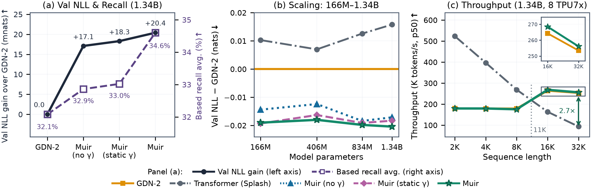
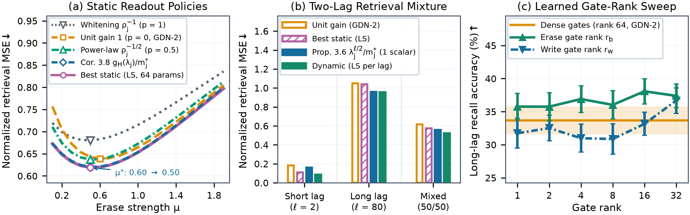
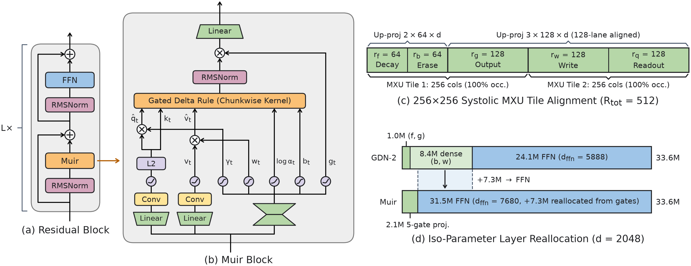
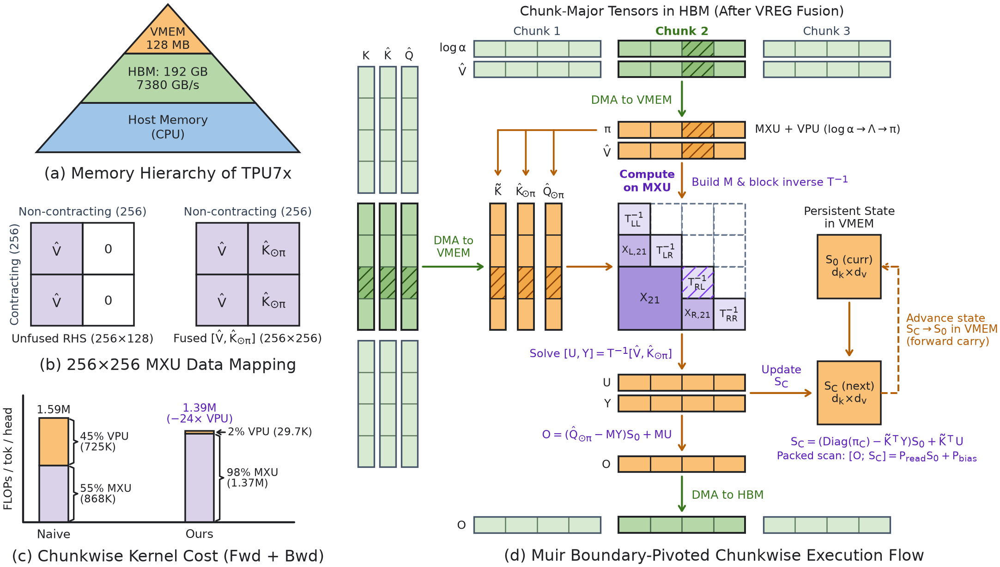
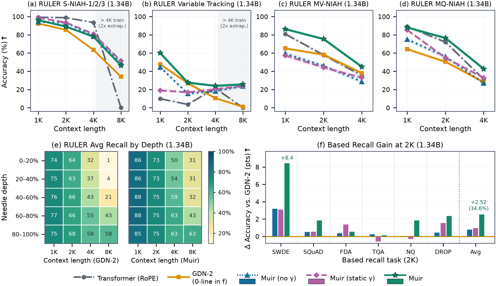
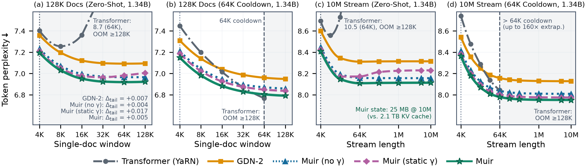

# Muir: Linear Attention with Sensitivity-Allocated Gating and Matched-Filter Readout 深度精读

> **论文**：Muir: Linear Attention with Sensitivity-Allocated Gating and Matched-Filter Readout
> **作者**：Tushaar Gangavarapu, Gil Tabak, Clemens JS Schaefer（Google）
> **arXiv ID**：2611.08376
> **发表时间**：2026-11-05
> **许可协议**：arXiv 默认（非 CC BY）
> **代码仓库**：无官方实现（附录 J 提供 JAX 参考实现；GPU 上可无改动复用 GDN-2 Triton kernel）

## 第 1 章 概述

### 1.1 一句话定位

Muir 是 Google 提出的门控 delta 规则（gated delta-rule）线性注意力架构：它通过对通道级门控状态动力学的理论分析，证明状态更新对擦除门的敏感度远低于写入门、且慢衰减状态行的能量会主导未加权读出，据此把 GDN-2 的五个门融合为一个按敏感度分配秩的低秩投影、为查询增加匹配滤波（matched-filter）读出门，并把省下的参数再投资到更宽的 FFN，在 166M–1.34B 同参数预算下于语言建模、联想回忆、长度外推与训练吞吐上全面超过 GDN-2 与 Transformer。

### 论文图表总览

| 编号 | 内容 | 章节 |
|------|------|------|
| **Figure 1** | 主结果 teaser：四规模语言建模/常识推理/召回对比 + 吞吐 | 第 1 章 |
| **Figure 2** | 合成记忆实验：行能量定律拟合、读出画像对比、门秩扫描 | 第 3 章 |
| **Figure 3** | Muir 架构图：五门融合低秩投影与 MXU tile 对齐 | 第 4 章 |
| **Figure 4** | 边界主元 chunkwise kernel 设计与 TPU 内存层级映射 | 第 5 章 |
| **Figure 5** | 100B token 训练 NLL 曲线（四规模） | 第 6 章 |
| **Figure 6** | RULER 六任务与 Based/JRT 六任务的召回对比 | 第 6 章 |
| **Figure 7** | 长度外推：128K 文档与 10M 流的困惑度 | 第 6 章 |
| **Figure 8** | 1K–1M token passkey 检索 | 第 6 章 |
| **Figure 9** | kernel 数值稳定性（溢出 NaN 与条件数） | 第 6 章 |
| **Figure 10** | 写-擦门敏感性诊断（SVD 截断与冻结实验） | 第 7 章 |
| **Figure 11** | 平稳行能量定律与读出缩放幂律拟合 | 第 7 章 |
| **Figure 12** | 反事实干预：读出指数扫描与擦除偏移 | 第 7 章 |
| **Figure 13** | MV-NIAH / VT 多跳写入保留与读出权重分解 | 第 7 章 |
| **Table 1** | 四规模主结果（NLL/困惑度/常识推理/TriviaQA） | 第 6 章 |
| **Table 2** | 门秩分配消融（含 uniform 与 r_g=256 对照） | 第 7 章 |
| **Table 3** | 机理诊断汇总（敏感度/能量/擦除率） | 第 7 章 |
| **Table 11** | 各规模模型配置与参数分解（附录 G.1） | 第 6 章 |

### 1.2 核心贡献

1. **写-擦敏感性不对称的定量刻画（Proposition 3.1 + Remark 3.2/3.3）**：对 GDN-2 状态更新的一阶分析表明，写入门的扰动无条件地缩放入射值（期望平方 Frobenius 敏感度为 $\|\bm{v}_t\|_2^2$），而擦除门的扰动需同时满足「当前 key 在该通道有能量」且「该状态行已积累能量」两个条件才生效。SiLU 激活与 ℓ2 归一化使 key 能量集中在极少数通道（实测参与率仅 5.98–7.43 / 128），因此擦除门可以承受远低于写入门的投影秩；低秩化还顺带压制了使状态转移谱范数超过 1 的斜投影残差。
2. **平稳行能量定律与匹配滤波读出（Proposition 3.4/3.6 + Corollary 3.8）**：在平稳流假设下推导出状态行能量的闭式缩放 $m_j^* = c_j\sigma_v^2\,\tau_{\mathrm{eff},j}$，证明多时间尺度衰减使行能量跨数量级（实测 >100×）并主导未加权读出；最优读出增益沿匹配滤波方向 $\gamma_j^*(\ell)\propto\bar a_{\ell,j}/m_j^*\approx\lambda_j^{\ell/2}/\rho_j^2$，静态最优解呈分数幂律 $\gamma\propto\rho^{-p}$（$p\in(0,1)$，实测 $p=0.35$）；读出侧的干扰抑制可以**替代**写侧擦除（Proposition 3.10），从而延长有效记忆视界。
3. **Muir 架构**：将 GDN-2 的五个门（decay $f$、erase $b$、output $g$、write $w$、新增的 readout gain $q$）融合为单个低秩投影，秩按敏感度分配为 $(64,64,128,128,128)$、总秩 $R_{\mathrm{tot}}=512$ 恰好是两块 256 列 TPU MXU tile；省下的参数（d=2048 时门投影从 9.44M 降至 2.10M，−77.8%）再投资使 FFN 宽度从 $3d-256$ 恢复到 $4d-512$（+30.4%）。
4. **边界主元 chunkwise kernel**：针对宽矩阵单元加速器（TPU 256×256 MXU、VPU 慢 ~64×）上大 chunk 训练的数值失稳，设计分治块分解 + 叶内 nilpotent Neumann 平方求逆 + 跨块边界主元分裂 $\pi_{t,s}=\pi_{t,p}\odot\pi_{p,s}$ 的并行更新，免除法、免 3D 衰减张量，VPU 计算减少 24×，配合自定义反传实现稳定高效训练。

### 1.3 关键结果速览

- **语言建模**（FineWeb-Edu 100B tokens，四规模）：Muir 较 GDN-2 降低困惑度 1.8–2.0%、较 Transformer 降低 2.5–3.6%（论文摘要口径）；1.34B 验证 NLL 1.9973 vs GDN-2 2.0177（−20.4 mnats）、Transformer 2.0335（−36.2 mnats），其中匹配滤波读出贡献 3.3 mnats。
- **常识推理**：1.34B 八任务 zero-shot 平均 53.84%，较 GDN-2 +1.38 pp、较 Transformer +1.79 pp；5-shot TriviaQA 达 19.32%（GDN-2 16.48%）。
- **召回与长上下文**：RULER 套件全部任务中取得最高平均；从 4K 训练长度零样本外推 2,560× 到 10M token 流无困惑度漂移（动态 $\bm{\gamma}_t$）；静态读出在 1M token passkey 上零样本 90.0%、64K cooldown 后 99.4%，而 GDN-2 在 4K–8K 即崩溃。
- **效率**：与 GDN-2 吞吐持平（4K 时 179.4 vs 179.3 K tokens/s，8×TPU7x），提前 1.2× 达到 GDN-2 的 100B token 验证损失；32K 时比 Transformer 快 2.74×（交叉点约 11K）；状态仅需 25 MB float32，而 10M token 的 KV cache 需 2.1 TB bfloat16。

*图1：四规模（166M–1.34B）语言建模与常识推理对比、1.34B 召回与长上下文结果、以及训练吞吐曲线*

## 第 2 章 背景与预备知识

### 2.1 从线性注意力到通道级门控 delta 规则

线性注意力将变长上下文压缩进固定尺寸的键值关联记忆 $\bm{S}_t\in\mathbb{R}^{d_k\times d_v}$（每头一份，通常 $d_k=d_v=128$），从而获得线性训练时间与常数推理内存。但有限维状态只能容纳有限多个正交 key 方向，塞入更多 key 必然产生跨 key 干扰。**Delta 规则**通过对瞬时重构损失 $\tfrac12\|\bm{k}_t\bm{S}-\bm{v}_t\|_2^2$ 做一步在线梯度下降来缓解干扰：写入新值前先擦除状态对当前 key 的预测。

沿这一谱系的演进路径为：Gated DeltaNet（标量指数衰减 + delta 擦除）→ Kimi Linear（通道级衰减，各行独立速率）→ **Gated DeltaNet-2（GDN-2）**：把衰减因子、擦除步长提升为通道级向量并解耦出通道级写门。GDN-2 的状态更新为

$$
\bm{S}_t=\big(\mathbf{I}-\bm{k}_t^\top(\bm{b}_t\odot\bm{k}_t)\big)\,\mathrm{Diag}(\bm{\alpha}_t)\,\bm{S}_{t-1}+\bm{k}_t^\top(\bm{w}_t\odot\bm{v}_t)=\hat{\bm{S}}_t-\bm{k}_t^\top(\hat{\bm{k}}_t\hat{\bm{S}}_t)+\bm{k}_t^\top\hat{\bm{v}}_t,\qquad \bm{o}_t=\bm{q}_t\bm{S}_t
$$

其中衰减门 $\bm{\alpha}_t\in(0,1)^{d_k}$、擦除门 $\bm{b}_t\in(0,2)^{d_k}$、写门 $\bm{w}_t\in(0,1)^{d_v}$、输出门 $\bm{g}_t$；key 与 query 经深度因果卷积 + SiLU 后 ℓ2 归一化到单位球（保证擦除因子特征值落在 $(-1,1)$、状态收缩稳定），value 不归一化以保留幅值。

### 2.2 GDN-2 的三大瓶颈（本文动机）

1. **参数分配失衡**：GDN-2 对擦除/写 logit 使用无偏稠密 $d\times d$ 投影，仅这两个矩阵就消耗 $2d^2$ 参数——占 $12d^2$ 层预算的六分之一，迫使等参比较下 FFN 从 $4d$ 收缩到 $3d-256$（d=2048 时 8,192→5,888，窄 28–31%），而 FFN 正是事实性关联的主要载体。
2. **未加权读出行能量失衡**：通道级衰减下，慢衰减行在数百到数千 token 上累积写入、能量远超快行（跨一个数量级以上）。未加权读出 $\bm{o}_t=\bm{q}_t\bm{S}_t$ 被高范数慢行主导，迫使模型加大写时擦除来压制干扰，进而过早覆盖已存关联。
3. **chunkwise 并行训练在宽矩阵单元上失稳**：通道级衰减与秩一擦除不可交换，chunkwise 算法必须用累计衰减前缀去除 key 或物化 $C\times C\times d_k$ 的 3D 衰减张量。前者在快衰减通道下溢出/除法上溢（$C=256$、$\alpha\le0.5$ 时 $\pi\le2^{-256}\approx10^{-77}$，低于 float32 最小正规数 $\approx1.18\times10^{-38}$），后者与逐块前代求解都落在比 MXU 慢 60× 以上的向量单元上。

### 2.3 chunkwise 并行形式与执行障碍

逐 token 求值式 (2.1) 每步只做 $\mathcal{O}(d_k d_v)$ 向量运算，算术强度低、受内存带宽限制。定义**有效写** $\tilde{\bm{v}}_t:=\hat{\bm{v}}_t-\hat{\bm{k}}_t\mathrm{Diag}(\bm{\alpha}_t)\bm{S}_{t-1}$（门控写减门控读），递归可改写为 GLA 形式 $\bm{S}_t=\mathrm{Diag}(\bm{\alpha}_t)\bm{S}_{t-1}+\bm{k}_t^\top\tilde{\bm{v}}_t$。把长度 $T$ 的序列切成 $N_c=T/C$ 个 chunk，chunk 内展开成矩阵方程：

$$
\bm{T}\tilde{\bm{V}}=\hat{\bm{V}}-\hat{\bm{K}}_{\odot\pi}\bm{S}_0,\qquad \bm{T}:=\mathbf{I}+\bm{L}_{\mathrm{strict}}\in\mathbb{R}^{C\times C}
$$

其中 $(\bm{L}_{\mathrm{strict}})_{t,s}=\langle\hat{\bm{k}}_t,\bm{\pi}_{t,s}\odot\bm{k}_s\rangle$（$t>s$），$\bm{\pi}_{t,s}=\prod_{r=s+1}^{t}\bm{\alpha}_r$ 为相对衰减。解出 $\tilde{\bm{V}}=\bm{T}^{-1}\hat{\bm{V}}-(\bm{T}^{-1}\hat{\bm{K}}_{\odot\pi})\bm{S}_0$ 后，chunk 输出与末端状态均由矩阵乘给出：$\bm{S}_C=\mathrm{Diag}(\bm{\pi}_C)\bm{S}_0+\tilde{\bm{K}}^\top\tilde{\bm{V}}$、$\bm{O}=\bm{Q}_{\odot\pi}\bm{S}_0+\bm{M}\tilde{\bm{V}}$（$\bm{M}$ 为因果下三角，元素 $\langle\bm{q}_t,\bm{\pi}_{t,s}\odot\bm{k}_s\rangle$）。

问题在于通道级衰减算子 $\mathrm{Diag}(\bm{\alpha}_t)$ 与秩一擦除算子 $\mathbf{I}-\bm{k}_t^\top\hat{\bm{k}}_t$ **不可交换**（标量衰减时可以，这正是 Gated DeltaNet 的情形），于是：

- 要用矩阵乘构造 $\bm{T},\bm{M}$，要么把 key 除以前缀衰减 $\bm{\pi}_s$（快通道下 float32 下溢/除法上溢：$C=256$、$\alpha_{r,j}\le0.5$ 时 $\pi_{s,j}\le2^{-256}$），要么物化 $C\times C\times d_k$ 的 3D 相对衰减张量（float32、$C=256$ 时每头 32 MB）并在 $d_k$ 维归约——后者只能落在 VPU 上；
- 即便形成了 $\bm{T}$，$C$ 步前代求解本身是串行的，同样吃 VPU。

这两个障碍正是第 5 章 kernel 设计的直接靶点。

### 2.4 目标硬件特征

论文的 kernel 针对 Google TPU7x Ironwood：每芯片两个 TensorCore 共 192 GB HBM（7,380 GB/s）、128 MB 片上 VMEM、256×256 脉动阵列 MXU（bfloat16 输入 float32 累加，2,307 TFLOP/s/芯片）；VPU 仅约 36 TFLOP/s（bfloat16），慢约 64×。MXU 任一维不足 256 都按比例浪费算力，XLA 将张量尾两维按 T(8,128)（32 位）tile 化——这些约束直接决定了后文 $R_{\mathrm{tot}}=512$、$C=256$、$n_0=8$ 的设计选择。

## 第 3 章 理论分析：门敏感性与读出动力学

### 3.1 写-擦敏感性不对称（Proposition 3.1–3.3）

把 $\bm{S}_t$ 视为 $(\bm{b}_t,\bm{w}_t)$ 的函数，方向导数为

$$
\mathrm{D}_{\bm{b}}\bm{S}_t[\delta\bm{b}]=-\bm{k}_t^\top\big((\delta\bm{b}\odot\bm{k}_t)\hat{\bm{S}}_t\big),\qquad
\mathrm{D}_{\bm{w}}\bm{S}_t[\delta\bm{w}]=\bm{k}_t^\top(\delta\bm{w}\odot\bm{v}_t)
$$

在各向同性扰动下的期望平方 Frobenius 敏感度分别为 $\sum_j k_{t,j}^2\|\hat{\bm{S}}_{t,j,:}\|_2^2$ 与 $\|\bm{v}_t\|_2^2$。二者的机制差异是本质性的：写扰动直接缩放入射值，即使状态为空也生效；擦扰动则被 $k_{t,j}^2$（key 通道能量）与行能量双重加权。由于 SiLU 抑制负预激活、ℓ2 归一化进一步集中能量，key 的单位范数只落在参与率 $\eta_{\mathrm{eff}}(\bm{k}_t)=1/\|\bm{k}_t\|_4^4\ll d_k$ 个活跃通道上（100B checkpoint 实测均值 5.98–7.43 / 128）。

进一步把擦除转移分解为 $(\mathbf{I}-\mu_t\bm{k}_t^\top\bm{k}_t)-\bm{k}_t^\top\bm{s}_t$（$\mu_t=\langle\bm{k}_t,\bm{b}_t\odot\bm{k}_t\rangle$ 为平行擦除强度，$\bm{s}_t$ 为正交残差）：任何非零 $\bm{s}_t$ 都使转移谱范数严格大于 1（$\ge\sqrt{1+\|\bm{s}_t\|_2^2}$），而 $\mu_t$ 的梯度 $\nabla_{\bm{b}}\mu_t=\bm{k}_t^{\odot2}$ 恰好只支撑在活跃 key 通道上。这给出了双重结论：擦除门用**带通道偏置的低秩瓶颈**参数化即可保留 GDN-2 的通道级擦除控制，同时投影掉会膨胀谱范数的高秩斜投影方差。

### 3.2 平稳行能量定律（Proposition 3.4–3.5）

在平稳独立流假设（及二阶闭合）下，行能量 $m_{t,j}=\mathbb{E}\|\bm{S}_{t,j,:}\|_2^2$ 满足线性递推，其平稳解为闭式

$$
m_j^*=\rho_j^2=\frac{c_j\sigma_v^2}{1-\lambda_j+2\lambda_j\bar b_j c_j}=c_j\sigma_v^2\,\tau_{\mathrm{eff},j}(\bar b_j),\qquad \tau_{\mathrm{eff},j}=\frac{1}{1-\lambda_j+2\lambda_j\bar b_j c_j}
$$

即「写入注入率 × 有效记忆视界」，分母由指数衰减与 key 触发擦除两种耗散机制竞争构成。两种极限：(i) 擦除主导时 $m_j^*\to\sigma_v^2/(2\bar b_j)$，行能量被强行拉平但代价是慢通道被过度擦除、视界被封顶在 $(2\bar b_j c_j)^{-1}$；(ii) 衰减主导时 $m_j^*\approx c_j\sigma_v^2/(1-\lambda_j)$，key 各向异性与多时间尺度衰减复合，使同一头内行能量跨越多个数量级。

### 3.3 匹配滤波读出与分数幂律（Proposition 3.6–3.9）

设查询沿历史 key $\bm{q}_t=\bm{k}_{t-\ell}$（检索滞后 $\ell$），采用增益读出 $\bm{o}_t(\bm{\gamma})=(\bm{\gamma}\odot\bm{q}_t)\bm{S}_t$，则检索 MSE 为

$$
\mathcal{L}_\ell(\bm{\gamma})=\sigma_v^2\Big(1-\sum_j\gamma_j c_j\bar a_{\ell,j}\Big)^2+\sum_j\gamma_j^2 c_j m_j^*
$$

其最优解沿匹配滤波方向 $\gamma_j^*(\ell)=\kappa_\ell\,\bar a_{\ell,j}/m_j^*\propto\bar a_{\ell,j}/\rho_j^2\approx\lambda_j^{\ell/2}/\rho_j^2$（后一近似在 $\bar b_j c_j\ll1$ 时成立）。关键结构性结论：**不同滞后需要非共线且与衰减率相关性相反的增益**——短滞后最优解强调低能量快行（与 $\lambda_j$ 负相关），长滞后必须上调慢行（正相关），因此任何静态向量都无法同时匹配多个检索视界（Remark 3.7），这为 token 级动态增益 $\bm{\gamma}_t$ 提供了理论必然性。

将滞后按均值 $H$ 的几何分布边缘化，静态最优为 $\gamma_j^{\mathrm{stat}}\propto g_H(\lambda_j)/m_j^*$，其中 $g_H(\lambda)=\sqrt{\lambda}/[1+(H-1)(1-\sqrt{\lambda})]$。在衰减主导区，$-\mathrm{d}\log\gamma/\mathrm{d}\log\rho\approx 4\tau_{\mathrm{eff}}/(2\tau_{\mathrm{eff}}+H-1)$，对 $\tau_{\mathrm{eff}}<(H-1)/2$ 的通道落在 $(0,1)$ 区间：既非单位增益（$p=0$）也非完全逆 RMS 白化（$p=1$），后者会把信号已消失的快行过度放大（Remark 3.9）。

### 3.4 擦除-读出替代（Proposition 3.10–3.11）

把读出侧干扰抑制建模为干扰乘子 $\Phi<1$，则均衡擦除率 $\bar b^*(\Phi)$ 随 $\Phi$ 下降而下降、每个通道的有效视界 $\tau_{\mathrm{eff},j}$ 相应延长。直觉：未加权读出下，压制高能量行多写干扰的唯一手段是抬高擦除率，代价是全通道提前冲刷旧关联；匹配滤波读出在查询时完成了这项压制，于是写侧可以「少擦、多留」。

### 3.5 合成实验验证（§3.2）

*图2：单头平稳检索的定律拟合（52.4× 动态范围、Spearman/log-Pearson 均为 1.0）与读出画像对比；学习型多查询联想回忆的门秩扫描*

- 单头平稳检索（$d_k=d_v=64$，幂律各向异性 $c_j$，对数间隔时间尺度）：闭式定律 (3.2) 在 52.4× 行能量动态范围上 Spearman 与 log-Pearson 相关均为 1.0；几何滞后视界 $H=27$ 下，完全白化 $1/\rho_j$ 劣于单位增益、半功率 $1/\sqrt{\rho_j}$ 优于单位增益、Corollary 3.8 的 horizon filter 匹配 64 参数最小二乘 oracle，并把最优擦除强度从 $\mu^*=0.60$ 降至 0.50（验证 Prop 3.10）。
- 双峰滞后 $\ell\in\{2,80\}$：条件 oracle 增益与通道衰减率 $\alpha_j$ 的 Spearman 相关从 $\ell=2$ 的 $-0.98$ 反转为 $\ell=80$ 的 $+0.83$（验证 Remark 3.7）；Prop 3.6 解析滤波器每滞后仅 1 个标量即在 $\ell=80$ 匹配 oracle。
- 学习型多查询联想回忆（单层双头端到端训练）：压缩擦除门（秩 1–32 全档位）均改善长滞后召回且把擦除 logit 的 token 方差从 27.9% 压到 3.0–15.6%；压缩写门到 $r_w\le8$ 则退化、$r_w=32$ 才反超稠密——精确对应写高敏/擦低敏的预测。$(r_b,r_w)=(4,4)$ 时引入读出增益（静态 $\bm{\gamma}$ 再到动态 $\bm{\gamma}_t$ 单调递进）合计较单位读出提升 +4.18 pp、较稠密门 +2.00 pp，同时最终状态能量较单位读出低 45.7%（较稠密门 −64.3 %）。

### 3.6 合成任务的构造细节

两个合成任务刻意设计成满足理论假设的数据生成过程，便于逐条对账：

- **单头平稳检索**：模拟单个门控 delta 头（$d_k=d_v=64$），key 取单位范数、通道二阶矩 $c_j$ 服从各向异性幂律（$\sum_j c_j=1$），value 各向同性 $\bm{v}_t\sim\mathcal{N}(\bm{0},d_v^{-1}\mathbf{I})$；写门固定为 $\bm{1}$、擦除门为标量 $\mu\bm{1}$、衰减取对数间隔时间尺度（$\alpha_j=e^{-1/\tau_j}$）。每步采样检索滞后 $\ell_t\sim p(\ell)$、沿历史 key 查询并度量归一化 MSE。对比五种静态读出画像（单位增益、半功率 $1/\sqrt{\rho}$、全白化 $1/\rho$、Corollary 3.8 horizon filter、64 参数最小二乘 oracle），各自在独立 split 上拟合标量前置因子。
- **学习型多查询联想回忆**：单层双头（$N_h=2$、$d_k=d_v=32$、$d=128$）端到端训练流式任务——每序列 256 个写/读事件、256 key、64 value、激活 96 个 key（总状态秩 $N_h d_k=64$ 的 1.5×）、Zipf(1.0) 频率；写（p=0.7）将激活 key 绑定到新值并覆盖旧绑定，读（p=0.3）查询已写 key 的最新值。value 被划分到四个正交子空间并向非激活子空间注入高斯噪声，迫使写门学会动态抑制非激活通道——这正是擦除/写门秩扫描（3.5 节第三条）所需的对偶压力。

### 3.7 小结

第三章的分析把「门该怎么分配预算、读出该不该加权」从经验问题变成了可计算的问题：敏感度不对称给出**秩的分配方向**（擦低写高），行能量定律给出**读出加权的必要性**（能量跨量级），匹配滤波给出**加权的正确形式**（分数幂律 + 滞后自适应），替代命题给出**读出与擦除的兑换率**。第四章的架构本质上就是这四条结论的直译。

## 第 4 章 Muir 架构

*图3：五门融合低秩投影、MXU/VMEM tile 对齐的列排布，与 FFN 再投资示意*

### 4.1 状态更新与第五个门

Muir 在 GDN-2 四门之外增加动态查询读出增益 $\bm{\gamma}_t\in\mathbb{R}^{d_k}$，读出改为 $\bm{o}_t=(\bm{\gamma}_t\odot\bm{q}_t)\bm{S}_t$。状态更新本身与 GDN-2 相同。$\bm{\gamma}_t$ 只缩放查询、不碰 key，因此 key 保持单位范数、擦除收缩性不受影响（区别于此前可学习的 per-channel query-key 缩放工作）。与 GDN-2 完整递推对比如下：

$$
\bm{S}_t=\big(\mathbf{I}-\bm{k}_t^\top(\bm{b}_t\odot\bm{k}_t)\big)\mathrm{Diag}(\bm{\alpha}_t)\bm{S}_{t-1}+\bm{k}_t^\top(\bm{w}_t\odot\bm{v}_t),\qquad \bm{o}_t=(\bm{\gamma}_t\odot\bm{q}_t)\bm{S}_t
$$

### 4.2 五门融合低秩投影

GDN-2 对 $(f,g)$ 用秩-128 瓶颈、对 $(b,w)$ 用稠密矩阵；Muir 统一为单个 fused down-projection $\bm{h}_t=\bm{x}_t\bm{W}_{\downarrow}\in\mathbb{R}^{R_{\mathrm{tot}}}$ 加五个 per-gate up-projection：

$$
[\bm{h}_t^f\ \bm{h}_t^b\ \bm{h}_t^g\ \bm{h}_t^w\ \bm{h}_t^q]=\bm{h}_t,\qquad \bm{z}_t^m=\bm{h}_t^m\bm{W}_{m\uparrow}+\bm{c}_m,\quad m\in\{f,b,g,w,q\}
$$

$$
\log\bm{\alpha}_t=-e^{a_{\log}}\,\mathrm{softplus}(\bm{z}_t^f),\quad \bm{b}_t=2\sigma(\bm{z}_t^b),\quad \bm{w}_t=\sigma(\bm{z}_t^w),\quad \bm{g}_t=\bm{z}_t^g,\quad \bm{\gamma}_t=\bm{\gamma}^{\mathrm{stat}}\odot 2\sigma(\bm{z}_t^q)
$$

设计要点：

- **每个 up-projection 带通道偏置 $\bm{c}_m$**：低秩瓶颈下仍保证每通道有独立工作点（$\bm{c}_b,\bm{c}_w,\bm{c}_q$ 为 Muir 新增），避免退化回标量门。
- **读出增益的因式分解**：$\bm{\gamma}^{\mathrm{stat}}$ 承担 horizon 边缘化幂律画像（Corollary 3.8），$2\sigma(\bm{z}_t^q)$ 承担滞后自适应的动态匹配滤波（Prop 3.6）；sigmoid 缩放到 $(0,2)$ 使动态乘子以 1 为中心、可衰减可放大。初始化 $\bm{\gamma}^{\mathrm{stat}}=\mathbf{1}$、$\bm{W}_{q\uparrow}=\bm{0}$、$\bm{c}_q=\bm{0}$，即初始等价于 GDN-2 的单位读出，训练平稳起步。RMSNorm 吸收全局尺度 $\kappa_\ell$。
- **秩按敏感度分配 + 硬件对齐**：直接调制全维向量的门 $(g,w,q)$ 取秩 128，控制衰减与 key 收缩擦除的门 $(f,b)$ 取秩 64；$R_{\mathrm{tot}}=512=2\times256$ 恰为两整块 MXU tile。列排布上，$(f,b)$ 两组 64 列紧邻占据 [:128]、$(g,w,q)$ 占据 [128:512]，使 down-projection 在 256×256 MXU 上 100% 列占用、五个 up-projection 合并为两次批量矩阵乘。
- 消融中省去动态因子时（$r_q=0$），那 128 列秩转移给写门（$r_w=256$），保持 $R_{\mathrm{tot}}$ 与层参数不变。

### 4.3 等参 FFN 再投资

融合投影参数量为 $2dR_{\mathrm{tot}}$，远小于 GDN-2 的 $2d^2+512d$。保持 $12d^2$ 层预算下取 $d_{\mathrm{ffn}}=4d-R_{\mathrm{tot}}$，则任意 $R_{\mathrm{tot}}$ 都精确等参。d=2048、$R_{\mathrm{tot}}=512$ 时：门投影参数 9.44M→2.10M（÷4.5，−77.8%）；token mixer 投影 26.21M→18.87M/层（−28.0%）；固定 $d_{\mathrm{ffn}}=5{,}888$ 时整层非嵌入参数与线性 FLOPs −14.6%（50.33M→42.99M）；等参再投资把省下的 7.34M/层 投入 FFN，$d_{\mathrm{ffn}}$ 从 5,888 扩到 7,680 = 30×256（+1,792 通道，+30.4%）。

## 第 5 章 边界主元 chunkwise kernel

*图4：分治树、Neumann 叶逆、边界主元分裂与 TPU7x 内存层级上的批处理执行*

### 5.1 递归约化与三阶段执行

用 $\hat{\bm{q}}_t=\bm{\gamma}_t\odot\bm{q}_t$ 替换查询后，Muir 递归在 chunk 内严格约化为 GDN-2 的 chunkwise 线性系统——这意味着在 GPU 上 Muir 可以零改动跑在现有 GDN-2 Triton kernel 上（先把 $\bm{q},\bm{k}$ 归一化再乘 $\bm{\gamma}$，并关闭 kernel 内的二次归一化）。chunk 求解分三阶段：(i) 构造单位下三角系统矩阵 $\bm{T}=\mathbf{I}+\bm{L}_{\mathrm{strict}}$（$(\bm{L}_{\mathrm{strict}})_{t,s}=\langle\hat{\bm{k}}_t,\bm{\pi}_{t,s}\odot\bm{k}_s\rangle$）与因果读出矩阵 $\bm{M}$；(ii) 解 $\bm{T}[\bm{U}\ \bm{Y}]=[\hat{\bm{V}}\ \hat{\bm{K}}_{\odot\pi}]$；(iii) 代入仿射状态更新 $\bm{O}=(\hat{\bm{Q}}_{\odot\pi}-\bm{M}\bm{Y})\bm{S}_0+\bm{M}\bm{U}$、$\bm{S}_C=(\mathrm{Diag}(\bm{\pi}_C)-\tilde{\bm{K}}^\top\bm{Y})\bm{S}_0+\tilde{\bm{K}}^\top\bm{U}$。

### 5.2 分治块分解与边界主元

对深度 $r$ 的二叉树做分治（Heller 1974 一脉）：每个父区间的逆分块为

$$
\bm{T}_{\mathrm{blk}}^{-1}=\begin{bmatrix}\bm{T}_{\mathcal{L}}^{-1} & \bm{0}\\ -\bm{T}_{\mathcal{R}}^{-1}\bm{T}_{\mathrm{cross}}\bm{T}_{\mathcal{L}}^{-1} & \bm{T}_{\mathcal{R}}^{-1}\end{bmatrix}
$$

- **叶基例**（$n_0=C/2^r=8$）：严格下三角 $\bm{L}_{\mathrm{leaf}}$ 是幂零矩阵，Neumann 级数在 $n_0-1$ 次截断，可用 $\log_2 n_0$ 级（含 $\log_2 n_0-1$ 次平方）矩阵乘因式分解求逆；$n_0\ll C$ 也让 bfloat16 下的幂次有界。
- **合并层**：跨块对 $(t,s)$ 必然跨过左右子区间边界 $p=\mathrm{last}(\mathcal{L})$，利用累计对数衰减的单调非增性，把相对衰减无除法地拆成两个恒在 $(0,1]$ 的因子：

$$
\bm{\pi}_{t,s}=\exp(\bm{\Lambda}_t-\bm{\Lambda}_p)\odot\exp(\bm{\Lambda}_p-\bm{\Lambda}_s)=\bm{\pi}_{t,p}\odot\bm{\pi}_{p,s}
$$

于是 $\bm{T}_{\mathrm{cross}},\bm{M}_{\mathrm{cross}}$ 可由单次行打包矩阵乘得到，逆的非对角块 $\bm{X}_{21}=-\bm{T}_{\mathcal{R}}^{-1}\bm{T}_{\mathrm{cross}}\bm{T}_{\mathcal{L}}^{-1}$ 再两次矩阵乘。整个 chunk 从不物化 $C\times C\times d_k$ 的 3D 衰减张量（全 chunk 需 $Cn_0d_k$ 元素，比全张量少 $2^r$ 倍）。

### 5.3 自定义反传与 TPU 映射

反传若走自动微分需保留整棵树的中间逆块。Muir 只保存前向的 $\bm{T}^{-1}$ 与解 $\bm{Z}$，用 $\mathrm{d}[\hat{\bm{V}}\ \hat{\bm{K}}_{\odot\pi}]=\bm{T}^{-\top}\mathrm{d}\bm{Z}$、$\mathrm{d}\bm{L}_{\mathrm{strict}}=-\mathrm{stril}(\mathrm{d}[\hat{\bm{V}}\ \hat{\bm{K}}_{\odot\pi}]\bm{Z}^\top)$ 两次全 chunk MXU 乘直接回传，再沿同一棵树重算边界缩放因子。$\mathrm{d}\log\bm{\alpha}$ 用三角全 1 矩阵的 MXU 乘完成前缀和。TPU 映射上：$C=256$ 匹配 MXU tile、$n_0=8$ 匹配 32 位 T(8,128) VMEM tile（叶缓冲 float32、平方后转 bfloat16）、$r=5$ 层 32 叶；将 $[\hat{\bm{V}}\ \hat{\bm{K}}_{\odot\pi}]$ 沿列拼成 256×256 后单次 MXU 乘即完成求解（100% tile 利用率，不拼只有 50%）；$\bm{S}_0$（128×128 float32，64 KB/头）常驻 VMEM。每 token 每头执行 1.37M MXU FLOPs（98%）与仅 29.7K VPU FLOPs（2%），较朴素 chunkwise 执行 VPU 计算减少 24×、总 FLOPs 减少 12%。

### 5.4 布局与批量化执行细节

投影与深度卷积产生的激活是 token 主序 $(B,T,N_h,d_k)$，而 chunkwise 执行需要 chunk 主序 $(N_c,B,N_h,C,d_k)$；尾维置换会造成每个张量一次 HBM 往返。Muir 利用递归只依赖乘积 $\hat{\bm{q}}_t=\bm{\gamma}_t\odot\bm{q}_t$、$\hat{\bm{v}}_t=\bm{w}_t\odot\bm{v}_t$、$\hat{\bm{k}}_t=\bm{b}_t\odot\bm{k}_t$ 的事实，在 VREG 中**先融合再置换**，把待置换张量从七个减到五个 $(\log\bm{\alpha},\hat{\bm{V}},\bm{K},\hat{\bm{K}},\hat{\bm{Q}})$。树的批量化通过 reshape 实现：叶层把 chunk 轴折成 $(32,8)$、全部 32 个叶折进前导 batch 维，使叶求值与两次 Neumann 平方在所有叶/chunk/头间并行；每个合并层同样把 $2^{4-m}$ 个父节点折进 batch 维。整棵树在前后向各以 $r=5$ 个串行阶段完成。此外把 $\bm{M}$ 与 $\tilde{\bm{K}}^\top$ 沿行堆成 $(C+d_k)\times C$ 矩阵、与 $[\bm{U}\ \bm{Y}]$ 单次打包收缩，同时产出读出与偏置两个仿射项；$\bm{S}_0$ 常驻 VMEM、仅在反传需要的 chunk 边界写回 HBM。

## 第 6 章 实验结果

### 6.1 设置

四档等参规模：166M（L=8, d=1024）、406M（L=11, d=1536）、834M（L=14, d=2048）、1.34B（L=24, d=2048），均 $d_k=d_v=128$。五个对比变体：Transformer（RoPE θ=10,000 + TPU Pallas Splash Attention）、GDN-2（稠密 b/w 门、$d_{\mathrm{ffn}}=3d-256$）、Muir (no γ)、Muir (static γ)（二者 $r_w=256$）、Muir (ours)（$(r_w,r_q)=(128,128)$）。全部在 FineWeb-Edu 100B tokens 上从头训练（Llama-2 32K tokenizer，相同 token 顺序），AdamW（β=(0.9,0.999)、wd=0.1、clip 1.0），LR 4×10⁻⁴ 峰值 cosine 至 4×10⁻⁵，1B token warmup，bf16 混合精度（状态与 $\bm{\Lambda}$ float32），T=4,096，全局 batch 524,288 tokens/step，8×TPU7x，固定 seed 0。等参性由 Table 11 的参数分解背书（见 6.1 末）：1.34B 时三架构均约 1,339M 总参，但 Muir 的 FFN 参数（754.97M）显著高于 GDN-2（578.81M）、接近 Transformer（805.31M）。

**Table 11（附录 G.1）：四规模完整配置与参数分解**

| 规模 | 模型 | L | d | $N_h$ | $d_{\mathrm{ffn}}$ | 门秩 $(r_f,r_b,r_g,r_w,r_q)$ | Mixer+门 (M) | FFN (M) | 总参 (M) |
|:---:|:---|:---:|:---:|:---:|:---:|:---:|:---:|:---:|:---:|
| 166M | Transformer | 8 | 1,024 | 8 | 4,096 | – | 33.55 | 67.11 | 166.20 |
| 166M | GDN-2 | 8 | 1,024 | 8 | 2,816 | (128, dense, 128, dense, –) | 54.53 | 46.14 | 166.20 |
| 166M | Muir | 8 | 1,024 | 8 | 3,584 | (64,64,128,128,128) | 41.95 | 58.72 | 166.21 |
| 406M | Transformer | 11 | 1,536 | 12 | 6,144 | – | 103.81 | 207.62 | 409.73 |
| 406M | GDN-2 | 11 | 1,536 | 12 | 4,352 | (128, dense, 128, dense, –) | 164.36 | 147.06 | 409.73 |
| 406M | Muir | 11 | 1,536 | 12 | 5,632 | (64,64,128,128,128) | 121.13 | 190.32 | 409.75 |
| 834M | Transformer | 14 | 2,048 | 16 | 8,192 | – | 234.88 | 469.76 | 835.72 |
| 834M | GDN-2 | 14 | 2,048 | 16 | 5,888 | (128, dense, 128, dense, –) | 367.00 | 337.64 | 835.72 |
| 834M | Muir | 14 | 2,048 | 16 | 7,680 | (64,64,128,128,128) | 264.27 | 440.40 | 835.74 |
| 1.34B | Transformer | 24 | 2,048 | 16 | 8,192 | – | 402.65 | 805.31 | 1,339.03 |
| 1.34B | GDN-2 | 24 | 2,048 | 16 | 5,888 | (128, dense, 128, dense, –) | 629.15 | 578.81 | 1,339.03 |
| 1.34B | Muir | 24 | 2,048 | 16 | 7,680 | (64,64,128,128,128) | 453.03 | 754.97 | 1,339.08 |

所有循环模型含一个 4-token 深度因果卷积（作用在拼接的 q,k,v 通道上，每层 4×3d 参数）与输出门 SiLU 前的 per-head RMSNorm；衰减参数化按四分位分层初始化以降低固定 seed 下的方差：$\exp(a_{\log})\sim\mathrm{Unif}(2^{k-1},2^k)$、$\mathrm{softplus}(c_{f,j})\sim\mathrm{LogUnif}(\tau_{k-1},\tau_k)$，$\tau_{0:4}=(0.001,0.004,0.015,0.05,0.15)$。

### 6.2 语言建模与常识推理（Table 1）

| 规模 | 模型 | FW-Edu NLL ↓ | WikiText ppl ↓ | LAMBADA ppl ↓ | 8 任务平均 ↑ | 5-shot TQA ↑ |
|:---|:---|:---:|:---:|:---:|:---:|:---:|
| 166M | Transformer | 2.4569 | 31.64 | 52.69 | 39.91 % | 4.74 % |
| 166M | GDN-2 | 2.4466 | 30.84 | 39.89 | 40.50 % | 5.80 % |
| 166M | Muir | 2.4276 | 30.28 | 34.45 | 40.86 % | 5.32 % |
| 406M | Transformer | 2.2424 | 23.18 | 21.10 | 45.60 % | 9.06 % |
| 406M | GDN-2 | 2.2354 | 22.90 | 19.15 | 45.71 % | 9.08 % |
| 406M | Muir | 2.2174 | 22.31 | 20.00 | 45.83 % | 10.05 % |
| 834M | Transformer | 2.1186 | 19.46 | 14.79 | 48.49 % | 11.85 % |
| 834M | GDN-2 | 2.1060 | 19.17 | 13.49 | 49.33 % | 13.40 % |
| 834M | Muir | 2.0862 | 18.58 | 11.88 | 50.37 % | 13.58 % |
| 1.34B | Transformer | 2.0335 | 17.17 | 10.30 | 52.05 % | 14.56 % |
| 1.34B | GDN-2 | 2.0177 | 16.80 | 10.38 | 52.46 % | 16.48 % |
| 1.34B | Muir (no γ) | 2.0006 | 16.46 | 10.26 | 53.79 % | 16.52 % |
| 1.34B | Muir (static γ) | 1.9994 | 16.35 | 10.15 | 53.40 % | 17.71 % |
| 1.34B | Muir | **1.9973** | 16.41 | **10.00** | **53.84 %** | **19.32 %** |

要点解读（注：WikiText ppl 该列最优为 Muir (static γ) 的 16.35）：

- **训练动力学**：三个 Muir 变体在前 10B token 内即超越 GDN-2，100B 时领先 12–20 mnats——FFN 加宽从一开始就扩展 token 级表征容量；随着训练推进、衰减门分化出行能量失衡，读出门的空间才逐渐打开（静态/动态 $\bm{\gamma}$ 全程保持对 no-γ 的额外增益）。四规模上 Muir 均约 85B token 达到 GDN-2 的 100B 验证 NLL（1.2× 加速）。
- **知识与上下文的分离**：短 prompt 多选题（<100 token）主要考 FFN 内的世界知识，FFN 恢复宽度后三个 Muir 变体同步受益；而依赖长上下文解析的任务（LAMBADA 词级困惑度、5-shot WinoGrande/TriviaQA 需跨 demonstration 提取格式与答案模式）中，no-γ 在 1.34B 几乎无增益（LAMBADA 10.26 vs 10.38；TQA 16.52 % vs 16.48 %），**动态 $\bm{\gamma}_t$ 才是主要驱动**（LAMBADA 10.00、TQA 19.32 %）——多 shot prompt 是「局部句法（短滞后）+ 示例模式（数百 token 滞后）」的双峰检索混合，恰是 Remark 3.7 预言静态增益无解、动态增益可解的场景。

### 6.3 联想召回（RULER + Based/JRT）

*图6：1.34B 在 RULER 六任务（1K–8K）与 Based/JRT 六任务（2K）上的召回*

- **单针检索**（S-NIAH-1/2/3）：GDN-2 的未加权读出随长度增长退化；Muir 在 S-NIAH-1 保持 100 % 至 8K。静态 γ + 宽写门（$r_w=256$）在单针平均上略优——S-NIAH-3 需把 36 字符 UUID 跨约 34 token 写入，受益于更高写门秩。
- **多跳/多针**（VT 5-hop、MV-NIAH 4 值、MQ-NIAH 4 查询）：需要查询存储在多个深度的关联、并随答案 token 生成切换读出滤波器。静态 γ 在 VT 上低于无 γ 的 Muir、在 MV 上低于 GDN-2（一个固定向量无法匹配多个滞后）；Muir 用动态 $\bm{\gamma}_t$ 以单针写入容量换滞后自适应读出，超过全部循环与注意力基线，取得最高 RULER 套件平均。
- **深度分布**：1K–2K 时 Muir 对 GDN-2 领先 7–12 pp；4K–8K 时 GDN-2 在早期深度（0–40 %）骤降而 Muir 保持——读出侧解耦噪声抑制后不再过早覆盖早期 needle。
- **真实文档抽取**（Based/JRT，2K）：动态 $\bm{\gamma}_t$ 贡献六任务提升的主要部分（1.34B 均值 34.60 vs GDN-2 32.08），并在 DROP 上超过 Transformer（Transformer 六任务均值 45.92 整体仍最高，其中含各任务口径差异）。

### 6.4 长度外推（1.34B）

*图7：4K 训练长度零样本外推与 64K cooldown 后的 128K 文档 / 10M 流困惑度*

- **零样本**：Dynamic YaRN 只延缓 Transformer 发散，8K 后困惑度上升、≥128K 非分块评估超 HBM；即便分块，10M token 的 KV cache 需 2.1 TB bfloat16（2.5 bit 量化也要 0.32 TB），而 Muir 全部 24 层状态共 25 MB float32。静态 γ 在连续主题累积的 128K 文档与 10M 流上因慢行能量累积而过权重化、32K 后上漂（$\Delta_{\mathrm{tail}}=+0.017$ nats）；动态 $\bm{\gamma}_t$ 把尾部漂移减少 3.6×，在每个视界直到 10M（2,560× 外推）都取得最低困惑度。
- **cooldown 后**（300 步 64K、0.315B token、70/30 长短文档混合）：Transformer 在 64K 内改善但 ≥128K 仍超 HBM；重校准的慢通道增益消除静态 γ 漂移（$\Delta_{\mathrm{tail}}=-0.012$ nats），完整 Muir 在整条 10M 流上优于 Transformer 与 GDN-2。
- **passkey（S-NIAH-1，1K–1M）**：Transformer 零样本 8K 后受未见 RoPE 位置限制，cooldown 抬高 RoPE base 后 32K 内 100 %、64K 早期深度下降、≥128K 超 HBM。GDN-2 4K–8K 即崩溃；Muir (no γ) 32K 后早期深度衰退；**静态 γ** 因单针单滞后而足够，零样本 1M 达 90.0 %、cooldown 后 99.4 %（256× 训练长度）；**完整 Muir**（写门减半）在 1K–32K 保持近满分、≥64K 起变弱。

### 6.5 训练吞吐与数值稳定性

**吞吐要点汇总（8×TPU7x，1.34B，batch 524,288 tokens/step）**

| 指标 | 数值 | 对照 |
|:---|:---|:---|
| 4K 吞吐 | 179.4 K tokens/s | GDN-2 179.3（持平） |
| 16K–32K 相对 GDN-2 | +1.0–1.6 % | FFN +30.4%、FLOPs −1.8% |
| Transformer 4K→32K 每步 FLOPs | 348→652 TFLOP/step/device | 吞吐 ÷4.2 |
| 循环模型 16K vs 8K 吞吐 | +48–53 % | HBM −330–356 GB/step/device |
| 与 Transformer 交叉点 | T≈11K | 16K/32K 快 1.64×/2.74× |
| 达到 GDN-2 100B 验证损失 | ~85B tokens | 1.2× 加速 |

- 8×TPU7x、固定 batch 524,288 tokens/step：Muir 与 GDN-2 在 4K 持平（179.4 vs 179.3 K tokens/s），尽管 FFN 宽 30.4 % 且多一个门（编译 FLOPs −1.8 %、HBM 流量 −0.7~−1.4 %）；16K–32K 反超 GDN-2 +1.0–1.6 %。Transformer 从 4K 到 32K 每步 FLOPs 近乎翻倍（348→652 TFLOP/step/device）、吞吐 ÷4.2；Muir 循环模型每步 FLOPs 与 T 无关，16K 比 8K 吞吐 +48–53 %（深层 chunk 循环让 XLA 融合边界临时量并重叠 HBM 传输，省 330–356 GB/step/device）。交叉点 T≈11K，16K/32K 上 Muir 快 1.64×/2.74×。
- **稳定性**：非主元的 $\bm{\pi}_t\oslash\bm{\pi}_s$ 分裂在快衰减通道（25 % 头，$\Lambda<-88.7$）上 float32 溢出产生 NaN；边界主元两因子恒在 (0,1]。bfloat16 块 Neumann 逆在 $\kappa_2(\bm{T})\gtrsim10^3$ 时舍入误差超过 $10^0$（即 1），但训练模型的衰减与 ℓ2 归一化 key 共同压制 $\bm{L}_{\mathrm{strict}}$，实测 1,536 个 chunk 系统的 $\kappa_2$ 最大 <40；Muir 的 p90 $\kappa_2$（7.7）低于 GDN-2（11.1）——匹配滤波读出降低擦除、进一步收缩 $\hat{\bm{k}}_t$。全程预训练无 loss 尖峰或 NaN。

### 6.6 评估协议细节

- **语言建模/常识**：全部经 lm-evaluation-harness；held-out FineWeb-Edu 验证 token NLL（100M token）与 WikiText/LAMBADA 词级困惑度；zero-shot 覆盖 LAMBADA、PIQA、HellaSwag、WinoGrande、ARC-E/C、OBQA、SIQA，另报 5-shot WinoGrande 与 closed-book TriviaQA；HellaSwag 与 ARC-Challenge 用长度归一化准确率。BoolQ 因在 <1.5B 模型上贴近 62.2 % 多数类基线且方差不稳而移入附录（含 BoolQ 的 9 任务平均见附录 H.1）。
- **RULER**：每任务每长度 500 例、needle 深度均匀覆盖 0–100 %；S-NIAH-1/2/3 分别考察合成噪声/文章中的 7 位数与 36 字符 UUID，VT 为 5 跳变量追踪；MV/MQ-NIAH 在分布内长度 1K–4K、其余任务到 8K（训练窗口的 2×）。本文 GDN-2 基线的 S-NIAH 分数与 GDN-2 原文不同，因评测器换用 lm-eval-harness 而非 NVIDIA/RULER。
- **长上下文**：语言建模外推用 64 篇连续 128K 文档与 3 条连续 10M token 流（按 $S/T$ 切成不重叠窗口保证各 $T$ 评分相同目标 token），并以 $\Delta_{\mathrm{tail}}$（128K 文档尾部 1K 段在 $T{=}128$K 与 $T{=}4$K 下的 NLL 差）分离状态漂移与边界重置效应；passkey 用 S-NIAH-1 自 1K 至 1M（11 个长度 × 10 个深度 bin × 160 例）。cooldown 为 300 步 64K、0.315B held-out token（占预训练 0.3 %），70/30 的 ≥16K 长文档与普通文档混合；Transformer 在 cooldown 中把 RoPE base 提到 $5\times10^5$、64K 之外仍用 Dynamic YaRN。

## 第 7 章 消融与机理验证

### 7.1 门秩分配消融（Table 2）

| 配置（1.34B 行） | $(r_f,r_b,r_g,r_w,r_q)$ | $d_{\mathrm{ffn}}$ | NLL 166M / 406M / 834M / 1.34B | Wiki ppl | LMB ppl | LM-Eval | Based | TQA |
|:---|:---:|:---:|:---|:---:|:---:|:---:|:---:|:---:|
| Transformer | – | 8,192 | 2.4569 / 2.2424 / 2.1186 / 2.0335 | 17.17 | 10.30 | 52.05 | 45.92 | 14.56 % |
| GDN-2 | (128,d,128,d,–) | 5,888 | 2.4466 / 2.2354 / 2.1060 / 2.0177 | 16.80 | 10.38 | 52.46 | 32.08 | 16.48 % |
| Muir (no γ) | (64,64,128,256,0) | 7,680 | 2.4322 / 2.2230 / 2.0876 / 2.0006 | 16.46 | 10.26 | 53.79 | 32.86 | 16.52 % |
| Muir (static γ) | (64,64,128,256,0) | 7,680 | 2.4273 / 2.2191 / 2.0869 / 1.9994 | 16.35 | 10.15 | 53.40 | 33.02 | 17.71 % |
| **Muir (ours)** | (64,64,128,128,128) | 7,680 | **2.4276 / 2.2174 / 2.0862 / 1.9973** | 16.41 | 10.00 | 53.84 | 34.60 | 19.32 % |
| $r_g{=}256$ + dyn γ | (64,64,256,256,128) | 7,424 | 2.4260 / 2.2187 / 2.0845 / 2.0002 | 16.44 | 10.12 | 52.95 | 33.36 | 17.34 % |
| Uniform + dyn γ | (128,128,128,128,128) | 7,552 | 2.4281 / 2.2213 / 2.0871 / 1.9999 | 16.40 | 9.89 | 53.10 | 33.84 | 17.19 % |

- **输出门加倍不划算**：$r_g=256$ 使 $R_{\mathrm{tot}}=640/768$、破坏双 tile 对齐并挤掉 128/256 个 FFN 通道，虽在 166M/834M 的 NLL 略低，但 1.34B 上被 Muir 全面反超。
- **敏感度分配优于均匀**：无/静态 γ 时均匀秩 (128,128,128,128,0) 与 (64,64,128,256,0) 相当；加入第五个秩-128 动态门后，均匀分配总秩升至 640（破坏对齐、$d_{\mathrm{ffn}}$ −128），而 Muir 压缩 $(f,b)$ 至 64 把动态门装进 $R_{\mathrm{tot}}=512$，在所有规模的 NLL 与 1.34B 常识/召回/TriviaQA 上胜出。
- **压缩与加宽解耦（406M）**：把稠密 $(b,w)$ 压到秩 128 并附带队宽 128 的动态 $\bm{\gamma}_t$（$R_{\mathrm{tot}}=640$）、FFN 保持不变——省 38.9 M 参数（−12.5 % 非嵌入、门 FLOPs ÷2.8）代价 +7.4 mnats；把同量参数直接加宽 GDN-2 的 FFN 得 −20.5 mnats；Muir 等参再投资（低秩门 + 宽 FFN + 低秩 $\bm{\gamma}_t$）得 −18.0 mnats，恢复无约束宽 FFN 收益的 88 %。反向地，在 GDN-2 里用稠密 $d\times d$ 投影参数化 $\bm{\gamma}_t$ 会迫使 $d_{\mathrm{ffn}}$ 降至 3,584 且 NLL 恶化 +8.3 mnats——**动态读出必须低秩**。

### 7.2 机理诊断（Table 3 + Figure 10–13）

| 诊断 | 统计量 | 规模 | GDN-2 | Muir | 理论对应 |
|:---|:---|:---:|:---:|:---:|:---|
| key 参与率 $\bar\eta_{\mathrm{eff}}$ | $1/\mathbb{E}\|\bm{k}_t\|_4^4$ | 166M | 7.43 | 5.98 | Remark 3.2（≪128 通道） |
| 写/擦敏感度比 | $\mathbb{E}\|\mathrm{D}_{z^w}\bm{S}\|_F^2/\mathbb{E}\|\mathrm{D}_{z^b}\bm{S}\|_F^2$ | 166M | 13.2 | 13.3 | Prop 3.1（13× 写 > 擦） |
| 平稳行定律拟合 | 头内中位 Spearman $r_s(m_j,m_j^*)$ | 166M | 0.957 | 0.960 | Prop 3.4 |
| 原始行能量展布 | 头内中位 p90/p10 | 1.34B | 14.7× | 17.2× | Prop 3.4（+17.0 %） |
| 增益加权后展布 | p90/p10 of $\bar\gamma_j^2 m_j$ | 1.34B | 14.7× | 9.6× | Cor 3.8（−34.7 %） |
| 平行擦除率 $\bar\mu$ | $\mathbb{E}\langle\bm{k}_t,\bm{b}_t\odot\bm{k}_t\rangle$ | 1.34B | 0.782 | 0.652 | Prop 3.10（−16.6 %） |
| 相邻自擦除 | $\mathbb{E}\|\langle\bm{k}_{t-1},\bm{b}_t\odot\bm{k}_t\rangle\|$ | 1.34B | 0.406 | 0.328 | Remark 3.11（−19.2 %） |

补充证据链：

- **SVD 截断**（406M 均匀秩 checkpoint）：把 $f$ 或 $b$ 从秩 128 截到 64，验证 NLL 仅 +0.6 mnats 以内；截 $q$/$w$/$g$ 则分别 +4.5 / +6.4 / +247 mnats——与秩分配 (64,64,128,128,128) 精确一致。
- **冻结实验**（834M）：冻结 $\bm{w}_t$ 比 freezing $\bm{b}_t$ 使 NLL 恶化 14.5×（GDN-2：+0.833 vs +0.0574 nats；Muir：+0.385 vs +0.0266 nats）。
- **读出画像**：$\log|\gamma_j|$ 对 $\log\rho_j$ 的头内中位斜率 −0.35，即 $\gamma\propto\rho^{-0.35}$，落在理论预言的分数幂律区间；反事实地把静态增益替换为纯幂律，$p=0$ 使 NLL +0.10 nats、$p=1$ +0.31 nats，$p=0.25$ 距无约束学习增益仅 +0.037 nats。
- **擦除偏移干预**（834M）：擦除 logit +0.5 对早期 token 无损但对 [256,4K) 段 +0.008–0.015 nats（过覆盖）；−1.0 则全位置 +0.031–0.044 nats（干扰上升）——擦除率确处于权衡均衡点。
- **多跳保留**：低擦除使 1.34B Muir 在 VT 查询时刻的根跳 H1 写入保留从 37 % 提升到 45 %（H1–H5 平均 46 %→52 %），状态谱有效秩 +16.1 %、时间回看窗 49.3→78.7 tokens（+59.6 %）；动态 $\bm{\gamma}_t$ 在答案步 A1–A4 间切换通道滤波器，把读出权重聚到目标对角线上（最老的根跳 18 %→23 % @A1）。
- **Transformer 基线的失败模式**（Figure 13 前两栏的对照）：MV-NIAH 上 Transformer 能召回 V1–V3，但第四个值 V4 的查询头会注意到**已生成的答案 token**而非原 needle；VT 上能单遍解析第一跳 H1、却无法在一次前向中链式解析 H2–H5（与已有潜多跳极限的文献一致）。循环模型通过 $\bm{S}_t$ 串行传播绑定关系、不存在这两个注意力病灶，其失败模式反而是「重复写入同一批状态行互相竞争」——GDN-2 因重擦除过早覆盖早期绑定（V1–V3、H1–H3），无 γ 的 Muir 因 V1 在慢行累积而掩蔽 V2–V4。这组对照说明 MV/VT 差距的来源在两个架构族中完全不同：Transformer 输在检索结构、循环模型输在状态写入策略。

### 7.3 证据链的整体闭环

把全篇证据按「命题 → 合成验证 → 训练模型验证 → 架构决策」四级串起来，可以看到每个理论结论都没有停留在 toy 设定：

| 理论结论 | 合成验证 | 100B checkpoint 验证 | 架构落点 |
|:---|:---|:---|:---|
| 写高敏/擦低敏（Prop 3.1） | 压缩 $r_b$ 全档位改善、$r_w\le8$ 退化 | 敏感度比 13×；SVD 截断 $f/b$ 几乎无损；冻结实验 14.5× | $(r_f,r_b)=64$ vs $(r_w,r_q)=128$ |
| 行能量定律（Prop 3.4） | 52.4× 范围 Spearman=1.0 | 头内 Spearman 0.96；p90/p10 展布 14.7–17.2× | （读出门的必要性前提） |
| 匹配滤波/分数幂律（Prop 3.6/3.8） | horizon filter 匹配 oracle；$\mu^*$ 0.60→0.50 | 拟合斜率 $p=0.35$；反事实 $p\in\{0.25,0.5\}$ 接近学习增益 | $\bm{\gamma}^{\mathrm{stat}}\odot2\sigma(\bm{z}_t^q)$ 因式分解 |
| 滞后不可兼容（Remark 3.7） | 双峰混合符号反转 $-0.98\to+0.83$ | 静态 γ 在 VT/MV 上劣化、动态 γ 反超 | 动态 $\bm{\gamma}_t$ 的 128 秩预算 |
| 擦除-读出替代（Prop 3.10） | 读出增益合计 +4.18 pp、状态能量 −45.7 % | $\bar\mu$ −16.6 %、回看窗 +59.6 %、H1 保留 37 %→45 % | 读出门替代写侧重擦除 |

这张表也解释了为什么 Muir 的每个组件都「有出处」：低秩门不是压缩技巧而是敏感度结构的直接映射；动态读出不是堆门而是滞后不可兼容性的必然解。相对地，uniform 消融行证明若不按敏感度分配、只是均匀低秩化，动态门就装不进 tile 对齐预算（$R_{\mathrm{tot}}=640$）且各规模 NLL 一致劣化——分配方式本身携带信息。

## 第 8 章 批判性评述与结论

### 8.1 方法论价值

本文最大的贡献不是又一个 SOTA 架构，而是一条「理论诊断 → 架构处方」的完整闭环：三个理论命题（敏感度不对称、行能量定律、匹配滤波读出）各自直接对应一个设计决策（擦除门低秩、静态幂律增益、动态读出门），且全部在 100B token 的训练模型上用干预实验闭环验证（Table 3 的每行都标注了对应命题）。这种「可证伪的架构设计」在同领域论文中相当少见。匹配滤波的信号处理视角（把读出增益看作对状态行的匹配滤波器、把擦除看作写侧的干扰抑制）也为线性注意力的门控设计提供了新的分析工具。

### 8.2 局限与代价

1. **静态/动态读出的写秩权衡**：固定 $R_{\mathrm{tot}}=512$ 下，动态 $\bm{\gamma}_t$ 的 128 秩必须从写门里扣——单针远距离 passkey（>32K）反而要靠静态 γ + $r_w=256$ 的变体（99.4 % @1M cooldown 后）。作者提出的出路是预测每头一个滞后来解析构造滤波器，或用滑动窗口注意力承担局部、静态读出 Muir 承担远程。
2. **短上下文吞吐劣势**：T<11K 时手调 Pallas Splash Attention + 块 GEMM 融合的 Transformer 仍更快，纯 JAX 实现在 kernel 边界产生 HBM 往返；需要单一 Pallas kernel 融合叶逆、合并树与跨 chunk 状态扫描才能收窄。
3. **实验覆盖面**：规模止步 1.34B、100B token（ FineWeb-Edu 单语料）；无官方开源实现（附录 J 伪代码 + GDN-2 Triton kernel 复用路径）；基线只对比 GDN-2 与 Transformer——GDN-2 论文已显示其超过 Gated DeltaNet / Kimi Linear / Mamba-3，但未在本文直接重跑。
4. **与相关工作的关系**：匹配滤波读出与 Complex KDA（对 delta 规则表达力的复数推广）、PISA（块稀疏注意力）、Lafa（流式语言模型）同属「线性注意力状态容量」这一问题的不同切面：Muir 切的是**读出端**（谁该被读出来）与**参数端**（门该占多少预算），而非写入场的设计或注意力拓扑。其低秩门 + 宽 FFN 的参数再分配结论对通道以不同速率衰减/更新、且查询未加权的矩阵状态模型（作者明示包括 test-time 优化类模型）原则上可迁移，但尚未在这些模型上实证。

### 8.3 对后续工作的可操作启示

对准备复用或延伸本文思路的实践者，可直接落地的要点有四条：

1. **GPU 上的零成本迁移路径**：附录 J 指出把 $\bm{q}_t$ 替换为 $\hat{\bm{q}}_t=\bm{\gamma}_t\odot\bm{q}_t$ 后 Muir 递归严格归约为 GDN-2 的 chunkwise 线性系统——即现有 GDN-2 Triton kernel 可以无改动跑 Muir，只需在 kernel 外先 ℓ2 归一化再乘 $\bm{\gamma}$、关闭 kernel 内的二次归一化。这意味着读出增益的收益可以独立于 kernel 工程先行验证。
2. **参数预算审计**：任何使用通道级门控的模型都值得做一次本文式的敏感度审计（SVD 截断/冻结实验的成本极低，0.6 mnats 与 247 mnats 的对比一眼可见）；「把不敏感的门压缩、把预算还给 FFN」这一原则不依赖具体硬件。
3. **读出端是尚未饱和的设计轴**：写入场（delta 规则、复数化、KDA 谱系）与注意力拓扑（稀疏/块状）已被广泛探索，而读出加权此前基本空白；$\gamma\propto\rho^{-0.35}$ 的分数幂律是一个可直接初始化的先验（反事实实验显示 $p=0.25$ 已接近学习增益）。
4. **长上下文的内存叙事**：25 MB 状态 vs 2.1 TB KV cache 的对比说明循环模型在超长流场景的性价比；但 passkey >32K 需要静态 γ 变体、多跳需要动态 γ 的现实也说明单一配置尚不能同时打满所有视界——「滑动窗口注意力 + 静态读出 Muir」的混合是作者指出的下一步。

### 8.4 结论

Muir 用两个互补的机制修复了通道级门控 delta 模型的结构性缺陷：低秩化「不敏感」的门并把预算还给 FFN（容量端），匹配滤波读出门在不增加写侧擦除的前提下压制高能量行干扰（视界端）。配合让大 chunk 训练在宽矩阵单元上数值稳定的边界主元 kernel，Muir 在 166M–1.34B 上以同参数、同吞吐实现较 GDN-2 与 Transformer 的全面改进，并把 4K 训练的循环模型有效视界推到 10M token。对后续工作的直接启示是：门控线性注意力的门并非越多越好、也非越宽越好——按状态动力学对各门的实际敏感度分配参数，比对称地堆门更有效；而读出端与写侧擦除之间的替代关系，为「常数内存下的超长上下文」提供了一条正交于写入场设计的调节旋钮。
