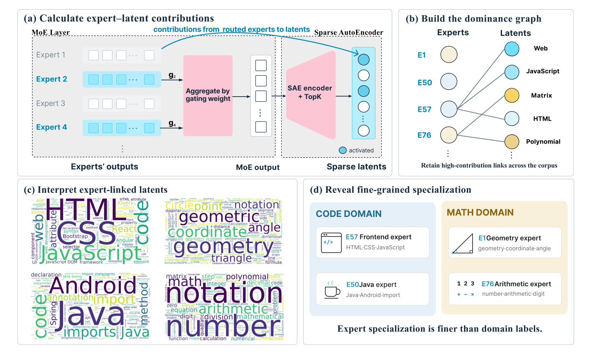
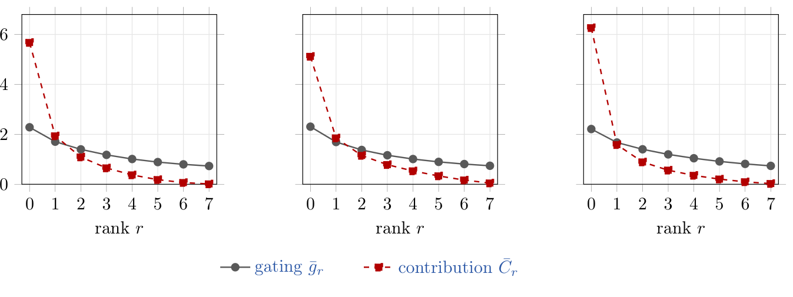
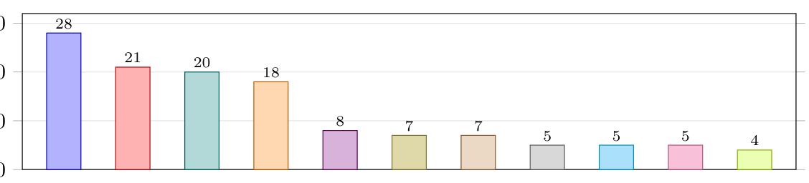

# SAE Interprets MoE：稀疏自编码器揭示 MoE 专家的人类可读细粒度分工 深度精读

> **论文**：SAE Interprets MoE: Sparse AutoEncoders Reveal That MoE Experts Exhibit Human-Interpretable Fine-Grained Specialization
> **作者**：Anyuan Zhuo（ByteDance Seed / 上海财经大学）, Shaohua Zhang（ByteDance Seed）, Yuan Lin（ByteDance Seed，通讯）, Pinyan Lu（上海财经大学，通讯）
> **arXiv ID**：2611.08089
> **发表时间**：2026-11-05
> **许可协议**：代码 Apache 2.0
> **代码仓库**：https://github.com/Bytedance-Seed/SAE-Interprets-MoE

## 第 1 章 概述

### 1.1 一句话定位

本文提出在 MoE 层输出上训练稀疏自编码器（SAE），利用编码器的仿射性把每个 latent 的激活精确分解到各专家的贡献，从而以「模型自身的特征词汇」取代「人为预设的域标签」来刻画专家分工——在 Qwen3-30B-A3B 的第 4/30/46 层上发现：贡献远比路由权重集中、多数 latent 仅被一两个专家支配、专家特化粒度远低于「代码/数学」这类粗域标签（Java 专家与前端专家分立、几何专家与算术专家分立），且各粗域占用的专家数量极不均衡。

### 论文图表总览

| 编号 | 内容 | 章节 |
|------|------|------|
| **Figure 1** | 方法总览：MoE 层加权求和 → SAE 仿射分解 → dominance graph → 自动解释（论文 Figure 1 对应） | 第 3 章 |
| **Figure 2** | 三层（L4/30/46）gating 与 contribution 的 rank profile 对比（论文 Figure 2 对应） | 第 4 章 |
| **Figure 3** | E50（Java）/E57（前端）/E93（地理气象）三个专家的解释词云（论文 Figure 3 对应） | 第 5 章 |
| **Figure 4** | E72 的路由 token 词云 vs 解释词云（含去功能词 + MI 重加权）对比（论文 Figure 4 对应） | 第 5 章 |
| **Figure 5** | layer 30 全部 128 个专家归入 11 个域后的数量分布条形图（论文 Figure 5 对应） | 第 5 章 |
| **Figure 6–8** | 支配图 latent 侧 / 专家端度分布与 Jaccard 重叠矩阵（论文附录 C/D 对应） | 第 4 章 |
| **Figure 9–16** | 全部 128 个专家的解释词云（论文附录 K 对应） | 第 5 章 |
| **Table 1** | 8128 个专家对的成对 Jaccard 相似度统计汇总（论文 Table 1 对应） | 第 4 章 |
| **Table 2** | 四个专家的主题归属占比 vs 随机基线（论文 Table 2 对应） | 第 5 章 |
| **Table 3** | 128 个专家的 GPT-5.5 标签与所属域完整列表（论文 Table 3 对应，附录 H） | 第 5 章 |
| **Table 4** | 三层 SAE 的 FVU 重建误差（论文 Table 4 对应，附录 I） | 第 4 章 |

### 1.2 核心贡献

1. **新仪器：精确的特征级专家归因**。既有分析在域标注语料上统计专家被选中的频率，存在四个缺陷（taxonomy 预设、标签粗粒度、文档级标签与 token 级路由错位、选择≠贡献）。本文改为在 MoE 层输出上训练 SAE，由于层输出是路由权重的加权求和、SAE 编码器对该输出仿射，每个 latent 的 pre-activation 可**精确**（代数恒等式，非近似归因）分解为编码偏置加各专家贡献之和。
2. **贡献集中性的定量刻画**。rank profile 显示贡献比 gating 陡峭得多（layer 30 首位贡献均值 0.512 vs 首位 gating 0.231）；τ=0.2 的支配图下，三层分别有 57.4%/62.1%/56.7% 的 latent 只有一个支配者，89.9%/85.1%/92.7% 恰有一到两个支配者。
3. **亚域粒度的分工实证**。自动解释专家的支配集得到人类可读的分工：同为代码域，E50 主司 Java/Android、E57 主司 HTML/CSS/JS 前端；同为数学域，E1 主司几何、E76 主司算术与多项式。主题判定的量化分离度高达 86.7% vs 1.9%（随机基线）。
4. **域级分配极不均衡 + 全套开源**。128 个专家经 GPT-5.5 逐个标注、再由单次分组调用归入 11 个域（域清单未预设、由标签数据涌现）；Computing（28 个）与 Mathematics and reasoning（20 个）合计占 37.5%，而三个非学科域（text form/language/entities）占 28.1%；SAE 权重与代码开源，另发布四个代表专家（E1/E50/E57/E76）的 latent 解释数据与全部 128 个专家的标签、11 域分组及 Table 2 的全部主题判定。

### 1.3 关键结果速览

| 结果 | 数值 | 来源 |
|------|------|------|
| 贡献首位均值 vs gating 首位均值（L30, rank 0） | 0.512 vs 0.231 | 论文 §4.1 / Figure 2 |
| 末位（rank 7）贡献 vs gating | 0.005 vs 0.074 | 论文 §4.1 |
| 单支配者 latent 占比（L4 / L30 / L46） | 57.4% / 62.1% / 56.7% | 论文 §4.2 |
| 恰有 1–2 个支配者的 latent 占比（L4 / L30 / L46） | 89.9% / 85.1% / 92.7% | 论文 §4.2 |
| E50 Java 主题占比 vs 随机基线 | 86.7% vs 1.9% | 论文 Table 2 |
| E57 前端主题占比 vs 随机基线 | 78.6% vs 3.5% | 论文 Table 2 |
| Computing + Mathematics 域专家占比 | 48/128 = 37.5% | 论文 §5.3 / Figure 5 |
| 非学科域（text form + language + entities）占比 | 36/128 = 28.1% | 论文 §5.3 |
| 三层 SAE 的 FVU | 12.6% / 25.1% / 7.6% | 论文 Table 4 |

## 第 2 章 研究背景与动机

### 2.1 MoE 专家特化：两派对立的结论

Mixture-of-Experts（MoE）架构是当前大语言模型扩展的核心手段之一：router 把每个 token 送到众多专家中的少数几个，模型得以在把参数量——以及随参数量而来的知识存储与容量——推高的同时，把每 token 推理成本维持在接近一个小得多的 dense 模型的水平。这一设计的枢纽是 router，但它在训练后实际实现的机制所受的审视相对有限：一个训练好的模型如何把 token 分配到各专家、每个专家究竟对什么负责，至今没有定论。

现有的实证证据分为对立的两派：

- **domain-specialized 一派**：DeepSeek-V3 技术报告（arXiv:2412.19437）与 OLMoE（ICLR 2025）报告专家是领域特化的——专家在来自特定 domain 的数据上优先激活，可以按"代码专家""数学专家"这类域标签来描述。
- **token identity 一派**：Mixtral of Experts（arXiv:2401.04088）与 OpenMoE（arXiv:2402.01739）的分析得出几乎相反的结论：路由与人类概念中的"领域"无关，而是由 token identity 这类表面性质（surface properties）驱动——决定专家选择的是 token 长什么样，而不是文本在讲什么。

两派结论相反，却建立在同一类测量之上；论文由此把审视的重心从"哪一派对"转向"双方共用的仪器是否可靠"。

### 2.2 共同的仪器：域标签语料上的选择计数

两派工作共享的仪器是**域标签语料上的选择计数**：准备若干带有人工域标签的语料（例如以 GitHub 语料对应 code、以 arXiv 语料对应学术文本），让模型在其上前向推理，统计每个专家在各域语料上被选中（fire）的频率，再比较频率分布的偏移，进而判断专家是否"偏好"某个域。

这一仪器实现简单、无需接触模型内部，因而在 DeepSeek-V3、OLMoE、Mixtral、OpenMoE 等彼此独立的分析中被反复使用。但论文指出：两派的分歧只出现在对同一类统计量的解读上，仪器本身此前未受到系统检视；若仪器带有系统性偏差，两派结论会一同被波及，争论便无从裁决。论文把这一偏差拆为四个具体的缺陷。

### 2.3 选择计数仪器的四个缺陷

**（a）taxonomy 由分析者预设，而非从模型中恢复。** 域分类是分析者强加给模型的，不是从模型中学出的。这样的研究只能回答"模型的分工是否与某个事先选定的划分相合"，而不能发现模型实际学到的组织方式——如果模型按一套与人类域分类完全不同的轴线划分劳动，预设 taxonomy 的仪器对此结构上视而不见：它连提问的方式都已经被答案的可能形状限定了。

**（b）语料尺度上可用的标签粒度过粗。** 能在语料尺度上批量指派的域标签通常只有少数几类——code、math 之类的量级——而单个 MoE 层内往往有数十到上百个专家。可以合理预期，这批专家之间的分工粒度远细于标签集；粗标签在原理上就无法分辨该粒度之下的结构，就像用七个大洲的地图去读一座城市的街区。

**（c）文档级标签与 token 级路由错配。** 标签贴在整个语料（文档）上，而被测量的路由决策是逐 token 做出的。一道数学题的题面可能包含大量叙事性铺垫（story narrative framing），把其中每个 token 都计入"math"，恰恰把分析想要检测的那些区分搅模糊了：被计成"math"的 token 里，既有真正承载数学内容的，也有纯粹叙事的。

**（d）选择不等于贡献。** 激活频率只记录哪些专家被 router 选中，与加权它们的 router 系数无关。一个专家可能在某个 token 上被选中，却只占该层在此处计算量的很小一部分——"在场"不等于"做事"。以选择计数为特化度量，系统性地把被路由"点到名"与"实际产出层输出"混为一谈。

四个缺陷可归纳如下：

| 缺陷 | 核心问题 | 后果 |
|------|----------|------|
| (a) taxonomy 预设 | 分类由分析者而非模型决定 | 只能验证预设划分，无法发现模型自身的组织方式 |
| (b) 标签粗粒度 | 语料级标签仅少数几类 | 原理上分辨不了数十至上百个专家的分工粒度 |
| (c) 标签—路由粒度错配 | 文档级标签 vs token 级路由 | 铺垫性 token 全部计入目标域，模糊待检测的区分 |
| (d) 选择 ≠ 贡献 | 计数忽略 router 系数 | 被选中但贡献小的专家被高估 |

### 2.4 SAE 与字典学习：取代域标签的分析单位

论文的替代方案是把专家特化搬进模型层的 feature 空间研究，分析单位来自 dictionary learning 一脉：

- **superposition 与 polysemantic neurons**：模型需要容纳的 feature 多于它的维度，只能以 superposition（叠加）的方式把 feature 挤进表示空间（Elhage et al., *Toy Models of Superposition*, arXiv:2209.10652）。其直接后果是神经元 polysemantic——单个神经元同时参与多个不相关概念的表示，读单个神经元得不到稳定的语义。
- **Sparse AutoEncoder**：SAE（Huben et al., ICLR 2024）在模型激活上学习一个过完备（overcomplete）的稀疏字典：latent 数远多于输入维度，但每个输入只激活少数 latent。字典方向比神经元显著更 monosemantic，被近似视为模型自身使用的 feature。这一构造此后被扩展到前沿模型与百万级 latents（Templeton et al., *Scaling Monosemanticity*, Transformer Circuits Thread, 2024；Gao et al., ICLR 2025）。
- **TopK 变体**：本文采用 Gao et al. 提出的 top-k SAE 作为编码器（第 3 章 Eq.2），稀疏性由硬性的 TopK 约束保证。
- **auto-interpretation**：latent 的语义由自动解释流程读出——从激活上下文（activating contexts）与 logit 效应（logit effects）生成自然语言解释，遵循 Paulo et al.（arXiv:2410.13928）的范式；本文的解释管线在论文附录 J 中给出。

SAE latents 作为分析单位，逐点回应 2.3 的四个缺陷：latents 从模型自身的激活中无监督发现，taxonomy 不再预设（回应 a）；其粒度由数据决定，细于任何能在语料尺度上指派的标签集（回应 b）；对贡献的分解逐 token 进行，不把文档整体归入单一域（回应 c）；度量的是功能贡献而非共现计数（回应 d）。

### 2.5 与 feature 级追踪方法的关系：沿不同的轴

latents 也被用于追踪计算：sparse feature circuits（Marks et al., ICLR 2025）与 attribution graphs（Ameisen et al., *Circuit Tracing*, Transformer Circuits Thread, 2025）以 latent 为节点、latent 之间的归因为边，跨层、跨组件地还原一条计算路径。论文的归因与它们沿不同的轴展开，区别有两点：

- **追踪范围不同**：这些工作在层与组件之间追踪计算；本文则在单个层内部，把一个 latent 的激活分解到产出该层输出的那些专家上——问的不是"信息从哪些上游 feature 流来"，而是"这一层里是哪几个专家造出了这个 feature"。
- **精确性不同**：本文的分解是精确的而非近似的。第 3 章 Eq.5 由"层输出对专家输出线性"与"编码器对该输出仿射"两个事实代数推出，不含基线选取或路径近似；而跨层归因方法本质上只能给出近似估计。

### 2.6 与 The Expert Strikes Back 的对比

与本文最近的工作是 The Expert Strikes Back（Herbst et al., arXiv:2604.02178, 2026）。其出发点是 k-sparse probing 的发现——专家内部的神经元比可比 dense 网络的神经元更少 polysemantic——并据此对数百个完整专家做自动标注，结论是专家为细粒度的 task experts，而非 domain specialists 或 token-level processors。这项工作已经离开 domain 层面，与本文方向一致，但度量单位仍有本质差别：

- 其 specialization score 相对**模型自身 output embedding 的聚类**计算。类别虽是 model-derived，但聚类数目是在少数几个值上手工设定的网格（hand-set grid of a few values）——score 度量的是"哪个被选中的分辨率最适合描述该专家"，而不是"模型实际在哪个层级上划分了劳动"。分辨率仍是分析者的选择。
- 本文的分析单位由 SAE **无监督学出**：专家的 dominant set 是从数据中直接读出（read off）的，而非与任何事先固定的划分做匹配；该集合在什么层级上连贯，本身就是实验结果之一（见后续实验章节）。

### 2.7 本文方案：两条轴线上的替换

综合以上诊断，论文在两个轴线上同时替换了既有分析：

| 轴线 | 既有分析 | 本文 |
|------|----------|------|
| 分析单位（unit of analysis） | 分析者定义的 domains | SAE 无监督学出的 latents |
| 分辨率（resolution） | 语料级选择频率 | 逐 token、逐专家的 contribution score |

替换的直接收益：对特化的刻画不再受预选 taxonomy 约束，粒度细于任何可在语料尺度上指定的标签集；既避免把一个文档的所有 token 归入单一域，度量又是功能贡献（functional contribution）而非单纯共现（mere co-occurrence）。

## 第 3 章 方法：SAE 仿射分解与支配图

本章按论文 Section 3（Eq.1–Eq.9）的顺序展开方法：先写出 MoE 层输出的线性结构（Eq.1），再用 SAE 把层输出编码进 latent 空间（Eq.2–3）；核心一步是利用编码器的仿射性，把每个激活 latent 的 pre-activation **精确**分解到各专家（Eq.4–5）；只保留正贡献（Eq.6）之后，经三级归一化（Eq.7–9）得到跨专家可比的 contribution fraction，最后以阈值 τ 定义 dominance 并构造二部 dominance graph。方法总览见图1。

*图1：方法总览。MoE 层输出是其激活专家输出的 router 加权和（左）；由于 SAE 编码器是仿射的，每个 latent 的激活可以精确分解到这些专家之上（中）；对语料上平均后的贡献分数做阈值化，得到 dominance graph（右）；对专家所支配的 latents 做自动解释即可描述该专家的角色（下）——例如 Qwen3-30B-A3B 第 30 层的 Java 专家 E50（Java·Android·import）、前端 web 专家 E57（HTML·CSS·JavaScript），以及几何专家 E1（geometry·coordinate·angle）与算术专家 E76（number·arithmetic·digit）。*

本章符号汇总：

| 符号 | 含义 |
|------|------|
| $d$, $N$, $k$ | 隐维度；单层专家数；每 token 激活的专家数 |
| $h(t)$, $y(t)$ | MoE block 在位置 $t$ 的输入 / 输出 |
| $g_j(t)$, $A(t)$, $u_j(t)$ | 专家 $j$ 的 router 权重；激活专家 id 集合；专家 $j$ 的输出 |
| $m$, $\kappa$, $F(t)$ | SAE latent 数；TopK 保留数；激活 latent 集合 |
| $W_{\mathrm{enc},(i)}$, $b_{\mathrm{enc},(i)}$ | 编码器权重第 $i$ 行；编码器偏置第 $i$ 分量 |
| $c$, $C$ | 单前缀正贡献（Eq.6）；其 token 内归一化与语料期望（Eq.7–8） |
| $s(j,i)$ | contribution fraction（Eq.9） |
| $\tau$, $S(j)$, $G(U,V,E)$ | dominance 阈值；专家 $j$ 的 dominant set；dominance graph |

### 3.1 MoE 层输出：专家输出的 router 加权和

设 MoE LLM 的隐维度为 $d$，一个 MoE block 含 $N$ 个专家。给定 token 序列 $x = (x_1, \ldots, x_T)$，记前缀 $x_{1:t} = (x_1, \ldots, x_t)$，$h(t) \in \mathbb{R}^d$ 为该 block 的输入。router 对 $h(t)$ 打分，取 top-$k$ 个专家并对其权重重归一化：第 $j$ 个专家获得权重 $g_j(t) \in [0, 1)$，其中只有 $k$ 个为正，且满足

$$\sum_{j=1}^{N} g_j(t) = 1.$$

称权重非零的专家为 activated expert，其 id 集合记作 $A(t)$；$u_j(t) \in \mathbb{R}^d$ 为第 $j$ 个专家的输出。该层的输出为

$$y(t) = \sum_{j \in A(t)} g_j(t)\, u_j(t) \in \mathbb{R}^d. \tag{Eq.1}$$

两个结构性的要点值得强调：

- **凸组合**：系数 $g_j(t)$ 非负、对全部专家求和为 1，故 $y(t)$ 是至多 $k$ 个专家输出的凸组合。"少数成员的加权和"这一结构是后文一切分解的出发点。
- **top-$k$ 重归一化的副作用**：router 先取 top-$k$ 再重归一化，排名靠前的专家天然获得更大的 $g_j(t)$——gating 权重本身就不均匀。论文在实验部分据此专门检验了"贡献集中"不是"gating 集中"的简单投影。

### 3.2 用 SAE 把层输出编码进 latent 空间

在 $y$ 上训练一个以重建为目标的 SAE，latent 维度 $m \gg d$：

$$f(t) = \mathrm{TopK}\text{-}\mathrm{ReLU}_{\kappa}\!\left(W_{\mathrm{enc}}\, y(t) + b_{\mathrm{enc}}\right), \tag{Eq.2}$$

$$\hat{y}(t) = W_{\mathrm{dec}}\, f(t) + b_{\mathrm{dec}} \approx y(t). \tag{Eq.3}$$

其中 $W_{\mathrm{enc}} \in \mathbb{R}^{m \times d}$、$W_{\mathrm{dec}} \in \mathbb{R}^{d \times m}$，且 $W_{\mathrm{dec}}$ 的列单位范数。$f(t)$ 的第 $i$ 个分量 $f_i(t)$ 是 latent $i$ 在该前缀上的激活幅度，至多 $\kappa$ 个分量非零；激活集合记 $F(t) = \{\, i \mid f_i(t) > 0 \,\}$。

$\mathrm{TopK}\text{-}\mathrm{ReLU}_\kappa$ 指对 $W_{\mathrm{enc}} y + b_{\mathrm{enc}}$ 先取 ReLU、再保留最大的 $\kappa$ 个分量（其余置零）：稀疏性由硬约束保证，而非靠 $L_1$ 之类的软惩罚间接诱导。本文采用 Gao et al. 的 top-k 变体。

注意分解只使用**编码器**：Eq.5 的精确性来自编码方向的仿射性，解码器（Eq.3）的职责是把 latents 锚定为"近似模型真实 feature"的可解释坐标系——重建质量决定 latents 的语义品质，但不进入分解的代数。

### 3.3 关键观察：激活 latent 的 pre-activation 是 y 的仿射函数

记 $W_{\mathrm{enc},(i)} \in \mathbb{R}^d$ 为编码器权重的第 $i$ 行，$b_{\mathrm{enc},(i)}$ 为编码器偏置的第 $i$ 个分量。对一个激活的 latent $i$（$i \in F(t)$），其激活值等于自身的 pre-activation——该分量被 TopK 选中且经 ReLU 后为正，截断与 ReLU 都不再改变其数值——于是

$$f_i(t) = W_{\mathrm{enc},(i)} \cdot y(t) + b_{\mathrm{enc},(i)}. \tag{Eq.4}$$

即：**激活 latent 的取值是层输出 $y(t)$ 的仿射函数**。把 Eq.1 代入 Eq.4，立即得到

$$f_i(t) = \sum_{j \in A(t)} g_j(t) \left(W_{\mathrm{enc},(i)} \cdot u_j(t)\right) + b_{\mathrm{enc},(i)}. \tag{Eq.5}$$

**Eq.5 是代数恒等式，不是近似归因。** 它由且仅由两个事实构成——层输出对专家输出是线性的（Eq.1），编码器对该输出是仿射的（Eq.4）——代入即得，不含基线选取或路径近似等任何近似步骤。因此，"专家 $j$ 占 latent $i$ 激活的多大份额"这一问题获得了精确的含义；这是全文方法论上的支点，也是与积分梯度、patching 类归因方法的本质区别。

分解式中的 $b_{\mathrm{enc},(i)}$ 是与专家无关的常数偏置，不属于任何专家的贡献；下一节贡献定义将其排除在分派之外。

### 3.4 正贡献：为什么丢弃负部

Eq.5 中每个专家项 $g_j(t)\,(W_{\mathrm{enc},(i)} \cdot u_j(t))$ 可正可负。论文定义专家 $j$ 对 latent $i$ 的**正贡献**为

$$c\left(j, i, x_{1:t}\right) = \mathrm{ReLU}\!\left(g_j(t)\, W_{\mathrm{enc},(i)} \cdot u_j(t)\right). \tag{Eq.6}$$

只保留正部的理由是统计上的：一个足够强的负贡献会把 latent 的 pre-activation 压到阈值之下，使该 latent 在此处根本不激活、于是不出现在数据里。对负贡献做任何统计都会有系统性偏差——能被观察到的激活都已经"活过"了负贡献的压制，负贡献的分布对观察者而言是截断的、不可复原的。因此 Eq.6 只取正部，且后续所有分析只用它。

由于 $g_j(t) \ge 0$，ReLU 内部的符号完全由内积 $W_{\mathrm{enc},(i)} \cdot u_j(t)$ 决定：所谓"截断"，即某个被激活的专家与该 latent 的编码方向夹角为钝角、贡献为零。论文在实验部分验证：这种截断平均而言是温和的，不是贡献集中现象的主要来源。

### 3.5 三级归一化：从单 token 贡献到 contribution fraction

**第一级：token 内归一化（Eq.7）。** 在单个前缀上，某专家对某 latent 贡献的相对大小，反映该专家对这个 latent 是否重要。在激活专家集合上归一化 $c$：

$$C\left(j, i, x_{1:t}\right) = \frac{c\left(j, i, x_{1:t}\right)}{\sum_{j' \in A(t)} c\left(j', i, x_{1:t}\right)}, \tag{Eq.7}$$

对 $j \in A(t)$ 且 $i \in F(t)$ 取值，其余情形约定为 0。于是在每个（前缀, 激活 latent）对上，$k$ 个激活专家把单位 1 分摊完毕。这一级抹去了 token 之间激活幅度的尺度差异——不同位置上同一 latent 的绝对激活可以相差很大，但相对份额在同一刻度上。

**第二级：语料期望（Eq.8）。** 论文关心的是专家"总体上"善于驱动哪些 latent，故对整个数据集 $\mathcal{X}$ 上的（文档, 位置）对取均匀期望：

$$C(j, i) = \mathbb{E}_{(x,t) \sim U\left\{(x,t) \,\middle|\, x \in \mathcal{X},\ 1 \le t \le |x|\right\}}\left[\, C\left(j, i, x_{1:t}\right) \right]. \tag{Eq.8}$$

由 Eq.7 的零约定，latent 未激活的位置自动贡献 0；期望把逐 token 的相对份额汇成语料级的"专家—latent 贡献画像"。

**第三级：跨专家归一化（Eq.9）。** 为判断专家对 latent 是否总体重要，在全部 $N$ 个专家上归一化：

$$s(j, i) = \frac{C(j, i)}{\sum_{j'=1}^{N} C(j', i)}. \tag{Eq.9}$$

论文称 $s(j,i)$ 为专家 $j$ 对 latent $i$ 的 **contribution fraction**。它满足 $\sum_{j=1}^{N} s(j,i) = 1$：全部专家对同一 latent 的贡献份额构成一个分布，"份额"在任何 latent 之间可通约。

三级归一化各司其职：Eq.7 消除 token 内与 token 间的幅度尺度；Eq.8 把瞬时份额汇成稳定画像；Eq.9 提供跨专家的统一刻度。没有第一、二级而直接平均原始贡献 $c$，结果会被高频高幅 token 主导；没有第三级，$C(j,i)$ 依赖 latent 的整体激活频率，无法在不同 latent 之间比较。

### 3.6 Dominance 与支配图

给定阈值 $\tau$：$s(j,i) \ge \tau$ 表示专家 $j$ 总体上对 latent $i$ 做出实质性贡献，此时称 **$j$ dominates $i$**。专家 $j$ 的 **dominant set** 定义为它所支配的全部 latents：

$$S(j) = \{\, i \mid i \text{ is dominated by } j \,\}.$$

在此之上构造二部图 **dominance graph** $G(U, V, E)$：左部顶点集 $U$ 为专家集合，右部顶点集 $V$ 为 SAE 的 latent 集合，边集

$$E = \{\, (j, i) \mid j \in U,\ i \in S(j) \,\}.$$

**阈值 $\tau = 0.2$ 的含义。** 本文取 $\tau = 0.2$。作为参照：若某 latent 的激活来源在全部 $N = 128$ 个专家间均匀分布，每个专家的份额只有 $1/N \approx 0.008$；$\tau$ 高出这一均匀基线约 25 倍，因此一条边记录的是"显著贡献"而非"非零贡献"。$\tau$ 还隐含一个算术上限：由 $\sum_j s(j,i) = 1$，同一 latent 至多被 $\lfloor 1/\tau \rfloor = 5$ 个专家同时支配——论文报告这一上限在任何一层都从未被触及。$\tau$ 越小图越稠密、共同支配越多，$\tau$ 越大越接近"独占"式读法；0.2 落在"显著高于均匀、又允许多支配者存在"的位置。

Dominance graph 把"哪个专家主要驱动哪些 latent"压缩为一张可整体分析的稀疏图，后续实证章节全部建立在它之上：

- **latent 侧度数**（一个 latent 被几个专家支配）回答"latent 的激活通常可归因于几个专家"；
- **专家侧度数**（一个专家支配多少 latents）回答"专家的支配范围多大、是否被少数 hub 专家吸收"；
- **dominant set 两两重叠**（如 Jaccard 相似度）回答"专家分工的边界在哪里、相邻专家是否共享地盘"；
- 对 $S(j)$ 内 latents 的自动解释则把结构问题落到语义上：专家的分工是否低于粗域标签的粒度。

### 3.7 方法的实例化

论文把上述流程实例化于 Qwen3-30B-A3B：模型共 48 层，每个 MoE 层含 $N = 128$ 个专家、每 token 激活 $k = 8$ 个、无共享专家；分析层取第 4、30、46 层，分别代表浅层、中后层与深层。每层独立训练一个 latent 数 $2^{20} = 1{,}048{,}576$ 的 SAE（隐维度 $d = 2048$，$m \gg d$）。全部统计在与 SAE 训练集同分布、且零数据重叠的 1.5B token 验证集上计算；该集合上每个 latent 至少激活一次，因此 $s(j,i)$ 对所有 latent 均有定义。

## 第 4 章 实验设置与贡献集中度分析

### 4.1 实验对象与 SAE 训练配置

**分析对象**是 Qwen3-30B-A3B：48 层，每个 MoE 层含 N=128 个专家，top-8 路由，无共享专家。作者选取第 4、30、46 层分别代表浅层、中后层与深层行为。

**SAE 配置**：对每层训练一个独立的 TopK SAE，latent 数 m=2^20=1,048,576（远大于隐维 d=2048）。关键超参数（论文附录 I）：

| 超参数 | 取值 |
|--------|------|
| TopK 稀疏度 κ | 1000 → 100（前 10,000 步线性衰减后恒定） |
| 辅助损失系数 | 1/32（Gao et al. 与 Deng et al.） |
| 优化器 | AdamW，(β₁, β₂)=(0.9, 0.999)，weight decay 0.01 |
| 峰值学习率 η_max | 8×10⁻⁵（100 步 sqrt warmup 自 0.1η_max 起，随后线性衰减） |
| batch size | 8192 |
| 训练数据量 | ~3.2B tokens |
| 激活归一化 | E[‖X‖]=√n，过滤范数 >20× 批均值的离群点 |

重建质量用 FVU（fraction of variance unexplained）评估（论文 Table 4）：

| Layer | FVU |
|:-----:|:---:|
| 4 | 12.6% |
| 30 | 25.1% |
| 46 | 7.6% |

中间层（L30）最难重建，这与 Gao et al. 的观察一致。**所有支配统计在 1.5B token 的验证集上计算**，该验证集与 SAE 训练集同分布但不重叠（其 5/8+1/4+1/8 配比与论文附录 I 的 SAE 训练激活配比一致，均取自 Olmo 3 训练语料：5/8 预训练数据 + 1/4 推理链 + 1/8 指令微调；据官方 README，三者分别为 Dolma 3、Dolci-Think SFT 与 Dolci-Instruct SFT，文档截断至 4096 token）。每个 SAE 的全部 latent 在验证集上至少激活一次，因此 s(j,i) 对所有 latent 有定义。

### 4.2 贡献比路由权重更集中

贡献 c 的定义天然携带因子 g_j(t)，而 top-k 重归一化本身就使高 rank 专家的 gating 更大。作者首先排除「贡献不均只是 gating 不均的直接投影」这一平凡解释：把 8 个激活专家的 gating 权重与 8 个贡献值 C(j,i,x) 分别按 rank 排序后取均值，得到两组可比的 profile（两者分别归一化，总和都为 1）。

*图2：三层中贡献 profile（Contribution）都明显比 gating profile（Gating）陡峭——首位贡献者独占的份额远超首位 gating，末位几乎归零，说明贡献的集中性不是 top-k 路由结构的伪影。*

以 layer 30 为例（论文 §4.1）：gating 前三位为 0.231、0.169、0.137，衰减平缓；贡献前三位为 **0.512、0.185、0.115**——仅首位就超过总量的一半。两条曲线在 r=1 与 r=2 之间交叉，此后贡献始终低于 gating；到 r=7，贡献均值只有 0.005，而 gating 仍有 0.074。L4 与 L46 呈现相同形状。

**ReLU 截断是否制造了陡峭？** Eq.6 的 ReLU 会把负贡献截断为 0，被截断的专家退出归一化分母，可能人为放大其余专家份额。论文的量化反驳：每个（前缀, 激活 latent）对的 8 个激活专家中，平均只有 2.09（L4）、1.29（L30）、1.64（L46）个被截断，多数激活专家保有正贡献，截断不是陡峭性的主要来源。

### 4.3 支配图的度分布：latent 端与专家端

以 τ=0.2 构造支配图（该阈值远高于均匀基线 1/N≈0.008，因此一条边记录的是实质性贡献而非非零贡献）。

**latent 端**（一个 latent 被几个专家支配，论文 §4.2 与附录 C）：

| 统计量 | L4 | L30 | L46 |
|--------|:--:|:---:|:---:|
| 恰有 1 个支配者 | 57.4% | 62.1% | 56.7% |
| 恰有 1–2 个支配者 | 89.9% | 85.1% | 92.7% |
| 度 ≥3 占比上限 | ≤3.7% | ≤3.7% | ≤3.7% |
| 无支配者 | 7.0% | 13.6% | 3.7% |

τ 的算术上限是 5 个支配者（5×0.2=1.0），但任何一层都没有 latent 达到该上限。无支配者的 latent 即激活来源较均匀、无专家越过 τ 的少数派。

**专家端**（一个专家支配多少 latent，附录 C）：三层中每个专家都支配非空集合，最小度分别为 362（L4）、224（L30）、83（L46）；度分布右偏但不极端——均值/中位数为 10786/8020（L4）、9170/7395（L30）、11439/7835（L46），度最高的 10 个专家仅占全部边的 24.6%（L4）、20.1%（L30）、30.1%（L46）（均匀情形应为 7.8%）。**支配散布在全层而非被少数枢纽专家垄断**。

### 4.4 支配集的两两重叠：多数互斥，尾部成对

若每个 latent 只有一两个支配者，dominant set 仍可能因少数专家共占大量 latent 而高度重叠。作者对每层的全部 $\binom{128}{2}=8128$ 个无序专家对计算 dominant set 的 Jaccard 相似度 $J(j,j')=\frac{|S(j)\cap S(j')|}{|S(j)\cup S(j')|}$（论文 Table 1）：

| 统计量 | L4 | L30 | L46 |
|--------|:--:|:---:|:---:|
| Mean J | 1.73×10⁻³ | 1.57×10⁻³ | 2.12×10⁻³ |
| Median J | 1.06×10⁻⁴ | 1.01×10⁻⁴ | 1.37×10⁻⁴ |
| 完全不共享 latent 的对 | 37.8% | 40.5% | 37.5% |
| J 最大的前 10% 对承载的交集份额 | 83.8% | 78.5% | 81.0% |
| J > 0.05 的对数（占比） | 25（0.31%） | 20（0.25%） | 46（0.57%） |
| 涉及的专家数（/128） | 35 | 34 | 60 |
| 其中只有单一搭档的专家 | 22 | 28 | 36 |
| 最大连通组大小 | 10 | 4 | 8 |
| 最大 J | 0.138 | 0.098 | 0.317 |

三个要点：① **均值比中位数高一个数量级**——多数对几乎不共享，存在的重叠集中在一个右尾；② 尾部以「对」而非「群」组织——J>0.05 的专家多数只有唯一搭档，连成的图分裂成至多 10 个专家的连通分量，三层分别有 26、33、30 对专家互为 J 意义上的最近邻；③ 支配集并非嵌套——超过 0.05 的对共享中位数只占较小集合的 16%-18%，而平均 46%-59% 的支配集由该专家独占。第 5.3 节将看到这些高重叠对几乎都落在同一域内。

## 第 5 章 专家分工：亚域粒度的分工与不均衡的域分配

### 5.1 解释词云比路由 token 词云携带更多信息

对每个专家，从其 dominant set 均匀采样最多 2000 个 latent，用 GPT-5.5 依据激活上下文与 logit 效应做自动解释（管线见论文附录 J：每 latent 取 top-5 激活上下文 + 5 个随机上下文，logit lens 投影 decoder 向量取 top-10 提升/抑制 token，层深先验仅作 tiebreaker）。把一个专家全部被采样 latent 的解释渲染成词云，词的大小是解释中的词频。

与直接用路由 token 加权（按 gating 质量累积）构建的词云对比（论文 Figure 4，layer 30 的 E72）：token 词云的最大词是 the、and、of 等功能词；去掉五个最高频功能词并按互信息重加权后可读性提升，但仍丢失部分主题。E72 的解释词云同时显示两个主题——「运动健康」与「算法与数据结构」——第二个主题在 MI 重加权的 token 词云中几乎不可读，因为承载它的 latent 只在算法内部的特定位置激活：例如 latent F97783 只在二分查找的 `<=` 算符处激活，其解释「Binary search loop condition」把它与二分查找联系起来，而 token 词云中该 latent 只能贡献一个 `<=` 符号。**功能 token 的信息存在于其位置激活的特征里，token 本身读不出来**。

### 5.2 亚域粒度：代码域与数学域的内部分工

*图3：三个专家的解释词云——E50 的词云被 Java/Android/imports 主导，E57 被 HTML/CSS/JavaScript/React 等前端词汇主导，E93 聚焦自然地理与气象；同为「代码」或「知识」的粗标签无法区分这三者。*

代码域内部：E50 的支配 latents 主要关于 Java 开发（Java import 语句、JDBC generated keys、ButterKnife Android imports），E57 关于前端（HTML/CSS/JavaScript，框架名 React/Bootstrap/jQuery，DOM 事件、CSS 选择器、响应式布局）。数学域内部：E1 是几何专家（geometry/coordinate/triangle/angle），E76 集中于算术与多项式计算（polynomial/matrix/division/decimal，latents 如「Polynomial long division」「arbitrary-precision integers」）。

分离度的量化（论文 Table 2，GPT-5.5 判定每个解释是否属于该主题；随机基线从其余 127 个专家的采样池中抽 2000 个 latents）：

| 专家 | 主题 | 支配集内占比 | 随机基线 |
|:----:|------|:----------:|:-------:|
| E50 | Java development | 86.7% | 1.9% |
| E57 | Front-end development | 78.6% | 3.5% |
| E1 | Geometry | 78.1% | 2.0% |
| E76 | Arithmetic and polynomial | 59.1% | 6.7% |

四个专家的主题占比与随机基线的差距从约 9 倍（E76）到约 46 倍（E50）不等——E50/E57/E1 相差一个数量级以上，E76 亦接近一个数量级——说明支配集确实是对「该专家做什么」的紧凑描述，而非语料主题的泛影。

### 5.3 域级汇总：11 个域与不均衡的分配

把视点从单个专家改为整层的域分配：先用 GPT-5.5 从每个专家的词云写一个 ≤9 词的标签（E50 得到「Java and Android programming」，E72 得到「coding algorithms and musculoskeletal fitness」），再用单次调用把 128 个标签分组（分组数约束在 6-13，返回 11）。**域与域名完全由标签数据涌现，未预设任何学科清单**。

*图5：layer 30 的 128 个专家在 11 个域上的数量分布——Computing（28）与 Text form（21）居前，域间规模差距高达 7 倍，专家分配远非均匀。*

| 域 | 专家数 | 域 | 专家数 |
|----|:-----:|----|:-----:|
| Computing | 28 | Culture and recreation | 7 |
| Text form | 21 | Entities and identifiers | 7 |
| Mathematics and reasoning | 20 | Safety and advice | 5 |
| Applied science | 18 | Commerce | 5 |
| Language | 8 | Society and law | 5 |
| — | — | Time and place | 4 |

三个发现：

1. **分配极不均衡**。Computing（28）+ Mathematics and reasoning（20）= 48/128 = 37.5%。Computing 内部并非单一的「代码」：竞赛编程（E9/E40/E118）、系统管理（E51）、Python API 文档（E113）、网络安全（E100）各占一隅（论文 Table 3）。
2. **三个域不是学科**。Text form（21，文档结构/标点/分隔符/编码痕迹）、Language（8）、Entities and identifiers（7）合计 36/128 = 28.1%。它们完全由标签数据涌现——一个纯学科 taxonomy 必须把这 36 个专家摊进自己的所有类别，不会恢复出这三个域作为单元。Text form 是全层第二大域。
3. **4.4 节的尾部重叠对几乎同域**。L30 的 20 个最大 J 对中 19 对连接同域专家（全体专家对中同域比例仅 12.8%）：E83/E105 同司标点、E77/E107 同司 mojibake、E57/E69 同司 JavaScript web；唯一例外 E11/E95 连接 LaTeX 代数与化学记号。但共享 latents 只占这些专家支配集的中位数 12.3%——成对是因为毗邻，不是因为重复。

**对不均衡的一个（明确的）猜想**：作者援引 Llama 3 公开的最终数据配比（~25% 数学与推理 token、17% 代码 token、50% 通用知识）推测域的专家配额反映预训练数据构成——模型为在数据中占比更高的域保留更细的区分与更多专家。论文明确标注这是 conjecture：Qwen3 技术报告未披露数据配比，无法在所研究的模型上验证。

## 第 6 章 代码实现详解

### 6.1 仓库结构与复现路径

官方仓库 `Bytedance-Seed/SAE-Interprets-MoE`（Apache-2.0）按论文实验组织，每个实验目录一个 `run.sh`：

| 目录 | 复现内容 | 对应论文 |
|------|---------|---------|
| `contribution/` | trace.py + aggregate.py：贡献统计（Eq.6/7 逐 token 计算、Eq.9 归一化） | §3 |
| `experiments/rank_profile/` | gating vs contribution rank profile | §4.1 / Figure 2 |
| `experiments/dominance_graph/` | 度分布（τ=0.2） | §4.2 / 附录 C |
| `experiments/dominance_overlap/` | Jaccard 重叠矩阵 | §4.3 / Table 1 |
| `experiments/wordclouds/` | 解释词云与 token 词云 | §5.1 / Figures 3-4 |
| `experiments/theme_check/` | 主题归属判定 | §5.2 / Table 2 |
| `experiments/expert_domains/` | 专家标注与域分组 | §5.3 / Figure 5 |

**已发布数据**（`data/layer30/`）：E1/E50/E57/E76 四个专家的 latent 解释 jsonl（每行 `{"feat": "30-F...", "explanation": ..., "confidence": ...}`，含 Uninterpretable 条目）、全部 128 个专家的标签（expert_labels.jsonl）、11 域分组（expert_groups.json）、Table 2 背后的全部 yes/no 判定、auto-interp 的完整 system/user prompt。**仅用发布数据即可离线复现**：四个专家的解释词云、Table 2（Random 行除外）、Figure 5 与域统计。

### 6.2 贡献统计的实现要点

`contribution/trace.py` hook 每个 trace 层的 MoE block，在 forward 过程中用 SAE 编码层输出并当场计算每个激活专家对每个激活 latent 的贡献（Eq.6/7），按 (expert, latent) 累加——**不落盘任何 per-token 数据**，forward 在最深的 trace 层后即停止。`aggregate.py` 把各分片汇总为 `aggregated.safetensors`，对其按专家归一化即得 Eq.9 的 s(j,i)。多 GPU 复现用 `--idx_start/--idx_end` 切行区间。latent 计为激活的条件是同时被 TopK 选中且激活值为正。

### 6.3 SAE 权重与硬件需求

三个 SAE 以 safetensors 发布在 `ByteDance-Seed/Qwen3-30B-A3B-MoE-SAE`，每层目录含四个 fp32 张量：`W_enc [2048, 2^20]`、`b_enc [2^20]`、`W_dec [2^20, 2048]`（行单位范数）、`b_dec [2048]`。注意存储布局与论文 Eq.2 记号互为转置：`W_enc` 的第 $i$ 列即 latent $i$ 的编码方向（论文记 $W_{\mathrm{enc}}\in\mathbb{R}^{m\times d}$，行 $i$ 为编码方向）。使用方式：对原始 MoE 块输出 y 直接 `TopK_100(ReLU(y @ W_enc + b_enc))` 编码、`acts @ W_dec + b_dec` 解码——训练时的激活归一化缩放已折叠进权重，无需输入预处理。

**硬件门槛**（据官方 README）：贡献统计需要逐专家的 `ModuleList`（因此要求 `transformers<5`）；Qwen3-30B-A3B bf16 约占 61 GB，每层 fp32 SAE 编码器再占约 8 GB，一次 trace 三层需要 **2 张 80 GB GPU**。LLM 实验（theme_check/expert_domains）走 OpenAI 兼容端点，论文使用 `gpt-5.5-2026-04-24`。

### 6.4 可复现性评估

复现分三档：① **发布数据即可复现**（Table 2 主体、Figure 5、四专家词云）——确定性最高；② **有模型 + API key 可完整复现**（rank profile、支配图、Jaccard、全部 128 专家词云）——需 2×80 GB GPU 与 GPT-5.5 端点；③ **采样敏感**（其余专家的解释与标注）——README 明确说明重新采样 + 重新解释的结果不会与论文精确一致，因为 latent 采样和 LLM 解释都有随机性。这一分档披露是本文工程质量的加分项：核心统计（贡献分解、支配图）是确定性的，只有解释层是随机敏感的。
## 第 7 章 局限性与延伸阅读

### 7.1 SAE 固有的不完善

本文的分析继承 SAE 的一切缺陷，论文在附录 A 的局限清单中将其列为第一条（SAE 的不完善），含两方面。

其一，**重建误差**。SAE 对层输出的重建不完美，论文测得的 FVU（fraction of variance unexplained）为第 4 层 12.6%、第 30 层 25.1%、第 46 层 7.6%——中间层最难重建。Eq.5 的分解在它所作用的 $y$ 上精确，但 $y$ 与"模型真实使用的 feature 空间"之间隔着这层重建误差；latents 语义品质的上限由重建质量决定。

其二，**latents 不是干净的基**。同一个 feature 可能分裂到多个 latents（feature splitting），也可能被吸收进另一个 latent（feature absorption；Chanin et al., NeurIPS 2026）。这会直接影响 dominant set 的边界与粒度。论文的表述是：一个更好的"层输出 → feature"分解，会进一步锐化本文为 MoE 层画出的这幅图像。

### 7.2 数据与推论的外部效度

两项数据层面的限制：

- **Qwen3 的预训练配比未披露**。实验章节把域级专家分配的不均衡与训练数据占比联系起来的解读——以 Llama 3 报告的终版配比（约 25% 数学与推理 token、17% code token、50% 通识）为旁证——在所研究的模型上无法核验，只能停留在 conjecture。论文同时指出，提高 code 与数学数据占比是当前预训练管线的常见做法，但"域分配反映数据配比"这一读法本身不可检验。
- **统计在自选语料上计算**。论文测得的是"本文语料上的路由"，而非"模型训练数据上的路由"；语料选择的自由度构成结果外部效度的一个边界。

### 7.3 单模型、三层、无因果干预

论文只报告了一个模型（Qwen3-30B-A3B）的三个层。把分析扩展到更多、更大的 MoE 模型，才能判断哪些观察具有普遍性；同一仪器也可用于比较不同 load balancing losses 如何塑造专家间的分工——这是方法泛化的两个自然方向。

其次，全部结论都是统计性、相关性的：论文没有做因果干预实验。Dominant sets 为 expert pruning、expert merging 与 feature-level steering 给出了明确可检验的假设——移除或编辑一个专家，应当主要影响它所支配的 latents——但这些干预的验证属于 future work。此外，域标签由 GPT-5.5 从词云自动生成并分组（所有 prompt 在论文附录 E–G、J 中公开），解释管线的质量本身也是测量链的一环。

### 7.4 延伸阅读

- **Gao et al., *Scaling and Evaluating Sparse Autoencoders*, ICLR 2025**：TopK SAE 与 auxiliary loss 的训练配方；本文 SAE 的激活函数、aux 损失系数（1/32）与初始化实践均直接沿用此文。
- **Templeton et al., *Scaling Monosemanticity*, Transformer Circuits Thread, 2024**：把字典学习推到前沿模型、百万级 latents 并系统评估可解释性的里程碑；本文"百万 latent 可用"的前提。
- **Herbst et al., *The Expert Strikes Back*, arXiv:2604.02178, 2026**：与本文最接近的专家级解读工作；对照阅读可看清"预设聚类网格打分"与"SAE 无监督单位直读"的方法论差异（本文 2.6 节）。
- **Marks et al., *Sparse Feature Circuits*, ICLR 2025**：以 latent 为节点、跨层追踪可编辑因果图的工作；与本文的单层内精确分解沿不同轴展开，方向互补。
- **Yang et al., *Qwen3 Technical Report*, arXiv:2505.09388, 2025**：被分析模型 Qwen3-30B-A3B 的官方报告；注意其未披露预训练数据配比——7.2 节的第一项局限即源于此。
- **Jiang et al., *Mixtral of Experts*, arXiv:2401.04088, 2024**："路由由 token identity 等表面性质驱动"一派的代表作，本文 2.1 节所述争论的一方。
